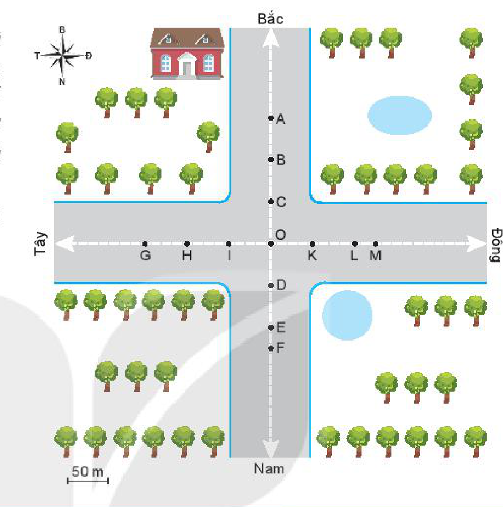
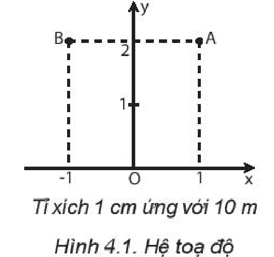
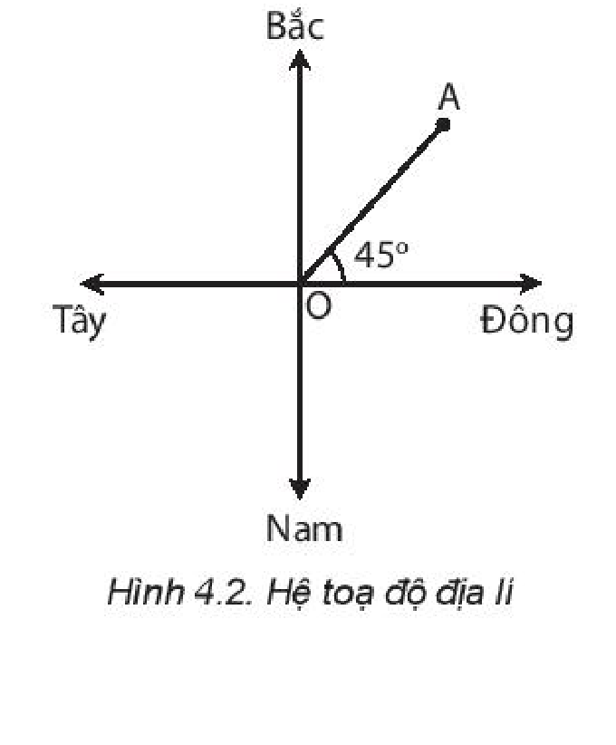
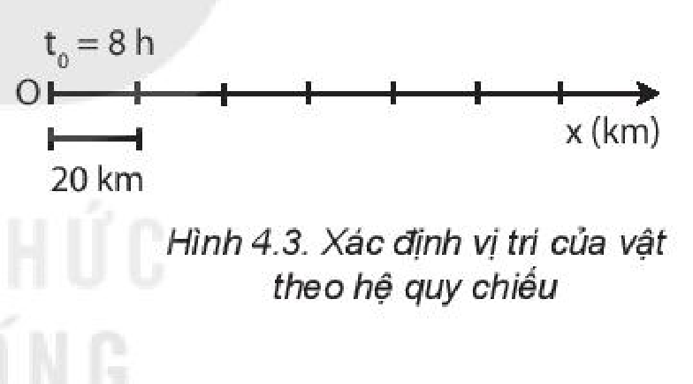
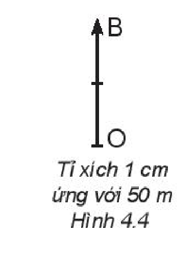
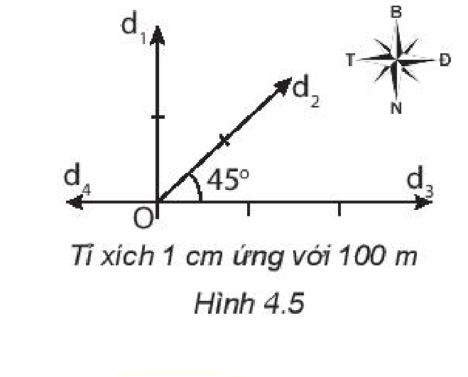
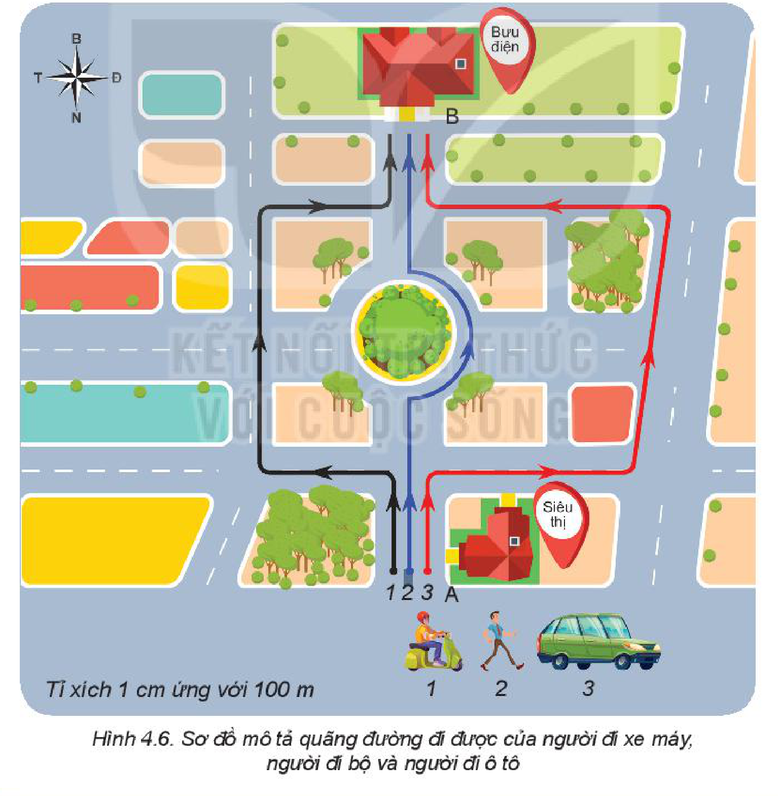
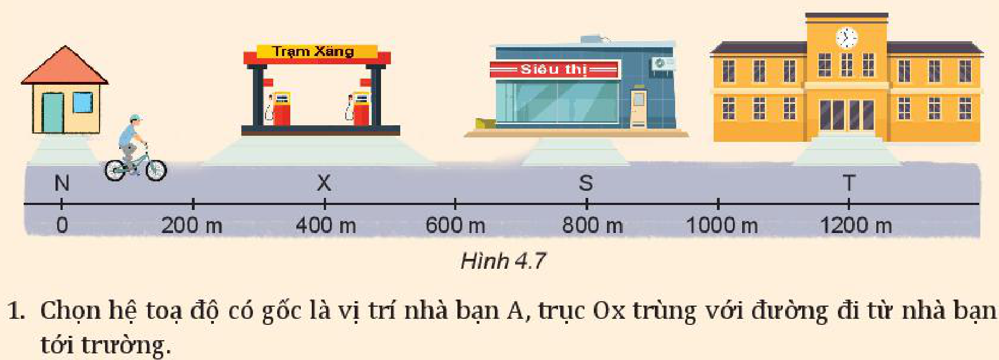
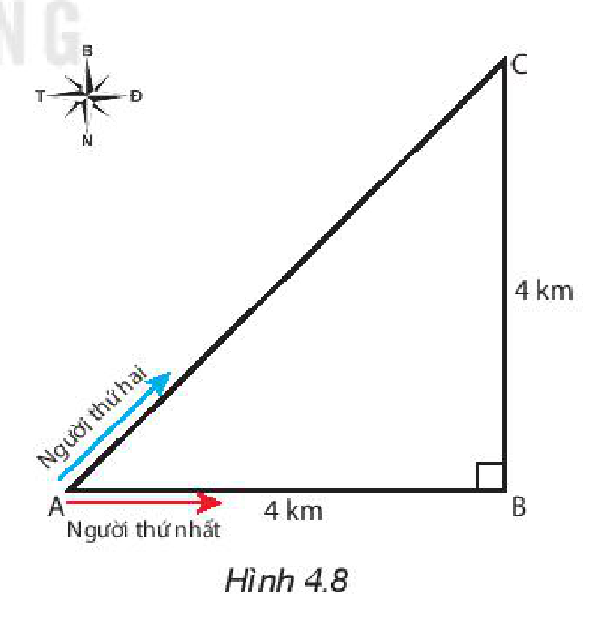

<!-- pdf:22 -->

# BÀI 4: ĐỘ DỊCH CHUYỂN VÀ QUÃNG ĐƯỜNG ĐI ĐƯỢC

## 🔴 Mở đầu

> Một ô tô đi tới điểm O của một ngã tư đường có 4 hướng: Đông, Tây, Nam, Bắc với tốc độ không đổi $36\text{ km/h}$. Nếu ô tô đi tiếp thì sau $10\text{ s}$:
> a) Quãng đường đi tiếp của ô tô là bao nhiêu mét?
> b) Vị trí của ô tô ở điểm nào trên hình vẽ?
>
> 

## I. VỊ TRÍ CỦA VẬT CHUYỂN ĐỘNG TẠI CÁC THỜI ĐIỂM

Khi vật chuyển động thì vị trí của vật so với vật được chọn làm mốc thay đổi theo thời gian. Bài toán cơ bản của động học là xác định vị trí của vật tại các thời điểm khác nhau.

- Để xác định vị trí của vật, người ta dùng hệ toạ độ vuông góc có gốc là vị trí của vật mốc, trục hoành Ox và trục tung Oy. Các giá trị trên các trục toạ độ được xác định theo một tỉ lệ xác định.
<!-- term: Hệ toạ độ vuông góc -->

Ví dụ: Nếu tỉ lệ là $\frac{1}{1000}$ thì vị trí của điểm A trong Hình 4.1 được xác định trên hệ toạ độ là $\text{A }(x = 10\text{ m}; y = 20\text{ m})$ và của điểm B là $\text{B }(x = -10\text{ m}; y = 20\text{ m})$.

> **Em có biết:**
>
> 1. **Động học** là phần vật lí nghiên cứu chuyển động của vật mà không đề cập đến tác dụng của lực lên chuyển động.
> 2. Khi kích thước của vật rất nhỏ so với độ dài của quãng đường đi được thì vật được coi là **chất điểm**. Trong chương này chúng ta chỉ tìm hiểu chuyển động của chất điểm.

<!-- pdf:23 -->

Trong thực tế, người ta thường chọn hệ toạ độ trùng với hệ toạ độ địa lí, có gốc là vị trí của vật mốc, trục hoành là đường nối hai hướng địa lí Tây – Đông, trục tung là đường nối hai hướng địa lí Bắc – Nam (Hình 4.2).
<!-- term: Hệ toạ độ địa lí -->

Ví dụ: Nếu $\text{OA} = 2\text{ cm}$ và tỉ lệ là $\frac{1}{1000}$ thì vị trí của điểm A cách điểm gốc $20\text{ m}$ theo hướng $45^\circ$ Đông – Bắc:

$\text{A }(d = 20\text{ m}; 45^\circ\text{ Đông – Bắc})$.

> **Câu hỏi:** Hãy dùng bản đồ Việt Nam và hệ toạ độ địa lí, xác định vị trí của thành phố Hải Phòng so với vị trí của Thủ đô Hà Nội.

- Để xác định thời điểm, người ta phải chọn một mốc thời gian, đo khoảng thời gian từ thời điểm được chọn làm mốc đến thời điểm cần xác định.
<!-- term: Thời điểm -->

Ví dụ: Nếu chọn mốc thời gian là $t_0 = 8\text{ h}$ và thời gian chuyển động là $\Delta t = 2\text{ h}$, thì thời điểm khi kết thúc chuyển động là $t_n = t_0 + \Delta t = 10\text{ h}$.

Hệ toạ độ kết hợp với mốc thời gian và đồng hồ đo thời gian được gọi là **hệ quy chiếu**.

> **Câu hỏi:** Xác định vị trí của vật A trên trục Ox vẽ ở Hình 4.3 tại thời điểm $11\text{ h}$. Biết vật chuyển động thẳng, mỗi giờ đi được $40\text{ km}$.
>
> 

> **Lưu ý:** Khi vật chuyển động trên đường thẳng thì chỉ cần dùng hệ toạ độ có điểm gốc O (vị trí của vật mốc) và trục Ox trùng với quỹ đạo chuyển động của vật.

## II. ĐỘ DỊCH CHUYỂN

Trong bài toán ở phần mở bài, biết quãng đường đi được có thể xác định được khoảng cách giữa điểm đầu và điểm cuối của chuyển động, nhưng chưa đủ để xác định vị trí của vật.

Muốn xác định được vị trí của vật phải biết thêm hướng của chuyển động. Ví dụ, nếu biết ô tô chuyển động theo hướng Bắc thì dễ dàng xác định được vị trí của ô tô là điểm B trên bản đồ.

Đại lượng vừa cho biết độ dài vừa cho biết hướng của sự thay đổi vị trí của vật gọi là **độ dịch chuyển**.

Độ dịch chuyển của ô tô trong bài toán trên là:

$d_{\text{OB}} = 100\text{ m (Bắc)}$

Một đại lượng vừa cho biết độ lớn, vừa cho biết hướng như độ dịch chuyển gọi là **đại lượng vectơ**.

*Độ dịch chuyển được biểu diễn bằng một mũi tên nối vị trí đầu và vị trí cuối của chuyển động, có độ dài tỉ lệ với độ lớn của độ dịch chuyển. Kí hiệu độ dịch chuyển là $\vec{d}$.*

<!-- pdf:24 -->

Hình 4.4 vẽ vectơ độ dịch chuyển của ô tô trong bài toán nêu ở đầu bài.

> **Câu hỏi:** Hãy xác định các độ lớn độ dịch chuyển mô tả ở Hình 4.5 trong toạ độ địa lí.
>
> 

## III. PHÂN BIỆT ĐỘ DỊCH CHUYỂN VÀ QUÃNG ĐƯỜNG ĐI ĐƯỢC

Ví dụ dưới đây giúp chúng ta phân biệt độ lớn độ dịch chuyển và quãng đường đi được.

Trong Hình 4.6 người đi xe máy (1), người đi bộ (2), người đi ô tô (3) đều khởi hành từ siêu thị A để đi đến bưu điện B.

> **Hoạt động:**
>
> 1. Hãy so sánh độ lớn của độ dịch chuyển và quãng đường đi được của ba chuyển động ở Hình 4.6.
> 2. Theo em, khi nào độ lớn của độ dịch chuyển và quãng đường đi được của một chuyển động bằng nhau?

<!-- pdf:25 -->

> **Câu hỏi:**
>
> Bạn A đi xe đạp từ nhà qua trạm xăng, tới siêu thị mua đồ rồi quay về nhà cất đồ, sau đó đi xe đến trường (Hình 4.7).
>
> 
>
> 1. Chọn hệ toạ độ có gốc là vị trí nhà bạn A, trục Ox trùng với đường đi từ nhà bạn A tới trường.
>    a) Tính quãng đường đi được và độ dịch chuyển của bạn A khi đi từ trạm xăng tới siêu thị.
>    b) Tính quãng đường đi được và độ dịch chuyển của bạn A trong cả chuyến đi trên.
> 2. Vẽ Bảng 4.1 vào vở và ghi kết quả tính được ở câu 1 vào các ô thích hợp.
>
> *Bảng 4.1*
>
> | Chuyển động | Quãng đường đi được $s\text{ (m)}$ | Độ dịch chuyển $d\text{ (m)}$ |
> | --- | --- | --- |
> | Từ trạm xăng đến siêu thị | $s_{\text{XS}} = \text{...?...}$ | $d_{\text{XS}} = \text{...?...}$ |
> | Cả chuyến đi | $s = \text{...?...}$ | $d = \text{...?...}$ |
>
> 3. Hãy dựa vào bảng kết quả trên để kiểm tra dự đoán của em trong câu hỏi 2 cuối trang 23 là đúng hay sai.

## IV. TỔNG HỢP ĐỘ DỊCH CHUYỂN

Có thể dùng phép cộng vectơ để tổng hợp độ dịch chuyển của vật.
<!-- term: Tổng hợp độ dịch chuyển -->

*Bài tập ví dụ:* Hai người đi xe đạp từ A đến C, người thứ nhất đi theo đường từ A đến B, rồi từ B đến C; người thứ hai đi thẳng từ A đến C (Hình 4.8). Cả hai đều về đích cùng một lúc.

Hãy tính quãng đường đi được và độ lớn độ dịch chuyển của người thứ nhất và người thứ hai. So sánh và nhận xét kết quả.

*Giải*

Quãng đường đi được của người thứ nhất:

$s_1 = \text{AB} + \text{BC} = 4 + 4 = 8\text{ km}$

Vì ABC là tam giác vuông nên độ lớn của độ dịch chuyển $\overrightarrow{\text{AC}}$ của người thứ nhất được tính bằng công thức:

$d_1 = \sqrt{\text{AB}^2 + \text{BC}^2} = \sqrt{4^2 + 4^2} \approx 5,7\text{ km}$

<!-- pdf:26 -->

Vì ABC là tam giác vuông cân nên $\widehat{\text{CAB}} = 45^\circ$. Hướng của độ dịch chuyển là hướng $45^\circ$ Đông – Bắc. Độ dịch chuyển của người thứ nhất là: $d_1 = 5,7\text{ km}$ (hướng $45^\circ$ Đông – Bắc).

Quãng đường đi được của người thứ hai là:

$s_2 = \text{AC} = 5,7\text{ km}$

Độ dịch chuyển của người thứ hai là:

$d_2 = 5,7\text{ km, hướng } 45^\circ\text{ Đông – Bắc}$

*Bảng 4.2*

| | Người thứ nhất | Người thứ hai |
| --- | --- | --- |
| Quãng đường đi được | $s_1 = 8\text{ km}$ | $s_2 = 5,7\text{ km}$ |
| Độ dịch chuyển | $d_1 = 5,7\text{ km}$ | $d_2 = 5,7\text{ km}$ |

Dựa vào kết quả ở Bảng 4.2, ta thấy:

- Vì sự dịch chuyển vị trí của người thứ nhất và người thứ hai là như nhau, đều từ A đến C, nên hai người có cùng độ dịch chuyển.
- Tuy về đích cùng một lúc nhưng người thứ nhất đi nhanh hơn vì phải đi quãng đường dài hơn. Tuy nhiên nếu chỉ chú ý đến sự thay đổi vị trí thì phải coi cả hai đều thay đổi vị trí nhanh như nhau.

> **Câu hỏi:**
>
> 1. Một người lái ô tô đi thẳng $6\text{ km}$ theo hướng Tây, sau đó rẽ trái đi thẳng theo hướng Nam $4\text{ km}$ rồi quay sang hướng Đông đi $3\text{ km}$. Xác định quãng đường đi được và độ dịch chuyển của ô tô.
> 2. Một người bơi ngang từ bờ bên này sang bờ bên kia của một dòng sông rộng $50\text{ m}$ có dòng chảy theo hướng từ Bắc xuống Nam. Do nước sông chảy mạnh nên khi sang đến bờ bên kia thì người đó đã trôi xuôi theo dòng nước $50\text{ m}$. Xác định độ dịch chuyển của người đó.

## 📌 Em đã học

- Độ dịch chuyển là một đại lượng vectơ, cho biết độ dài và hướng của sự thay đổi vị trí của vật.
- Khi vật chuyển động thẳng, không đổi chiều thì độ lớn của độ dịch chuyển và quãng đường đi được bằng nhau. Khi vật chuyển động thẳng, có đổi chiều thì độ lớn của độ dịch chuyển và quãng đường đi được không bằng nhau.
<!-- term: Quãng đường đi được -->
- Tổng hợp các độ dịch chuyển bằng cách tổng hợp vectơ.

## ✏️ Em có thể

- Xác định được vị trí của một địa điểm trên bản đồ.

## 📷 Danh sách hình trong bài

| Mã hình | Số hình SGK | Trang PDF | Chú thích |
| --- | --- | --- | --- |
| H10-vat_ly-b04-01 | — | 22 | Hình mở đầu: Sơ đồ ngã tư đường có 4 hướng Đông, Tây, Nam, Bắc |
| H10-vat_ly-b04-02 | Hình 4.1 | 22 | Hệ toạ độ |
| H10-vat_ly-b04-03 | Hình 4.2 | 23 | Hệ toạ độ địa lí |
| H10-vat_ly-b04-04 | Hình 4.3 | 23 | Xác định vị trí của vật theo hệ quy chiếu |
| H10-vat_ly-b04-05 | Hình 4.4 | 24 | Vectơ độ dịch chuyển của ô tô |
| H10-vat_ly-b04-06 | Hình 4.5 | 24 | Các độ dịch chuyển trong toạ độ địa lí |
| H10-vat_ly-b04-07 | Hình 4.6 | 24 | Sơ đồ mô tả quãng đường đi được của người đi xe máy, người đi bộ và người đi ô tô |
| H10-vat_ly-b04-08 | Hình 4.7 | 25 | Sơ đồ chuyển động của bạn A từ nhà qua trạm xăng, siêu thị đến trường |
| H10-vat_ly-b04-09 | Hình 4.8 | 25 | Sơ đồ đường đi của hai người đi xe đạp từ A đến C |
