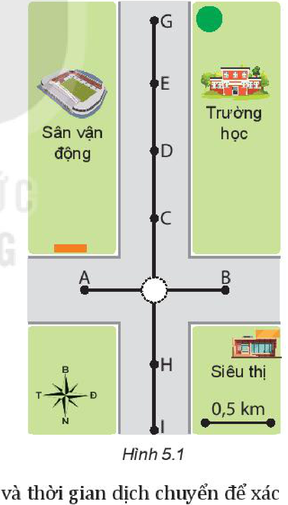
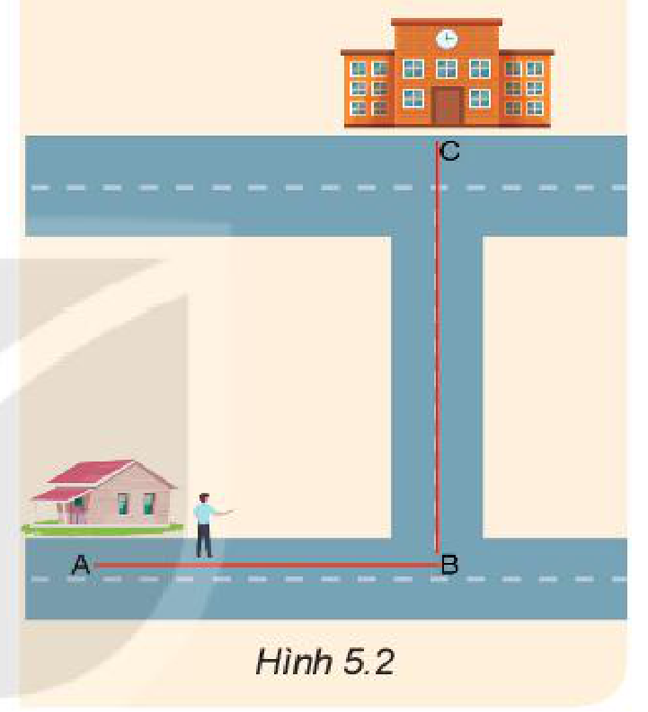
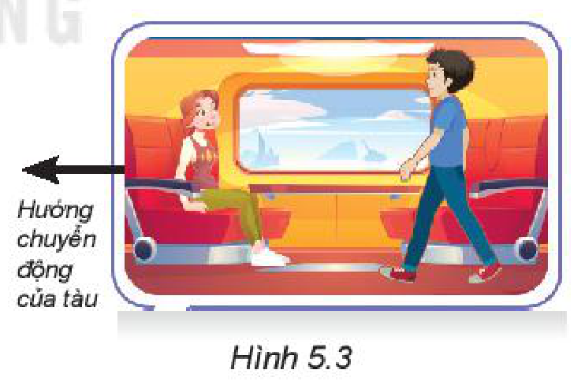
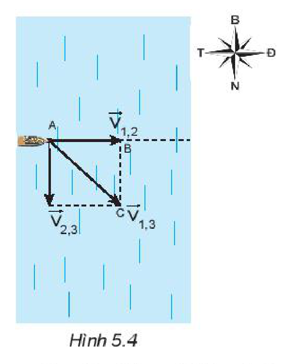

<!-- pdf:27 -->

# BÀI 5: TỐC ĐỘ VÀ VẬN TỐC

## 🔴 Mở đầu

> Trong đời sống, tốc độ và vận tốc là hai đại lượng đều dùng để mô tả sự nhanh chậm của chuyển động. Em đã từng sử dụng hai đại lượng này trong những trường hợp cụ thể nào?

## I. TỐC ĐỘ

### 1. Tốc độ trung bình

Người ta dùng hai cách sau đây để xác định độ nhanh hay chậm của chuyển động:

- So sánh quãng đường đi được trong cùng một thời gian.
- So sánh thời gian để đi cùng một quãng đường.

> **Hoạt động:** Một vận động viên người Nam Phi đã lập kỉ lục thế giới về chạy ba cự li: $100\text{ m}$, $200\text{ m}$ và $400\text{ m}$ (Bảng 5.1). Hãy dùng hai cách trên để xác định vận động viên này chạy nhanh nhất ở cự li nào.

*Bảng 5.1. Kỉ lục chạy ba cự li của một vận động viên người Nam Phi*

| Cự li chạy (m) | Thời gian chạy (s) |
| --- | --- |
| $100$ | $9,98$ |
| $200$ | $19,94$ |
| $400$ | $43,45$ |
<!-- ocr-ok: đối chiếu ảnh trang PDF 27 khớp nguyên văn -->

Người ta thường dùng quãng đường đi được trong cùng một đơn vị thời gian để xác định độ nhanh, chậm của chuyển động. Đại lượng này gọi là **tốc độ trung bình** của chuyển động (gọi tắt là tốc độ trung bình), kí hiệu là $\upsilon$:

$\text{Tốc độ trung bình} = \frac{\text{Quãng đường đi được}}{\text{Thời gian}}$

$\upsilon = \frac{s}{t} \quad (5.1\text{a})$

> **Lưu ý:** Từ công thức $(5.1\text{a})$, suy ra công thức của:
> - Quãng đường đi được: $s = \upsilon \cdot t$.
> - Thời gian đi: $t = \frac{s}{\upsilon}$.

> **Lưu ý:** Nếu gọi quãng đường đi được từ thời điểm ban đầu tới thời điểm $t_1$ là $s_1$, tới thời điểm $t_2$ là $s_2$ thì:
> - Khoảng thời gian từ $t_1$ đến $t_2$ là: $\Delta t = t_2 - t_1$;
> - Quãng đường đi được trong thời gian $\Delta t$ là $\Delta s = s_2 - s_1$;
> - Tốc độ trung bình của chuyển động là: $\upsilon = \frac{\Delta s}{\Delta t} \quad (5.1\text{b})$

*Bảng 5.2. Thành tích của một nữ vận động viên Việt Nam*

| Giải thi đấu | Cự li chạy (m) | Thời gian chạy (s) |
| --- | --- | --- |
| Điền kinh quốc gia 2016 | $100$ | $11,64$ |
| SEA Games 29 (2017) | $100$ | $11,56$ |
| SEA Games 30 (2019) | $100$ | $11,54$ |
<!-- ocr-ok: đối chiếu ảnh trang PDF 27 khớp nguyên văn -->

> **Câu hỏi:**
>
> 1. Tại sao tốc độ trong công thức $(5.1\text{b})$ được gọi là tốc độ trung bình?
> 2. Hãy tính tốc độ trung bình ra đơn vị $\text{m/s}$ và $\text{km/h}$ của nữ vận động viên tại một số giải thi đấu dựa vào Bảng 5.2.

<!-- pdf:28 -->

### 2. Tốc độ tức thời

Trên xe máy và ô tô, đồng hồ tốc độ (**tốc kế**) đặt trước mặt người lái xe, chỉ tốc độ mà xe đang chạy vào thời điểm người lái xe đọc số chỉ của tốc kế. Tốc độ này được gọi là **tốc độ tức thời**.

> **Em có biết:**
>
> Khái niệm tốc độ tức thời liên quan đến phép tính đạo hàm của môn Toán sẽ được học ở lớp 11. Có thể coi tốc độ tức thời là tốc độ trung bình trong một khoảng thời gian rất ngắn.

> **Câu hỏi:**
>
> Bố bạn A đưa A đi học bằng xe máy vào lúc 7 giờ. Sau 5 phút xe đạt tốc độ $30\text{ km/h}$. Sau 10 phút nữa, xe tăng tốc độ lên thêm $15\text{ km/h}$. Đến gần trường, xe giảm dần tốc độ và dừng trước cổng trường lúc 7 giờ 30 phút.
> a) Tính tốc độ trung bình của xe máy chở A khi đi từ nhà đến trường. Biết quãng đường từ nhà đến trường dài $15\text{ km}$.
> b) Tính tốc độ của xe vào lúc 7 giờ 15 phút và 7 giờ 30 phút. Tốc độ này là tốc độ gì?

## II. VẬN TỐC

### 1. Vận tốc trung bình

Biết tốc độ và thời gian chuyển động nhưng chưa biết hướng chuyển động thì chưa thể xác định được vị trí của vật. Biết tốc độ, thời gian chuyển động và hướng chuyển động của vật thì có thể xác định được vị trí của vật.

> **Câu hỏi:** Một người đi xe máy qua ngã tư (Hình 5.1) với tốc độ trung bình $30\text{ km/h}$ theo hướng Bắc. Sau 3 phút người đó đến vị trí nào trên hình?
>
> 

> **Câu hỏi:** Theo em biểu thức nào sau đây xác định giá trị vận tốc? Tại sao?
>
> a) $\frac{s}{t}$; $\quad$ b) $\upsilon t$; $\quad$ c) $\frac{d}{t}$; $\quad$ d) $d \cdot t$.
<!-- ocr-ok: đối chiếu ảnh trang PDF 28 khớp nguyên văn -->

Trong Vật lí, người ta dùng thương số của độ dịch chuyển và thời gian dịch chuyển để xác định độ nhanh, chậm của chuyển động theo một hướng xác định. Đại lượng này được gọi là **vận tốc trung bình**, kí hiệu là $\vec{v}$.

$\vec{v} = \frac{\vec{d}}{t} \quad (5.2\text{a})$

Tương tự như trường hợp $(5.1\text{b})$, ta có thể viết: $\vec{v} = \frac{\Delta \vec{d}}{\Delta t}$. $\quad (5.2\text{b})$

Trong đó $\Delta \vec{d}$ là độ dịch chuyển trong thời gian $\Delta t$.

<!-- pdf:29 -->

Vì độ dịch chuyển là một đại lượng vectơ nên **vận tốc** cũng là một đại lượng vectơ. Vectơ vận tốc có:
- Gốc nằm trên vật chuyển động;
- Hướng là hướng của độ dịch chuyển;
- Độ dài tỉ lệ với độ lớn của vận tốc.

> **Câu hỏi:**
>
> Bạn A đi học từ nhà đến trường theo lộ trình ABC (Hình 5.2). Biết bạn A đi đoạn đường $\text{AB} = 400\text{ m}$ hết 6 phút, đoạn đường $\text{BC} = 300\text{ m}$ hết 4 phút. Xác định tốc độ trung bình và vận tốc trung bình của bạn A khi đi từ nhà đến trường.
>
> 

### 2. Vận tốc tức thời

**Vận tốc tức thời** là vận tốc tại một thời điểm xác định, được kí hiệu là $\vec{v}_t$:

$\vec{v}_t = \frac{\Delta \vec{d}}{\Delta t} \text{ với } \Delta t \text{ rất nhỏ.}$

### 3. Tổng hợp vận tốc

**a) Tổng hợp hai vận tốc cùng phương**

*Bài tập ví dụ:* Trên đoàn tàu đang chạy thẳng với vận tốc trung bình $36\text{ km/h}$ so với mặt đường, một hành khách đi về phía đầu tàu với vận tốc $1\text{ m/s}$ so với mặt sàn tàu (Hình 5.3).
a) Hành khách này tham gia mấy chuyển động?
b) Làm cách nào để xác định được vận tốc của hành khách đối với mặt đường?

*Giải*

a) Hành khách này tham gia 2 chuyển động: Chuyển động với vận tốc $1\text{ m/s}$ so với sàn tàu và chuyển động do tàu kéo đi (**chuyển động kéo theo**) với vận tốc bằng vận tốc của tàu so với mặt đường. Chuyển động của hành khách so với mặt đường là tổng hợp của hai chuyển động trên.

b) Nếu gọi $\vec{v}_{1,2}$ là vận tốc của hành khách so với tàu, $\vec{v}_{2,3}$ là vận tốc của tàu so với mặt đường và $\vec{v}_{1,3}$ là vận tốc của hành khách so với mặt đường thì: $\vec{v}_{1,3} = \vec{v}_{1,2} + \vec{v}_{2,3}$

Vì các chuyển động trên đều là chuyển động thẳng theo hướng chạy của đoàn tàu nên:

$v_{1,3} = v_{1,2} + v_{2,3} = 1\text{ m/s} + 10\text{ m/s} = 11\text{ m/s}.$

Hướng của vận tốc là hướng đoàn tàu chạy.

> **Câu hỏi:**
>
> 1. Hãy xác định vận tốc của hành khách đối với mặt đường nếu người này chuyển động về cuối đoàn tàu với vận tốc có cùng độ lớn $1\text{ m/s}$.
> 2. Một người bơi trong bể bơi yên lặng có thể đạt tới vận tốc $1\text{ m/s}$. Nếu người này bơi xuôi dòng sông có dòng chảy với vận tốc $1\text{ m/s}$ thì có thể đạt vận tốc tối đa là bao nhiêu?
> 3. Một ca nô chạy hết tốc lực trên mặt nước yên lặng có thể đạt $21,5\text{ km/h}$. Ca nô này chạy xuôi dòng sông trong 1 giờ rồi quay lại thì phải mất 2 giờ nữa mới về tới vị trí ban đầu. Hãy tính vận tốc chảy của dòng sông.

<!-- pdf:30 -->

**b) Tổng hợp hai vận tốc vuông góc với nhau**

*Bài tập ví dụ:* Một ca nô chạy trong hồ nước yên lặng có vận tốc tối đa $18\text{ km/h}$. Nếu ca nô chạy ngang một con sông có dòng chảy theo hướng Bắc – Nam với vận tốc lên tới $5\text{ m/s}$ thì vận tốc tối đa nó có thể đạt được so với bờ sông là bao nhiêu và theo hướng nào?

*Giải*

Gọi vận tốc của ca nô đối với mặt nước là $\vec{v}_{1,2}$; vận tốc của nước chảy đối với bờ sông là $\vec{v}_{2,3}$. Vận tốc của ca nô đối với bờ sông là:

$\vec{v}_{1,3} = \vec{v}_{1,2} + \vec{v}_{2,3}\text{. Suy ra: } v_{1,3} = \sqrt{v_{1,2}^2 + v_{2,3}^2} = \sqrt{5^2 + 5^2} = 7,07\text{ m/s}$

Vì $\text{AB} = \text{BC}$ nên $\Delta\text{ABC}$ là tam giác vuông cân và $\widehat{\text{BAC}} = 45^\circ$. Hướng của vận tốc nghiêng $45^\circ$ theo hướng Đông – Nam (Hình 5.4).

> **Câu hỏi:**
>
> 1. Một máy bay đang bay theo hướng Bắc với vận tốc $200\text{ m/s}$ thì bị gió từ hướng Tây thổi vào với vận tốc $20\text{ m/s}$. Xác định vận tốc tổng hợp của máy bay lúc này.
> 2. Một người lái máy bay thể thao đang tập bay ngang. Khi bay từ A đến B thì vận tốc tổng hợp của máy bay là $15\text{ m/s}$ theo hướng $60^\circ$ Đông – Bắc và vận tốc của gió là $7,5\text{ m/s}$ theo hướng Bắc.
>    Hãy chứng minh rằng khi bay từ A đến B thì người lái phải luôn hướng máy bay về hướng Đông.

## 📌 Em đã học

- Tốc độ trung bình trên một đoạn đường xác định (hoặc trong một khoảng thời gian xác định):
  $\upsilon = \frac{s}{t} \text{ hoặc } \upsilon = \frac{\Delta s}{\Delta t}$
- Tốc độ tức thời là tốc độ tại một thời điểm xác định.
- Vận tốc trung bình trên một độ dịch chuyển xác định (hoặc trong một khoảng thời gian xác định):
  $\vec{v} = \frac{\vec{d}}{t} \text{ hoặc } \vec{v} = \frac{\Delta \vec{d}}{\Delta t}$
- Vận tốc tức thời là vận tốc tại một thời điểm xác định:
  $\vec{v}_t = \frac{\Delta \vec{d}}{\Delta t} \text{ với } \Delta t \text{ rất nhỏ.}$
- Khi vật chuyển động thẳng theo một hướng thì tốc độ và vận tốc có độ lớn bằng nhau: $v = \upsilon$.
- **Công thức cộng vận tốc**: $\vec{v}_{1,3} = \vec{v}_{1,2} + \vec{v}_{2,3}$
  Trong đó $\vec{v}_{1,2}$ là vận tốc của vật (1) đối với vật (2); $\vec{v}_{2,3}$ là vận tốc của vật (2) so với vật (3) đứng yên; $\vec{v}_{1,3}$ (**vận tốc tổng hợp** của vật) là vận tốc của vật (1) đối với vật (3).

## ✏️ Em có thể

1. Tự xác định được tốc độ chuyển động của mình trong một số trường hợp đơn giản.
2. Sử dụng đúng các thuật ngữ tốc độ và vận tốc trong các tình huống khác nhau.

## 📷 Danh sách hình trong bài

| Mã hình | Số hình SGK | Trang PDF | Chú thích |
| --- | --- | --- | --- |
| H10-vat_ly-b05-01 | Hình 5.1 | 28 | Sơ đồ ngã tư đường và các vị trí xung quanh |
| H10-vat_ly-b05-02 | Hình 5.2 | 29 | Lộ trình ABC đi học từ nhà đến trường của bạn A |
| H10-vat_ly-b05-03 | Hình 5.3 | 29 | Hành khách chuyển động trên đoàn tàu đang chạy |
| H10-vat_ly-b05-04 | Hình 5.4 | 30 | Tổng hợp hai vận tốc vuông góc của ca nô và dòng nước |
