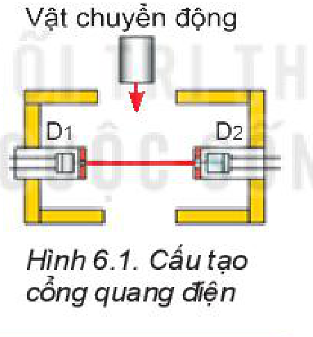
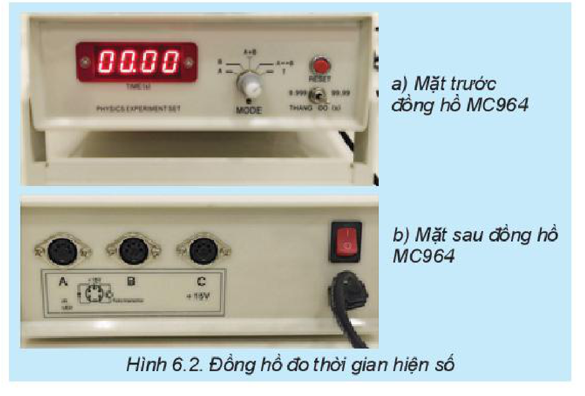
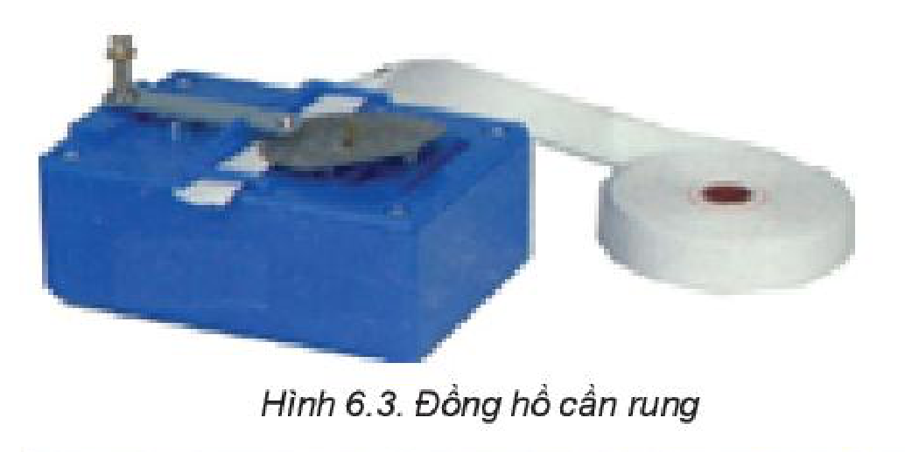
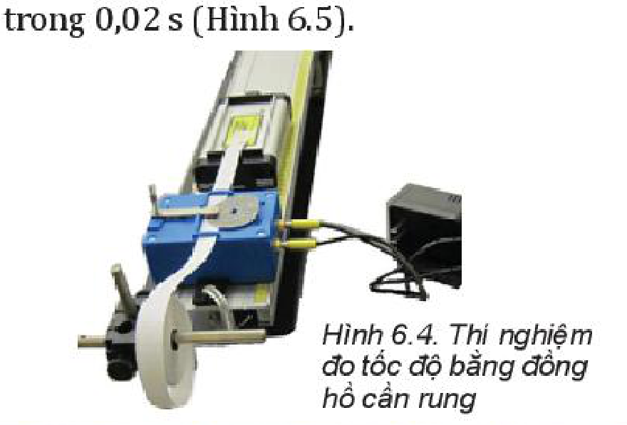
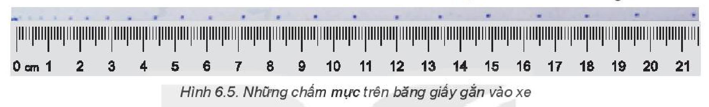
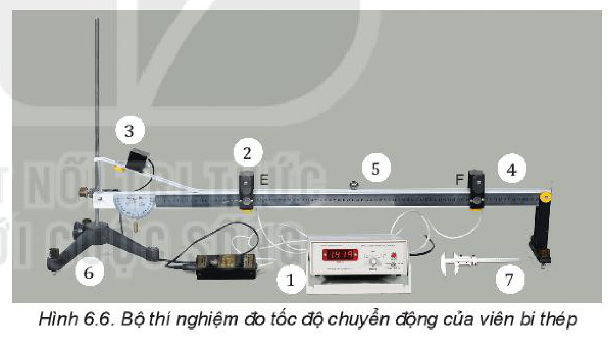
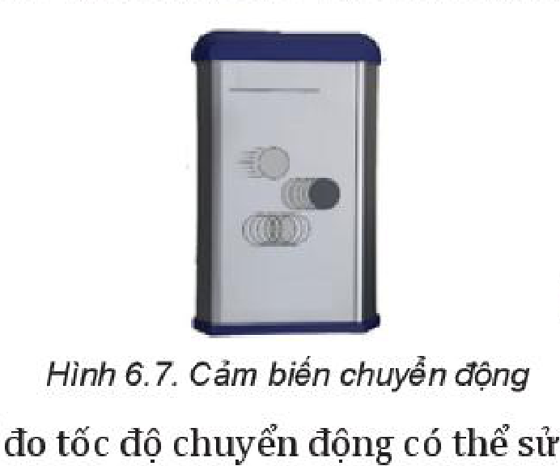
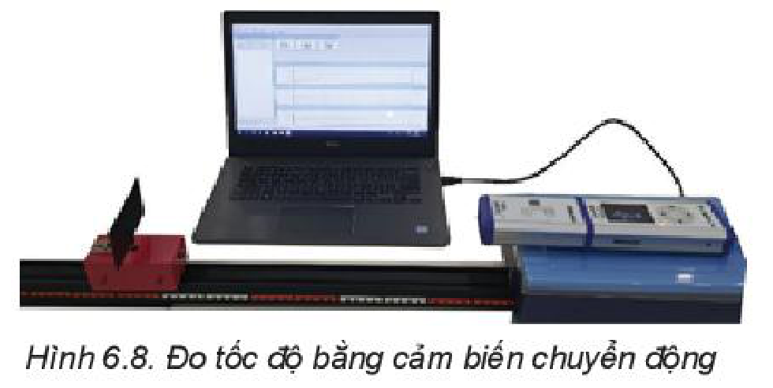

<!-- pdf:31 -->

# BÀI 6: THỰC HÀNH: ĐO TỐC ĐỘ CỦA VẬT CHUYỂN ĐỘNG

## 🔴 Mở đầu

> Làm thế nào đo được tốc độ chuyển động của vật bằng dụng cụ thí nghiệm thực hành?

## I. CÁCH ĐO TỐC ĐỘ TRONG PHÒNG THÍ NGHIỆM

Để đo tốc độ chuyển động của một vật có thể đo thời gian và quãng đường chuyển động của vật đó.

> **Hoạt động:**
>
> Hãy thảo luận nhóm về các nội dung sau:
> 1. Dùng dụng cụ gì để đo quãng đường và thời gian chuyển động của vật?
> 2. Làm thế nào đo được quãng đường đi được của vật trong một khoảng thời gian hoặc ngược lại?
> 3. Thiết kế các phương án đo tốc độ và so sánh ưu, nhược điểm của các phương án đó.

## II. GIỚI THIỆU DỤNG CỤ ĐO THỜI GIAN

Dụng cụ đo độ dài đã được học ở Trung học cơ sở, phần này chỉ giới thiệu các dụng cụ đo thời gian chưa được học một cách đầy đủ.

### 1. Đồng hồ đo thời gian hiện số và cổng quang điện

**Đồng hồ đo thời gian hiện số** (Hình 6.2) có thể đo thời gian chính xác đến phần nghìn giây, được điều khiển bằng cổng quang điện (Hình 6.1).

> **Lưu ý:** Sử dụng đồng hồ đo thời gian hiện số MC964 (Hình 6.2):
> - THANG ĐO: Chọn thang đo thời gian, với ĐCNN tương ứng là $0,001\text{ s}$ hoặc $0,01\text{ s}$.
> - MODE: Chọn kiểu làm việc cho máy đo thời gian.
>   (1) MODE A: Đo thời gian vật chắn cổng quang điện nối với ổ A (Hình 6.3).
>   (2) MODE B: Đo thời gian vật chắn cổng quang điện nối với ổ B.
>   (3) MODE A + B: Đo tổng của hai khoảng thời gian vật chắn cổng quang điện nối với ổ A và vật chắn cổng quang điện nối với ổ B.
>   (4) MODE $\text{A} \leftrightarrow \text{B}$: Đo thời gian vật chuyển động từ cổng quang điện nối với ổ A tới cổng quang điện nối với ổ B.
>   (5) MODE T: Đo khoảng thời gian $T$ của từng chu kì dao động.
> - Nút RESET: Đặt lại chỉ số của đồng hồ về giá trị $0.000$.

> **Câu hỏi:** Sử dụng đồng hồ đo thời gian hiện số và cổng quang điện để đo tốc độ chuyển động có ưu điểm, nhược điểm gì?

<!-- pdf:32 -->

### 2. Thiết bị đo thời gian bằng cần rung (đồng hồ cần rung)

**Đồng hồ cần rung** (Hình 6.3) sử dụng một cần rung đều đặn khoảng $50$ lần trong một giây và đánh dấu các chấm trên băng giấy gắn vào xe chuyển động. Đo khoảng cách giữa các dấu chấm xác định được quãng đường đi được của xe trong $0,02\text{ s}$ (Hình 6.5).

## III. THỰC HÀNH ĐO TỐC ĐỘ CHUYỂN ĐỘNG

### 1. Dụng cụ thí nghiệm

- Đồng hồ đo thời gian hiện số MC964 (1).
- **Cổng quang điện** có vai trò như công tắc điều khiển mở/đóng đồng hồ đo (2).
- Nam châm điện và công tắc sử dụng để giữ/thả viên bi thép (3).
- Máng có giá đỡ bằng hợp kim nhôm, có gắn thước đo góc và dây dọi (4).
- Viên bi thép (5).
- Giá đỡ có đế ba chân, có vít chỉnh cân bằng và trụ thép (6).
- Thước cặp để đo đường kính viên bi thép (7).

### 2. Thiết kế phương án thí nghiệm

> **Hoạt động:**
>
> Thả cho viên bi chuyển động đi qua cổng quang điện trên máng nhôm. Thảo luận nhóm để lập phương án đo tốc độ của viên bi theo các gợi ý sau:
> 1. Làm thế nào xác định được tốc độ trung bình của viên bi khi đi từ cổng quang điện E đến cổng quang điện F?
> 2. Làm thế nào xác định được tốc độ tức thời của viên bi khi đi qua cổng quang điện E hoặc cổng quang điện F?
> 3. Xác định các yếu tố có thể gây sai số trong thí nghiệm và tìm cách để giảm sai số.

<!-- pdf:33 -->

### 3. Tiến hành thí nghiệm

> **Hoạt động:** Đo tốc độ trung bình và tốc độ tức thời của viên bi thép chuyển động trên máng nghiêng.

**Thí nghiệm 1. Đo tốc độ trung bình**

1. Bố trí thí nghiệm như Hình 6.6.
2. Nới vít hãm và đặt cổng quang điện E cách chân phần dốc của máng nghiêng.
3. Nối hai cổng quang điện E, F với hai ổ cắm A, B ở mặt sau của đồng hồ đo thời gian.
4. Cắm nguồn điện của đồng hồ và bật công tắc nguồn đồng hồ đo thời gian hiện số, đặt MODE ở $\text{A} \leftrightarrow \text{B}$.
5. Nới vít cổng quang điện, dịch chuyển đến vị trí thích hợp và vặn chặt để định vị. Đo quãng đường EF và ghi số liệu vào Bảng 6.1.
6. Đặt viên bi thép lên máng nghiêng tại vị trí tiếp xúc với nam châm điện N và bị giữ lại ở đó.
7. Nhấn nút RESET của đồng hồ đo thời gian hiện số để chuyển các số hiển thị về giá trị ban đầu $0.000$.
8. Nhấn nút của hộp công tắc kép để ngắt điện vào nam châm N: viên bi lăn xuống và chuyển động đi qua hai cổng quang điện E, F trên máng nghiêng.
9. Ghi lại các giá trị thời gian hiển thị trên đồng hồ.
10. Thực hiện lại các thao tác 6, 7, 8, 9 ba lần và ghi các giá trị thời gian $t$ tương ứng với quãng đường $s$ vào Bảng 6.1 trong báo cáo thực hành.

> **Lưu ý:** Khi cắm cổng quang điện vào ổ cắm A, B cần chú ý xoay đúng khe định vị, cắm thẳng giắc cắm, không rung, lắc chân cắm.

**Thí nghiệm 2. Đo tốc độ tức thời**

1. Nới vít cổng quang điện, dịch chuyển đến vị trí thích hợp và vặn chặt để định vị.
2. Sử dụng thước cặp đo đường kính viên bi.
3. Bật công tắc nguồn đồng hồ đo thời gian hiện số, đặt MODE ở A hoặc B.
4. Đặt viên bi thép lên máng nghiêng tại vị trí tiếp xúc với nam châm điện N và bị giữ lại ở đó.
5. Nhấn nút RESET của đồng hồ đo thời gian hiện số để chuyển các số hiển thị về giá trị ban đầu $0.000$.
6. Nhấn nút của hộp công tắc kép để ngắt điện vào nam châm N: viên bi lăn xuống và chuyển động đi qua cổng quang điện trên máng nghiêng.
7. Ghi lại các giá trị thời gian hiển thị trên đồng hồ.
8. Thực hiện lại các thao tác 4, 5, 6, 7 ba lần và ghi các giá trị thời gian $t$ vào Bảng 6.2 trong báo cáo thực hành.

> **Lưu ý:** Kết thúc thí nghiệm cần tắt nguồn điện đồng hồ đo thời gian. Tháo các dụng cụ thí nghiệm và sắp xếp ngăn nắp.

### 4. Kết quả thí nghiệm

*Bảng 6.1. Quãng đường: $s = \text{... (m)}$; $\Delta s = \text{... (m)}$.*

| | Lần 1 | Lần 2 | Lần 3 | Giá trị trung bình | Sai số |
| --- | --- | --- | --- | --- | --- |
| Thời gian $t\text{ (s)}$ | | | | | |
<!-- ocr-ok: đối chiếu ảnh trang PDF 33 khớp nguyên văn -->

$\overline{\upsilon} = \frac{\overline{s}}{\overline{t}} = \text{...}$

*Bảng 6.2. Đường kính viên bi: $d = \text{... (m)}$; $\Delta d = \text{... (m)}$.*

| | Lần 1 | Lần 2 | Lần 3 | Giá trị trung bình | Sai số |
| --- | --- | --- | --- | --- | --- |
| Thời gian $t\text{ (s)}$ | | | | | |
<!-- ocr-ok: đối chiếu ảnh trang PDF 33 khớp nguyên văn -->

$\overline{\upsilon}_t = \frac{\overline{d}}{\overline{t}} = \text{...}$

<!-- pdf:34 -->

> **Hoạt động:**
>
> **Xử lí kết quả thí nghiệm**
> 1. Tính tốc độ trung bình và tốc độ tức thời của viên bi thép và điền kết quả vào Bảng 6.1 và Bảng 6.2.
> 2. Tính sai số của phép đo $s$, $t$ và phép đo tốc độ rồi điền vào Bảng 6.1 và Bảng 6.2. Trong đó
>    + $\Delta s$ bằng nửa ĐCNN của thước đo.
>    + $\Delta t$ theo công thức $(3.1)$, $(3.2)$ trang 18.
>    + $\Delta \upsilon$ tính theo ví dụ trang 18.
> 3. Đề xuất một phương án thí nghiệm để có thể đo tốc độ tức thời của viên bi tại hai vị trí: cổng quang điện E và cổng quang điện F.

## 📌 Em đã học

- Sử dụng đồng hồ đo thời gian hiện số và cổng quang điện có thể đo chính xác thời gian chuyển động của vật đến phần nghìn giây.
- Sử dụng hai cổng quang điện để đo tốc độ trung bình của viên bi thép.
- Đo đường kính viên bi và thời gian viên bi chắn một cổng quang điện để đo tốc độ tức thời của của viên bi.

## ✏️ Em có thể

1. Mô tả một số phương án đo tốc độ thông dụng và đánh giá ưu, nhược điểm của các phương án đó.
2. Sử dụng điện thoại thông minh, quay video chuyển động của một vật rồi sử dụng phần mềm phân tích video để xác định tốc độ chuyển động của vật đó.

> **Em có biết:**
>
> 1. Sử dụng cảm biến chuyển động
>
>    **Cảm biến chuyển động** (Hình 6.7) là thiết bị truyền các sóng siêu âm đập vào tấm cản gắn trên xe và nhận các sóng phản xạ từ xe tới cảm biến. Máy tính kết nối với cảm biến sẽ xác định được tốc độ của xe (Hình 6.8).
>
>    
>
>    
>
> 2. Để đo tốc độ chuyển động có thể sử dụng ảnh hoạt nghiệm hoặc sử dụng camera quay chuyển động của xe và dùng phần mềm phân tích video trên máy tính để xác định vị trí của xe tương ứng với tỉ lệ khung hình với khoảng cách thực tế và thời gian dịch chuyển qua mỗi khung hình (khoảng $30\text{ khung hình/giây}$ tuỳ theo video), từ đó máy tính vẽ đồ thị quãng đường – thời gian và xác định tốc độ của xe.

## 📷 Danh sách hình trong bài

| Mã hình | Số hình SGK | Trang PDF | Chú thích |
| --- | --- | --- | --- |
| H10-vat_ly-b06-01 | Hình 6.1 | 31 | Cấu tạo cổng quang điện |
| H10-vat_ly-b06-02 | Hình 6.2 | 31 | Đồng hồ đo thời gian hiện số |
| H10-vat_ly-b06-03 | Hình 6.3 | 32 | Đồng hồ cần rung |
| H10-vat_ly-b06-04 | Hình 6.4 | 32 | Thí nghiệm đo tốc độ bằng đồng hồ cần rung |
| H10-vat_ly-b06-05 | Hình 6.5 | 32 | Những chấm mực trên băng giấy gắn vào xe |
| H10-vat_ly-b06-06 | Hình 6.6 | 32 | Bộ thí nghiệm đo tốc độ chuyển động của viên bi thép |
| H10-vat_ly-b06-07 | Hình 6.7 | 34 | Cảm biến chuyển động |
| H10-vat_ly-b06-08 | Hình 6.8 | 34 | Đo tốc độ bằng cảm biến chuyển động |
