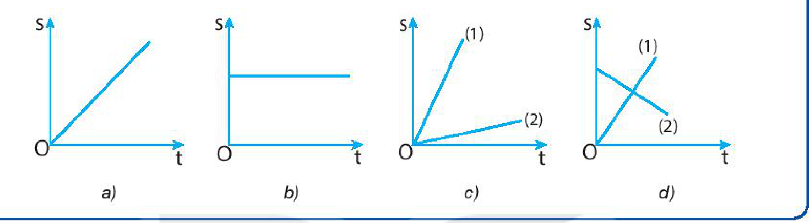
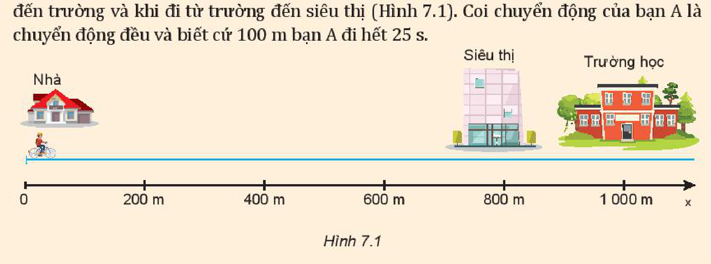
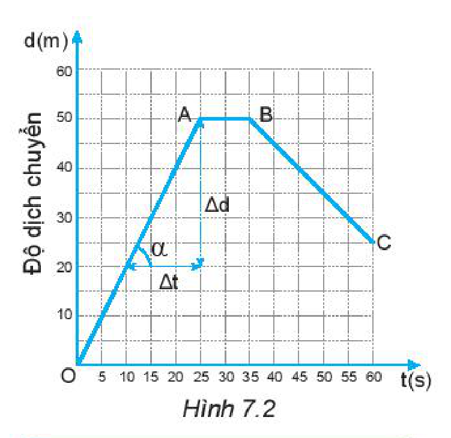
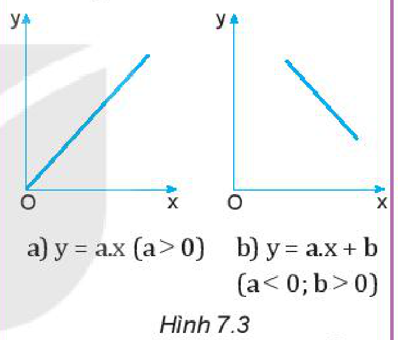
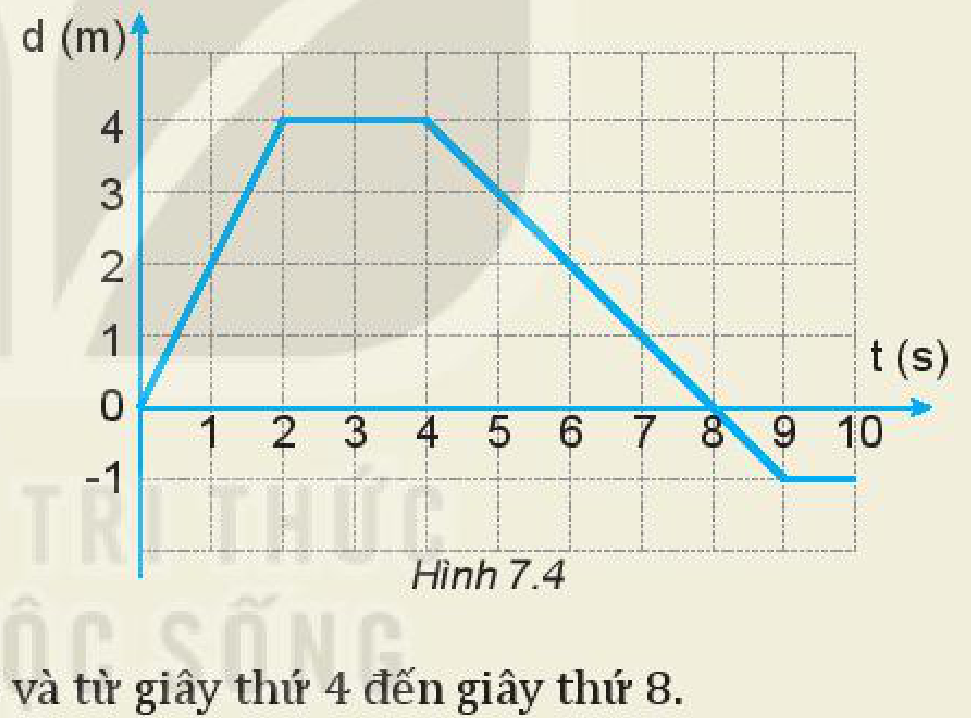

<!-- pdf:35 -->

# BÀI 7: ĐỒ THỊ ĐỘ DỊCH CHUYỂN – THỜI GIAN

## 🔴 Mở đầu

> Hãy nhớ lại kiến thức đã học về đồ thị của chuyển động trong môn Khoa học tự nhiên 7 để phát hiện ra tính chất của các chuyển động thẳng có đồ thị mô tả ở những hình sau.
>
> 

## I. CHUYỂN ĐỘNG THẲNG

**Chuyển động thẳng** là chuyển động thường gặp trong đời sống, có quỹ đạo chuyển động là đường thẳng.

Khi vật chuyển động thẳng theo một chiều không đổi thì độ dịch chuyển và quãng đường đi được có độ lớn như nhau $d = s$; vận tốc và tốc độ có độ lớn như nhau $v = \upsilon$.

Khi vật đang chuyển động thẳng theo chiều dương, nếu đổi chiều chuyển động thì trong khoảng thời gian chuyển động ngược chiều đó quãng đường đi được vẫn có giá trị dương, còn độ dịch chuyển có giá trị âm; tốc độ vẫn có giá trị dương còn vận tốc có giá trị âm $v = -\upsilon$.

Dựa vào các công thức $(5.1)$ và $(5.2)$ ta có thể xác định được quãng đường đi được, độ dịch chuyển, tốc độ và vận tốc của chuyển động.

> **Câu hỏi:**
>
> Hãy tính quãng đường đi được, độ dịch chuyển, tốc độ, vận tốc của bạn A khi đi từ nhà đến trường và khi đi từ trường đến siêu thị (Hình 7.1). Coi chuyển động của bạn A là chuyển động đều và biết cứ $100\text{ m}$ bạn A đi hết $25\text{ s}$.
>
> 

<!-- pdf:36 -->

## II. ĐỒ THỊ ĐỘ DỊCH CHUYỂN – THỜI GIAN TRONG CHUYỂN ĐỘNG THẲNG

**Đồ thị độ dịch chuyển – thời gian** của một chuyển động không những cho phép mô tả được chuyển động, mà còn có thể cho biết nhiều thông tin khác nữa về chuyển động.

### 1. Cách vẽ đồ thị độ dịch chuyển – thời gian ($d - t$) trong chuyển động thẳng đều

Đồ thị đơn giản nhất là đồ thị độ dịch chuyển – thời gian của chuyển động thẳng đều. Trong **chuyển động thẳng đều** thì $d = v \cdot t$ (với $v$ là một hằng số). Biểu thức $d = v \cdot t$ có dạng giống biểu thức của hàm số $y = a \cdot x$ đã học trong môn Toán nên có đường biểu diễn là một đoạn thẳng.

> **Hoạt động:**
>
> Hãy vẽ đồ thị độ dịch chuyển – thời gian trong chuyển động của bạn A nêu ở trên theo trình tự sau đây:
> 1. Lập bảng ghi số liệu vào vở.
>
> | Độ dịch chuyển (m) | $0$ | $200$ | $400$ | $600$ | $800$ | $1\text{ }000$ | $800$ |
> | --- | --- | --- | --- | --- | --- | --- | --- |
> | Thời gian (s) | $0$ | $50$ | $100$ | $150$ | $200$ | $250$ | $300$ |
>
> 2. Vẽ đồ thị: trên trục tung (trục độ dịch chuyển) $1\text{ cm}$ ứng với $200\text{ m}$; trên trục hoành (trục thời gian) $1\text{ cm}$ ứng với $50\text{ s}$.

### 2. Sử dụng đồ thị độ dịch chuyển – thời gian trong chuyển động thẳng

> **Hoạt động:**
>
> Hình 7.2 là đồ thị độ dịch chuyển – thời gian của một người đang bơi trong một bể bơi dài $50\text{ m}$. Đồ thị này cho biết những gì về chuyển động của người đó?
> 1. Trong 25 giây đầu mỗi giây người đó bơi được bao nhiêu mét? Tính vận tốc của người đó ra $\text{m/s}$.
> 2. Từ giây nào đến giây nào người đó không bơi?
> 3. Từ giây 35 đến giây 60 người đó bơi theo chiều nào?
> 4. Trong 20 giây cuối cùng, mỗi giây người đó bơi được bao nhiêu mét? Tính vận tốc của người đó ra $\text{m/s}$.
> 5. Xác định độ dịch chuyển và vận tốc của người đó khi bơi từ B đến C.
> 6. Xác định độ dịch chuyển và vận tốc của người đó trong cả quá trình bơi.

> **Em có biết:**
>
> 1. Đồ thị của các hàm số đã học trong môn Toán:
>    a) $y = a \cdot x\text{ }(a > 0) \quad$ b) $y = a \cdot x + b\text{ }(a < 0; b > 0)$
>
>    
>
> 2. Khi vật chuyển động thẳng với vận tốc không đổi $v > 0$ thì $d = v \cdot t$. Phương trình này có dạng của hàm số $y = a \cdot x$ nên có đồ thị ở Hình 7.3a.
> 3. Khi vật đang chuyển động thẳng, theo chiều dương, nếu đổi chiều chuyển động thì trong khoảng thời gian chuyển động ngược chiều đó, quãng đường đi được vẫn có giá trị dương còn độ dịch chuyển có giá trị âm. Đồ thị độ dịch chuyển – thời gian có dạng như Hình 7.3b.

> **Câu hỏi:** Hãy xác định vận tốc và tốc độ của người bơi từ giây 45 đến giây 60 bằng đồ thị ở Hình 7.2.

<!-- pdf:37 -->

## III. VẬN TỐC VÀ ĐỒ THỊ ĐỘ DỊCH CHUYỂN – THỜI GIAN TRONG CHUYỂN ĐỘNG THẲNG

Từ đồ thị độ dịch chuyển – thời gian có thể dễ dàng tính được giá trị của vận tốc.

Trong đồ thị vẽ ở Hình 7.2, hệ số góc (độ dốc) của đường biểu diễn OA là:

$\frac{\Delta d}{\Delta t} = \frac{50 - 20}{25 - 10} = \frac{30}{15} = 2\text{ m/s}$

Đây chính là độ lớn vận tốc của người bơi trong $50\text{ m}$ đầu.

**Độ dốc** của đồ thị độ dịch chuyển – thời gian trong chuyển động thẳng cho biết độ lớn vận tốc chuyển động.

> **Hoạt động:**
>
> **Vận dụng**
> 1. Số liệu về độ dịch chuyển và thời gian của chuyển động thẳng của một xe ô tô đồ chơi chạy bằng pin được ghi trong bảng bên:
>
> | Độ dịch chuyển (m) | $1$ | $3$ | $5$ | $7$ | $7$ | $7$ |
> | --- | --- | --- | --- | --- | --- | --- |
> | Thời gian (s) | $0$ | $1$ | $2$ | $3$ | $4$ | $5$ |
>
> Dựa vào bảng này để:
> a) Vẽ đồ thị độ dịch chuyển – thời gian của chuyển động.
> b) Mô tả chuyển động của xe.
> c) Tính vận tốc của xe trong $3\text{ s}$ đầu.
>
> 2. Đồ thị độ dịch chuyển – thời gian trong chuyển động thẳng của một xe ô tô đồ chơi điều khiển từ xa được vẽ ở Hình 7.4.
>    a) Mô tả chuyển động của xe.
>    b) Xác định vị trí của xe so với điểm xuất phát của xe ở giây thứ 2, giây thứ 4, giây thứ 8 và giây thứ 10.
>    c) Xác định tốc độ và vận tốc của xe trong 2 giây đầu, từ giây thứ 2 đến giây thứ 4 và từ giây thứ 4 đến giây thứ 8.
>    d) Xác định quãng đường đi được và độ dịch chuyển của xe sau 10 giây chuyển động. Tại sao giá trị của chúng không giống nhau?
>
> 

## 📌 Em đã học

- Dùng đồ thị độ dịch chuyển – thời gian của chuyển động thẳng có thể mô tả được chuyển động: biết khi nào vật chuyển động, khi nào vật dừng, khi nào vật chuyển động nhanh, khi nào vật chuyển động chậm, khi nào vật đổi chiều chuyển động,...
- Vận tốc có giá trị bằng hệ số góc (độ dốc) của đường biểu diễn trong đồ thị độ dịch chuyển – thời gian của chuyển động thẳng.

## ✏️ Em có thể

1. Vẽ được đồ thị độ dịch chuyển – thời gian của chuyển động thẳng.
2. Dựa vào đồ thị độ dịch chuyển – thời gian, xác định được vị trí và vận tốc của vật ở bất kì thời điểm nào.

## 📷 Danh sách hình trong bài

| Mã hình | Số hình SGK | Trang PDF | Chú thích |
| --- | --- | --- | --- |
| H10-vat_ly-b07-01 | — | 35 | Hình mở đầu: Các đồ thị quãng đường – thời gian a, b, c, d |
| H10-vat_ly-b07-02 | Hình 7.1 | 35 | Sơ đồ đường đi từ nhà qua siêu thị đến trường học |
| H10-vat_ly-b07-03 | Hình 7.2 | 36 | Đồ thị độ dịch chuyển – thời gian của một người đang bơi |
| H10-vat_ly-b07-04 | Hình 7.3 | 36 | Đồ thị của các hàm số bậc nhất $y = a \cdot x$ và $y = a \cdot x + b$ |
| H10-vat_ly-b07-05 | Hình 7.4 | 37 | Đồ thị độ dịch chuyển – thời gian của xe ô tô đồ chơi điều khiển từ xa |
