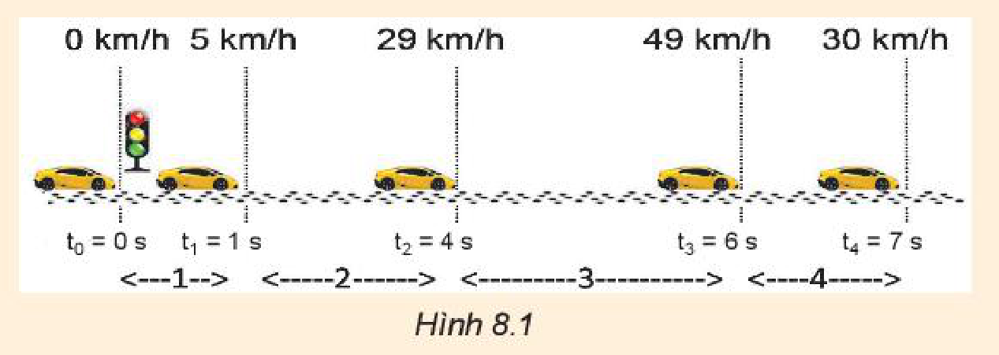
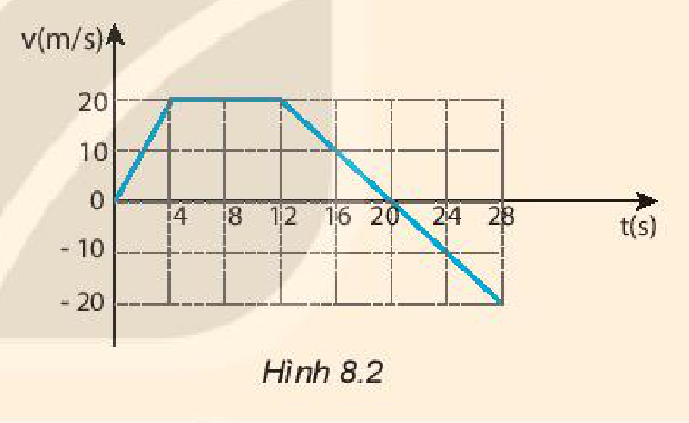

<!-- pdf:38 -->

# BÀI 8: CHUYỂN ĐỘNG BIẾN ĐỔI. GIA TỐC

## 🔴 Mở đầu

> Hình dưới là ảnh chụp hoạt nghiệm thí nghiệm về sự thay đổi vận tốc của một ô tô đồ chơi chạy bằng pin có gắn anten dùng để điều khiển từ xa, trong ba giai đoạn chuyển động. Vận tốc trong ba giai đoạn chuyển động này có gì giống nhau, khác nhau?
>
> 

## I. CHUYỂN ĐỘNG BIẾN ĐỔI

Một ô tô đang đứng yên, bắt đầu chuyển động sẽ **chuyển động nhanh dần** (vận tốc tăng dần); khi đang chuyển động muốn dừng lại sẽ phải **chuyển động chậm dần** (vận tốc giảm dần).

Chuyển động có vận tốc thay đổi được gọi là **chuyển động biến đổi**.

> **Câu hỏi:** Hãy tìm thêm ví dụ về chuyển động biến đổi trong cuộc sống.

## II. GIA TỐC CỦA CHUYỂN ĐỘNG BIẾN ĐỔI

### 1. Khái niệm gia tốc

Để xác định được sự thay đổi vận tốc theo thời gian, phải biết vận tốc tức thời của chuyển động tại các thời điểm khác nhau. Các phương tiện giao thông như xe máy, ô tô được trang bị tốc kế là thiết bị đo trực tiếp vận tốc tức thời. Do đó có thể dùng tốc kế trên xe máy hoặc ô tô để tìm hiểu sự thay đổi vận tốc của chuyển động biến đổi.

Bảng dưới đây ghi vận tốc tức thời đo bởi tốc kế của một ô tô sau các khoảng thời gian $2\text{ s}$ kể từ khi bắt đầu chạy trên một đường thẳng.

*Bảng 8.1. Bảng ghi số liệu vận tốc tức thời của một chuyển động*

| Thời điểm $t\text{ (s)}$ | | $0$ | $2$ | $4$ | $6$ | $8$ |
| --- | --- | --- | --- | --- | --- | --- |
| Vận tốc tức thời $v_t$ | $(\text{km/h})$ | $0$ | $9$ | $19$ | $30$ | $45$ |
| Vận tốc tức thời $v_t$ | $(\text{m/s})$ | $0$ | $2,50$ | $5,28$ | $8,33$ | $12,50$ |

Bảng trên cho thấy vận tốc của ô tô tăng dần theo thời gian: Ô tô chuyển động nhanh dần.

> **Em có biết:**
>
> 1. Thuật ngữ "gia tốc" có nghĩa là tăng thêm tốc độ. Tuy nhiên trong vật lí, gia tốc không chỉ được dùng để mô tả sự tăng vận tốc mà còn dùng để mô tả sự giảm vận tốc.
> 2. Trong các bài sau, chúng ta sẽ thấy gia tốc không những dùng để mô tả sự thay đổi về độ lớn của vận tốc mà còn dùng để mô tả cả sự thay đổi hướng của vận tốc.
> 3. Gia tốc xác định bằng công thức $a = \frac{\Delta v}{\Delta t}$ được gọi là **gia tốc trung bình**.
>    Nếu $\Delta t$ rất nhỏ thì có thể coi gia tốc này là **gia tốc tức thời**.

<!-- pdf:39 -->

> **Câu hỏi:**
>
> 1. Xác định độ biến thiên vận tốc sau $8\text{ s}$ của chuyển động trên.
> 2. Xác định độ biến thiên vận tốc sau mỗi giây của chuyển động trên trong $4\text{ s}$ đầu và trong $4\text{ s}$ cuối.
> 3. Các đại lượng xác định được ở câu 2 cho ta biết điều gì về sự thay đổi vận tốc của chuyển động trên?

Nếu trong thời gian $\Delta t$, độ biến thiên vận tốc là $\Delta v$ thì độ biến thiên của vận tốc trong một đơn vị thời gian là:

$a = \frac{\Delta v}{\Delta t} = \frac{v_t - v_0}{t - t_0} \quad (1)$

Đại lượng $a$ cho biết sự thay đổi nhanh hay chậm của vận tốc được gọi là **gia tốc** của chuyển động (gọi tắt là gia tốc).

Nếu $\Delta v$ có đơn vị là $\text{m/s}$ ($\text{m.s}^{-1}$), $\Delta t$ có đơn vị là giây ($\text{s}$), thì gia tốc có đơn vị là $\text{m/s}^2$ ($\text{m.s}^{-2}$).

Vì $\Delta \vec{v}$ là đại lượng vectơ, nên gia tốc $\vec{a}$ cũng là đại lượng vectơ:

$\vec{a} = \frac{\Delta \vec{v}}{\Delta t} \quad (2)$

> **Câu hỏi:** Hãy chứng tỏ khi $\vec{a}$ cùng chiều với $\vec{v}$ ($a \cdot v > 0$) thì chuyển động là nhanh dần, khi $\vec{a}$ ngược chiều với $\vec{v}$ ($a \cdot v < 0$) thì chuyển động là chậm dần.

### 2. Bài tập ví dụ

Một xe máy đang chuyển động thẳng với vận tốc $10\text{ m/s}$ thì tăng tốc. Biết rằng sau $5\text{ s}$ kể từ khi tăng tốc, xe đạt vận tốc $12\text{ m/s}$.
a) Tính gia tốc của xe.
b) Nếu sau khi đạt vận tốc $12\text{ m/s}$, xe chuyển động chậm dần với gia tốc có độ lớn bằng gia tốc trên thì sau bao lâu xe sẽ dừng lại?

*Giải*

a) $v_0 = 10\text{ m/s}$; $v = 12\text{ m/s}$; $\Delta t = 5\text{ s}$; $a?$

$a = \frac{\Delta v}{\Delta t} = \frac{12 - 10}{5} = 0,4\text{ m/s}^2$

Gia tốc của xe $a = 0,4\text{ m/s}^2$

b) $v_0' = 12\text{ m/s}$; $v' = 0$; $a = -0,4\text{ m/s}^2$; $\Delta t'?$

$\Delta t' = \frac{\Delta v'}{a} = \frac{0 - 12}{-0,4} = 30\text{ s}$

Xe dừng lại sau $30\text{ s}$.

<!-- pdf:40 -->

> **Câu hỏi:**
>
> 1. a) Tính gia tốc của ô tô trên 4 đoạn đường trong Hình 8.1.
>    b) Gia tốc của ô tô trên đoạn đường 4 có gì đặc biệt so với sự thay đổi vận tốc trên các đoạn đường khác?
>
>    
>
> 2. Một con báo đang chạy với vận tốc $30\text{ m/s}$ thì chuyển động chậm dần khi tới gần một con suối. Trong 3 giây, vận tốc của nó giảm còn $9\text{ m/s}$. Tính gia tốc của con báo.
> 3. Đồ thị ở Hình 8.2 mô tả sự thay đổi vận tốc theo thời gian trong chuyển động của một ô tô thể thao đang chạy thử về phía Bắc.
>    Tính gia tốc của ô tô:
>    a) Trong $4\text{ s}$ đầu.
>    b) Từ giây thứ 4 đến giây thứ 12.
>    c) Từ giây thứ 12 đến giây thứ 20.
>    d) Từ giây thứ 20 đến giây thứ 28.
>
>    

## 📌 Em đã học

- Gia tốc là đại lượng cho biết sự thay đổi nhanh chậm của sự thay đổi vận tốc: $\vec{a} = \frac{\Delta \vec{v}}{\Delta t}$.
- Khi $\vec{a}$ cùng chiều với $\vec{v}$ ($a \cdot v > 0$): chuyển động nhanh dần; khi $\vec{a}$ ngược chiều với $\vec{v}$ ($a \cdot v < 0$): chuyển động chậm dần.
- Đơn vị của gia tốc trong hệ SI là $\text{m/s}^2$ ($\text{m.s}^{-2}$).

## ✏️ Em có thể

Dùng khái niệm gia tốc để giải thích một số hiện tượng về chuyển động dưới tác dụng của lực. Ví dụ như chuyển động rơi của một vật là chuyển động có gia tốc vì vật rơi chịu tác dụng của lực hút của Trái Đất.

## 📷 Danh sách hình trong bài

| Mã hình | Số hình SGK | Trang PDF | Chú thích |
| --- | --- | --- | --- |
| H10-vat_ly-b08-01 | — | 38 | Hình mở đầu: Ảnh chụp hoạt nghiệm thí nghiệm về sự thay đổi vận tốc của ô tô đồ chơi |
| H10-vat_ly-b08-02 | Hình 8.1 | 40 | Sự thay đổi vận tốc của ô tô trên 4 đoạn đường |
| H10-vat_ly-b08-03 | Hình 8.2 | 40 | Đồ thị vận tốc – thời gian của ô tô thể thao đang chạy thử |
