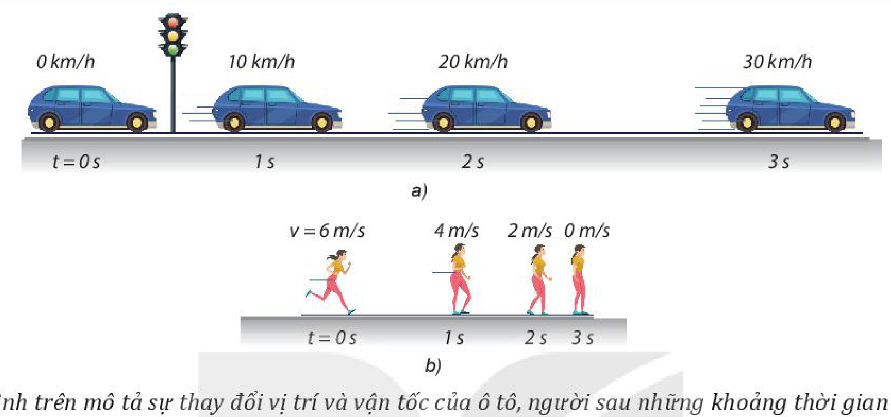
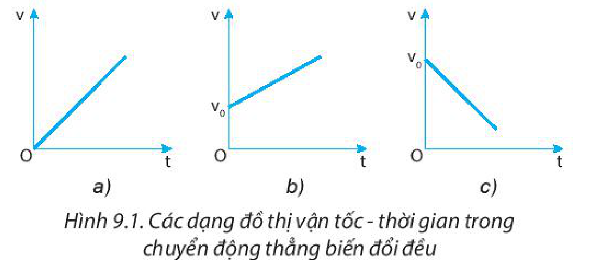
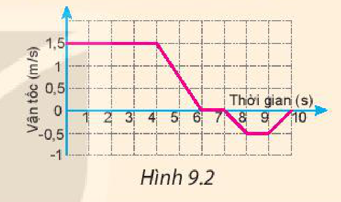
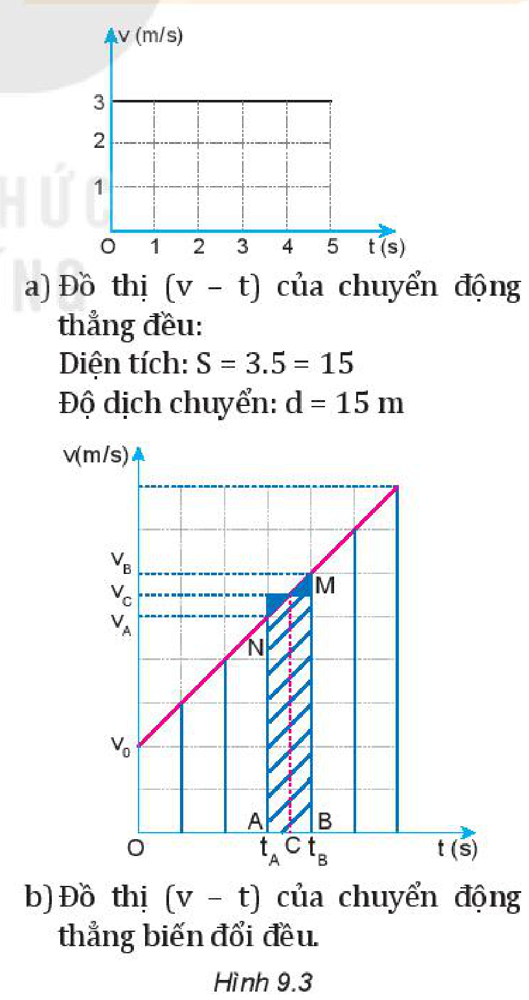
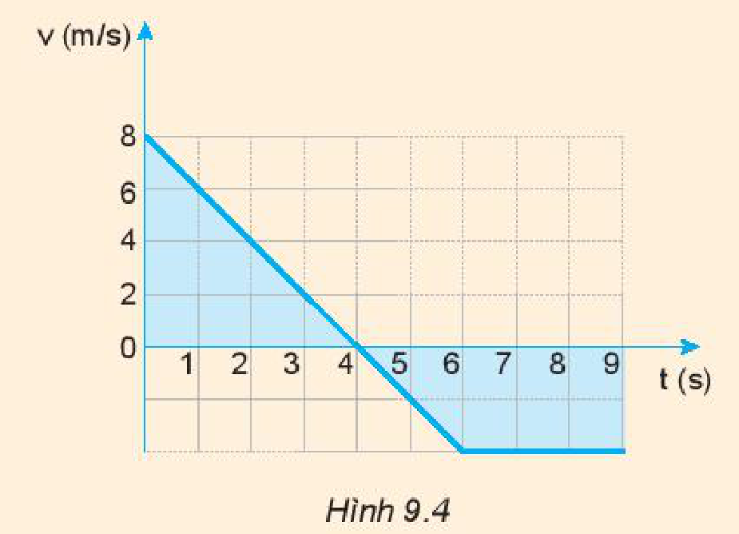
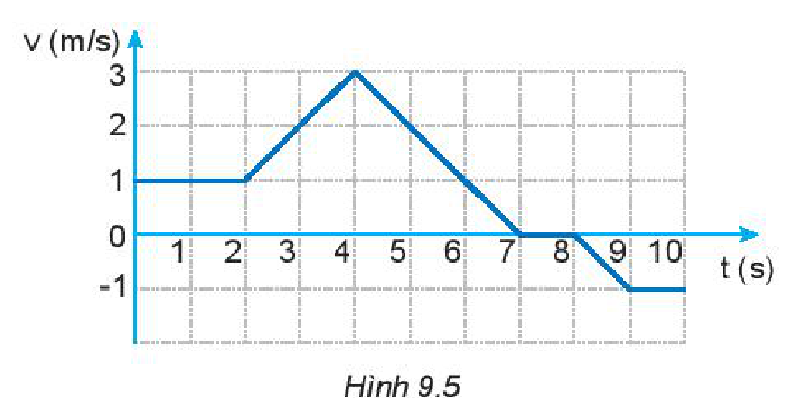

<!-- pdf:41 -->

# BÀI 9: CHUYỂN ĐỘNG THẲNG BIẾN ĐỔI ĐỀU

## 🔴 Mở đầu

> 
>
> Hình trên mô tả sự thay đổi vị trí và vận tốc của ô tô, người sau những khoảng thời gian bằng nhau. Hai chuyển động này có gì giống nhau, khác nhau?

## I. GIA TỐC CỦA CHUYỂN ĐỘNG THẲNG BIẾN ĐỔI ĐỀU

**Chuyển động thẳng biến đổi đều** là chuyển động thẳng mà vận tốc có độ lớn tăng hoặc giảm đều theo thời gian.

Chuyển động thẳng có độ lớn vận tốc tăng đều theo thời gian gọi là **chuyển động thẳng nhanh dần đều**; chuyển động thẳng có độ lớn vận tốc giảm đều theo thời gian gọi là **chuyển động thẳng chậm dần đều**.

Vì chuyển động thẳng biến đổi đều có vận tốc thay đổi đều theo thời gian nên gia tốc của chuyển động này không đổi theo thời gian:

$a = \frac{\Delta v}{\Delta t} = \text{hằng số} \quad (9.1)$

> **Câu hỏi:**
>
> 1. Tính gia tốc của các chuyển động trong hình vẽ ở đầu bài.
> 2. Các chuyển động trong hình vẽ ở đầu bài có phải là chuyển động thẳng biến đổi đều hay không?

## II. VẬN TỐC TỨC THỜI CỦA CHUYỂN ĐỘNG THẲNG BIẾN ĐỔI ĐỀU

Gọi $v_0$ là vận tốc tại thời điểm ban đầu $t_0$, $v_t$ là vận tốc tại thời điểm $t$.

Vì $a = \frac{\Delta v}{\Delta t} = \frac{v_t - v_0}{t - t_0} = \frac{v_t - v_0}{\Delta t}$ nên $v_t = v_0 + a \cdot \Delta t$.

Nếu ở thời điểm ban đầu $t_0 = 0$ thì:

$v_t = v_0 + a \cdot t \quad (9.2)$

Nếu ở thời điểm ban đầu $t_0 = 0$ vật mới bắt đầu chuyển động thì:

$v_0 = 0 \text{ và } v_t = a \cdot t \quad (9.3)$

<!-- pdf:42 -->

## III. ĐỒ THỊ VẬN TỐC – THỜI GIAN CỦA CHUYỂN ĐỘNG THẲNG BIẾN ĐỔI ĐỀU

Các công thức $(9.2)$ và $(9.3)$ cho thấy vận tốc tức thời $v$ trong chuyển động thẳng biến đổi đều là hàm bậc nhất của thời gian $t$, nên **đồ thị vận tốc – thời gian** của chuyển động này có các dạng như Hình 9.1.

> **Câu hỏi:**
>
> 1. Từ các đồ thị trong Hình 9.1:
>    a) Hãy viết công thức về mối liên hệ giữa $v$ với $a$ và $t$ của từng chuyển động ứng với từng đồ thị trong Hình 9.1.
>    b) Chuyển động nào là chuyển động nhanh dần đều, chậm dần đều?
> 2. Hình 9.2 là đồ thị vận tốc – thời gian trong chuyển động của một bạn đang đi trong siêu thị. Hãy dựa vào đồ thị để mô tả bằng lời chuyển động của bạn đó (khi nào đi đều, đi nhanh lên, đi chậm lại, nghỉ).
>
> 

## IV. ĐỘ DỊCH CHUYỂN CỦA CHUYỂN ĐỘNG THẲNG BIẾN ĐỔI ĐỀU

### 1. Tính độ dịch chuyển bằng đồ thị vận tốc – thời gian ($v - t$)

- Trong khoảng thời gian $t$, nếu vật chuyển động thẳng đều với vận tốc $v$, thì đồ thị ($v - t$) có dạng như Hình 9.3a và độ dịch chuyển trong thời gian này có độ lớn là: $d = v \cdot t$.

  Độ lớn này bằng diện tích của hình chữ nhật, các cạnh có độ dài là $v$ và $t$. Diện tích này gọi là diện tích giới hạn của đồ thị ($v - t$) đối với trục hoành.

- Trong thời gian $t$, nếu vật chuyển động thẳng biến đổi đều với vận tốc ban đầu $v_0$, thì công thức tính vận tốc là $v_t = v_0 + a \cdot t$, đồ thị ($v - t$) có dạng như Hình 9.3b. Có thể dựa vào đồ thị này để tính độ lớn độ dịch chuyển.

  Kẻ các đường song song với trục tung $\text{O}v$, cách nhau một khoảng $\Delta t$ rất nhỏ để chia hình thang giới hạn bởi đường biểu diễn đồ thị, đường thẳng vuông góc với trục $\text{O}t$ và các trục toạ độ thành các hình thang nhỏ có đường cao $\Delta t$.

  Chọn một hình thang nhỏ bất kì trong hình. Vì vật chuyển động thẳng biến đổi đều nên trong khoảng thời gian nhỏ từ $t_\text{A}$ đến $t_\text{B}$, có thể coi chuyển động của vật là thẳng đều với vận tốc $v_\text{C} = \frac{v_\text{A} + v_\text{B}}{2}$ ($\text{C}$ nằm giữa $\text{A}$ và $\text{B}$).

  Độ dịch chuyển của vật trong thời gian $\Delta t$ có độ lớn bằng diện tích hình chữ nhật có cạnh là $v_\text{C}$ và $\Delta t$.

<!-- pdf:43 -->

Hình vẽ cho thấy diện tích của hình này bằng diện tích của hình thang nhỏ gạch chéo trong hình có đường cao $\Delta t$ và các đáy có độ dài $v_\text{A}, v_\text{B}$. Độ lớn độ dịch chuyển trong thời gian $t$ bằng tổng các độ lớn của độ dịch chuyển trong các khoảng thời gian $\Delta t$, nên có độ lớn bằng diện tích của hình thang vuông có đường cao là $t$ và các đáy có độ lớn $v_0, v$.

> **Câu hỏi:**
>
> 1. Hãy tính độ dịch chuyển của chuyển động có đồ thị ($v - t$) vẽ ở Hình 9.3b. Biết mỗi cạnh của ô vuông nhỏ trên trục tung ứng với $2\text{ m/s}$, trên trục hoành ứng với $1\text{ s}$.
> 2. Chứng tỏ rằng có thể xác định được giá trị của gia tốc dựa trên đồ thị ($v - t$).

### 2. Tính độ dịch chuyển bằng công thức

> **Câu hỏi:**
>
> 1. Biết độ dịch chuyển trong chuyển động thẳng biến đổi đều có độ lớn bằng diện tích giới hạn bởi đồ thị ($v - t$), trong thời gian $t$ của chuyển động và các trục toạ độ. Hãy chứng minh rằng công thức tính độ lớn của độ dịch chuyển trong chuyển động thẳng biến đổi đều là:
>    $d = v_0 \cdot t + \frac{1}{2} \cdot a \cdot t^2 \quad (9.4)$
> 2. Từ công thức $(9.2)$ và $(9.4)$ chứng minh rằng:
>    $v_t^2 - v_0^2 = 2 \cdot a \cdot d \quad (9.5)$

> **Câu hỏi:**
>
> Hãy dùng đồ thị ($v - t$) vẽ ở Hình 9.4 để:
> a) Mô tả chuyển động;
> b) Tính độ dịch chuyển trong 4 giây đầu, 2 giây tiếp theo và 3 giây cuối;
> c) Tính gia tốc của chuyển động trong 4 giây đầu;
> d) Tính gia tốc của chuyển động từ giây thứ 4 đến giây thứ 6.
> Kiểm tra kết quả của câu b và câu c bằng cách dùng công thức.
>
> 

<!-- pdf:44 -->

*Bài tập vận dụng*

1. Đồ thị vận tốc – thời gian ở Hình 9.5 mô tả chuyển động của một chú chó con đang chạy trong một ngõ thẳng và hẹp.
   a) Hãy mô tả chuyển động của chú chó.
   b) Tính quãng đường đi được và độ dịch chuyển của chú chó sau: $2\text{ s}$; $4\text{ s}$; $7\text{ s}$ và $10\text{ s}$ bằng đồ thị và bằng công thức.

   

2. Một vận động viên đua xe đạp đường dài vượt qua vạch đích với tốc độ $10\text{ m/s}$. Sau đó vận động viên này đi chậm dần đều thêm $20\text{ m}$ mới dừng lại. Coi chuyển động của vận động viên là thẳng.
   a) Tính gia tốc của vận động viên trong đoạn đường sau khi qua vạch đích.
   b) Tính thời gian vận động viên đó cần để dừng lại kể từ khi cán đích.
   c) Tính vận tốc trung bình của người đó trên quãng đường dừng xe.

## 📌 Em đã học

- Chuyển động thẳng biến đổi đều là chuyển động thẳng có gia tốc không đổi theo thời gian.
- Chuyển động thẳng nhanh dần đều có $(a \cdot v) > 0$, chuyển động thẳng chậm dần đều có $(a \cdot v) < 0$.
- Hệ số góc của đồ thị vận tốc – thời gian của chuyển động thẳng biến đổi đều cho biết giá trị của gia tốc.
- Các công thức của chuyển động thẳng biến đổi đều:
  1. $v_t = v_0 + a \cdot t$
  2. $d = v_0 \cdot t + \frac{1}{2} \cdot a \cdot t^2$
  3. $v_t^2 - v_0^2 = 2 \cdot a \cdot d$

## ✏️ Em có thể

Từ đồ thị vận tốc – thời gian của chuyển động thẳng biến đổi đều mô tả được chuyển động này.

## 📷 Danh sách hình trong bài

| Mã hình | Số hình SGK | Trang PDF | Chú thích |
| --- | --- | --- | --- |
| H10-vat_ly-b09-01 | — | 41 | Hình mở đầu: Sự thay đổi vị trí và vận tốc của ô tô, người sau những khoảng thời gian bằng nhau |
| H10-vat_ly-b09-02 | Hình 9.1 | 42 | Các dạng đồ thị vận tốc – thời gian trong chuyển động thẳng biến đổi đều |
| H10-vat_ly-b09-03 | Hình 9.2 | 42 | Đồ thị vận tốc – thời gian của một bạn đang đi trong siêu thị |
| H10-vat_ly-b09-04 | Hình 9.3 | 42 | Đồ thị ($v - t$) của chuyển động thẳng đều và chuyển động thẳng biến đổi đều |
| H10-vat_ly-b09-05 | Hình 9.4 | 43 | Đồ thị ($v - t$) của một chuyển động thẳng biến đổi đều |
| H10-vat_ly-b09-06 | Hình 9.5 | 44 | Đồ thị vận tốc – thời gian của một chú chó con |
