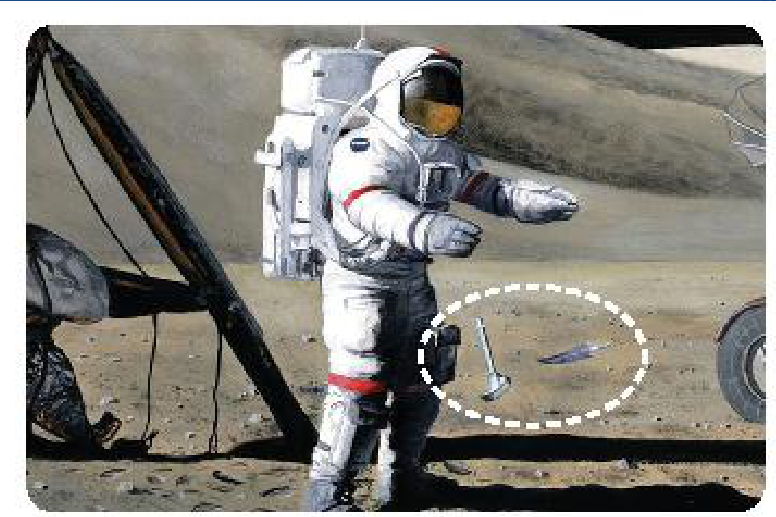
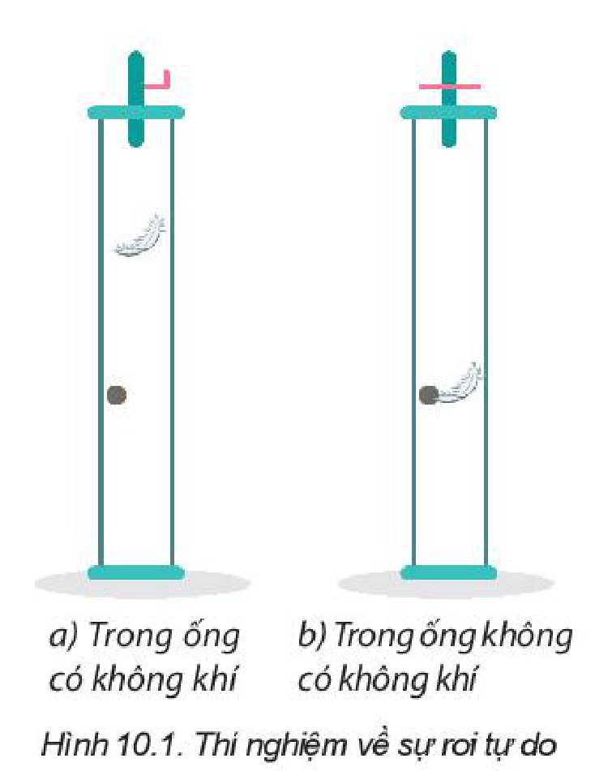
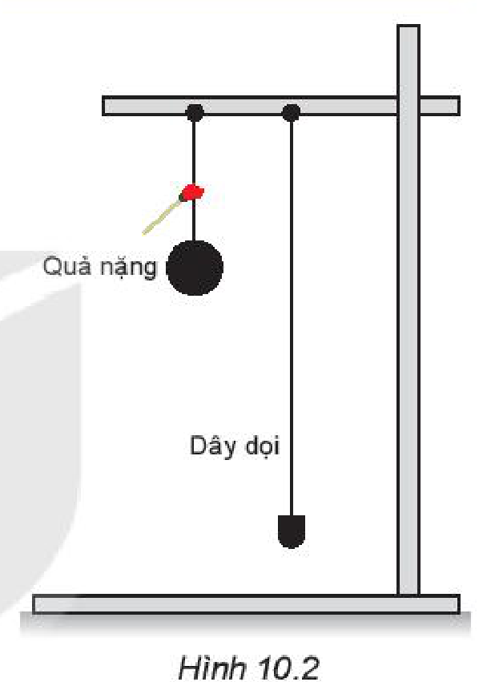
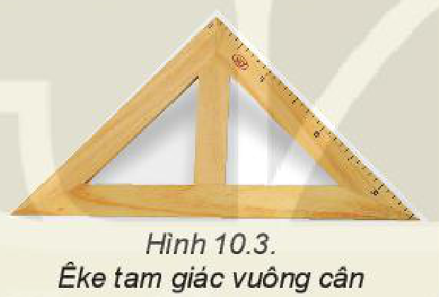

<!-- pdf:45 -->

# BÀI 10: SỰ RƠI TỰ DO

## 🔴 Mở đầu

> Năm 1971, nhà du hành vũ trụ người Mỹ David Scott đã đồng thời thả rơi trên Mặt Trăng một chiếc lông chim và một chiếc búa ở cùng một độ cao và nhận thấy cả hai đều rơi xuống như nhau. Em có suy nghĩ gì về hiện tượng này?
>
> 

## I. SỰ RƠI TRONG KHÔNG KHÍ

Sự rơi của các vật trong không khí là chuyển động thường gặp. Ai cũng thấy hòn đá rơi nhanh hơn viên phấn, viên phấn rơi nhanh hơn chiếc lông chim. Nhiều người dự đoán rằng, rơi nhanh hay chậm là do vật nặng hay nhẹ. Em có đồng ý với dự đoán đó không? Em có dự đoán nào về nguyên nhân làm cho các vật rơi nhanh chậm khác nhau không?

> **Hoạt động:**
>
> Các thí nghiệm (TN) sau đây sẽ giúp chúng ta kiểm tra dự đoán của mình về sự rơi của các vật từ cùng độ cao trong không khí.
>
> TN 1: Thả rơi một viên bi và một chiếc lá.
>
> TN 2: Thả hai tờ giấy giống nhau, nhưng một tờ được vo tròn, một tờ để nguyên.
>
> TN 3: Thả rơi hai viên bi có cùng kích thước, một bằng sắt và một bằng thuỷ tinh.
>
> Từ những thí nghiệm trên, rút ra nhận xét về sự rơi trong không khí.

> **Câu hỏi:**
>
> 1. Trong TN 1, tại sao quả bóng rơi nhanh hơn chiếc lá?
> 2. Trong TN 2, hai tờ giấy giống nhau, nặng như nhau, tại sao tờ giấy vo tròn lại rơi nhanh hơn?
> 3. Trong TN 3, trọng lượng bi sắt lớn hơn bi thuỷ tinh, tại sao hai viên bi rơi nhanh như nhau?

Các thí nghiệm trên cho thấy sự rơi nhanh hay chậm của vật phụ thuộc vào độ lớn của lực cản không khí tác dụng lên vật. Lực cản càng nhỏ so với trọng lực tác dụng lên vật thì vật sẽ rơi càng nhanh và ngược lại.

> **Câu hỏi:** Theo em nếu loại bỏ được sức cản của không khí, các vật sẽ rơi như thế nào?

Câu hỏi này đã được nhà bác học Newton trả lời bằng kết quả thí nghiệm với các ống hút chân không (Hình 10.1): Hai vật rơi là viên bi chì và chiếc lông chim. Kết quả cho thấy trong chân không mọi vật rơi nhanh như nhau.

<!-- pdf:46 -->

## II. SỰ RƠI TỰ DO

### 1. Sự rơi tự do

**Sự rơi tự do** là sự rơi chỉ dưới tác dụng của trọng lực.
Nếu vật rơi trong không khí mà độ lớn của lực cản không khí không đáng kể so với trọng lượng của vật thì cũng coi là rơi tự do.

> **Câu hỏi:**
>
> Trong các chuyển động sau, chuyển động nào được coi là rơi tự do? Tại sao?
> A. Chiếc lá đang rơi.
> B. Hạt bụi chuyển động trong không khí.
> C. Quả tạ rơi trong không khí.
> D. Vận động viên đang nhảy dù.

### 2. Đặc điểm của chuyển động rơi tự do

**a) Phương và chiều của chuyển động rơi tự do**

Vì trọng lực có phương thẳng đứng, chiều từ trên xuống nên có thể dự đoán sự rơi chỉ dưới tác dụng của trọng lực cũng có phương thẳng đứng, chiều từ trên xuống.

> **Hoạt động:**
>
> 1. Hãy thực hiện thí nghiệm (Hình 10.2) để kiểm tra dự đoán về phương và chiều của sự rơi tự do.
> 2. Dựa vào đặc điểm về phương của sự rơi tự do, hãy tìm cách kiểm tra bề mặt của bức tường trong lớp học có phải là mặt phẳng thẳng đứng không.
> 3. Hãy nghĩ cách dùng êke tam giác vuông cân và dây dọi để kiểm tra xem sàn lớp mình có phẳng hay không.
>
> 

**b) Tính chất của chuyển động rơi tự do**

Quan sát sự rơi tự do ta thấy đó là chuyển động thẳng nhanh dần. Tuy nhiên, để biết sự rơi tự do có phải là chuyển động thẳng nhanh dần đều hay không thì phải dựa vào thí nghiệm. Vì vật rơi tự do rất nhanh nên người ta thường dùng **phương pháp chụp ảnh hoạt nghiệm** (dùng máy ảnh đặc biệt chụp liên tiếp vật chuyển động sau những khoảng thời gian bằng nhau) để có thể đo quãng đường rơi được sau những khoảng thời gian bằng nhau.

Bảng 10.1 ghi kết quả chụp ảnh hoạt nghiệm trong phòng thí nghiệm của một trường phổ thông về sự rơi của một hòn bi thép sau những khoảng thời gian $0,1\text{ s}$.

Trong bài chuyển động biến đổi đều ta đã biết:

Một vật chuyển động thẳng nhanh dần đều không vận tốc ban đầu thì quãng đường đi được $s$ tỉ lệ với bình phương thời gian $t$:

$s = \frac{1}{2} \cdot a \cdot t^2$

*Bảng 10.1. Quãng đường vật rơi tự do theo thời gian từ kết quả chụp ảnh hoạt nghiệm*

| Thời gian rơi (s) | Quãng đường rơi (m) |
| --- | --- |
| $0,1$ | $0,049$ |
| $0,2$ | $0,197$ |
| $0,3$ | $0,441$ |
| $0,4$ | $0,785$ |
| $0,5$ | $1,227$ |

> **Câu hỏi:**
>
> Hãy căn cứ vào số liệu trong Bảng 10.1 để:
> 1. Chứng tỏ chuyển động rơi tự do là nhanh dần đều.
> 2. Tính gia tốc của chuyển động rơi tự do.

<!-- pdf:47 -->

**c) Gia tốc rơi tự do**

Ở cùng một nơi trên Trái Đất, mọi vật rơi tự do với cùng một gia tốc.

**Gia tốc rơi tự do** kí hiệu là $g$, giá trị của $g$ phụ thuộc vào vĩ độ địa lí và độ cao. Ở gần bề mặt Trái Đất người ta thường lấy giá trị của $g$ bằng $9,8\text{ m/s}^2$.

### 3. Công thức rơi tự do

Rơi tự do có các công thức của chuyển động nhanh dần đều không vận tốc ban đầu. Chọn thời điểm ban đầu $t_0 = 0$.

Độ dịch chuyển, quãng đường đi được tại thời điểm $t$:

$d = s = \frac{1}{2} \cdot g \cdot t^2$

Vận tốc tức thời tại thời điểm $t$: $v_t = g \cdot t$.

Liên hệ giữa vận tốc và quãng đường đi được với gia tốc: $v_t^2 = 2 \cdot g \cdot s$.

> **Câu hỏi:**
>
> 1. Tại sao độ dịch chuyển và quãng đường đi được trong sự rơi tự do có cùng độ lớn?
> 2. Hãy nêu cách đo gần đúng độ sâu của một cái giếng mỏ cạn. Coi vận tốc truyền âm trong không khí là không đổi và đã biết.

*Bài tập vận dụng:* Một người thả một hòn bi từ trên cao xuống đất và đo được thời gian rơi là $3,1\text{ s}$. Bỏ qua sức cản không khí. Lấy $g = 9,8\text{ m/s}^2$.
a) Tính độ cao của nơi thả hòn bi so với mặt đất và vận tốc lúc chạm đất.
b) Tính quãng đường rơi được trong $0,5\text{ s}$ cuối trước khi chạm đất.

## 📌 Em đã học

- Chuyển động rơi chỉ chịu tác dụng của trọng lực gọi là rơi tự do.
- Chuyển động rơi tự do là chuyển động thẳng nhanh dần đều theo phương thẳng đứng, chiều từ trên xuống.
- Tại một nơi nhất định trên Trái Đất và ở gần mặt đất, mọi vật đều rơi tự do với cùng gia tốc $g$. Gia tốc rơi tự do ở các nơi khác nhau trên Trái Đất thì khác nhau.
- Các công thức của sự rơi tự do:
  Gia tốc $a = g = \text{hằng số}$.
  Vận tốc tức thời: $v_t = g \cdot t$.
  Độ lớn của độ dịch chuyển $=$ Quãng đường đi được: $d = s = \frac{1}{2} \cdot g \cdot t^2 = \frac{v_t^2}{2 \cdot g}$.

## ✏️ Em có thể

- Vận dụng được những kiến thức về sự rơi tự do vào một số tình huống thực tế đơn giản.
- Biết cách xác định phương thẳng đứng và phương nằm ngang.

## 📷 Danh sách hình trong bài

| Mã hình | Số hình SGK | Trang PDF | Chú thích |
| --- | --- | --- | --- |
| H10-vat_ly-b10-01 | — | 45 | Hình mở đầu: Nhà du hành vũ trụ David Scott thả rơi chiếc lông chim và chiếc búa trên Mặt Trăng |
| H10-vat_ly-b10-02 | Hình 10.1 | 45 | Thí nghiệm về sự rơi tự do |
| H10-vat_ly-b10-03 | Hình 10.2 | 46 | Thí nghiệm kiểm tra phương và chiều của sự rơi tự do bằng quả nặng và dây dọi |
| H10-vat_ly-b10-04 | Hình 10.3 | 46 | Êke tam giác vuông cân |
