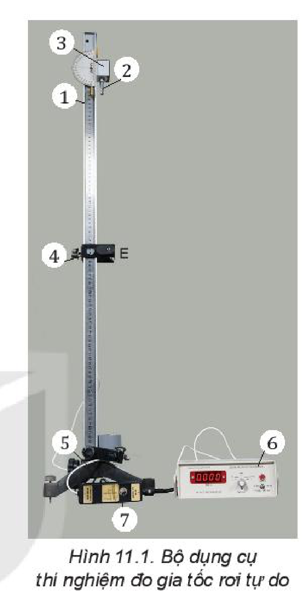
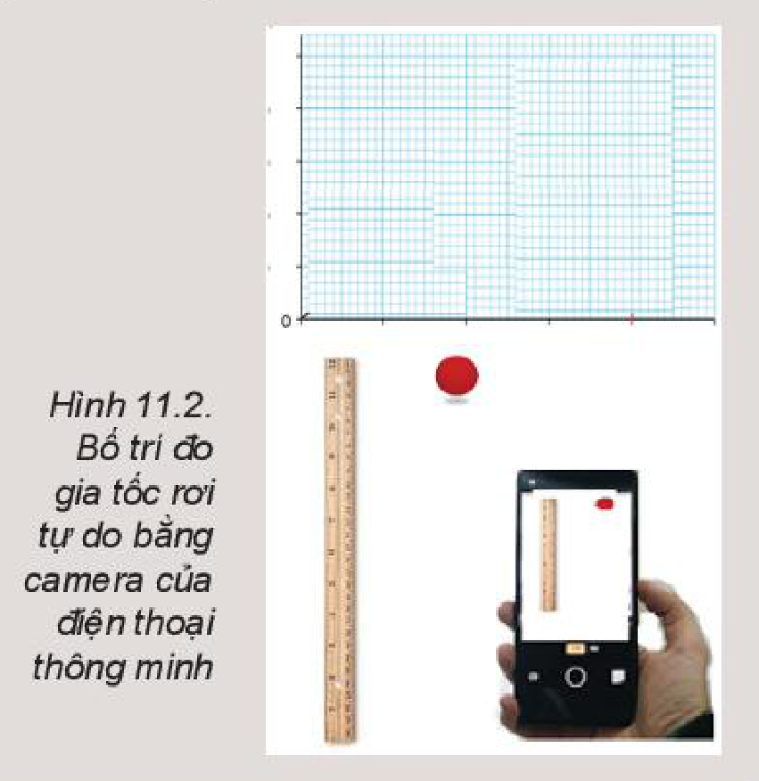

<!-- pdf:48 -->

# BÀI 11: THỰC HÀNH: ĐO GIA TỐC RƠI TỰ DO

## 🔴 Mở đầu

> Các vật rơi tự do chuyển động rất nhanh, làm thế nào đo được gia tốc rơi tự do của vật?

## I. DỤNG CỤ THÍ NGHIỆM

- Máng đứng, có gắn dây dọi (1).
- Vật bằng thép hình trụ (2).
- Nam châm điện N, dùng giữ và thả trụ thép (3).
- Cổng quang điện E (4).
- Giá đỡ có đế ba chân, có vít chỉnh cân bằng và trụ thép (5).
- Đồng hồ đo thời gian hiện số (6).
- Công tắc kép (7).

## II. THIẾT KẾ PHƯƠNG ÁN THÍ NGHIỆM

> **Hoạt động:**
>
> Thảo luận về phương án thí nghiệm dựa trên hoạt động sau: Thả trụ thép rơi qua cổng quang điện trên máng đứng và trả lời câu hỏi.
> 1. Xác định gia tốc rơi tự do của trụ thép theo công thức nào?
> 2. Để xác định gia tốc rơi tự do của trụ thép cần đo các đại lượng nào?
> 3. Làm thế nào để trụ thép rơi qua cổng quang điện?
> 4. Cần đặt chế độ đo của đồng hồ ở vị trí nào để đo được đại lượng cần đo?

> **Lưu ý:** Để thả rơi trụ thép theo máng đứng có thể thực hiện như sau:
> - Đặt máng đứng lên giá đỡ. Vặn chặt vít hãm.
> - Nối công tắc điện với nam châm điện và nối công tắc vào ổ cắm A, nối cổng quang điện ổ cắm B ở mặt sau của đồng hồ đo thời gian.
> - Cắm nguồn điện của đồng hồ và bật công tắc nguồn. Đặt trụ thép tại vị trí tiếp xúc với nam châm điện N và bị giữ lại ở đó.
> - Nhấn nút của hộp công tắc kép để ngắt điện vào nam châm điện.

## III. TIẾN HÀNH THÍ NGHIỆM

1. Cắm nam châm điện vào ổ A và cổng quang vào ổ B ở mặt sau của đồng hồ đo thời gian hiện số. (xem Hình 6.2)
2. Đặt MODE đồng hồ đo thời gian hiện số ở chế độ thích hợp.
3. Đặt trụ thép tại vị trí tiếp xúc với nam châm điện N và bị giữ lại ở đó.
4. Nhấn nút RESET của đồng hồ MC964 để chuyển các số hiển thị về giá trị ban đầu $0.000$.
5. Nhấn nút của hộp công tắc kép để ngắt điện vào nam châm điện: Trụ thép rơi xuống và chuyển động đi qua cổng quang điện.
6. Ghi lại các giá trị thời gian hiển thị trên đồng hồ vào Bảng 11.1.
7. Dịch chuyển cổng quang điện ra xa dần nam châm điện, thực hiện lại các thao tác 3, 4, 5, 6 bốn lần nữa. Ghi các giá trị thời gian $t$ tương ứng với quãng đường $s$ vào Bảng 11.1 trong báo cáo thực hành.

<!-- pdf:49 -->

## IV. KẾT QUẢ THÍ NGHIỆM

*Bảng 11.1*

| Quãng đường | Lần 1 | Lần 2 | Lần 3 | Lần 4 | Lần 5 |
| --- | --- | --- | --- | --- | --- |
| $s_1$ | | | | | |
| $s_2$ | | | | | |
| $s_3$ | | | | | |
| $s_4$ | | | | | |
| $s_5$ | | | | | |
<!-- ocr-ok: đối chiếu ảnh trang PDF 49 khớp nguyên văn -->

$\overline{g} = \text{... ;} \qquad \Delta g = \text{... ;} \qquad g = \text{...}$

> **Hoạt động:**
>
> **Nhận xét và đánh giá kết quả thí nghiệm**
> 1. Hãy tính giá trị trung bình và sai số tuyệt đối của phép đo gia tốc rơi tự do.
> 2. Tại sao lại dùng trụ thép làm vật rơi trong thí nghiệm? Có thể dùng viên bi thép được không? Giải thích tại sao.
> 3. Vẽ đồ thị mô tả mối quan hệ $s$ và $t^2$ trên hệ toạ độ ($s - t^2$).
> 4. Nhận xét chung về dạng của đồ thị mô tả mối quan hệ $s$ và $t^2$ rồi rút ra kết luận về tính chất của chuyển động rơi tự do.
> 5. Hãy đề xuất một phương án thí nghiệm khác để đo gia tốc rơi tự do của trụ thép.

## 📌 Em đã học

- Rơi tự do là chuyển động thẳng, nhanh dần đều nên có thể xác định gia tốc rơi tự do theo công thức xác định gia tốc của chuyển động nhanh dần đều.
- Sử dụng đồng hồ đo thời gian hiện số và cổng quang đo gia tốc rơi tự do của viên bi thép hoặc trụ thép.

## ✏️ Em có thể

Sử dụng camera của điện thoại thông minh và phần mềm phân tích video để xác định được gia tốc rơi tự do của vật (Hình 11.2).

> **Em có biết:**
>
> Vào năm 1602, Galilei phát hiện ra chuyển động của con lắc và khoảng thời gian một chu kì tỉ lệ với căn bậc hai chiều dài con lắc. Nhờ phát hiện này có thể đo gia tốc rơi tự do bằng **con lắc đơn**.

## 📷 Danh sách hình trong bài

| Mã hình | Số hình SGK | Trang PDF | Chú thích |
| --- | --- | --- | --- |
| H10-vat_ly-b11-01 | Hình 11.1 | 48 | Bộ dụng cụ thí nghiệm đo gia tốc rơi tự do |
| H10-vat_ly-b11-02 | Hình 11.2 | 49 | Bố trí đo gia tốc rơi tự do bằng camera của điện thoại thông minh |
