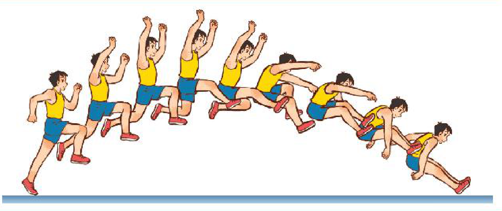
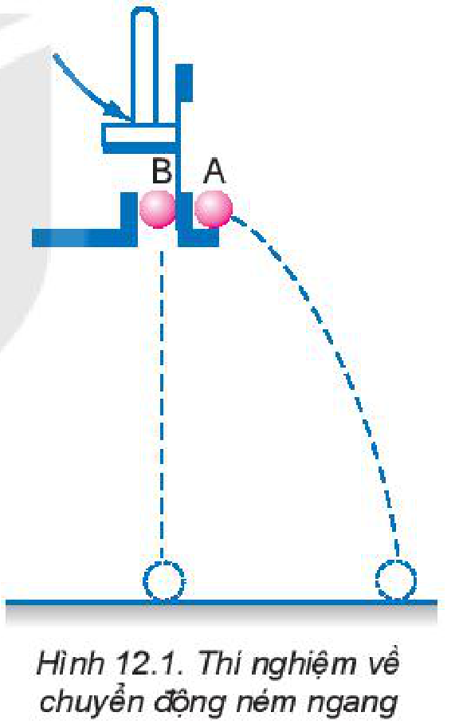
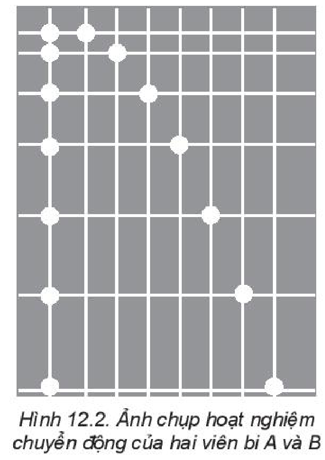
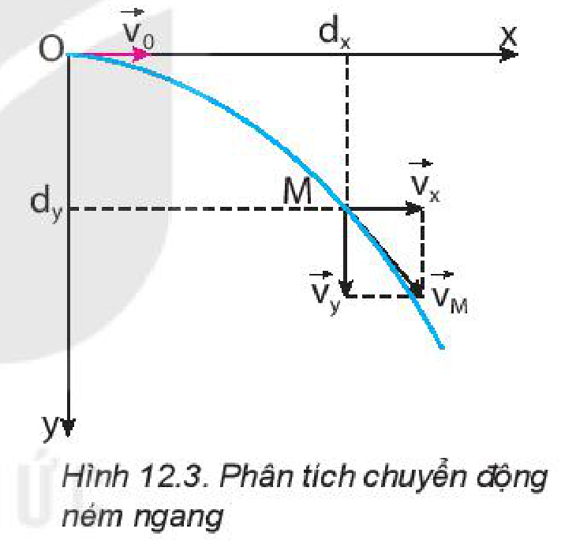
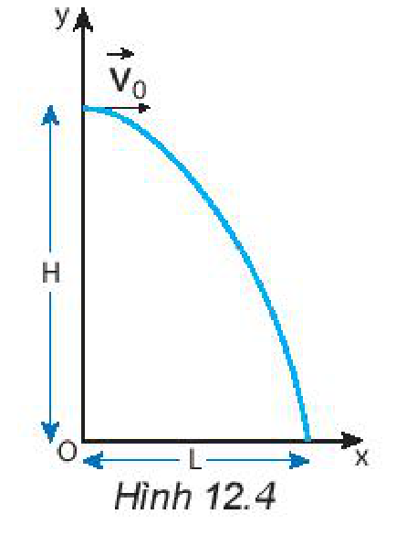
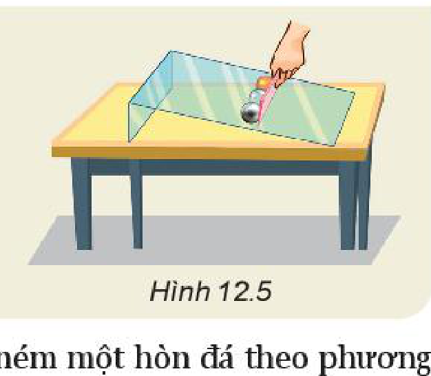
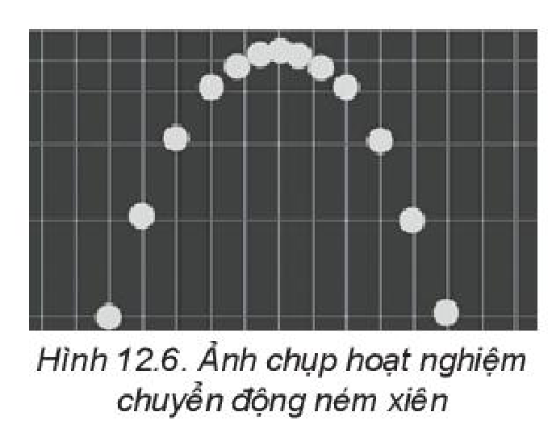
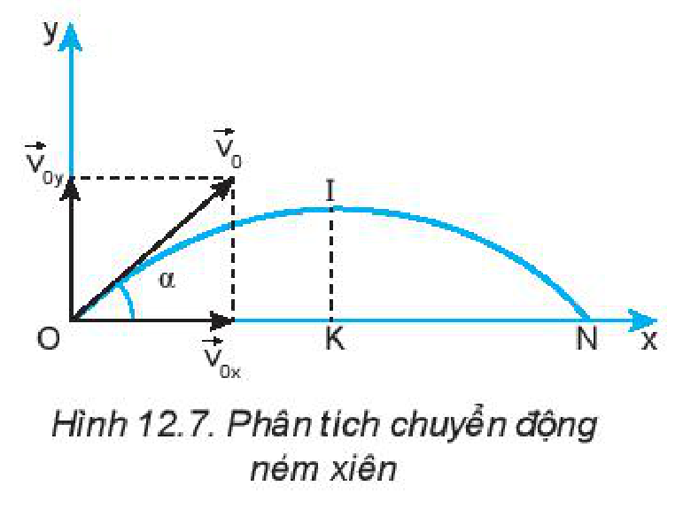
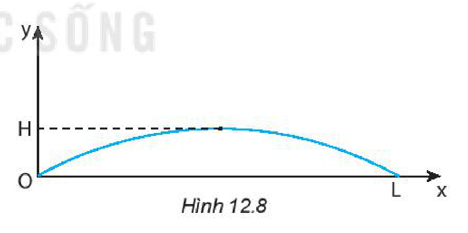

<!-- pdf:50 -->

# BÀI 12: CHUYỂN ĐỘNG NÉM

## 🔴 Mở đầu

> Nhảy xa là một ví dụ về chuyển động ném. Theo em, trong việc nhảy xa thì những yếu tố nào có tính quyết định đến thành tích nhảy của vận động viên?
>
> 

## I. CHUYỂN ĐỘNG NÉM NGANG

### 1. Khái niệm chuyển động ném ngang

**Chuyển động ném ngang** là chuyển động có vận tốc ban đầu theo phương nằm ngang và chuyển động dưới tác dụng của trọng lực.

### 2. Thí nghiệm

Thí nghiệm mô tả ở Hình 12.1 dùng để tìm hiểu chuyển động của vật bị ném theo phương nằm ngang.

Dùng búa đập nhẹ vào thanh thép giữ bi B, thanh thép chuyển động thả bi B rơi tự do đồng thời đẩy bi A theo phương nằm ngang khỏi giá đỡ với vận tốc $v_0$.

> **Câu hỏi:** Hai viên bi có chạm đất cùng một lúc không?

Việc phân tích ảnh chụp hoạt nghiệm thí nghiệm trên (Hình 12.2) giúp ta so sánh chuyển động rơi tự do của bi B (sự thay đổi vị trí của bi B theo phương thẳng đứng) với vận tốc ban đầu $v_{0y} = 0$ với sự thay đổi vị trí theo phương thẳng đứng của viên bi A bị ném ngang với vận tốc ban đầu theo phương nằm ngang $v_{0x} = v_0$.

> **Câu hỏi:** Hãy nhận xét về sự thay đổi vị trí theo phương thẳng đứng của hai viên bi sau những khoảng thời gian bằng nhau.

<!-- pdf:51 -->

### 3. Phân tích kết quả thí nghiệm

Đối với chuyển động ném ngang, người ta quan tâm tới thời gian từ khi vật được ném tới khi vật rơi chạm đất và tầm bay xa của vật theo phương nằm ngang. Để xác định các đại lượng này, người ta phân tích chuyển động của vật bị ném ngang thành hai chuyển động thành phần: chuyển động thành phần theo phương thẳng đứng và chuyển động thành phần theo phương nằm ngang.

Thí nghiệm trên cho thấy thành phần chuyển động theo phương thẳng đứng của viên bi A giống chuyển động rơi của viên bi B. Điều đó chứng tỏ thành phần chuyển động theo phương nằm ngang của viên bi A không ảnh hưởng đến thành phần chuyển động theo phương thẳng đứng của nó: Hai chuyển động thành phần này độc lập với nhau.

**a) Thành phần chuyển động theo phương thẳng đứng**

Nếu bỏ qua sức cản của không khí thì chuyển động thành phần theo phương thẳng đứng của vật là chuyển động rơi tự do với vận tốc ban đầu bằng $0$.

Nếu chọn chiều dương là chiều từ trên xuống và gọi $H$ là độ cao của vật khi bị ném ngang thì:

$H = \frac{1}{2} \cdot g \cdot t^2 \Rightarrow t = \sqrt{\frac{2 \cdot H}{g}} \quad (12.1)$

Công thức $(12.1)$ cho thấy:

- Thời gian rơi của vật bị ném ngang chỉ phụ thuộc độ cao $H$ của vật khi bị ném, không phụ thuộc vận tốc ném.
- Nếu từ cùng một độ cao, đồng thời ném ngang các vật khác nhau với các vận tốc khác nhau thì chúng đều rơi xuống đất cùng một lúc.

**b) Thành phần chuyển động theo phương nằm ngang**

Nếu chọn chiều dương là chiều ném viên bi thì độ dịch chuyển trong chuyển động thành phần nằm ngang là:

$d_x = v_x \cdot t = v_0 \cdot t.$

> **Câu hỏi:** Hãy quan sát ảnh hoạt nghiệm ở Hình 12.2 để chứng tỏ chuyển động thành phần theo phương nằm ngang là chuyển động thẳng đều với vận tốc $v_x = v_0$.

Giá trị cực đại của độ dịch chuyển trong chuyển động thành phần nằm ngang được gọi là **tầm xa** $L$ của chuyển động ném ngang (Hình 12.4):

$L = d_{x\max} = v_0 \cdot t_{\max}\text{, với } t_{\max} \text{ là thời gian rơi của vật.}$

Do đó: $L = v_0 \sqrt{\frac{2 \cdot H}{g}} \quad (12.2)$

Công thức $(12.2)$ cho thấy:

1. Tầm xa của vật bị ném ngang phụ thuộc vào độ cao $H$ của vật khi bị ném và vận tốc ném. Nếu từ cùng một độ cao đồng thời ném các vật khác nhau với vận tốc khác nhau thì vật nào có vận tốc ném lớn hơn sẽ có tầm xa lớn hơn.
2. Nếu từ các độ cao khác nhau ném ngang các vật với cùng vận tốc thì vật nào được ném ở độ cao lớn hơn sẽ có tầm xa lớn hơn.

<!-- pdf:52 -->

> **Hoạt động:**
>
> 1. Hãy đề xuất phương án thí nghiệm để kiểm tra những kết luận 1 và 2.
> 2. Dùng thước kẻ giữ ba viên bi (sắt, thuỷ tinh và gỗ) có cùng kích thước, trên một tấm thuỷ tinh đặt nghiêng trên mặt bàn rồi nâng thước lên (Hình 12.5). Hãy dự đoán tầm xa của ba viên bi và làm thí nghiệm kiểm tra.
>
> 

*Bài tập ví dụ:* Một người đứng từ một đài quan sát ven biển, ném một hòn đá theo phương nằm ngang hướng ra biển với vận tốc $12\text{ m/s}$. Biết độ cao từ vị trí ném so với mặt biển là $40\text{ m}$. Bỏ qua sức cản của không khí.
a) Sau bao lâu thì hòn đá chạm mặt biển?
b) Tầm xa $L$ của hòn đá là bao nhiêu mét?

*Giải*

$v_{0y} = 0$; $v_{0x} = v = 12\text{ m/s}$; $H = 40\text{ m}$; $g = 9,8\text{ m/s}^2$; a) $t = ?$; b) $L = ?$

a) $H = d_y = \frac{1}{2} \cdot g \cdot t^2$

Do đó: $t = \sqrt{\frac{2 \cdot H}{g}} = 2,86\text{ s}$.

b) $L = d_{x\max} = v \cdot t = 34,3\text{ m}$.

> **Câu hỏi:**
>
> 1. Nếu đồng thời ném hai quả bóng giống nhau với những vận tốc bằng nhau theo phương nằm ngang từ hai độ cao $h_1, h_2$ khác nhau ($h_1 < h_2$) thì:
>    a) Quả bóng ném ở độ cao nào chạm đất trước?
>    b) Quả bóng ném ở độ cao nào có tầm xa lớn hơn?
> 2. Một máy bay chở hàng đang bay ngang ở độ cao $490\text{ m}$ với vận tốc $100\text{ m/s}$ thì thả một gói hàng cứu trợ xuống một làng đang bị lũ lụt. Lấy $g = 9,8\text{ m/s}^2$ và bỏ qua sức cản của không khí.
>    a) Sau bao lâu thì gói hàng chạm đất?
>    b) Tầm xa của gói hàng là bao nhiêu?
>    c) Xác định vận tốc của gói hàng khi chạm đất.

## II. CHUYỂN ĐỘNG NÉM XIÊN

Khi đánh một quả bóng tennis lên cao theo phương xiên góc với phương nằm ngang, người ta thấy quả bóng bay lên rồi rơi xuống theo một quỹ đạo có dạng hình parabol (Hình 12.6). Chuyển động của quả bóng trong trường hợp này gọi là chuyển động của vật bị ném xiên, gọi tắt là **chuyển động ném xiên**.

> **Câu hỏi:** Hãy tìm thêm ví dụ về chuyển động ném xiên trong đời sống.

<!-- pdf:53 -->

### 1. Phân tích chuyển động ném xiên

Đối với chuyển động ném xiên, người ta cũng quan tâm đến thời gian từ khi vật được ném lên tới khi vật rơi chạm đất và tầm xa của vật theo phương nằm ngang. Để xác định các đại lượng này người ta cũng thực hiện như đã làm với chuyển động ném ngang, phân tích chuyển động ném xiên thành hai chuyển động thành phần: chuyển động thành phần theo phương thẳng đứng và chuyển động thành phần theo phương nằm ngang (Hình 12.7).

### 2. Công thức xác định tầm cao và tầm xa của chuyển động ném xiên

Bằng cách làm tương tự như cách làm đối với chuyển động ném ngang. Bỏ qua sức cản của không khí, có thể thiết lập được công thức xác định tầm cao và tầm xa của chuyển động ném xiên:
**Tầm cao**: $H = d_{y\max} = \frac{v_0^2 \cdot \sin^2\alpha}{2 \cdot g}$.

Tầm xa: $L = d_{x\max} = \frac{v_0^2 \cdot \sin 2\alpha}{g}$.

*Bài tập ví dụ:* Một người nhảy xa với vận tốc ban đầu $7,5\text{ m/s}$ theo phương xiên $30^\circ$ với phương nằm ngang. Biết vị trí dậm nhảy ngang với hố nhảy. Bỏ qua sức cản của không khí và lấy $g = 9,8\text{ m/s}^2$. Tính:
a) Vận tốc ban đầu của người nhảy theo phương thẳng đứng và theo phương nằm ngang.
b) Tầm cao $H$.
c) Thời gian từ khi bắt đầu nhảy tới khi đạt tầm cao.
d) Thời gian từ lúc bắt đầu nhảy lên tới lúc rơi xuống hố nhảy.
e) Tầm xa $L$.

*Giải*

Chọn hệ toạ độ $\text{O}xy$ với $\text{O}$ là vị trí trên mặt đất mà người đó đặt chân vào để nhảy lên, chiều dương là chiều từ dưới lên ($\text{O}y$) và chiều từ trái sang phải ($\text{O}x$), gốc thời gian là thời điểm nhảy (Hình 12.8).

a) Vận tốc ban đầu:
$v_{0y} = v_0 \cdot \sin 30^\circ = 3,75\text{ m/s}$ (từ dưới lên)
$v_{0x} = v_0 \cdot \cos 30^\circ = 6,50\text{ m/s}$ (trái sang phải)

b) Khi đạt tầm cao $H$ thì vận tốc của người nhảy theo phương thẳng đứng bằng $0$:
$v_y = 0$; $v_{0y} = 3,75\text{ m/s}$; $a = -g$; $H = ?$

$v_y^2 - v_{0y}^2 = 2 \cdot a \cdot H = -2 \cdot g \cdot H$

$H = \frac{v_{0y}^2}{2 \cdot g} = 0,717\text{ m}$

c) Thời gian từ lúc bắt đầu nhảy tới khi đạt tầm cao:

$v_y = v_{0y} - g \cdot t \Rightarrow t = \frac{3,75}{9,8} = 0,383\text{ s}$

<!-- pdf:54 -->

d) Thời gian từ lúc bắt đầu nhảy lên tới lúc rơi xuống hố nhảy:

$t' = 2 \cdot t = 2 \cdot 0,383 = 0,766\text{ s}$

e) Tầm xa:
$v_{0x} = 6,5\text{ m/s}$; $t' = 0,766\text{ s}$; $L = ?$

$L = d_{x\max} = v_{0x} \cdot t' = 4,98\text{ m}.$

> **Câu hỏi:**
>
> Người ta bắn một viên bi với vận tốc ban đầu $4\text{ m/s}$ hướng lên theo phương xiên $45^\circ$ so với phương nằm ngang. Coi sức cản của không khí là không đáng kể.
> 1. Tính vận tốc của viên bi theo phương nằm ngang và phương thẳng đứng tại các thời điểm: bắt đầu bắn, sau $0,1\text{ s}$ và sau $0,2\text{ s}$.
> 2. a) Viên bi đạt tầm cao $H$ vào lúc nào?
>    b) Tính tầm cao $H$.
>    c) Gia tốc của viên bi ở tầm cao $H$ có giá trị bằng bao nhiêu?
> 3. a) Vận tốc của viên bi có độ lớn cực tiểu ở vị trí nào?
>    b) Viên bi có vận tốc cực tiểu vào thời điểm nào?
> 4. a) Khi nào viên bi chạm sàn?
>    b) Xác định vận tốc của viên bi khi chạm sàn.
>    c) Xác định tầm xa $L$ của viên bi.

## 📌 Em đã học

- Chuyển động ném có thể phân tích thành hai chuyển động thành phần vuông góc với nhau: chuyển động với gia tốc theo phương thẳng đứng, chuyển động thẳng đều theo phương nằm ngang.
<!-- term: Chuyển động ném -->
- Các công thức của chuyển động ném:
  - Ném ngang:
    Tầm xa: $L = v_0 \cdot t = v_0 \sqrt{\frac{2 \cdot H}{g}}$
  - Ném xiên:
    Tầm cao: $H = \frac{v_0^2 \cdot \sin^2\alpha}{2 \cdot g}$
    Tầm xa: $L = \frac{v_0^2 \cdot \sin 2\alpha}{g}$
    Chú ý: Các công thức trên chỉ đúng khi lực cản của không khí không đáng kể.

<!-- pdf:55 -->

## ✏️ Em có thể

1. Sử dụng được các công thức của chuyển động ném ngang để giải thích cách thả hàng cứu trợ bằng máy bay.
2. Vận dụng được kiến thức về chuyển động ném xiên để giải thích một số tình huống đơn giản trong cuộc sống. Ví dụ: thành tích nhảy xa của vận động viên phụ thuộc vào góc nhảy, việc điều chỉnh góc bắn để có tầm đạn bay xa nhất của các pháo thủ.

> **Hoạt động:**
>
> **HOẠT ĐỘNG TRẢI NGHIỆM**
>
> **I. Mục đích**
>
> Nghiên cứu tìm hiểu điều kiện để ném một vật đạt tầm bay xa lớn nhất.
>
> **II. Chuẩn bị**
>
> - Dụng cụ có thể dùng để bắn các viên bi nhỏ với những lực có độ lớn khác nhau, theo các phương khác nhau.
> - Thước đo độ dài, thước đo góc.
> - Địa điểm làm thí nghiệm có các độ cao khác nhau, đảm bảo an toàn tuyệt đối khi tiến hành thí nghiệm.
>
> **III. Các bước tiến hành**
>
> 1. Tìm hiểu bằng lí thuyết
>    Vận dụng những kiến thức đã học về chuyển động ném để dự đoán:
>    - Để ném ngang một vật đạt tầm bay xa lớn nhất thì phải chọn độ cao như thế nào?
>    - Để ném xiên một vật đạt tầm bay xa lớn nhất thì phải chọn góc ném như thế nào?
> 2. Lập phương án làm thí nghiệm kiểm tra dự đoán.
> 3. Thực hiện thí nghiệm, rút ra kết luận.
> 4. Viết báo cáo về kết quả tìm được.
> 5. Trình bày báo cáo trước lớp.

## 📷 Danh sách hình trong bài

| Mã hình | Số hình SGK | Trang PDF | Chú thích |
| --- | --- | --- | --- |
| H10-vat_ly-b12-01 | — | 50 | Hình mở đầu: Vận động viên nhảy xa |
| H10-vat_ly-b12-02 | Hình 12.1 | 50 | Thí nghiệm về chuyển động ném ngang |
| H10-vat_ly-b12-03 | Hình 12.2 | 50 | Ảnh chụp hoạt nghiệm chuyển động của hai viên bi A và B |
| H10-vat_ly-b12-04 | Hình 12.3 | 51 | Phân tích chuyển động ném ngang |
| H10-vat_ly-b12-05 | Hình 12.4 | 51 | Tầm xa của chuyển động ném ngang |
| H10-vat_ly-b12-06 | Hình 12.5 | 52 | Thí nghiệm kiểm tra tầm xa của ba viên bi |
| H10-vat_ly-b12-07 | Hình 12.6 | 52 | Ảnh chụp hoạt nghiệm chuyển động ném xiên |
| H10-vat_ly-b12-08 | Hình 12.7 | 53 | Phân tích chuyển động ném xiên |
| H10-vat_ly-b12-09 | Hình 12.8 | 53 | Sơ đồ quỹ đạo của vận động viên nhảy xa |
