<!-- pdf:57 -->

# BÀI 13: TỔNG HỢP VÀ PHÂN TÍCH LỰC. CÂN BẰNG LỰC

## 🔴 Mở đầu

> Hai tàu kéo giống nhau dùng dây cáp để kéo một tàu chở hàng bị chết máy vào cảng bằng hai lực $\vec{F}_1$ và $\vec{F}_2$ như hình dưới đây.
> - Tàu chở hàng sẽ chuyển động theo hướng nào?
> - Làm thế nào để tính được độ lớn của lực kéo tác dụng lên tàu chở hàng?
>
> 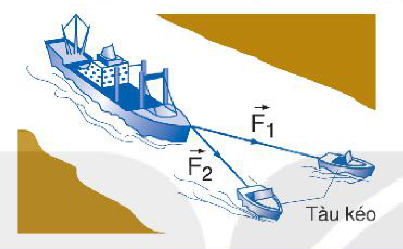

## I. TỔNG HỢP LỰC – HỢP LỰC TÁC DỤNG

**Tổng hợp lực** là phép thay thế các lực tác dụng đồng thời vào cùng một vật bằng một lực có tác dụng giống hệt như các lực ấy.
Lực thay thế này gọi là **hợp lực**.

Về mặt toán học, ta có thể tìm hợp lực bằng phép cộng vectơ:

$$\vec{F} = \vec{F}_1 + \vec{F}_2 + \vec{F}_3 + ... \quad (13.1)$$
<!-- ocr-ok: đối chiếu ảnh trang PDF 57 khớp nguyên văn công thức -->

> **Câu hỏi:** Tại sao lực đẩy của người bố trong Hình 13.1b có tác dụng như lực đẩy của hai anh em?
>
> 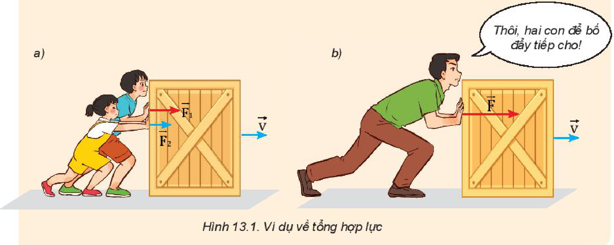

<!-- pdf:58 -->

### 1. Tổng hợp hai lực cùng phương

> **Câu hỏi:**
>
> 1. Dựa vào Hình 13.2, hãy nêu cách xác định độ lớn và chiều của hợp lực trong hai trường hợp:
>    a) Vật chịu tác dụng của hai lực cùng phương, cùng chiều (Hình 13.2a).
>    b) Vật chịu tác dụng của hai lực cùng phương, ngược chiều (Hình 13.2b).
> 2. Nêu quy tắc tổng hợp hai lực cùng phương.
>
> 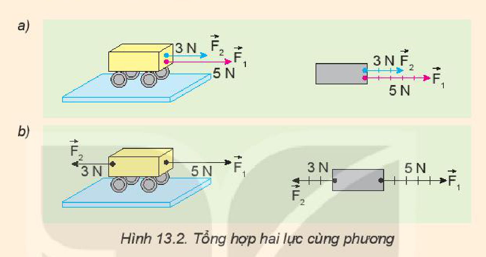
<!-- term: Tổng hợp hai lực cùng phương -->

### 2. Tổng hợp hai lực đồng quy – Quy tắc hình bình hành

Từ các thí nghiệm và thực tế, người ta thấy rằng phép tổng hợp hai lực đồng quy tuân theo **quy tắc hình bình hành** sau đây (Hình 13.3):
- Bước 1: Vẽ hai vectơ $\vec{F}_1$ và $\vec{F}_2$ đồng quy tại O.
- Bước 2: Vẽ một hình bình hành có hai cạnh liền kề trùng với hai vectơ $\vec{F}_1$ và $\vec{F}_2$.
- Bước 3: Vẽ đường chéo hình bình hành có cùng gốc O. Vectơ hợp lực $\vec{F}$ trùng với đường chéo này.

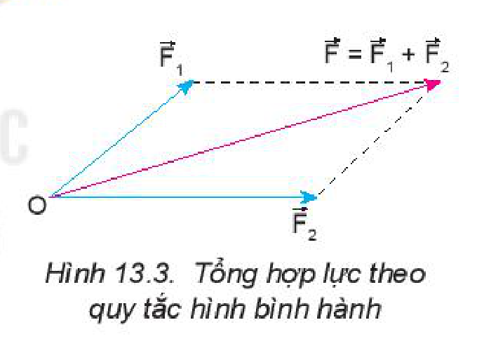

> **Câu hỏi:**
>
> 1. Cho hai lực đồng quy có độ lớn $F_1 = 6\text{ N}$ và $F_2 = 8\text{ N}$.
>    Nếu hợp lực có độ lớn $F = 10\text{ N}$ thì góc giữa hai lực $\vec{F}_1$ và $\vec{F}_2$ bằng bao nhiêu? Vẽ hình minh hoạ.
> 2. Giả sử lực kéo của mỗi tàu kéo ở đầu bài đều có độ lớn bằng $8\text{ }000\text{ N}$ và góc giữa hai dây cáp bằng $30^\circ$.
>    a) Biểu diễn các lực kéo của mỗi tàu và hợp lực tác dụng vào tàu chở hàng.
>    b) Tính độ lớn của hợp lực của hai lực kéo.
>    c) Xác định phương và chiều của hợp lực.
>    d) Nếu góc giữa hai dây cáp bằng $90^\circ$ thì hợp lực của hai lực kéo có phương, chiều và độ lớn như thế nào?

<!-- pdf:59 -->

## II. CÁC LỰC CÂN BẰNG VÀ KHÔNG CÂN BẰNG

### 1. Các lực cân bằng

Xét trường hợp vật đứng yên dưới tác dụng của nhiều lực. Khi đó tổng hợp các lực tác dụng lên vật bằng $0$. Ta nói các lực tác dụng lên vật là **các lực cân bằng** và vật ở **trạng thái cân bằng**.

$$\vec{F} = \vec{F}_1 + \vec{F}_2 + \vec{F}_3 + ... = \vec{0} \quad (13.2)$$
<!-- ocr-ok: đối chiếu ảnh trang PDF 59 khớp nguyên văn công thức -->

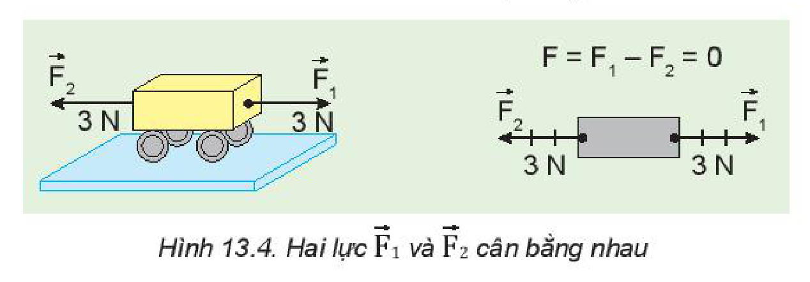

> **Câu hỏi:**
>
> Quan sát quyển sách đang nằm yên trên mặt bàn (Hình 13.5).
> a) Có những lực nào tác dụng lên quyển sách?
> b) Các lực này có cân bằng không? Vì sao?
>
> 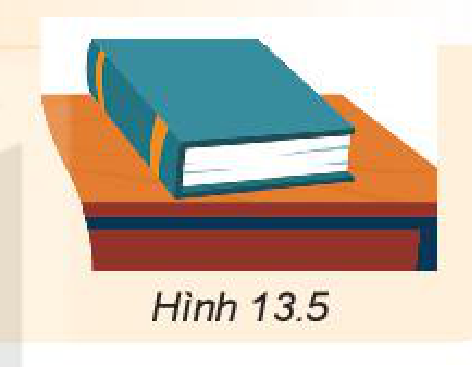

### 2. Các lực không cân bằng

Khi hợp lực của các lực khác $0$ thì các lực này không cân bằng. Hợp lực hay **các lực không cân bằng** này tác dụng vào một vật có thể làm thay đổi vận tốc của vật.

> **Câu hỏi:**
>
> 1. Một ô tô chịu một lực $F_1 = 400\text{ N}$ hướng về phía trước và một lực $F_2 = 300\text{ N}$ hướng về phía sau (Hình 13.6). Hỏi hợp lực tác dụng lên ô tô có độ lớn bằng bao nhiêu và hướng về phía nào?
>
> 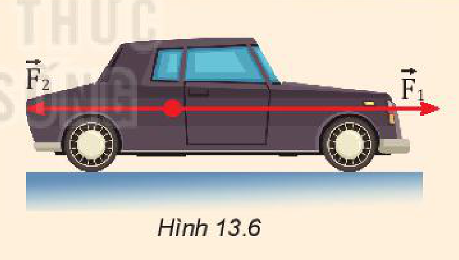
>
> 2. Quan sát mỗi cặp tình huống ở Hình 13.7.
>    a) Tình huống nào có hợp lực khác $0$?
>    b) Mô tả sự thay đổi vận tốc (độ lớn, hướng) của mỗi vật trong hình, nếu có.
>
> 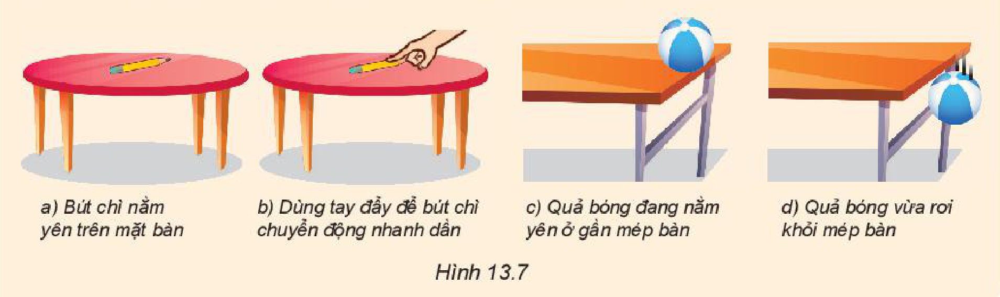

<!-- pdf:60 -->

## III. PHÂN TÍCH LỰC

**Phân tích lực** là phép thay thế một lực thành hai lực thành phần có tác dụng giống hệt như lực ấy.

### 1. Quy tắc

a) Thường người ta phân tích lực thành hai lực vuông góc với nhau để lực thành phần này không có tác dụng nào theo phương của lực thành phần kia.

b) Phân tích lực là phép làm ngược lại với tổng hợp lực nhưng chỉ được áp dụng vào trường hợp riêng nêu ở trên. Hình 13.8 cho biết cách phân tích một lực $\vec{F}$ theo hai trục.

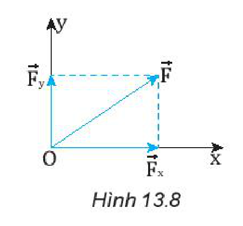

### 2. Chú ý

Chỉ khi xác định được một lực có tác dụng theo hai phương vuông góc nào thì mới phân tích lực theo hai phương vuông góc đó.

### 3. Ví dụ

Xét một vật đang trượt trên một mặt phẳng nghiêng nhẵn (Hình 13.9). Trọng lực $\vec{P}$ có tác dụng: một mặt nó ép vật vào mặt phẳng nghiêng, mặt khác nó kéo vật trượt theo mặt phẳng nghiêng xuống dưới. Vì thế ta phân tích trọng lực $\vec{P}$ theo hai phương vuông góc như Hình 13.9.

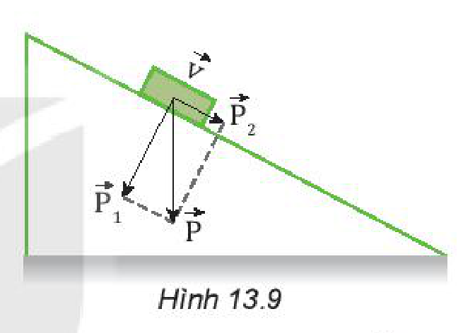

> **Câu hỏi:**
>
> Một vật được giữ yên trên một mặt phẳng nghiêng nhẵn bởi một lò xo (Hình 13.10).
> 1. Có những lực nào tác dụng lên vật?
> 2. Phân tích trọng lực tác dụng lên vật thành hai lực thành phần và nêu rõ tác dụng của hai lực này.
>
> 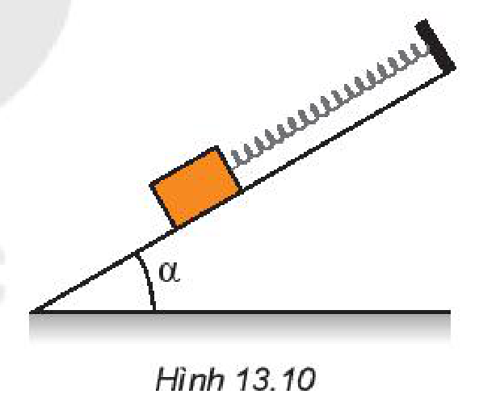

## 📌 Em đã học

- Tổng hợp lực là phép thay thế các lực tác dụng đồng thời vào cùng một vật bằng một lực có tác dụng giống hệt như các lực ấy. Lực thay thế này gọi là hợp lực.
- Tổng hợp hai lực cùng phương và đồng quy đều tuân theo quy tắc cộng vectơ.
- Nếu các lực tác dụng lên một vật cân bằng nhau thì hợp lực tác dụng lên vật bằng $0$.
- Nếu các lực tác dụng lên một vật không cân bằng thì hợp lực tác dụng lên vật đó khác $0$. Khi đó, vận tốc của vật thay đổi (độ lớn, hướng).
- Phân tích lực là phép thay thế một lực bằng hai lực thành phần có tác dụng giống hệt lực đó.

## ✏️ Em có thể

1. Vận dụng quy tắc hình bình hành để tìm hợp lực của hai lực đồng quy.
2. Phân tích được một lực thành hai lực thành phần vuông góc.

## 📷 Danh sách hình trong bài

| Mã hình | Số hình SGK | Trang PDF | Chú thích |
| --- | --- | --- | --- |
| H10-vat_ly-b13-01 | — | 57 | Hai tàu kéo dùng dây cáp kéo tàu chở hàng vào cảng (hình mở đầu) |
| H10-vat_ly-b13-02 | Hình 13.1 | 57 | Ví dụ về tổng hợp lực |
| H10-vat_ly-b13-03 | Hình 13.2 | 58 | Tổng hợp hai lực cùng phương |
| H10-vat_ly-b13-04 | Hình 13.3 | 58 | Tổng hợp lực theo quy tắc hình bình hành |
| H10-vat_ly-b13-05 | Hình 13.4 | 59 | Hai lực $\vec{F}_1$ và $\vec{F}_2$ cân bằng nhau |
| H10-vat_ly-b13-06 | Hình 13.5 | 59 | Quyển sách đang nằm yên trên mặt bàn |
| H10-vat_ly-b13-07 | Hình 13.6 | 59 | Ô tô chịu tác dụng của hai lực ngược chiều |
| H10-vat_ly-b13-08 | Hình 13.7 | 59 | a) Bút chì nằm yên trên mặt bàn; b) Dùng tay đẩy để bút chì chuyển động nhanh dần; c) Quả bóng đang nằm yên ở gần mép bàn; d) Quả bóng vừa rơi khỏi mép bàn |
| H10-vat_ly-b13-09 | Hình 13.8 | 60 | Phân tích một lực $\vec{F}$ theo hai trục vuông góc |
| H10-vat_ly-b13-10 | Hình 13.9 | 60 | Phân tích trọng lực $\vec{P}$ của vật trượt trên mặt phẳng nghiêng nhẵn |
| H10-vat_ly-b13-11 | Hình 13.10 | 60 | Vật được giữ yên trên mặt phẳng nghiêng nhẵn bởi một lò xo |
