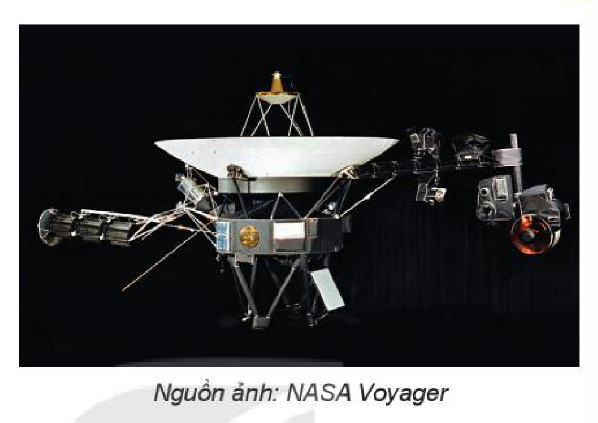
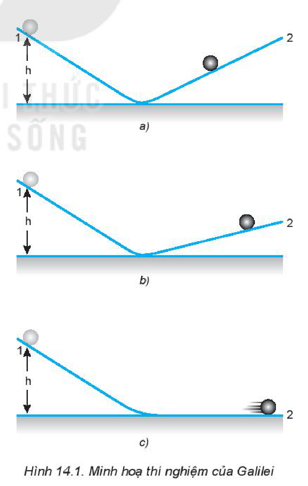
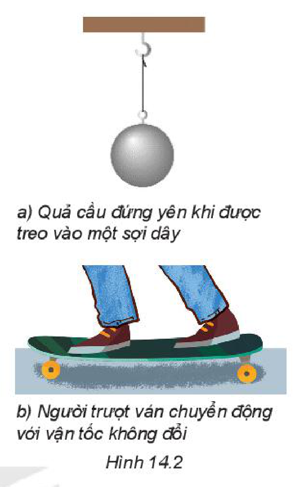
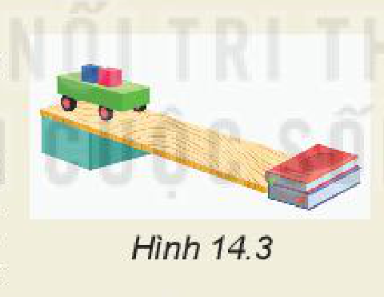
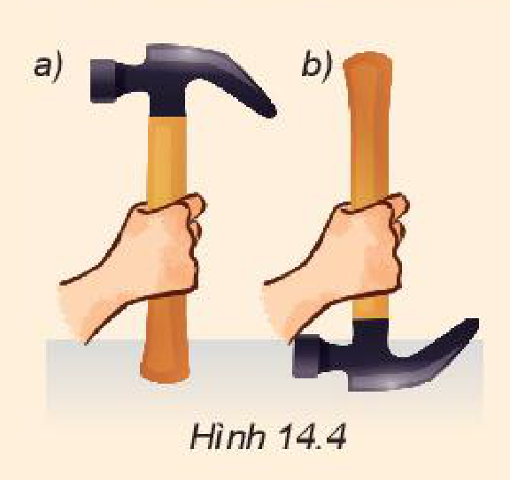
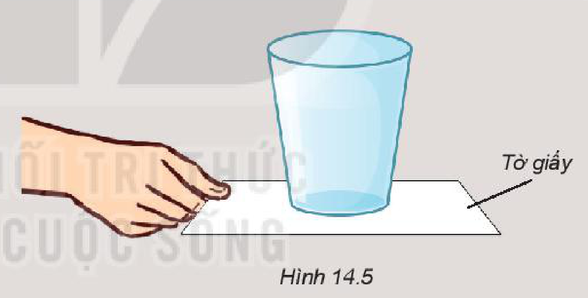

<!-- pdf:61 -->

# BÀI 14: ĐỊNH LUẬT 1 NEWTON

## 🔴 Mở đầu

> Hình bên cho thấy một trong hai con tàu vũ trụ Voyager đang làm nhiệm vụ thăm dò các hành tinh nằm xa Trái Đất trong hệ Mặt Trời. Chúng được phóng lên từ Mũi Canaveral, Florida (Hoa Kì) vào năm 1977 và hiện nay cả hai con tàu đã ra khỏi hệ Mặt Trời, đang tiếp tục hoạt động và gửi thông tin về Trái Đất.
>
> Điều gì đã giúp cho tàu Voyager tiếp tục chuyển động rời xa Trái Đất, mặc dù thực tế không còn lực nào tác dụng lên chúng nữa?
>
> 

## I. LỰC VÀ CHUYỂN ĐỘNG

Lực có phải là nguyên nhân làm cho một vật chuyển động và duy trì chuyển động đó hay không?

> **Câu hỏi:** Một quyển sách đang nằm yên trên mặt bàn. Ta phải đẩy nó thì nó mới dịch chuyển và khi ngừng đẩy thì nó dừng lại. Nếu em đặt mình vào thời của nhà khoa học Hy Lạp Aristotle (384 – 322 TCN), khi mà mọi người còn chưa biết đến ma sát, thì em sẽ trả lời câu hỏi nêu ra như thế nào?

Galilei bố trí thí nghiệm như Hình 14.1, rồi thả hòn bi cho lăn xuống theo máng nghiêng 1. Ông nhận thấy hòn bi lăn ngược lên máng 2 đến một độ cao thấp hơn độ cao ban đầu.

Khi hạ thấp độ nghiêng của máng 2, ông thấy hòn bi lăn trên máng 2 được một đoạn dài hơn. Ông cho rằng hòn bi không lăn được đến độ cao ban đầu là vì có *ma sát*. Ông tiên đoán rằng nếu không có ma sát và nếu máng nghiêng 2 nằm ngang thì hòn bi sẽ lăn mãi mãi với vận tốc không đổi.
<!-- term: Thí nghiệm của Galilei -->

<!-- pdf:62 -->

## II. ĐỊNH LUẬT 1 NEWTON

Năm 1687, nhà vật lí người Anh Newton đã khái quát kết quả nghiên cứu của mình, đồng thời phát triển các ý tưởng của Galilei thành một định luật chuyển động, sau này được gọi là **định luật 1 Newton**:
*Nếu một vật không chịu tác dụng của lực nào hoặc chịu tác dụng của các lực có hợp lực bằng không, thì vật đang đứng yên sẽ tiếp tục đứng yên, đang chuyển động sẽ tiếp tục chuyển động thẳng đều.*

> **Câu hỏi:**
>
> Quan sát các vật trong Hình 14.2.
> 1. Giải thích tại sao quả cầu đứng yên.
> 2. Tại sao người trượt ván có thể giữ nguyên vận tốc của mình?
>
> 

## III. QUÁN TÍNH

### 1. Quán tính

Tính chất bảo toàn trạng thái đứng yên hay chuyển động của vật, gọi là **quán tính** của vật.
- Do có quán tính mà mọi vật có xu hướng bảo toàn vận tốc cả về hướng và độ lớn.
- Định luật 1 Newton còn được gọi là **định luật quán tính**.

> **Hoạt động:**
>
> Thí nghiệm Hình 14.3 giúp minh hoạ quán tính của vật.
>
> 
>
> - *Chuẩn bị:* Một tấm ván dài khoảng $1\text{ m}$ làm mặt phẳng nghiêng, xe lăn, vật nhỏ đặt trên xe lăn, vật chắn (có thể dùng quyển sách dày) (Hình 14.3).
> - *Tiến hành:*
>   - Đặt các vật nhỏ lên xe lăn. Giữ các vật và xe đứng yên trên đỉnh mặt phẳng nghiêng.
>   - Thả cho xe trượt xuống dốc, dọc theo mặt phẳng nghiêng.
>   - Quan sát hiện tượng xảy ra đối với xe và các vật trên xe.
> - *Thảo luận:*
>   1. Giải thích tại sao khi xe trượt xuống dốc và bị cản lại ở cuối dốc thì vật nhỏ bị văng về phía trước.
>   2. Làm thế nào để giữ cho vật trên xe không bị văng đi?

> **Câu hỏi:**
>
> 1. Mô tả và giải thích điều gì xảy ra đối với một hành khách ngồi trong ô tô ở các tình huống sau:
>    a) Xe đột ngột tăng tốc.
>    b) Xe phanh gấp.
>    c) Xe rẽ nhanh sang trái.
> 2. Một vật đang chuyển động với vận tốc $3\text{ m/s}$ dưới tác dụng của các lực. Nếu bỗng nhiên các lực này mất đi thì:
>    A. Vật dừng lại ngay.
>    B. Vật đổi hướng chuyển động.
>    C. Vật chuyển động chậm dần rồi dừng lại.
>    D. Vật tiếp tục chuyển động theo hướng cũ với vận tốc $3\text{ m/s}$.
> 3. Một vật đang nằm yên trên mặt bàn nằm ngang. Tại sao ta có thể khẳng định rằng bàn đã tác dụng một lực lên nó?

<!-- pdf:63 -->

### 2. Ứng dụng của quán tính trong đời sống

> **Câu hỏi:**
>
> 1. Khi ngồi trên ô tô, tàu lượn cao tốc hoặc máy bay, hành khách luôn được nhắc thắt dây an toàn. Giải thích điều này.
> 2. Để tra đầu búa vào cán, nên chọn cách nào dưới đây? Giải thích tại sao.
>    a) Đập mạnh cán búa xuống đất như Hình 14.4a.
>    b) Đập mạnh đầu búa xuống đất như Hình 14.4b.
>
> 

## 📌 Em đã học

- Định luật 1 Newton: Nếu một vật không chịu tác dụng của lực nào hoặc chịu tác dụng của các lực có hợp lực bằng $0$, thì vật đang đứng yên sẽ tiếp tục đứng yên, đang chuyển động sẽ tiếp tục chuyển động thẳng đều.
- Quán tính của vật là tính chất bảo toàn trạng thái đứng yên hay chuyển động.

## ✏️ Em có thể

1. Dùng khái niệm quán tính để giải thích hiện tượng trong Hình 14.5: Khi dùng tay kéo từ từ tờ giấy và khi giật mạnh tờ giấy.

2. Giải thích được nguyên nhân của nhiều vụ tai nạn giao thông liên quan đến quán tính. Chuẩn bị một bài thuyết trình (dài khoảng 15 phút) về đề tài sau đây: Rất nhiều vụ tai nạn giao thông có nguyên nhân từ quán tính. Em hãy nêu một số ví dụ về điều đó và cách phòng tránh những tai nạn này.

## 📷 Danh sách hình trong bài

| Mã hình | Số hình SGK | Trang PDF | Chú thích |
| --- | --- | --- | --- |
| H10-vat_ly-b14-01 | — | 61 | Tàu vũ trụ Voyager (Nguồn ảnh: NASA Voyager) (hình mở đầu) |
| H10-vat_ly-b14-02 | Hình 14.1 | 61 | Minh hoạ thí nghiệm của Galilei |
| H10-vat_ly-b14-03 | Hình 14.2 | 62 | a) Quả cầu đứng yên khi được treo vào một sợi dây; b) Người trượt ván chuyển động với vận tốc không đổi |
| H10-vat_ly-b14-04 | Hình 14.3 | 62 | Thí nghiệm minh hoạ quán tính của vật |
| H10-vat_ly-b14-05 | Hình 14.4 | 63 | Hai cách tra đầu búa vào cán |
| H10-vat_ly-b14-06 | Hình 14.5 | 63 | Kéo tờ giấy dưới cốc nước |
