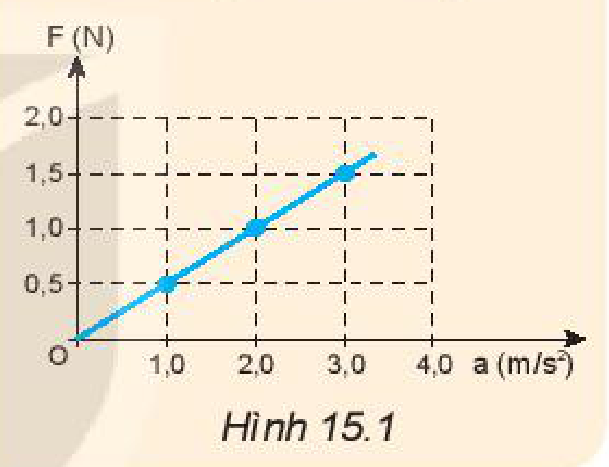
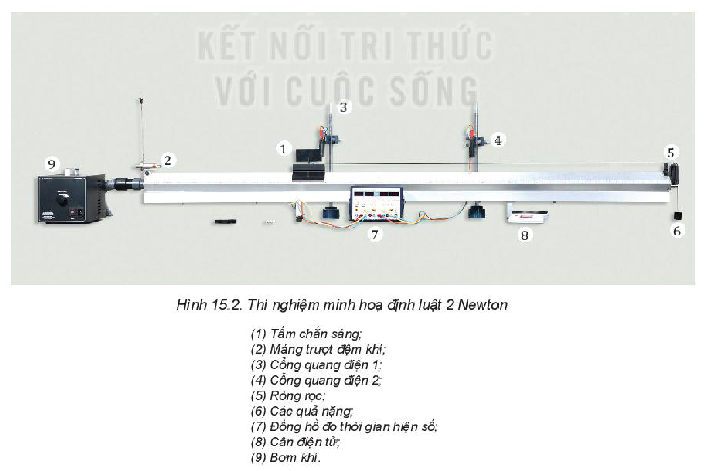
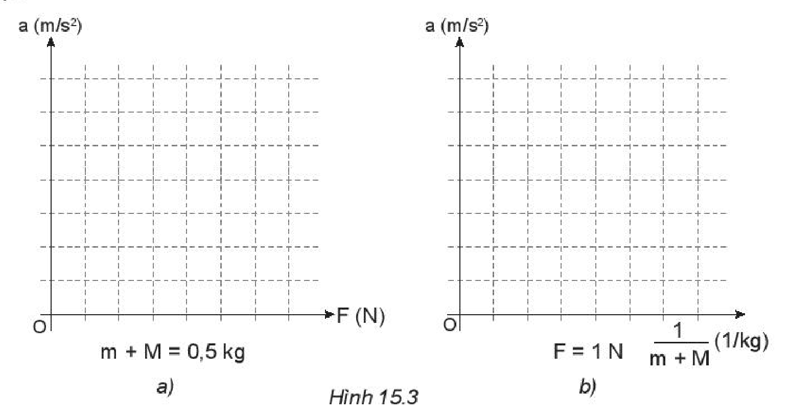

<!-- pdf:64 -->

# BÀI 15: ĐỊNH LUẬT 2 NEWTON

## 🔴 Mở đầu

> Đẩy một xe chở hàng cho nó chuyển động và nhận xét xem gia tốc của xe tăng hay giảm, nếu:
> a) Giữ nguyên lực đẩy nhưng khối lượng xe tăng lên (Hình a và b).
> b) Giữ nguyên khối lượng nhưng lực đẩy tăng lên (Hình b và c).
>
> 

## I. ĐỊNH LUẬT 2 NEWTON

Từ những quan sát và thí nghiệm cho thấy gia tốc của một vật không chỉ phụ thuộc vào lực tác dụng mà còn phụ thuộc vào khối lượng của vật.

Mối liên hệ giữa ba đại lượng: *gia tốc, lực và khối lượng* đã được Newton khái quát trong một phương trình vectơ đơn giản gọi là **định luật 2 Newton**:
*Gia tốc của một vật cùng hướng với lực tác dụng lên vật. Độ lớn của gia tốc tỉ lệ thuận với độ lớn của lực và tỉ lệ nghịch với khối lượng của vật.*

$$\vec{a} = \frac{\vec{F}}{m} \quad (15.1)$$
<!-- ocr-ok: đối chiếu ảnh trang PDF 64 khớp nguyên văn công thức -->

Xét về mặt Toán học, định luật 2 Newton có thể viết là:

$$\vec{F} = m.\vec{a}$$
<!-- ocr-ok: đối chiếu ảnh trang PDF 64 khớp nguyên văn công thức -->

Trong trường hợp vật chịu nhiều lực tác dụng $\vec{F}_1, \vec{F}_2, \vec{F}_3,...$ thì $\vec{F}$ là hợp lực của các lực đó:

$$\vec{F} = \vec{F}_1 + \vec{F}_2 + \vec{F}_3 + ...$$
<!-- ocr-ok: đối chiếu ảnh trang PDF 64 khớp nguyên văn công thức -->

> **Em có biết:**
>
> Dựa vào biểu thức $\vec{F} = m.\vec{a}$, ta có mối liên hệ:
>
> $$1\text{ N} = 1\text{ kg}.1\text{ m/s}^2$$
>
> $1\text{ N}$ là độ lớn của lực gây ra gia tốc $1\text{ m/s}^2$ cho vật có khối lượng $1\text{ kg}$, theo hướng của lực.
>
> | Đại lượng | Kí hiệu | Đơn vị |
> | --- | --- | --- |
> | Gia tốc | $a$ | $\text{m/s}^2$ |
> | Khối lượng | $m$ | $\text{kg}$ |
> | Lực | $F$ | $\text{N}$ |
<!-- ocr-ok: đối chiếu ảnh trang PDF 64 khớp nguyên văn -->

## II. KHỐI LƯỢNG VÀ QUÁN TÍNH

Lúc đầu, khối lượng chỉ được hiểu là một đại lượng dùng để chỉ lượng của chất chứa trong vật. Nhưng định luật 2 Newton còn cho ta một cách hiểu mới về khối lượng.

Thật vậy, theo định luật 2 Newton, nếu có nhiều vật khác nhau lần lượt chịu tác dụng của cùng một lực không đổi, thì vật nào có khối lượng lớn hơn sẽ có gia tốc nhỏ hơn. Vậy, vật nào có khối lượng càng lớn thì càng khó thay đổi vận tốc, tức là càng có **mức quán tính** lớn hơn. Từ đó ta có thể nói: ***Khối lượng** của vật là đại lượng đặc trưng cho mức quán tính của vật.*

> **Lưu ý:**
> - Khối lượng trong định luật 2 Newton còn được gọi là **khối lượng quán tính**.
> - Khối lượng là đại lượng vô hướng, dương, không đổi với mỗi vật và có tính chất cộng được.

<!-- pdf:65 -->

Điều đó cho phép ta so sánh được khối lượng của những vật làm bằng các chất khác nhau. Một xe chở cát và một xe chở gạo được coi là có khối lượng bằng nhau nếu dưới tác dụng của hợp lực như nhau, chúng có gia tốc như nhau.

> **Câu hỏi:**
>
> 1. Nêu một số ví dụ cho thấy khối lượng của vật càng lớn thì mức quán tính của vật càng lớn. Điều này có ý nghĩa gì trong thực tiễn?
> 2. Cho đồ thị biểu diễn mối liên hệ giữa các lực tác dụng lên một vật và gia tốc gây ra tương ứng (Hình 15.1). Khối lượng của vật là
>    A. $1,0\text{ kg}$.
>    B. $2,0\text{ kg}$.
>    C. $0,5\text{ kg}$.
>    D. $1,5\text{ kg}$.
>
> 

## III. THÍ NGHIỆM MINH HOẠ ĐỊNH LUẬT 2 NEWTON

> **Hoạt động:**
>
> Thí nghiệm được thiết lập như Hình 15.2.
>
> *Dụng cụ:*
> - Một xe trượt có khối lượng $M = 200\text{ g}$ được buộc vào một sợi dây vắt qua rãnh của ròng rọc. Coi dây không dãn và có khối lượng không đáng kể.
> - Một hộp đựng 10 quả nặng giống nhau, có cùng khối lượng $m = 50\text{ g}$.
> - Một máng trượt đệm khí với các lỗ nhỏ thổi không khí (nhằm giảm tối đa ma sát khi xe di chuyển trên máng trượt).
> - Bộ đếm thời gian gồm: một đồng hồ điện tử, hai cổng quang (đặt cách nhau $0,5\text{ m}$) và tấm chắn sáng dài $10\text{ cm}$.
> - Vật ở thí nghiệm này phải được hiểu là hệ vật gồm xe trượt và các quả nặng. Như vậy khối lượng của vật có thể là $(M + m)$, $(M + 2.m),...$ còn lực kéo $F$ là trọng lượng của các quả nặng, cụ thể là $F_1 = m.g$, $F_2 = 2.m.g,...$
>
> 

<!-- pdf:66 -->

> *Tiến hành:*
>
> Bước 1: Cho lực kéo $F$ có độ lớn tăng dần $1\text{ N}$, $2\text{ N}$ và $3\text{ N}$ (bằng cách móc thêm các quả nặng vào đầu dây vắt qua ròng rọc).
>
> Bước 2: Ghi vào Bảng 15.1 độ lớn lực kéo $F$ và tổng khối lượng của hệ (gồm xe trượt và các quả nặng), ứng với mỗi lần thí nghiệm.
>
> Bước 3: Đo thời gian chuyển động $t$ của xe; từ khi đồng hồ bắt đầu đếm từ lúc tấm chắn sáng đi qua cổng quang điện 1 và kết thúc đếm khi tấm chắn vượt qua cổng quang điện 2.
>
> Bước 4: Gia tốc $a$ được tính từ công thức: $d = v_0.t + \frac{1}{2}.a.t^2$ (đặt xe trượt có gắn tấm chắn sáng sao cho tấm chắn này sát với cổng quang điện 1 để $v_0 = 0$; $d = 0,5\text{ m}$ là khoảng cách giữa hai cổng quang điện trong thí nghiệm). Đo thời gian $t$ ứng với mỗi lần thí nghiệm, ta tính được:
>
> $$a = \frac{2.d}{t^2} = \frac{2.0,5}{t^2} = \frac{1}{t^2}\text{ (m/s}^2\text{)}.\text{ Ghi giá trị của gia tốc }a\text{ vào Bảng 15.1.}$$
>
> Kết quả thí nghiệm ghi trong Bảng 15.1.
>
> **Bảng 15.1.** Bảng ghi kết quả thí nghiệm
>
> | Đại lượng | Lần 1 | Lần 2 | Lần 3 | Lần 4 | Lần 5 |
> | --- | --- | --- | --- | --- | --- |
> | Lực kéo $F\text{ (N)}$ | $1$ | $1$ | $1$ | $2$ | $3$ |
> | Khối lượng $(M + m)\text{ (kg)}$ | $0,3$ | $0,4$ | $0,5$ | $0,5$ | $0,5$ |
> | Thời gian $t\text{ (s)}$ | $0,55$ | $0,64$ | $0,71$ | $0,50$ | $0,42$ |
> | Gia tốc $a = \frac{2.d}{t^2}\text{ (m/s}^2\text{)}$ | $3,31$ | $2,44$ | $1,99$ | $4,03$ | $5,67$ |
<!-- ocr-ok: đối chiếu ảnh trang PDF 66 khớp nguyên văn -->
>
> *Thảo luận:*
>
> a) Dựa vào số liệu trong Bảng 15.1, hãy vẽ đồ thị chỉ sự phụ thuộc của gia tốc $a$:
> - Vào $F$ (ứng với $m + M = 0,5\text{ kg}$), (Hình 15.3a). Đồ thị có phải là đường thẳng không? Tại sao?
> - Vào $\frac{1}{m + M}$ (ứng với $F = 1\text{ N}$), (Hình 15.3b). Đồ thị có phải là đường thẳng không? Tại sao?
>
> b) Nêu kết luận về sự phụ thuộc của gia tốc vào độ lớn của lực tác dụng và khối lượng của vật.
>
> 

<!-- pdf:67 -->

> **Lưu ý:**
> - Khi thực hiện đo gia tốc theo phương án thí nghiệm trên cần lưu ý: Để đồng hồ bắt đầu đếm thời gian khi xe có vận tốc ban đầu bằng $0$, cần đặt tấm chắn sáng sát cổng quang điện 1.
> - Có thể xác định gia tốc theo công thức $a = \frac{v_2^2 - v_1^2}{2.d}$, trong đó $v_1, v_2$ lần lượt là vận tốc tức thời qua hai cổng quang điện; $v_1, v_2$ được đo bằng cách thay tấm chắn sáng có chiều dài $\ell = 1\text{ cm}$ và đặt đồng hồ đo thời gian ở chế độ đo thời gian chắn cổng quang điện.

> **Câu hỏi:**
>
> 1. Trong các cách viết hệ thức của định luật 2 Newton sau đây, cách viết nào đúng?
>    A. $\vec{F} = m.a$.
>    B. $\vec{F} = -m.\vec{a}$.
>    C. $\vec{F} = m.\vec{a}$.
>    D. $-\vec{F} = m.\vec{a}$.
<!-- ocr-ok: đối chiếu ảnh trang PDF 67 khớp nguyên văn -->
>
> 2. Một quả bóng khối lượng $0,50\text{ kg}$ đang nằm yên trên mặt đất. Một cầu thủ đá bóng với một lực $250\text{ N}$. Thời gian chân tác dụng vào bóng là $0,02\text{ s}$. Quả bóng bay đi với tốc độ:
>    A. $0,01\text{ m/s}$.
>    B. $0,10\text{ m/s}$.
>    C. $2,50\text{ m/s}$.
>    D. $10,00\text{ m/s}$.
>
> 3. Dưới tác dụng của hợp lực $20\text{ N}$, một chiếc xe đồ chơi chuyển động với gia tốc $0,4\text{ m/s}^2$. Dưới tác dụng của hợp lực $50\text{ N}$, chiếc xe sẽ chuyển động với gia tốc bao nhiêu?
> 4. Tại sao máy bay khối lượng càng lớn thì đường băng phải càng dài?

## 📌 Em đã học

- Định luật 2 Newton: Gia tốc của một vật cùng hướng với lực tác dụng lên vật. Độ lớn của gia tốc tỉ lệ thuận với độ lớn của lực và tỉ lệ nghịch với khối lượng của vật.
  $$\vec{a} = \frac{\vec{F}}{m}$$
  Xét về mặt Toán học, định luật 2 Newton có thể viết là $\vec{F} = m.\vec{a}$.
- Khối lượng là đại lượng đặc trưng cho mức quán tính của vật.

## ✏️ Em có thể

1. Đề xuất được một thí nghiệm chứng tỏ gia tốc mà vật thu được phụ thuộc vào:
   a) Độ lớn của lực tác dụng vào vật.
   b) Khối lượng của vật.
2. Giải thích được khối lượng của vật càng lớn thì quán tính của vật càng lớn.
3. Giải thích tại sao trong tham gia giao thông, khi ô tô chở hàng nặng khó hãm phanh hơn khi ô tô không chở hàng.

## 📷 Danh sách hình trong bài

| Mã hình | Số hình SGK | Trang PDF | Chú thích |
| --- | --- | --- | --- |
| H10-vat_ly-b15-01 | — | 64 | Đẩy xe chở hàng chuyển động trong các trường hợp khác nhau (hình mở đầu) |
| H10-vat_ly-b15-02 | Hình 15.1 | 65 | Đồ thị biểu diễn mối liên hệ giữa lực tác dụng và gia tốc |
| H10-vat_ly-b15-03 | Hình 15.2 | 65 | Thí nghiệm minh hoạ định luật 2 Newton |
| H10-vat_ly-b15-04 | Hình 15.3 | 66 | Đồ thị sự phụ thuộc của gia tốc $a$ vào $F$ và vào $\frac{1}{m + M}$ |
