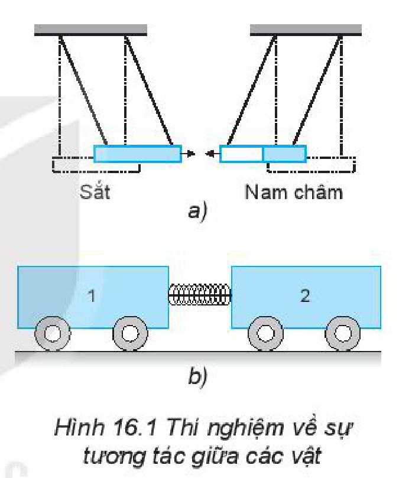
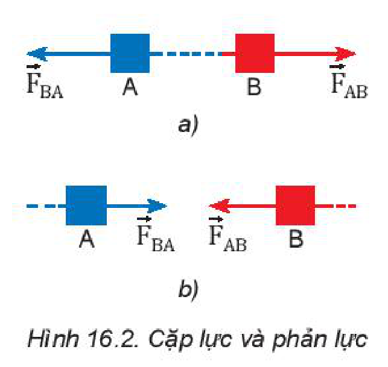
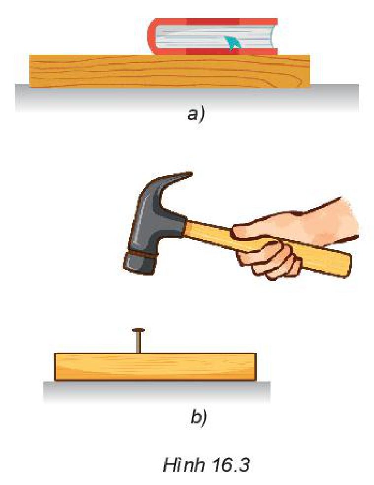
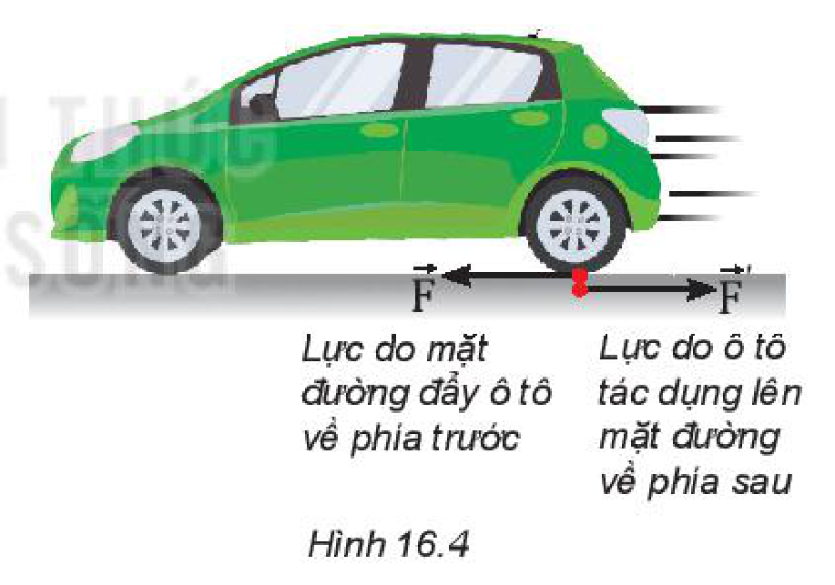

<!-- pdf:68 -->

# BÀI 16: ĐỊNH LUẬT 3 NEWTON

## 🔴 Mở đầu

> Móc hai lực kế vào nhau rồi kéo một trong hai lực kế như hình sau.
>
> 
>
> a) Dự đoán xem số chỉ của hai lực kế giống nhau hay khác nhau.
> b) Hãy kiểm tra kết quả và nêu kết luận.
> c) Nếu cả hai tiếp tục kéo về hai phía ngược nhau với độ lớn lực tăng lên thì số chỉ của hai lực kế sẽ thay đổi thế nào?

## I. ĐỊNH LUẬT 3 NEWTON

### 1. Lực tương tác giữa hai vật

> **Hoạt động:**
>
> Quan sát thí nghiệm được mô tả trong Hình 16.1.
> 1. Một thanh sắt và một thanh nam châm được treo như Hình 16.1a. Trong thí nghiệm này, lực nào làm cho thanh nam châm dịch chuyển lại gần thanh sắt?
> 2. Xe lăn 1 có khối lượng $m_1$ và có gắn một lò xo nhẹ. Xe lăn 2 có khối lượng $m_2$. Ta cho hai xe áp lại gần nhau bằng cách buộc dây để nén lò xo (Hình 16.1b). Quan sát hiện tượng xảy ra khi đốt đứt sợi dây buộc.
>    Thảo luận để làm sáng tỏ ý kiến sau: *Lực không tồn tại riêng lẻ. Các lực hút hoặc đẩy luôn xuất hiện thành từng cặp giữa hai vật.*
>
> 

### 2. Định luật 3 Newton

*Trong mọi trường hợp, khi vật A tác dụng lên vật B một lực thì đồng thời vật B cũng tác dụng trở lại vật A một lực. Hai lực này là hai lực trực đối (Hình 16.2).*

$$\vec{F}_{AB} = -\vec{F}_{BA}$$
<!-- ocr-ok: đối chiếu ảnh trang PDF 68 khớp nguyên văn công thức -->

**Hai lực trực đối** là hai lực tác dụng theo cùng một đường thẳng, ngược chiều nhau, có độ lớn bằng nhau và điểm đặt lên hai vật khác nhau.

## II. CÁC ĐẶC ĐIỂM CỦA LỰC VÀ PHẢN LỰC

Theo **định luật 3 Newton**, trong tương tác giữa hai vật, một lực gọi là **lực tác dụng** còn lực kia gọi là **phản lực**.

> **Câu hỏi:**
>
> 1. Cặp lực và phản lực có những đặc điểm gì?
> 2. Cặp lực và phản lực có phải là hai lực cân bằng hay không? Tại sao?

> **Câu hỏi:** Hãy chỉ rõ điểm đặt của mỗi lực trong mỗi cặp lực ở Hình 16.2 a, b.

<!-- pdf:69 -->

> **Câu hỏi:**
>
> 1. Hãy chỉ ra các cặp lực và phản lực trong hai trường hợp sau:
>    a) Quyển sách nằm yên trên mặt bàn (Hình 16.3a).
>    b) Dùng búa đóng đinh vào gỗ (Hình 16.3b).
> 2. Quyển sách nằm yên có phải là kết quả của sự cân bằng giữa lực và phản lực hay không?
> 3. Lực do búa tác dụng vào đinh và phản lực của đinh lên búa có các đặc điểm gì?
>
> 

> **Hoạt động:**
>
> 1. Trong thí nghiệm ở phần mở đầu bài học, nếu cả hai người cùng kéo nhưng để lực kế di chuyển về phía một người (ví dụ cùng di chuyển hai lực kế sang phải) thì số chỉ của hai lực kế sẽ giống nhau hay khác nhau? Làm thí nghiệm kiểm tra dự đoán.
> 2. Nêu thêm một số ví dụ trong thực tế và thảo luận để làm sáng tỏ các đặc điểm sau đây của lực và phản lực:
>    - *Lực và phản lực luôn xuất hiện thành từng cặp (xuất hiện hoặc mất đi đồng thời).*
>    - *Lực và phản lực cùng tác dụng theo một đường thẳng, cùng độ lớn nhưng ngược chiều (hai lực như vậy là hai lực trực đối).*
>    - *Lực và phản lực không cân bằng nhau (vì chúng đặt vào hai vật khác nhau).*
>    - *Cặp lực và phản lực là hai lực cùng loại.*
<!-- term: Cặp lực và phản lực -->

> **Câu hỏi:**
>
> Một ô tô chuyển động trên mặt đường (Hình 16.4), nếu lực do ô tô tác dụng lên mặt đường có độ lớn bằng lực mà mặt đường đẩy ô tô thì tại sao chúng không “khử nhau”?
>
> 

## 📌 Em đã học

**Định luật 3 Newton**: Trong mọi trường hợp, khi vật A tác dụng lên vật B một lực, thì đồng thời vật B cũng tác dụng trở lại vật A một lực. Hai lực này tác dụng theo cùng một phương, cùng độ lớn, nhưng ngược chiều, điểm đặt lên hai vật khác nhau: $\vec{F}_{AB} = -\vec{F}_{BA}$.

## ✏️ Em có thể

Giải thích tại sao các vận động viên khi bơi tới mép hồ bơi và quay lại thì dùng chân đẩy mạnh vào vách hồ bơi để di chuyển nhanh hơn.

## 📷 Danh sách hình trong bài

| Mã hình | Số hình SGK | Trang PDF | Chú thích |
| --- | --- | --- | --- |
| H10-vat_ly-b16-01 | — | 68 | Móc hai lực kế vào nhau rồi kéo (hình mở đầu) |
| H10-vat_ly-b16-02 | Hình 16.1 | 68 | Thí nghiệm về sự tương tác giữa các vật |
| H10-vat_ly-b16-03 | Hình 16.2 | 68 | Cặp lực và phản lực |
| H10-vat_ly-b16-04 | Hình 16.3 | 69 | a) Quyển sách nằm yên trên mặt bàn; b) Dùng búa đóng đinh vào gỗ |
| H10-vat_ly-b16-05 | Hình 16.4 | 69 | Lực tương tác giữa ô tô và mặt đường |
