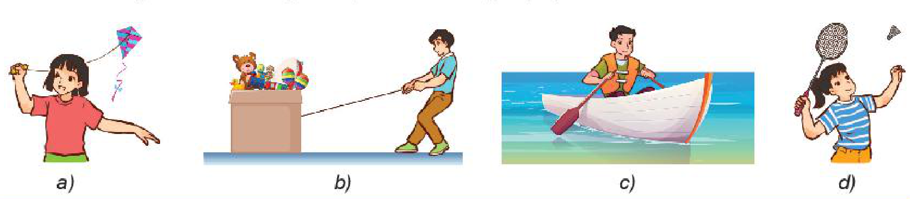
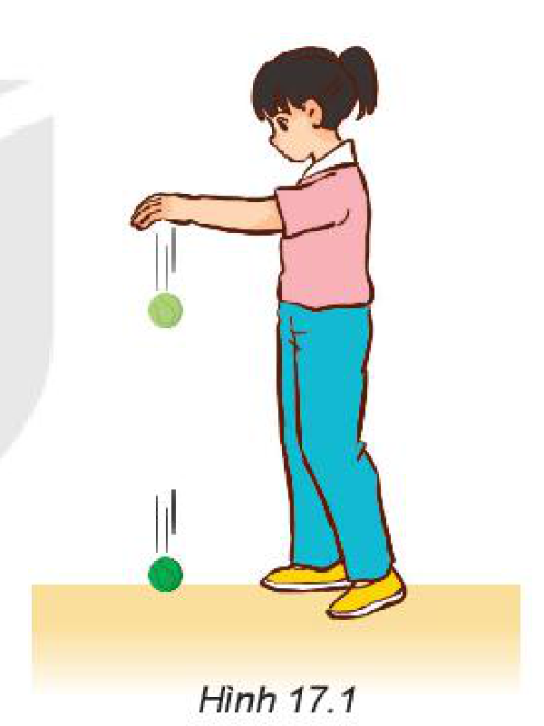
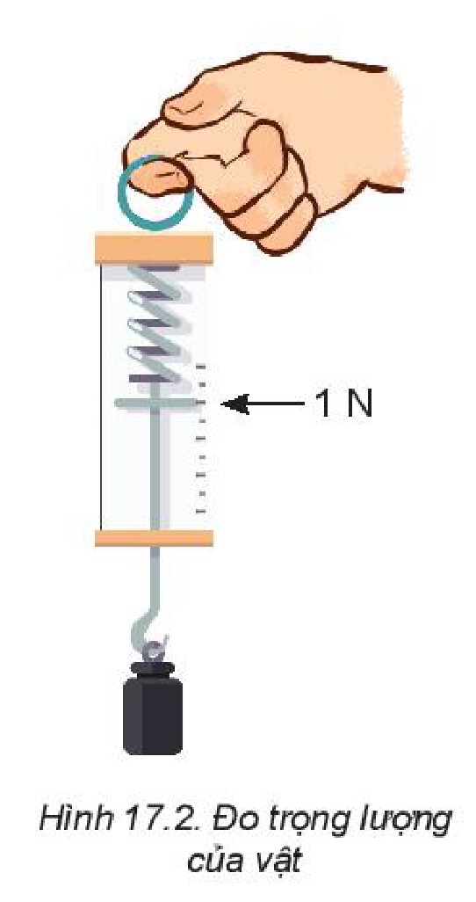
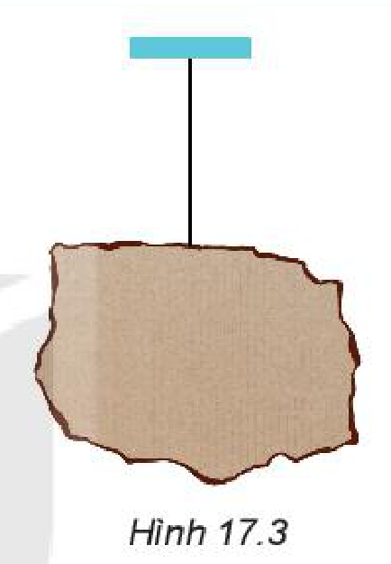
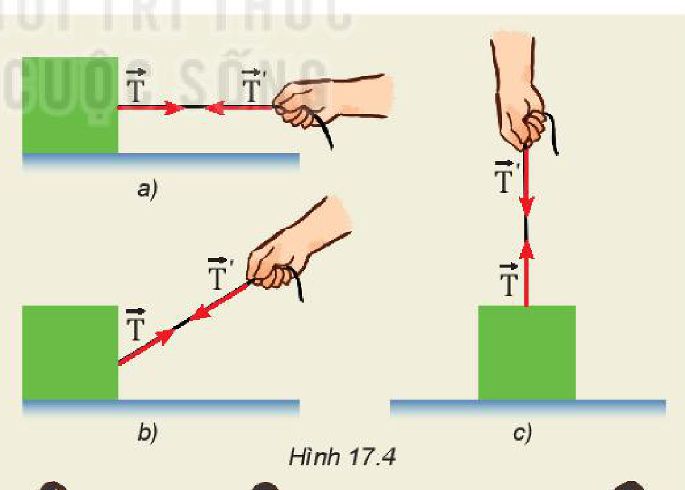
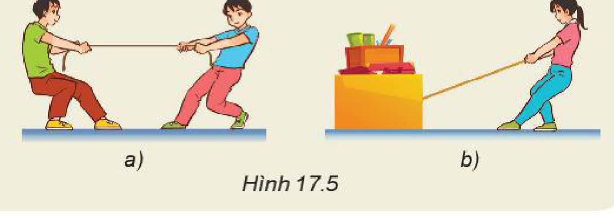
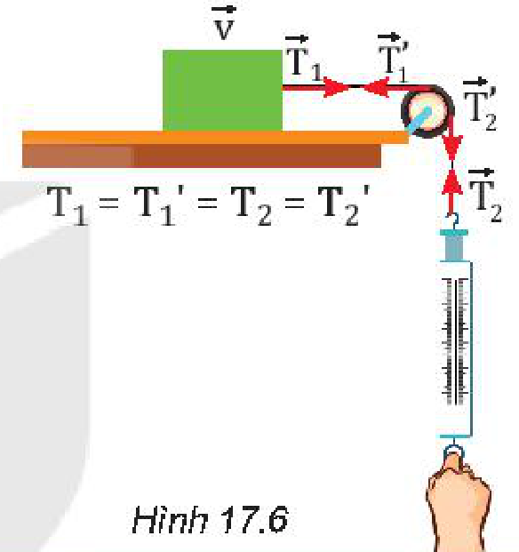
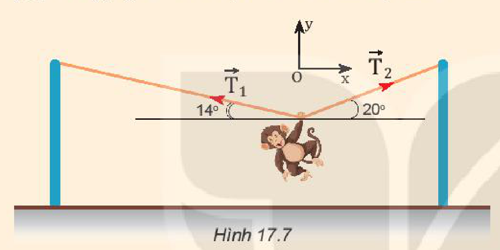

<!-- pdf:70 -->

# BÀI 17: TRỌNG LỰC VÀ LỰC CĂNG

## 🔴 Mở đầu

> Các tình huống ở hình dưới đây liên quan đến những loại lực nào?
>
> 
<!-- ocr-ok: đối chiếu ảnh trang PDF 70 khớp nguyên văn -->

## I. TRỌNG LỰC

> **Hoạt động:**
>
> Thảo luận tình huống được đề cập trong Hình 17.1: Tại sao khi được buông ra, các vật quanh ta đều rơi xuống đất?
>
> 

### 1. Trọng lực

**Trọng lực** là lực hấp dẫn do Trái Đất tác dụng lên vật gây ra cho vật gia tốc rơi tự do. Trọng lực được kí hiệu là vectơ $\vec{P}$.
- Ở gần Trái Đất trọng lực có:
  + Phương thẳng đứng.
  + Chiều từ trên xuống.
  + Điểm đặt gọi là **trọng tâm** của vật.
- Công thức của trọng lực:
  Áp dụng định luật 2 Newton vào trường hợp vật rơi tự do, ta tìm được công thức của trọng lực: $\vec{P} = m.\vec{g}$.

### 2. Trọng lượng

- Độ lớn của trọng lực tác dụng lên một vật gọi là **trọng lượng** của vật.
- Công thức tính trọng lượng: $P = m.g$.
- Trọng lượng của một vật có thể đo bằng lực kế hoặc cân lò xo Hình 17.2.

> **Câu hỏi:**
>
> Lực kế trong Hình 17.2 đang chỉ ở vạch $1\text{ N}$.
> a) Tính trọng lượng và khối lượng của vật. Lấy $g \approx 9,8\text{ m/s}^2$.
> b) Biểu diễn các lực tác dụng lên vật (xem vật là chất điểm).

<!-- pdf:71 -->

### 3. Phân biệt trọng lượng và khối lượng

Trọng lượng của một vật thay đổi khi đem vật đến một nơi khác có gia tốc rơi tự do thay đổi.

Khối lượng là số đo lượng chất của vật. Vì vậy, khối lượng của một vật không thay đổi khi ta chuyển nó từ nơi này đến nơi khác.

> **Câu hỏi:** Đo trọng lượng của một vật ở một địa điểm trên Trái Đất có gia tốc rơi tự do là $9,80\text{ m/s}^2$, ta được $P = 9,80\text{ N}$. Nếu đem vật này tới một địa điểm khác có gia tốc rơi tự do $9,78\text{ m/s}^2$ thì khối lượng và trọng lượng của nó đo được là bao nhiêu?

> **Hoạt động:**
>
> Xác định trọng tâm của một vật phẳng, mỏng
> - *Chuẩn bị:* một số tấm bìa các-tông phẳng, mỏng; dây treo; thước thẳng; bút chì; kéo.
> - *Tiến hành:*
>   *Thí nghiệm 1:* Hãy xác định trọng tâm của tấm bìa các-tông ở Hình 17.3 và giải thích rõ cách làm của em.
>   *Thí nghiệm 2:* Cắt một số tấm bìa các-tông thành hình tròn, hình vuông, hình tam giác đều. Hãy tiến hành thí nghiệm để kiểm chứng kết luận sau: *“Trọng tâm của các vật phẳng, mỏng và có dạng hình học đối xứng nằm ở tâm đối xứng của vật”*.
>
> 

## II. LỰC CĂNG

Khi dùng hai tay kéo dãn một sợi dây cao su, ta thấy dây cao su cũng kéo trở lại hai tay. Khi một sợi dây bị kéo thì ở tại mọi điểm trên dây, kể cả hai đầu dây xuất hiện lực để chống lại sự kéo (Hình 17.4), lực này gọi là **lực căng**, kí hiệu là $\vec{T}$.

> **Hoạt động:**
>
> 1. Dựa vào Hình 17.4, hãy thảo luận và phân tích để làm sáng tỏ các ý sau đây:
>    - Những vật nào chịu lực căng của dây?
>    - Lực căng có phương, chiều thế nào?
>    Từ đó, nêu những đặc điểm (về phương, chiều, điểm đặt) của lực căng.
>
> 
>
> 2. Hãy chỉ ra điểm đặt, phương, chiều của lực căng trong Hình 17.5a và 17.5b.
>
> 

<!-- pdf:72 -->

> **Em có biết:**
>
> - Mỗi sợi dây chỉ chịu được một lực căng giới hạn. Khi lực tác dụng lên dây vượt quá giá trị giới hạn này thì dây sẽ đứt.
> - Trong Hình 17.6, nếu khối lượng của ròng rọc và của dây đều rất nhỏ so với khối gỗ (có thể bỏ qua) thì lực căng ở các điểm trên dây có độ lớn bằng nhau.
>
> 

> **Câu hỏi:**
>
> 1. Một bóng đèn có khối lượng $500\text{ g}$ được treo thẳng đứng vào trần nhà bằng một sợi dây và đang ở trạng thái cân bằng.
>    a) Biểu diễn các lực tác dụng lên bóng đèn.
>    b) Tính độ lớn của lực căng.
>    c) Nếu dây treo chỉ chịu được một lực căng giới hạn $5,5\text{ N}$ thì nó có bị đứt không?
> 2. Một con khỉ biểu diễn xiếc. Nó dùng tay nắm vào dây để đứng yên treo mình như Hình 17.7. Hãy cho biết trong hai lực căng xuất hiện trên dây ($\vec{T}_1$ và $\vec{T}_2$), lực nào có độ lớn lớn hơn. Tại sao?
>
> 

## 📌 Em đã học

- Trọng lực được kí hiệu là vectơ $\vec{P}$, có:
  - Phương thẳng đứng.
  - Chiều hướng về phía tâm Trái Đất.
  - Điểm đặt của trọng lực gọi là trọng tâm của vật.
  - Độ lớn: $P = m.g$.
- Khi vật đứng yên trên Trái Đất, trọng lượng của vật bằng độ lớn của trọng lực tác dụng lên vật: $P = m.g$.
- Lực căng do sợi dây tác dụng vào vật, có phương trùng với phương của sợi dây, có chiều ngược với chiều của lực do vật kéo dãn dây.

## ✏️ Em có thể

1. Giải thích được trọng tâm của các vật phẳng, đồng chất, có dạng hình học đối xứng nằm ở tâm đối xứng của vật.
2. Giải thích được tại sao các vệ tinh nhân tạo của Trái Đất cuối cùng đều rơi xuống Trái Đất.

## 📷 Danh sách hình trong bài

| Mã hình | Số hình SGK | Trang PDF | Chú thích |
| --- | --- | --- | --- |
| H10-vat_ly-b17-01 | — | 70 | Các tình huống liên quan đến các loại lực (hình mở đầu) |
| H10-vat_ly-b17-02 | Hình 17.1 | 70 | Vật rơi xuống đất khi được buông ra |
| H10-vat_ly-b17-03 | Hình 17.2 | 70 | Đo trọng lượng của vật |
| H10-vat_ly-b17-04 | Hình 17.3 | 71 | Xác định trọng tâm của tấm bìa các-tông |
| H10-vat_ly-b17-05 | Hình 17.4 | 71 | Lực căng xuất hiện ở hai đầu dây khi dây bị kéo |
| H10-vat_ly-b17-06 | Hình 17.5 | 71 | Lực căng dây trong trò chơi kéo co và khi kéo thùng hàng |
| H10-vat_ly-b17-07 | Hình 17.6 | 72 | Lực căng trên dây vắt qua ròng rọc |
| H10-vat_ly-b17-08 | Hình 17.7 | 72 | Con khỉ treo mình trên dây |
