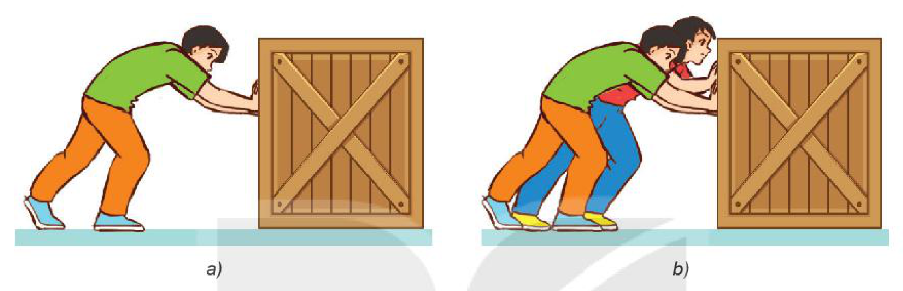
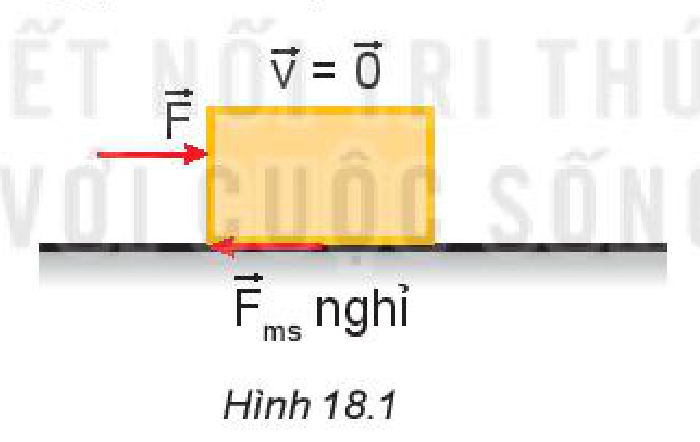
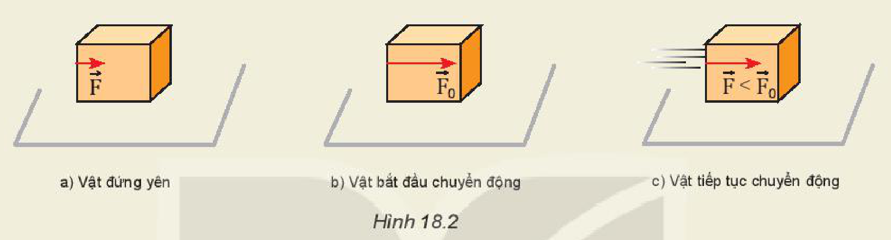
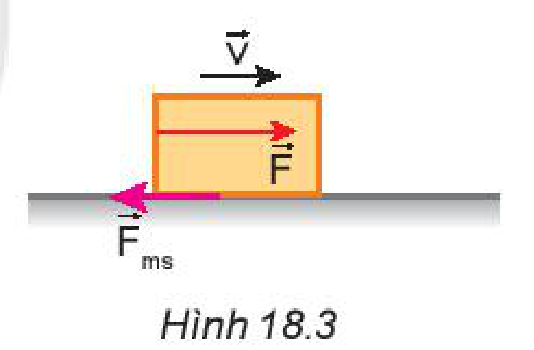
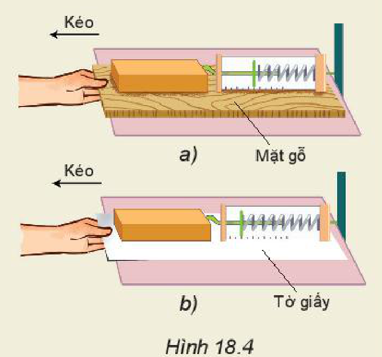
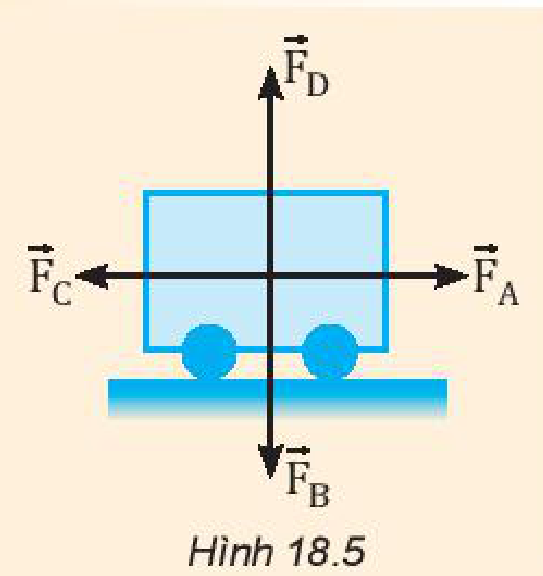
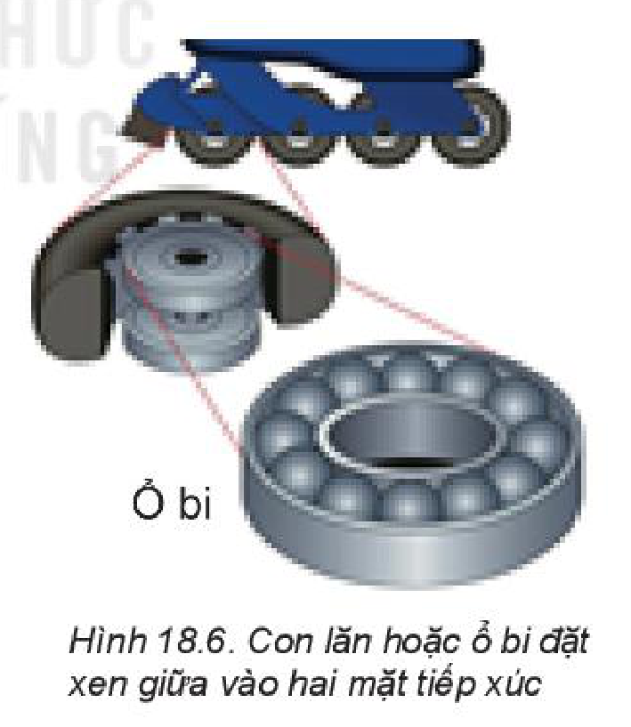

<!-- pdf:73 -->

# BÀI 18: LỰC MA SÁT

## 🔴 Mở đầu

> Điều gì ngăn cản thùng hàng (Hình a), khiến nó không thể di chuyển? Tại sao lực đẩy tăng lên (Hình b) mà vẫn không làm cho thùng hàng di chuyển?
>
> Có cách nào làm thùng hàng di chuyển dễ dàng hơn không?
>
> 
> *Hình mở đầu: a) Một người đẩy thùng hàng; b) Hai người đẩy thùng hàng*

## I. LỰC MA SÁT NGHỈ

**Lực ma sát nghỉ** là lực ma sát tác dụng lên mặt tiếp xúc của vật, khi vật có xu hướng chuyển động nhưng chưa chuyển động (Hình 18.1).

*Hình 18.1*

> **Câu hỏi:**
> 1. Điều nào sau đây **không** đúng khi nói về lực ma sát nghỉ?
>    - A. Lực ma sát nghỉ luôn xuất hiện ở bề mặt tiếp xúc giữa hai vật.
>    - B. Lực ma sát nghỉ giữ cho các điểm tiếp xúc của vật không trượt trên bề mặt.
>    - C. Một vật có thể đứng yên trên mặt phẳng nghiêng mà không cần đến lực ma sát nghỉ.
>    - D. Một vật có thể đứng yên trên mặt phẳng ngang mà không cần đến lực ma sát nghỉ.
> 2. Các tình huống sau đây liên quan đến loại lực ma sát nào?
>    - a) Xoa hai bàn tay vào nhau.
>    - b) Đặt vali lên một băng chuyền đang chuyển động ở sân bay.

<!-- pdf:74 -->

> **Hoạt động:**
> Quan sát Hình 18.2 và thảo luận các tình huống sau:
>
> Đặt trên bàn một vật nặng có dạng hình hộp.
> - Lúc đầu ta đẩy vật bằng một lực có cường độ nhỏ, vật không chuyển động (Hình 18.2a). Lực nào đã ngăn không cho vật chuyển động?
> - Tăng lực đẩy đến khi lớn hơn một giá trị $F_0$ nào đó (Hình 18.2b) thì vật bắt đầu trượt. Điều đó chứng tỏ gì?
> - Khi vật đã trượt, ta chỉ cần đẩy vật bằng một lực nhỏ hơn giá trị $F_0$ vẫn duy trì được chuyển động trượt của vật (Hình 18.2c). Điều đó chứng tỏ gì?
>
> 
> *Hình 18.2: a) Vật đứng yên; b) Vật bắt đầu chuyển động; c) Vật tiếp tục chuyển động*

## II. LỰC MA SÁT TRƯỢT

Ở lớp 6 ta đã biết, **lực ma sát trượt** là lực ma sát cản trở vật trượt trên bề mặt tiếp xúc (Hình 18.3).

Các thí nghiệm dưới đây sẽ giúp các em tìm hiểu thêm một số đặc điểm của lực ma sát trượt.

*Hình 18.3*

### 1. Đặc điểm của lực ma sát trượt

> **Thí nghiệm 1:** Kiểm chứng độ lớn của lực ma sát phụ thuộc vào vật liệu và tình trạng của bề mặt tiếp xúc, nhưng không phụ thuộc vào diện tích tiếp xúc.
>
> **Chuẩn bị:** Lực kế (có GHĐ $1,0\text{ N}$, ĐCNN $0,01\text{ N}$), khối gỗ hình hộp chữ nhật, các bề mặt: gỗ, giấy.
>
> **Tiến hành:**
> 1. Đặt mặt có diện tích lớn của khối gỗ lên bề mặt tiếp xúc.
>    - Gắn lực kế vào giá thí nghiệm để cố định lực kế theo phương nằm ngang.
>    - Móc khối gỗ vào lực kế, lần lượt kéo các mặt tiếp xúc (mặt gỗ, mặt tờ giấy) theo phương nằm ngang để chúng trượt đều dưới khối gỗ (Hình 18.4).
>    - Ghi số chỉ của lực kế vào Bảng 18.1. Lấy giá trị trung bình của các số chỉ lực kế làm độ lớn của lực ma sát trượt.
> 2. Đặt mặt có diện tích nhỏ của khối gỗ lên bề mặt tiếp xúc và lặp lại thí nghiệm như trên.
>
> 
> *Hình 18.4: a) Mặt gỗ; b) Tờ giấy*

<!-- pdf:75 -->

> **Bảng 18.1**
>
> | Bề mặt tiếp xúc | Độ lớn lực ma sát trượt ($\text{N}$) - Lần 1 | Độ lớn lực ma sát trượt ($\text{N}$) - Lần 2 | Độ lớn lực ma sát trượt ($\text{N}$) - Lần 3 | Độ lớn lực ma sát trượt ($\text{N}$) - Trung bình |
> | :--- | :---: | :---: | :---: | :---: |
> | Mặt gỗ | ? | ? | ? | ? |
> | Mặt giấy | ? | ? | ? | ? |
>
> **Thảo luận và phân tích:**
> - a) Nêu các lực tác dụng lên khối gỗ khi mặt tiếp xúc bên dưới nó được kéo trượt đều. Tại sao khi đó số chỉ của lực kế bằng độ lớn của lực ma sát trượt?
> - b) Sắp xếp thứ tự theo mức tăng dần lực ma sát trên mỗi bề mặt.
> - c) Điều gì xảy ra đối với độ lớn của lực ma sát trượt khi diện tích tiếp xúc thay đổi, khi vật liệu và tình trạng của bề mặt tiếp xúc thay đổi?

> **Thí nghiệm 2:** Mối liên hệ giữa độ lớn của lực ma sát trượt với độ lớn của áp lực lên bề mặt tiếp xúc.
>
> **Chuẩn bị:** Lực kế (có GHĐ $1,0\text{ N}$, ĐCNN $0,01\text{ N}$), ba khối gỗ hình hộp chữ nhật giống nhau, mặt tiếp xúc: gỗ.
>
> **Tiến hành:**
> - Đo trọng lượng của khối gỗ bằng lực kế. Ghi vào Bảng 18.2 (Áp lực của khối gỗ lên mặt tiếp xúc nằm ngang có độ lớn bằng trọng lượng của khối gỗ).
> - Gắn lực kế vào giá thí nghiệm để cố định lực kế theo phương nằm ngang.
> - Móc khối gỗ vào lực kế, kéo mặt tiếp xúc (mặt gỗ) theo phương nằm ngang để nó trượt đều dưới khối gỗ. Ghi lại số chỉ của lực kế trong 3 lần thí nghiệm vào Bảng 18.2. Lấy giá trị trung bình các kết quả đo.
> - Lần lượt đặt thêm 1, 2 khối gỗ lên khối gỗ đầu tiên và lặp lại bước 3.
>
> **Bảng 18.2**
>
> | Áp lực của các khối gỗ ($\text{N}$) | Độ lớn lực ma sát trượt ($\text{N}$) - Lần 1 | Độ lớn lực ma sát trượt ($\text{N}$) - Lần 2 | Độ lớn lực ma sát trượt ($\text{N}$) - Lần 3 | Độ lớn lực ma sát trượt ($\text{N}$) - Trung bình |
> | :--- | :---: | :---: | :---: | :---: |
> | 1 khối gỗ: ... | ? | ? | ? | ? |
> | 2 khối gỗ: ... | ? | ? | ? | ? |
> | 3 khối gỗ: ... | ? | ? | ? | ? |
>
> **Thảo luận và phân tích:**
> - a) Điều gì xảy ra đối với độ lớn của lực ma sát trượt khi tăng áp lực lên bề mặt tiếp xúc?
> - b) Vẽ đồ thị cho thấy sự thay đổi độ lớn của lực ma sát trượt khi tăng dần độ lớn của áp lực.
> - c) Nêu kết luận về những đặc điểm của lực ma sát trượt.

<!-- pdf:76 -->

### 2. Công thức của lực ma sát trượt

**a) Hệ số ma sát trượt**

Tỉ số giữa độ lớn của lực ma sát trượt $F_{mst}$ và áp lực $N$ gọi là **hệ số ma sát trượt**, kí hiệu là $\mu$.

Hệ số $\mu$ phụ thuộc vào vật liệu và tình trạng của hai mặt tiếp xúc (xem Bảng 18.3).

**Bảng 18.3.** Hệ số ma sát trượt (gần đúng) của một số cặp vật liệu

| Cặp vật liệu tiếp xúc nhau | $\mu$ |
| :--- | :---: |
| Gỗ trên gỗ (khô) | $0,20$ |
| Thép trên thép (khô) | $0,57$ |
| Thép trên thép (trơn) | $0,10$ |
| Cao su trên bê tông (khô) | $0,70$ |
| Cao su trên bê tông (ướt) | $0,50$ |
| Cao su trên băng | $0,10$ |
| Mặt khớp xương người | $0,01$ |
<!-- ocr-ok: đối chiếu ảnh trang PDF 76 khớp nguyên văn bảng -->

**b) Công thức tính lực ma sát trượt**

$$F_{mst} = \mu \cdot N$$
<!-- ocr-ok: đối chiếu ảnh trang PDF 76 khớp nguyên văn công thức -->

> **Lưu ý:** Trong các điều kiện cùng áp lực $N$ thì lực ma sát nghỉ tác dụng vào các vật lăn nhỏ hơn lực ma sát trượt tác dụng lên các vật trượt rất nhiều.
<!-- term: Lực ma sát lăn -->

## III. BÀI TẬP VÍ DỤ

Một người đi xe đạp có khối lượng tổng cộng $m = 86\text{ kg}$ đang chuyển động trên đường nằm ngang với vận tốc $v_0 = 4\text{ m/s}$. Nếu người đi xe ngừng đạp và hãm phanh để giữ không cho các bánh xe quay, xe trượt đi một đoạn đường $2\text{ m}$ thì dừng lại.
1. Lực nào đã gây ra gia tốc cho xe? Tính độ lớn của lực này.
2. Tính hệ số ma sát trượt giữa mặt đường và lốp xe. Lấy $g = 10\text{ m/s}^2$.

**Giải**

Khi tính lực và gia tốc, ta coi người + xe là chất điểm. Chọn chiều dương là chiều chuyển động của người và xe.

1. Gia tốc của chuyển động được tính bằng công thức:

$$a = \frac{v^2 - v_0^2}{2s} = \frac{0 - 4^2}{2 \cdot 2} = -4\text{ m/s}^2$$
<!-- ocr-ok: đối chiếu ảnh trang PDF 76 khớp nguyên văn công thức -->

Lực gây ra gia tốc này là lực ma sát trượt của mặt đường tác dụng lên lốp xe:

$$F_{mst} = m \cdot a = 86 \cdot (-4) = -344\text{ N}$$
<!-- ocr-ok: đối chiếu ảnh trang PDF 76 khớp nguyên văn công thức -->

Dấu "$-$" chứng tỏ lực ma sát trượt ngược chiều chuyển động.

2. Hệ số ma sát trượt giữa lốp xe với mặt đường được tính từ công thức:

$$\mu = \frac{F_{mst}}{N}$$
<!-- ocr-ok: đối chiếu ảnh trang PDF 76 khớp nguyên văn công thức -->

Ta có $\vec{P} + \vec{N} = \vec{0}$, vì ô tô chuyển động trên đường nằm ngang nên $N = P = m \cdot g$.

$$\mu = \frac{344}{86 \cdot 10} = 0,4$$
<!-- ocr-ok: đối chiếu ảnh trang PDF 76 khớp nguyên văn công thức -->

> **Câu hỏi:**
> 1. Các lực tác dụng lên xe chở hàng được quy ước vẽ tại trọng tâm của xe (Hình 18.5):
>    - a) Các lực này có tên gọi là gì?
>    - b) Hãy chỉ ra các cặp lực cân bằng nhau.
> 2. Để đẩy chiếc tủ, cần tác dụng một lực theo phương nằm ngang có giá trị tối thiểu $300\text{ N}$ để thắng lực ma sát nghỉ. Nếu người kéo tủ với lực $35\text{ N}$ và người kia đẩy tủ với lực $260\text{ N}$, có thể làm dịch chuyển tủ được không? Biểu diễn các lực tác dụng lên tủ.
>
> 
> *Hình 18.5*

<!-- pdf:77 -->

## IV. LỰC MA SÁT TRONG ĐỜI SỐNG

> **Câu hỏi:**
> Nêu vai trò của lực ma sát trong các tình huống sau:
> - a) Người di chuyển trên đường.
> - b) Vận động viên thể dục dụng cụ xoa phấn vào lòng bàn tay trước khi nâng tạ.

> **Hoạt động:**
> 1. Thảo luận để làm sáng tỏ những vấn đề sau đây:
>    - Trong thực tế, có một số trường hợp lực ma sát có tác dụng cản trở chuyển động, nhưng cũng có trường hợp lực ma sát thúc đẩy chuyển động.
>    - Vai trò của ma sát trong lĩnh vực thể thao.
> 2. Nêu một số cách làm giảm ma sát trong kĩ thuật và trong đời sống.

## 📌 Em đã học

- Lực ma sát nghỉ và lực ma sát trượt đều là những lực tiếp xúc.
- Lực ma sát nghỉ có giá trị cực đại $F_0$. Khi lực đẩy (hay kéo) vật $F > F_0$ thì vật bắt đầu trượt.
- Công thức tính lực ma sát trượt: $F_{mst} = \mu \cdot N$.
  Trong đó $\mu$ là hệ số ma sát trượt, không có đơn vị; $N$ là áp lực lên bề mặt vật trượt.
<!-- term: Lực ma sát nghỉ cực đại -->

> **Em có biết:**
> Trong đời sống và trong kĩ thuật, để giảm ma sát người ta thay vật trượt bằng vật lăn (hình cầu hoặc hình trụ) (Hình 18.6).
> <!-- term: Lực ma sát lăn -->
>
> 
> *Hình 18.6. Con lăn hoặc ổ bi đặt xen giữa vào hai mặt tiếp xúc*

## ✏️ Em có thể

- Thuyết trình về ích lợi, tác hại của ma sát trong an toàn giao thông đường bộ.

## 📷 Danh sách hình trong bài

| Mã hình | Số hình SGK | Trang PDF | Chú thích |
| --- | --- | --- | --- |
| H10-vat_ly-b18-01 | — | 73 | a) Một người đẩy thùng hàng; b) Hai người đẩy thùng hàng (hình mở đầu) |
| H10-vat_ly-b18-02 | Hình 18.1 | 73 | Lực ma sát nghỉ tác dụng lên vật |
| H10-vat_ly-b18-03 | Hình 18.2 | 74 | a) Vật đứng yên; b) Vật bắt đầu chuyển động; c) Vật tiếp tục chuyển động |
| H10-vat_ly-b18-04 | Hình 18.3 | 74 | Lực ma sát trượt cản trở vật trượt trên bề mặt tiếp xúc |
| H10-vat_ly-b18-05 | Hình 18.4 | 74 | Thí nghiệm đo lực ma sát trượt trên: a) Mặt gỗ; b) Tờ giấy |
| H10-vat_ly-b18-06 | Hình 18.5 | 76 | Các lực tác dụng lên xe chở hàng |
| H10-vat_ly-b18-07 | Hình 18.6 | 77 | Con lăn hoặc ổ bi đặt xen giữa vào hai mặt tiếp xúc |
