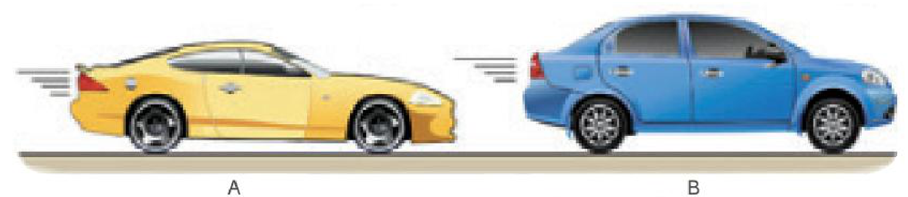
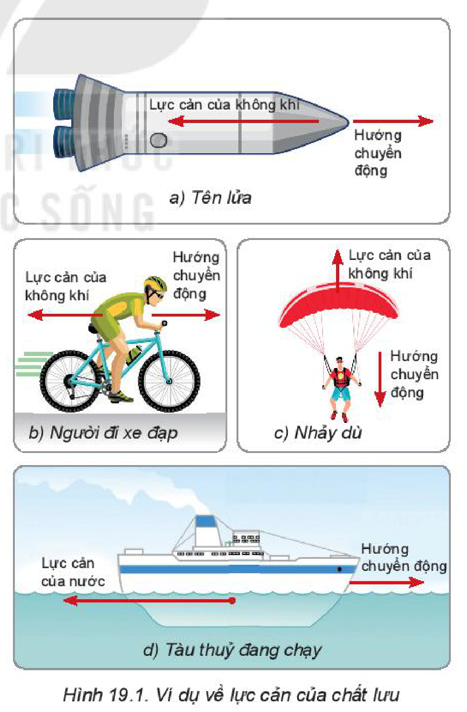
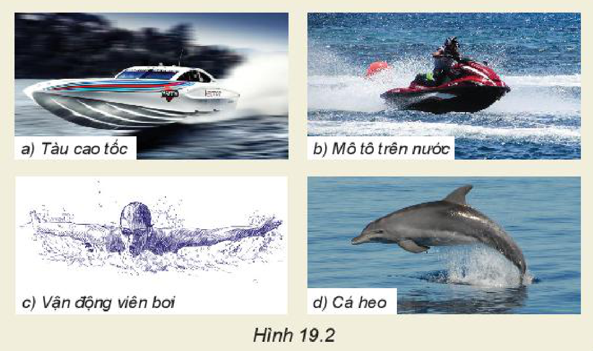
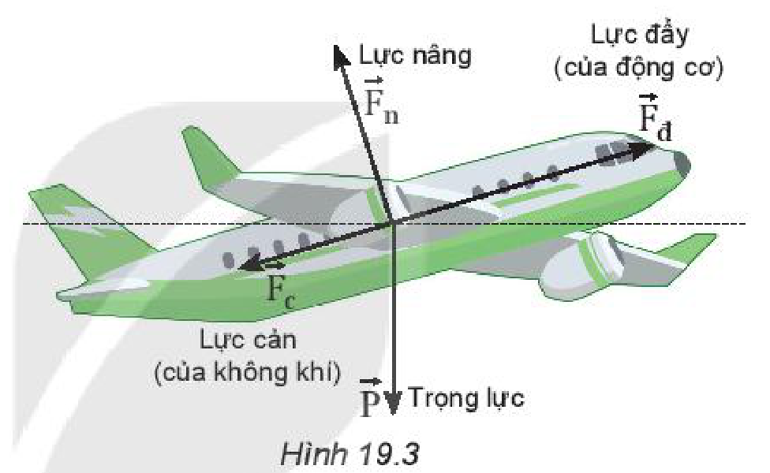
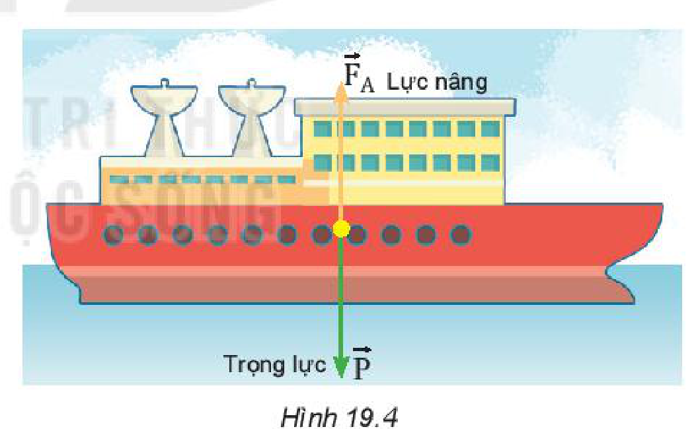
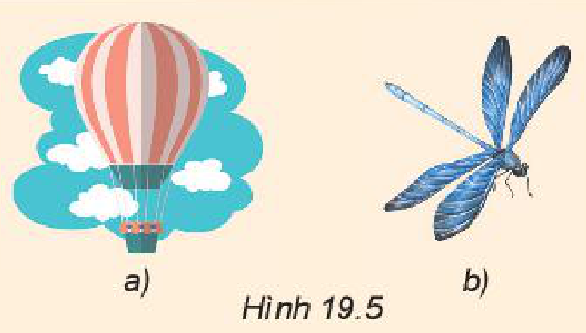
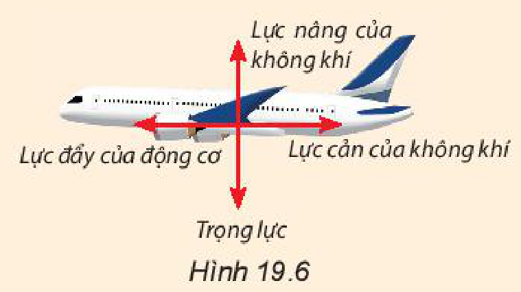
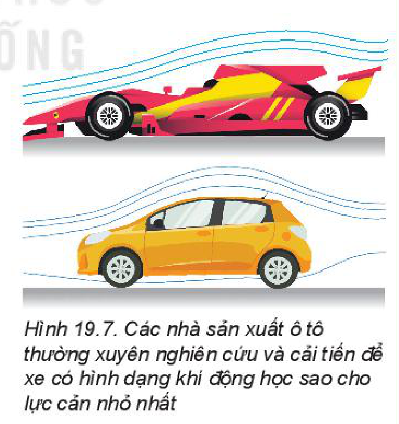

<!-- pdf:78 -->

# BÀI 19: LỰC CẢN VÀ LỰC NÂNG

## 🔴 Mở đầu

> Một hãng ô tô sử dụng cùng loại động cơ cho hai chiếc ô tô A và B có khối lượng như nhau. Khi cho hai ô tô này chạy thử nghiệm trên cùng quãng đường $100\text{ km}$, với cùng tốc độ $72\text{ km/h}$, các kĩ sư thấy rằng ô tô A tiêu thụ ít nhiên liệu hơn nhiều so với ô tô B.
>
> Tại sao lại có sự khác biệt như vậy?
>
> 
> *Hình mở đầu: Hai chiếc ô tô A và B*

## I. LỰC CẢN CỦA CHẤT LƯU

### 1. Lực cản

Thông thường thuật ngữ **chất lưu** được dùng để chỉ chất lỏng và chất khí.

Mọi vật chuyển động trong chất lưu luôn chịu tác dụng bởi **lực cản của chất lưu**. Lực này ngược hướng chuyển động và cản trở chuyển động của vật (Hình 19.1).

*Hình 19.1. Ví dụ về lực cản của chất lưu: a) Tên lửa; b) Người đi xe đạp; c) Nhảy dù; d) Tàu thuỷ đang chạy*

### 2. Lực cản phụ thuộc vào những yếu tố nào?

> **Hoạt động:**
> - a) Bằng cảm nhận trực giác, em thử đoán xem độ lớn của lực cản phụ thuộc vào những yếu tố nào?
> - b) Em hãy tìm những thí nghiệm để chứng minh cho những dự đoán của em.

> **Câu hỏi:**
> 1. Trong hình ở phần mở đầu bài học, ô tô nào chịu lực cản nhỏ hơn?
> 2. Nêu thêm một số ví dụ chứng tỏ lực cản của không khí liên quan đến hình dạng và tốc độ của vật.

<!-- pdf:79 -->

> **Hoạt động:**
> Quan sát Hình 19.2 và thảo luận để làm sáng tỏ về lực cản của nước phụ thuộc vào hình dạng của các vật chuyển động trong nước như thế nào.
>
> 
> *Hình 19.2: a) Tàu thuỷ; b) Sứa biển; c) Vận động viên bơi; d) Cá heo*

**Nhận xét:** Lực cản của chất lưu (không khí, nước) phụ thuộc vào hình dạng và tốc độ của vật.

## II. LỰC NÂNG CỦA CHẤT LƯU

Khi vật chuyển động trong nước hay trong không khí thì ngoài lực cản (của không khí, của nước), vật còn chịu tác dụng của **lực nâng**.

Hình 19.3 cho thấy, nếu cánh máy bay nghiêng đi một chút, chếch theo luồng gió, thì tăng thêm lực nâng tác dụng vuông góc với mặt dưới của cánh để nâng máy bay lên cao.

*Hình 19.3*

Sau đây là một số tình huống trong thực tiễn, cho thấy khi các vật ở trong chất lưu, chúng chịu tác dụng của lực nâng. Việc giải thích lực nâng tác dụng lên vật sẽ trình bày ở bài 34 của chương VII.

Nhờ có lực nâng:
- Máy bay có thể di chuyển trong không khí (Hình 19.3).
- Tàu thuyền có thể nổi và di chuyển được trên mặt nước (Hình 19.4).
- Khinh khí cầu lơ lửng trên không trung (Hình 19.5a).
- Nhiều sinh vật bay lượn dễ dàng trong không khí (Hình 19.5b).

*Hình 19.4*

- Khi vật rơi trong chất lưu dưới tác dụng của trọng lực và lực cản của chất lưu thì đến một lúc nào đó vật sẽ đạt tới vận tốc giới hạn và sẽ chuyển động đều với vận tốc này.
<!-- term: Vận tốc giới hạn -->

> **Lưu ý:**
> **Lực đẩy Archimedes**
>
> **Lực đẩy Archimedes** học ở môn Khoa học tự nhiên lớp 8 là trường hợp riêng của lực nâng vật đứng yên trong chất lưu.
>
> Công thức tính lực đẩy Archimedes:
>
> $$F_A = \rho \cdot g \cdot V$$
>
> Trong đó:
> - $F_A$: lực đẩy Archimedes ($\text{N}$).
> - $\rho$: khối lượng riêng của chất lỏng ($\text{kg/m}^3$).
> - $V$: thể tích phần chất lỏng bị vật chiếm chỗ ($\text{m}^3$).

<!-- pdf:80 -->

> **Câu hỏi:**
> 1. Chuồn chuồn có thể bay lượn trong không trung. Tại sao chúng không bị rơi xuống đất do trọng lực (Hình 19.5b)?
> 2. Biểu diễn các lực tác dụng lên một khí cầu đang lơ lửng trong không khí (Hình 19.5a).
> 3. Hình 19.6 biểu diễn các vectơ lực tác dụng lên một máy bay đang bay ngang ở độ cao ổn định với tốc độ không đổi. Nếu khối lượng tổng cộng của máy bay là $500\text{ tấn}$ thì lực nâng có độ lớn bao nhiêu?
> 4. Nêu những điểm khác biệt giữa lực cản và lực nâng.
>
> 
> *Hình 19.5*
>
> 
> *Hình 19.6*

## 📌 Em đã học

- Lực cản của chất lưu có tác dụng tương tự như lực ma sát, chúng làm chuyển động của các vật bị chậm lại. Lực cản phụ thuộc vào hình dạng và tốc độ của vật.
- Lực nâng của chất lưu giúp khinh khí cầu lơ lửng trên không trung, máy bay di chuyển trong không khí, cho phép tàu thuyền di chuyển trên mặt nước,...

## ✏️ Em có thể

1. Giải thích tại sao các phương tiện giao thông tốc độ cao lại cần có hình con thoi.
2. Chỉ ra được lực nâng và lực cản khi máy bay hạ cánh hoặc cất cánh.

> **Em có biết:**
> **Hình dạng khí động học là gì?**
>
> Người đầu tiên khởi xướng mô hình khí động học trên ô tô là nhà thiết kế nổi tiếng Eduard Rumpler, cha đẻ của ngành hàng không Đức.
>
> Vào những năm 1930 – 1940, các cuộc đua ô tô bỗng nhiên trở thành "phong trào" rất được ưa chuộng. Các kĩ sư đã cố gắng sản xuất những chiếc xe chuyển động càng nhanh càng tốt. Tuy nhiên, tại đường đua Le Mans, ở nước Pháp năm 1937, chiếc ô tô có dung tích động cơ $1,7\text{ lít}$ đã gây sốc với hai chiến thắng ngoạn mục trước những ô tô có dung tích động cơ $2\text{ lít}$. Bí quyết về sau được công bố: chiếc ô tô chiến thắng là nhờ cải tiến công nghệ và hình dạng sao cho lực cản nhỏ nhất.
>
> Từ đó đến nay, ngành công nghiệp ô tô đã tiến một bước rất dài. Hầu hết các kiểu xe ngày nay đều chú trọng đến biện pháp tối ưu hình dạng con thoi (trong khoa học gọi là **hình khí động học**) và điều đó đã giúp cho xe ít hao phí nhiên liệu hơn xưa.
>
> 
> *Hình 19.7. Các nhà sản xuất ô tô thường xuyên nghiên cứu và cải tiến để xe có hình dạng khí động học sao cho lực cản nhỏ nhất*

## 📷 Danh sách hình trong bài

| Mã hình | Số hình SGK | Trang PDF | Chú thích |
| --- | --- | --- | --- |
| H10-vat_ly-b19-01 | — | 78 | Hai chiếc ô tô A và B (hình mở đầu) |
| H10-vat_ly-b19-02 | Hình 19.1 | 78 | Ví dụ về lực cản của chất lưu |
| H10-vat_ly-b19-03 | Hình 19.2 | 79 | a) Tàu thuỷ; b) Sứa biển; c) Vận động viên bơi; d) Cá heo |
| H10-vat_ly-b19-04 | Hình 19.3 | 79 | Các lực tác dụng lên máy bay khi đang bay |
| H10-vat_ly-b19-05 | Hình 19.4 | 79 | Trọng lực và lực nâng tác dụng lên tàu thuỷ trên mặt nước |
| H10-vat_ly-b19-06 | Hình 19.5 | 80 | a) Khinh khí cầu lơ lửng; b) Chuồn chuồn bay trong không trung |
| H10-vat_ly-b19-07 | Hình 19.6 | 80 | Các vectơ lực tác dụng lên máy bay đang bay ngang ở độ cao ổn định |
| H10-vat_ly-b19-08 | Hình 19.7 | 80 | Các nhà sản xuất ô tô thường xuyên nghiên cứu và cải tiến để xe có hình dạng khí động học sao cho lực cản nhỏ nhất |
