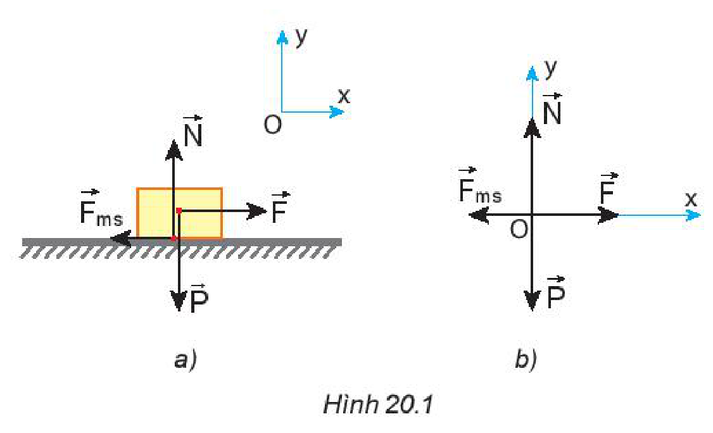
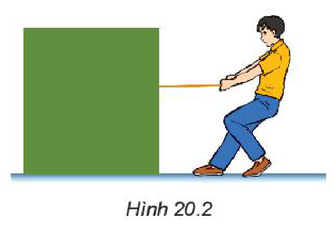
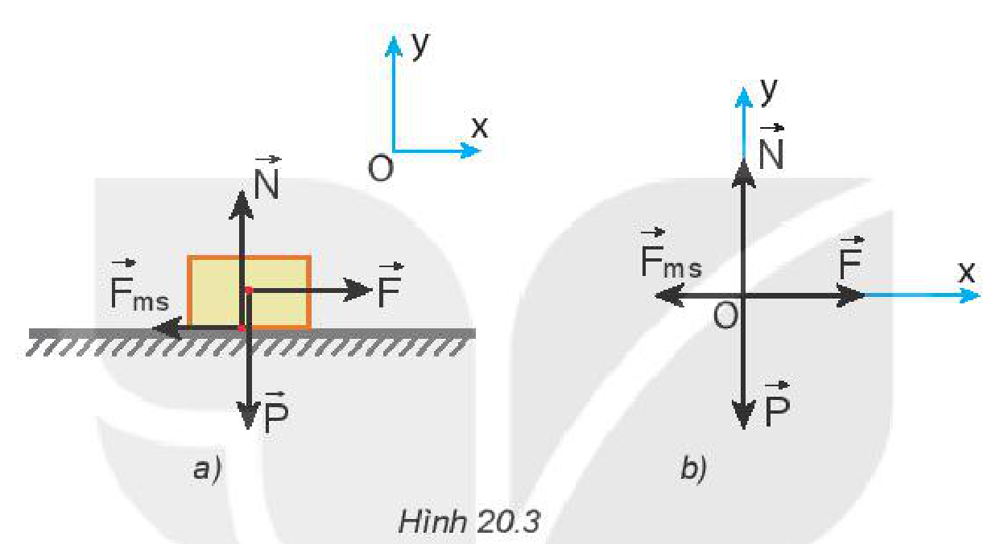
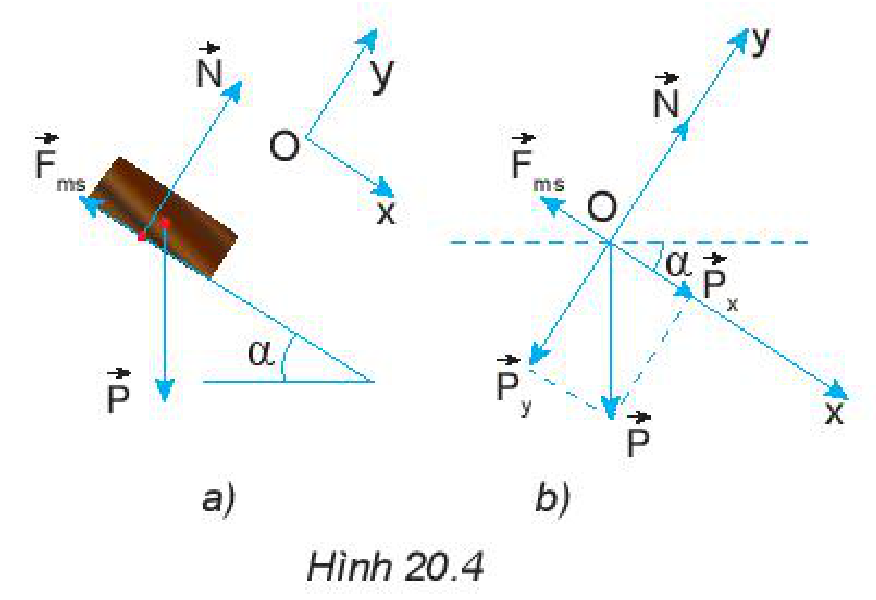

<!-- pdf:81 -->

# BÀI 20: MỘT SỐ VÍ DỤ VỀ CÁCH GIẢI CÁC BÀI TOÁN THUỘC PHẦN ĐỘNG LỰC HỌC

## I. CÁC BƯỚC GIẢI CHÍNH

1. Chọn vật khảo sát chuyển động. Biểu diễn các lực tác dụng lên vật, trong đó làm rõ phương, chiều và điểm đặt của từng lực.
2. Chọn hai trục vuông góc $Ox$ và $Oy$; trong đó trục $Ox$ cùng hướng với chuyển động của vật hay cùng hướng với lực kéo khi vật đứng yên. Phân tích các lực theo hai trục này. Áp dụng định luật 2 Newton theo hai trục toạ độ $Ox$ và $Oy$.
<!-- term: Phương pháp động lực học -->

$$Ox: F_x = F_{1x} + F_{2x} + \dots = m \cdot a_x \quad (1)$$
<!-- ocr-ok: đối chiếu ảnh trang PDF 81 khớp nguyên văn công thức -->

$$Oy: F_y = F_{1y} + F_{2y} + \dots = 0 \quad (2)$$
<!-- ocr-ok: đối chiếu ảnh trang PDF 81 khớp nguyên văn công thức -->

3. Giải hệ phương trình (1) và (2) để tìm gia tốc hay tìm lực, tuỳ từng bài toán.
<!-- term: Phương pháp động lực học -->

## II. CÁC LOẠI BÀI TOÁN

### 1. Bài toán xác định gia tốc của vật khi biết lực tác dụng vào vật

**Ví dụ.** Một người đẩy một thùng hàng, khối lượng $50\text{ kg}$, trượt trên sàn nhà. Lực đẩy có phương nằm ngang với độ lớn là $180\text{ N}$. Tính gia tốc của thùng hàng, biết hệ số ma sát trượt giữa thùng hàng và sàn nhà là $0,25$. Lấy $g = 9,8\text{ m/s}^2$.

**Giải**

Thùng hàng chịu tác dụng của bốn lực: trọng lực $\vec{P}$, lực đẩy $\vec{F}$, phản lực $\vec{N}$ và lực ma sát trượt $\vec{F}_{ms}$ của sàn (Hình 20.1a).

Coi thùng hàng như một chất điểm (Hình 20.1b).

*Hình 20.1*

Áp dụng định luật 2 Newton cho chuyển động của vật theo hai trục $Ox, Oy$:

$$\begin{cases} Ox: F_x = F - F_{ms} = m \cdot a_x = m \cdot a \quad (1) \\ Oy: F_y = N - P = 0 \quad (2) \end{cases}$$
<!-- ocr-ok: đối chiếu ảnh trang PDF 81 khớp nguyên văn công thức -->

$$F_{ms} = \mu \cdot N \quad (3)$$
<!-- ocr-ok: đối chiếu ảnh trang PDF 81 khớp nguyên văn công thức -->

Giải hệ phương trình:

Từ (2) $\Rightarrow N = P = m \cdot g = 50 \cdot 9,8 = 490\text{ N}$

$$F_{ms} = \mu \cdot N = 0,25 \cdot 490 = 122,5\text{ N}$$
<!-- ocr-ok: đối chiếu ảnh trang PDF 81 khớp nguyên văn công thức -->

$$a = \frac{F - F_{ms}}{m} = \frac{180 - 122,5}{50} = 1,15\text{ m/s}^2$$
<!-- ocr-ok: đối chiếu ảnh trang PDF 81 khớp nguyên văn công thức -->

Thùng hàng trượt với gia tốc $a = 1,15\text{ m/s}^2$ cùng chiều với trục $Ox$.

<!-- pdf:82 -->

### 2. Bài toán xác định lực tác dụng vào vật khi biết gia tốc

**Ví dụ 1.** Một người dùng dây buộc để kéo một thùng gỗ theo phương nằm ngang bằng một lực $\vec{F}$ (Hình 20.2). Khối lượng của thùng là $35\text{ kg}$. Hệ số ma sát giữa sàn và đáy thùng là $0,3$. Lấy $g = 9,8\text{ m/s}^2$.

Tính độ lớn của lực kéo trong hai trường hợp:
- a) Thùng trượt với gia tốc $0,2\text{ m/s}^2$.
- b) Thùng trượt đều.

*Hình 20.2*

**Giải**

Thùng chịu tác dụng của bốn lực: trọng lực $\vec{P} = m \cdot \vec{g}$, lực kéo $\vec{F}$, phản lực $\vec{N}$ và lực ma sát trượt $\vec{F}_{ms}$ của mặt sàn (Hình 20.3a).

*Hình 20.3*

Coi thùng như một chất điểm (Hình 20.3b) và áp dụng định luật 2 Newton cho các lực thành phần theo các phương $Ox, Oy$.

$$\begin{cases} Ox: F_x = F - F_{ms} = m \cdot a_x = m \cdot a \quad (1) \\ Oy: F_y = N - P = N - m \cdot g = 0 \quad (2) \end{cases}$$
<!-- ocr-ok: đối chiếu ảnh trang PDF 82 khớp nguyên văn công thức -->

$$F_{ms} = \mu \cdot N$$
<!-- ocr-ok: đối chiếu ảnh trang PDF 82 khớp nguyên văn công thức -->

Giải hệ phương trình:

Từ (2) $\Rightarrow N = m \cdot g$

Suy ra: $F_{ms} = \mu \cdot N = \mu \cdot m \cdot g$

Thay vào (1), ta được:

$$F = m \cdot a + \mu \cdot m \cdot g$$
<!-- ocr-ok: đối chiếu ảnh trang PDF 82 khớp nguyên văn công thức -->

$$F = m(a + \mu \cdot g)$$
<!-- ocr-ok: đối chiếu ảnh trang PDF 82 khớp nguyên văn công thức -->

- a) Thùng trượt với gia tốc $a = 0,2\text{ m/s}^2$
  $$F = m(a + \mu \cdot g) = 35(0,2 + 0,3 \cdot 9,8) = 109,9\text{ N}.$$
- b) Thùng trượt đều ($a = 0$)
  $$F = \mu \cdot m \cdot g = 0,3 \cdot 35 \cdot 9,8 = 102,9\text{ N}.$$
<!-- ocr-ok: đối chiếu ảnh trang PDF 82 khớp nguyên văn công thức -->

<!-- pdf:83 -->

**Ví dụ 2.** Một chiếc hộp gỗ được thả trượt không vận tốc ban đầu từ đầu trên của một tấm gỗ dài $L = 2\text{ m}$. Tấm gỗ đặt nghiêng $30^\circ$ so với phương ngang. Hệ số ma sát giữa đáy hộp và mặt gỗ là $0,2$. Lấy $g = 9,8\text{ m/s}^2$. Hỏi sau bao lâu thì hộp trượt xuống đến đầu dưới của tấm gỗ?

**Giải**

Hộp (coi là chất điểm) chịu tác dụng của ba lực: trọng lực $\vec{P}$, phản lực $\vec{N}$ và lực ma sát trượt $\vec{F}_{ms}$ (Hình 20.4a).

*Hình 20.4*

Phân tích trọng lực $\vec{P}$ thành hai lực thành phần $\vec{P}_x, \vec{P}_y$ (Hình 20.4b) và áp dụng định luật 2 Newton theo hai trục $Ox, Oy$:

$$\begin{cases} Ox: F_x = m \cdot g \cdot \sin\alpha - F_{ms} = m \cdot a_x = m \cdot a \quad (1) \\ Oy: F_y = N - m \cdot g \cdot \cos\alpha = 0 \quad (2) \end{cases}$$
<!-- ocr-ok: đối chiếu ảnh trang PDF 83 khớp nguyên văn công thức -->

$$F_{ms} = \mu \cdot N$$
<!-- ocr-ok: đối chiếu ảnh trang PDF 83 khớp nguyên văn công thức -->

Giải hệ phương trình: $a = g(\sin\alpha - \mu\cos\alpha)$

Thay số, ta được: $a = g(\sin 30^\circ - 0,2\cos 30^\circ) \approx 3,2\text{ m/s}^2$

Hộp trượt xuống với gia tốc $a = 3,2\text{ m/s}^2$, cùng chiều với trục $Ox$.

Áp dụng công thức:

$$L = \frac{1}{2}at^2 \Rightarrow t = \sqrt{\frac{2L}{a}} = \sqrt{\frac{2 \cdot 2}{3,2}} \approx 1,1\text{ s}$$
<!-- ocr-ok: đối chiếu ảnh trang PDF 83 khớp nguyên văn công thức -->

## III. BÀI TẬP TỰ GIẢI

1. Người ta đẩy một cái thùng có khối lượng $55\text{ kg}$ theo phương ngang với lực $220\text{ N}$ làm thùng chuyển động trên mặt phẳng ngang. Hệ số ma sát trượt giữa thùng và mặt phẳng là $0,35$. Tính gia tốc của thùng. Lấy $g = 9,8\text{ m/s}^2$.
2. Một quyển sách đặt trên mặt bàn nghiêng và được thả cho trượt xuống. Cho biết góc nghiêng $\alpha = 30^\circ$ so với phương ngang và hệ số ma sát giữa quyển sách và mặt bàn là $\mu = 0,3$. Lấy $g = 9,8\text{ m/s}^2$. Tính gia tốc của quyển sách và quãng đường đi được của nó sau $2\text{ s}$.
3. Một học sinh dùng dây kéo một thùng sách nặng $10\text{ kg}$ chuyển động trên mặt sàn nằm ngang. Dây nghiêng một góc chếch lên trên $30^\circ$ so với phương ngang. Hệ số ma sát trượt giữa đáy thùng và mặt sàn là $\mu = 0,2$ (lấy $g = 9,8\text{ m/s}^2$). Hãy xác định độ lớn của lực kéo để thùng sách chuyển động thẳng đều.
4. Hai vật có khối lượng lần lượt là $m_1 = 5\text{ kg}$ và $m_2 = 10\text{ kg}$ được nối với nhau bằng một sợi dây không dãn và được đặt trên một mặt sàn nằm ngang. Kéo vật 1 bằng một lực $\vec{F}$ nằm ngang có độ lớn $F = 45\text{ N}$. Hệ số ma sát giữa mỗi vật và mặt sàn là $\mu = 0,2$. Lấy $g = 9,8\text{ m/s}^2$. Tính gia tốc của mỗi vật và lực căng của dây nối.

## 📷 Danh sách hình trong bài

| Mã hình | Số hình SGK | Trang PDF | Chú thích |
| --- | --- | --- | --- |
| H10-vat_ly-b20-01 | Hình 20.1 | 81 | Thùng hàng chịu tác dụng của bốn lực trên sàn nhà |
| H10-vat_ly-b20-02 | Hình 20.2 | 82 | Kéo thùng gỗ theo phương nằm ngang |
| H10-vat_ly-b20-03 | Hình 20.3 | 82 | Biểu diễn các lực tác dụng lên thùng gỗ |
| H10-vat_ly-b20-04 | Hình 20.4 | 83 | Hộp gỗ trượt trên tấm gỗ đặt nghiêng |
