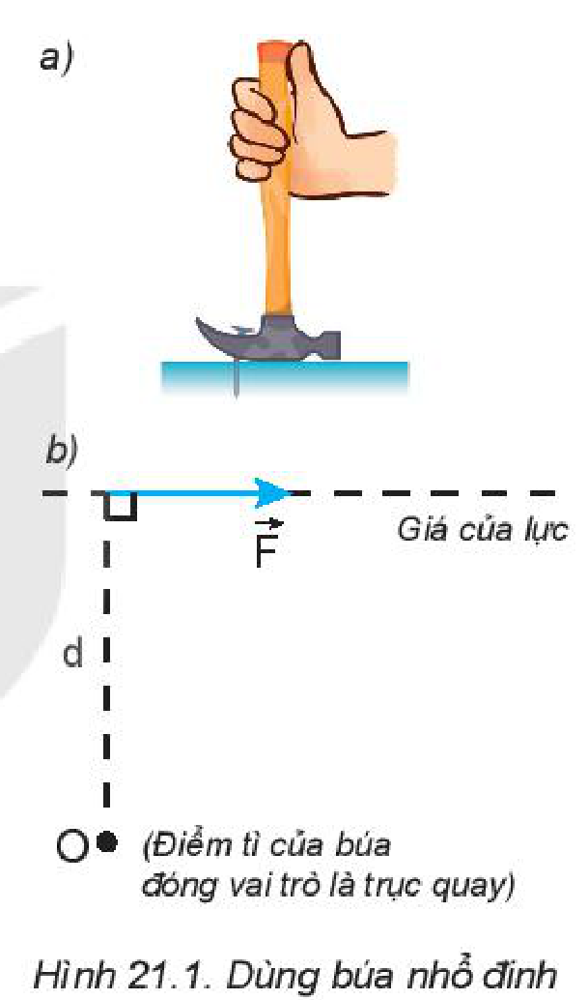
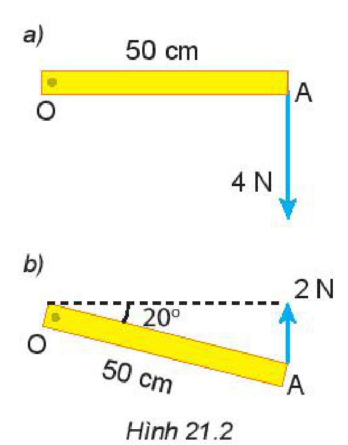
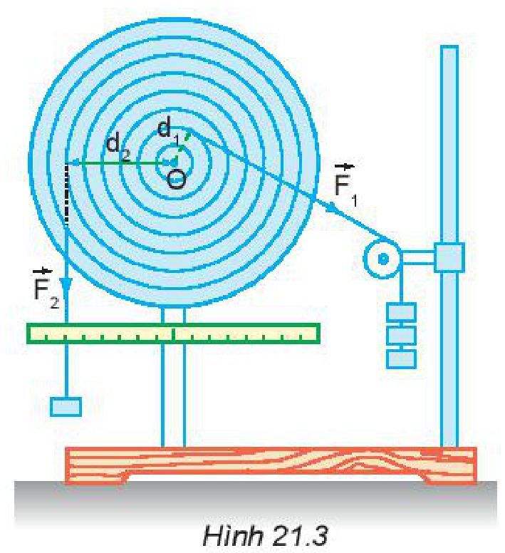
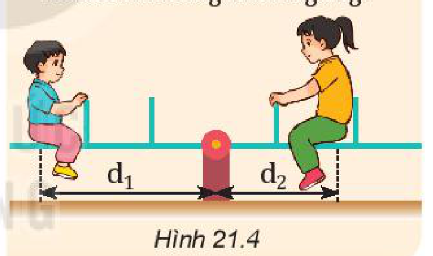
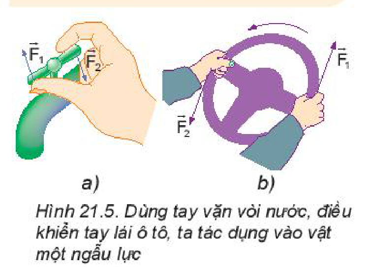
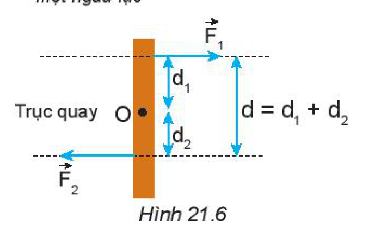
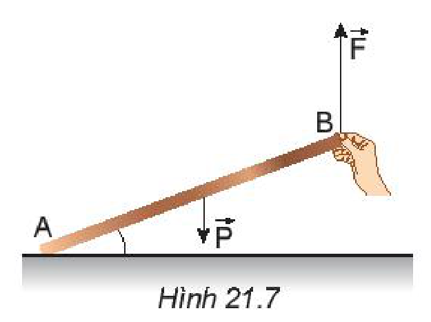
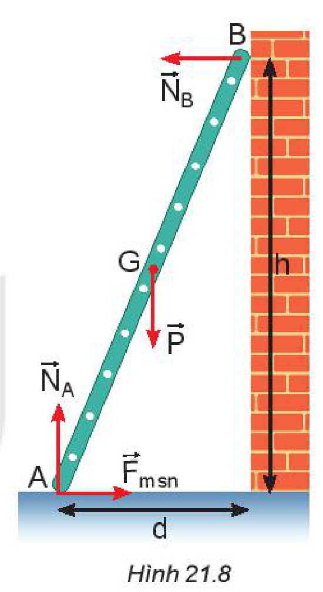
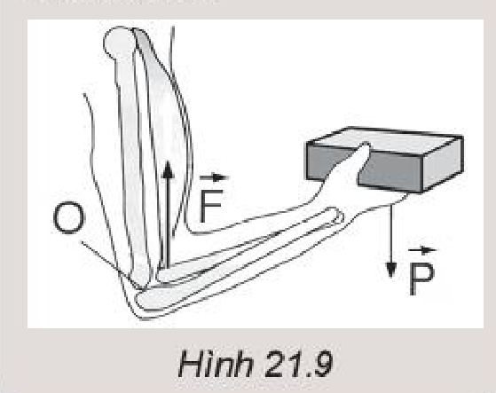

<!-- pdf:84 -->

# BÀI 21: MOMENT LỰC. CÂN BẰNG CỦA VẬT RẮN

## 🔴 Mở đầu

> Nếu dùng tay để siết chặt một đai ốc thì việc đó rất khó, tuy nhiên với dụng cụ thích hợp như cờ lê thì việc siết chặt đai ốc trở nên dễ dàng.
>
> Tác dụng của dụng cụ này thay đổi thế nào nếu ta tăng độ lớn của lực hoặc sử dụng cờ lê dài hơn?
>
> 
> *Hình mở đầu: Dùng cờ lê siết đai ốc*

## I. MOMENT LỰC

### 1. Tác dụng làm quay của lực

Ở lớp 8 các em đã học trong môn KHTN về tác dụng làm quay của lực. Muốn mô tả chính xác tác dụng của búa khi dùng để nhổ đinh (Hình 21.1a), ta phải đưa vào khái niệm mới là *cánh tay đòn của lực*.

**Cánh tay đòn của lực** là khoảng cách từ trục quay đến giá của lực, kí hiệu là $d$ (Hình 21.1b).

*Hình 21.1. Dùng búa nhổ đinh*

> **Câu hỏi:**
> 1. Mô tả thao tác dùng búa để nhổ đinh.
> 2. Lực $\vec{F}$ nên đặt vào đâu trên cán búa để nhổ đinh được dễ dàng? Khi đó cánh tay đòn ($d$) của lực lớn hay nhỏ?
> 3. Tác dụng làm quay của lực phụ thuộc những yếu tố nào?

### 2. Moment lực

Ví dụ trên cho phép ta lấy tích $F \cdot d$ làm đại lượng đặc trưng cho tác dụng làm quay của lực và gọi là **moment lực**, kí hiệu là $M$.
*Moment lực đối với trục quay là đại lượng đặc trưng cho tác dụng làm quay của lực và được đo bằng tích của lực với cánh tay đòn của nó.*

$$M = F \cdot d$$

Đơn vị của moment lực là niutơn mét ($\text{N.m}$).

> **Câu hỏi:**
> Hình 21.2 mô tả một chiếc thước mảnh $OA$, đồng chất, dài $50\text{ cm}$, có thể quay quanh trục quay cố định ở đầu $O$.
> 1. Trong các tình huống ở Hình 21.2a, b, thước $OA$ quay theo chiều kim đồng hồ hay ngược chiều kim đồng hồ?
> 2. Tính moment lực ứng với mỗi tình huống trong Hình 21.2.
>
> 
> *Hình 21.2*

<!-- pdf:85 -->

## II. QUY TẮC MOMENT LỰC

### 1. Thí nghiệm

Dùng một đĩa tròn có trục quay đi qua tâm $O$, trên mặt đĩa có những lỗ dùng để treo những quả cân. Tác dụng vào đĩa những lực $\vec{F}_1$ và $\vec{F}_2$ nằm trong mặt phẳng của đĩa sao cho đĩa đứng yên (Hình 21.3). Khi đó moment của lực $\vec{F}_1$ đã cân bằng với moment của lực $\vec{F}_2$.

Về độ lớn ta có: $F_1 \cdot d_1 = F_2 \cdot d_2$

*Hình 21.3*

> **Câu hỏi:**
> 1. Nếu bỏ lực $\vec{F}_1$ thì đĩa quay theo chiều nào?
> 2. Nếu bỏ lực $\vec{F}_2$ thì đĩa quay theo chiều nào?
> 3. Khi đĩa cân bằng lập tích $F_1 \cdot d_1$ và $F_2 \cdot d_2$ rồi so sánh.

### 2. Quy tắc moment lực (hay điều kiện cân bằng của một vật có trục quay cố định)

Muốn cho một vật có trục quay cố định ở trạng thái cân bằng, thì tổng các moment lực có xu hướng làm vật quay theo chiều kim đồng hồ phải bằng tổng các moment lực có xu hướng làm vật quay ngược chiều kim đồng hồ.
<!-- term: Quy tắc moment lực -->

Nếu chọn một chiều quay làm chiều dương thì điều kiện cân bằng của vật có trục quay cố định là: *Tổng các moment lực tác dụng lên vật (đối với một điểm bất kì) bằng $0$.*
<!-- term: Quy tắc moment lực -->

$$\sum M = 0$$

> **Câu hỏi:**
> - a) Sử dụng kiến thức về moment lực giải thích vì sao chiếc bập bênh đứng cân bằng.
> - b) Cho biết người chị (bên phải) có trọng lượng $P_2 = 300\text{ N}$, khoảng cách $d_2 = 1\text{ m}$, còn người em có trọng lượng $P_1 = 200\text{ N}$. Hỏi khoảng cách $d_1$ phải bằng bao nhiêu để bập bênh cân bằng nằm ngang?
>
> 
> *Hình 21.4*

## III. NGẪU LỰC

### 1. Ngẫu lực là gì?

**Ngẫu lực** là hệ hai lực song song, ngược chiều, có độ lớn bằng nhau và cùng đặt vào một vật.

Ngẫu lực tác dụng lên một vật chỉ làm cho vật quay chứ không tịnh tiến.

Các Hình 21.5a, b là những ví dụ về ngẫu lực.

*Hình 21.5. Dùng tay vặn vòi nước, điều khiển tay lái ô tô, ta tác dụng vào vật một ngẫu lực*

### 2. Moment của ngẫu lực

Vì hai lực $\vec{F}_1$ và $\vec{F}_2$ đều làm cho vật quay theo một chiều nên **moment của ngẫu lực** $M$ được xác định:

$$M = F_1 \cdot d_1 + F_2 \cdot d_2 \text{ hay } M = F \cdot d$$
<!-- ocr-ok: đối chiếu ảnh trang PDF 85 khớp nguyên văn công thức -->

Trong đó $F$ là độ lớn của mỗi lực, $d$ là khoảng cách giữa hai giá của lực, gọi là **cánh tay đòn của ngẫu lực** (Hình 21.6).

*Hình 21.6*

<!-- pdf:86 -->

## IV. ĐIỀU KIỆN CÂN BẰNG TỔNG QUÁT CỦA VẬT RẮN

> **Hoạt động:**
> 1. Đặt một chiếc thước dài trên bàn. Cho một bạn nâng một đầu thước lên và giữ yên (Hình 21.7). Hỏi:
>    - Khi thay đổi lực nâng $\vec{F}$ ta thấy thước quay quanh trục nào?
>    - Khi thước đang đứng yên ở vị trí như Hình 21.7, ta có thể áp dụng quy tắc moment lực được không và áp dụng như thế nào?
> 2. Khi một vật không có điểm tựa cố định. Ví dụ, thanh cứng tựa vào bức tường nhẵn, đầu dưới của thanh đặt trên mặt bàn nhám (Hình 21.8). Khi đó ta có thể áp dụng được quy tắc moment lực được không và áp dụng như thế nào?
>    Gợi ý: Chọn đầu $A$ của thanh để viết quy tắc moment.
>
> 
> *Hình 21.7*
>
> 
> *Hình 21.8*

Ta đã biết, vật đứng yên thì trọng lực phải cân bằng với các lực khác tác dụng lên vật. Như vậy, **điều kiện cân bằng của một vật rắn** là:
- Tổng các lực tác dụng lên vật bằng $0$.
- Tổng các moment lực tác dụng lên vật đối với một điểm bất kì chọn làm trục quay bằng $0$ (nếu chọn một chiều quay làm chiều dương).

> **Câu hỏi:**
> Áp dụng điều kiện cân bằng tổng quát vào thanh cứng tựa tường (Hình 21.8).
> - a) Viết điều kiện cân bằng thứ nhất.
> - b) Viết điều kiện cân bằng thứ hai đối với trục quay $A$.

## 📌 Em đã học

- Moment lực đối với trục quay là đại lượng đặc trưng cho tác dụng làm quay của lực và được đo bằng tích của lực với cánh tay đòn của nó: $M = F \cdot d$.
- Đơn vị của moment lực là niutơn mét ($\text{N.m}$).
- Tác dụng của ngẫu lực lên vật chỉ làm quay vật.
- Moment ngẫu lực: $M = F \cdot d = F(d_1 + d_2)$.
- Điều kiện cân bằng của một vật rắn: Tổng các lực tác dụng lên vật bằng $0$ và tổng moment lực tác dụng lên vật (đối với một điểm bất kì chọn làm trục quay) bằng $0$.

## ✏️ Em có thể

- Giải thích được sự cân bằng moment trong Hình 21.9.

*Hình 21.9*

## 📷 Danh sách hình trong bài

| Mã hình | Số hình SGK | Trang PDF | Chú thích |
| --- | --- | --- | --- |
| H10-vat_ly-b21-01 | — | 84 | Dùng cờ lê siết đai ốc (hình mở đầu) |
| H10-vat_ly-b21-02 | Hình 21.1 | 84 | Dùng búa nhổ đinh |
| H10-vat_ly-b21-03 | Hình 21.2 | 84 | Chiếc thước mảnh OA có thể quay quanh trục cố định ở đầu O |
| H10-vat_ly-b21-04 | Hình 21.3 | 85 | Thí nghiệm quy tắc moment lực với đĩa tròn có trục quay qua tâm O |
| H10-vat_ly-b21-05 | Hình 21.4 | 85 | Chiếc bập bênh đứng cân bằng |
| H10-vat_ly-b21-06 | Hình 21.5 | 85 | Dùng tay vặn vòi nước, điều khiển tay lái ô tô, ta tác dụng vào vật một ngẫu lực |
| H10-vat_ly-b21-07 | Hình 21.6 | 85 | Moment của ngẫu lực và cánh tay đòn của ngẫu lực |
| H10-vat_ly-b21-08 | Hình 21.7 | 86 | Nâng một đầu chiếc thước dài đặt trên bàn |
| H10-vat_ly-b21-09 | Hình 21.8 | 86 | Thanh cứng tựa vào bức tường nhẵn, đầu dưới đặt trên mặt bàn nhám |
| H10-vat_ly-b21-10 | Hình 21.9 | 86 | Sự cân bằng moment khi cánh tay nâng vật nặng |
