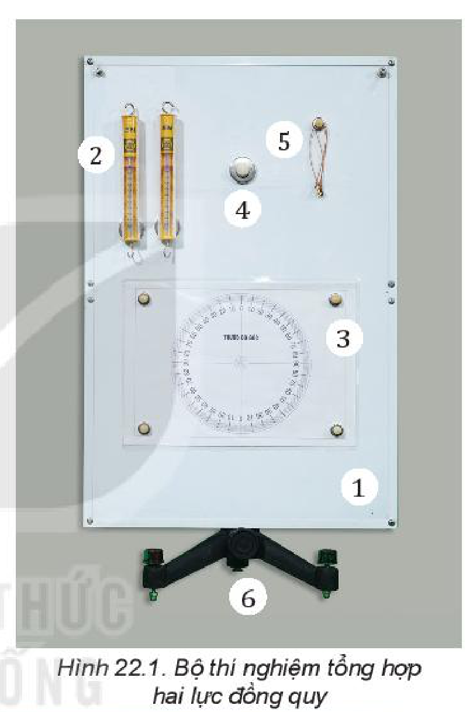
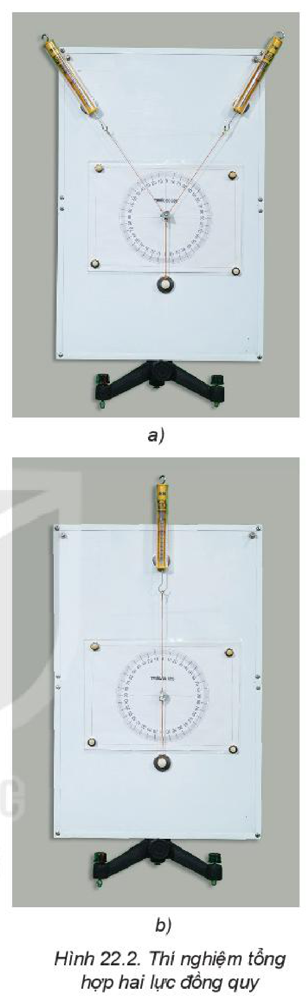
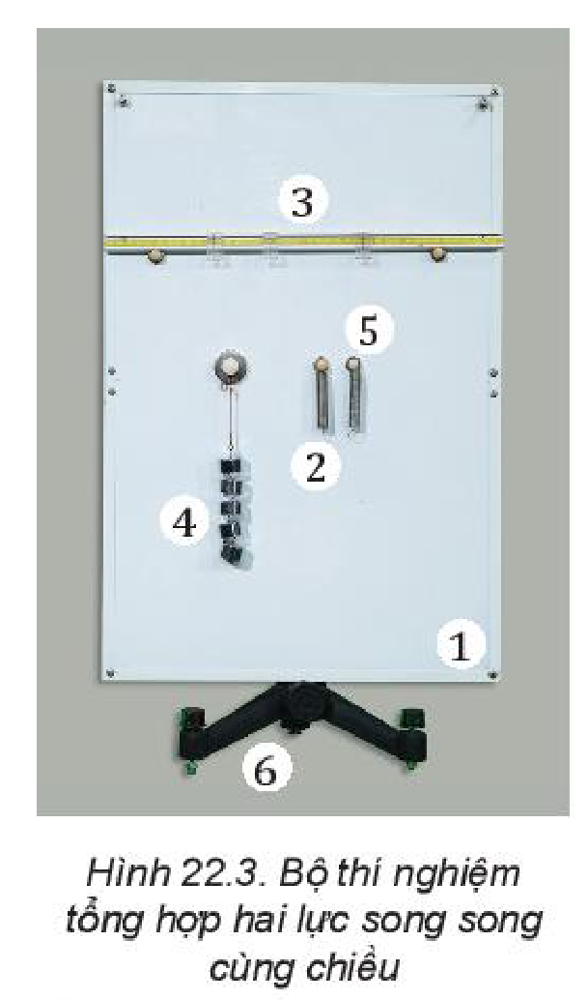
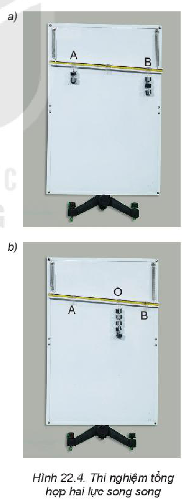
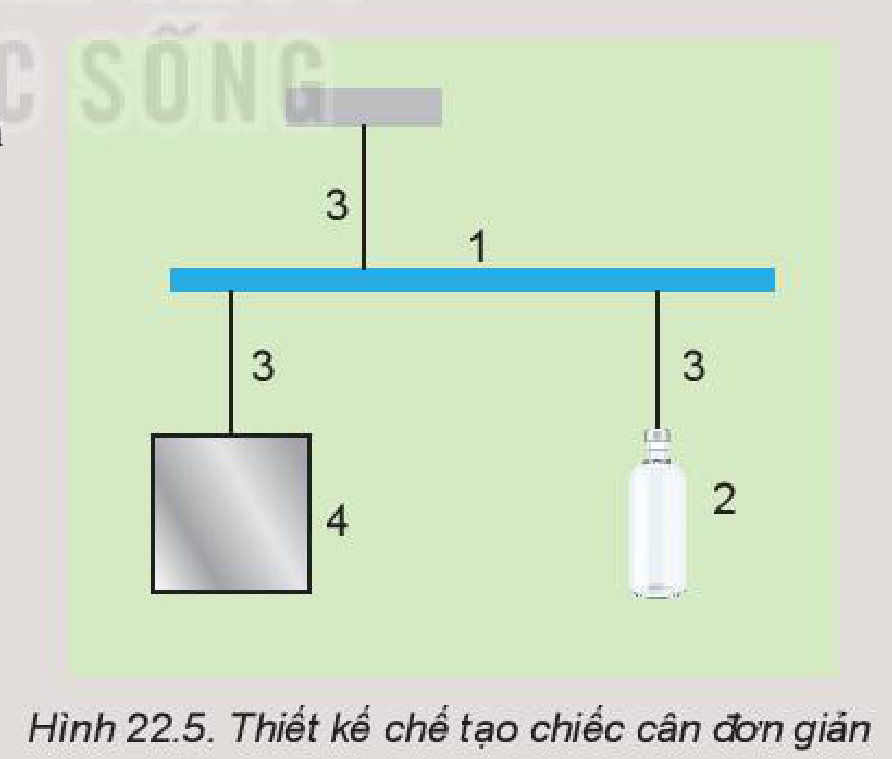

<!-- pdf:87 -->

# BÀI 22: THỰC HÀNH: TỔNG HỢP LỰC

## 🔴 Mở đầu

> Hai lực $\vec{F}_1$ và $\vec{F}_2$ tác dụng lên một vật. Làm thế nào xác định hợp lực của hai lực này bằng dụng cụ thí nghiệm?

## I. TỔNG HỢP HAI LỰC ĐỒNG QUY

### 1. Dụng cụ thí nghiệm (Hình 22.1)

- Bảng thép (1).
- Hai lực kế ống $5\text{ N}$, có đế nam châm (2).
- Thước đo góc có độ chia nhỏ nhất $1^\circ$ được in trên tấm mica trong suốt (3).
- Một đế nam châm có móc để buộc dây cao su (4).
- Dây chỉ bền và một dây cao su (5).
- Giá đỡ có trục $\varnothing 10\text{ mm}$, cắm lên đế ba chân (6).
- Bút dùng để đánh dấu.

*Hình 22.1. Bộ thí nghiệm tổng hợp hai lực đồng quy*

### 2. Thiết kế phương án thí nghiệm

Xác định lực tổng hợp của hai lực đồng quy.

> **Hoạt động:**
> Gắn đế nam châm lên bảng thép, móc sợi dây cao su vào đế nam châm, đặt hai lực kế lên bảng thép và móc hai lực kế vào đầu còn lại của dây cao su. Dịch chuyển hai lực kế để kéo sợi dây cao su làm dây dãn ra một khoảng và thảo luận:
> 1. Làm thế nào để hai lực $\vec{F}_1$ và $\vec{F}_2$ đồng quy?
> 2. Làm thế nào thay thế tác dụng của hai lực $\vec{F}_1$ và $\vec{F}_2$ bằng một lực $\vec{F}$ mà dây cao su vẫn dãn một đoạn và hướng như ban đầu?
> 3. Làm thế nào xác định lực tổng hợp của hai lực $\vec{F}_1$ và $\vec{F}_2$?
<!-- term: Hai lực đồng quy -->

### 3. Tiến hành thí nghiệm

**A - Xác định hai lực thành phần $\vec{F}_1, \vec{F}_2$**

1. Đặt bảng thép lên giá đỡ. Gắn đế nam châm có móc buộc sợi dây cao su vào móc. Buộc sợi dây chỉ vào dây cao su. Móc hai lực kế vào đầu còn lại của sợi chỉ và gắn hai lực kế lên bảng.

<!-- pdf:88 -->

2. Gắn thước đo góc lên bảng bằng nam châm (Hình 22.2a).
3. Di chuyển hai lực kế sao cho dây cao su và các đoạn dây chỉ song song với mặt phẳng và tâm $O$ của thước trùng với giao điểm của sợi dây và dây cao su.
4. Đánh dấu lên bảng sắt điểm $A$ của đầu dây cao su, phương của hai lực $\vec{F}_1$ và $\vec{F}_2$ do hai lực kế tác dụng vào dây.
5. Ghi các số liệu $F_1, F_2$ từ số chỉ của hai lực kế và góc $\alpha$ giữa hai lực vào Bảng 22.1.
6. Lặp lại các bước thí nghiệm 3, 4, 5 hai lần nữa. Ghi số liệu vào Bảng 22.1.

**B - Xác định lực tổng hợp $F_{tn}$ của hai lực $\vec{F}_1, \vec{F}_2$ bằng thí nghiệm**

7. Tháo một lực kế và bố trí thí nghiệm như Hình 22.2b.
8. Di chuyển lực kế sao cho đầu dây cao su trùng điểm $A$ đã đánh dấu và ghi giá trị của lực $F_{tn}$ vào Bảng 22.1.
9. Lặp lại bước 8 hai lần nữa.

**C - Xác định lực tổng hợp theo lí thuyết $F_{lt}$**

10. Tính giá trị của $F_{lt}$ theo định lí hàm số cosin và ghi vào Bảng 22.1.

*Hình 22.2. Thí nghiệm tổng hợp hai lực đồng quy*

> **Lưu ý:** Khi di chuyển lực kế luôn đảm bảo các đoạn sợi dây và dây cao su luôn nằm trên cùng mặt phẳng.

### 4. Kết quả thí nghiệm

**Bảng 22.1.** Tổng hợp hai lực đồng quy

| Lần | $F_1\text{ (N)}$ | $F_2\text{ (N)}$ | Góc $\alpha$ | $F_{tn}\text{ (N)}$ | $F_{lt}\text{ (N)}$ |
| :---: | :---: | :---: | :---: | :---: | :---: |
| 1 | ? | ? | ? | ? | ? |
| 2 | ? | ? | ? | ? | ? |
| 3 | ? | ? | ? | ? | ? |
<!-- ocr-ok: đối chiếu ảnh trang PDF 88 khớp nguyên văn bảng -->

Xử lí kết quả thí nghiệm:

Tính giá trị trung bình và sai số: $\overline{F}_{tn} = \dots$; $\Delta F_{tn} = \dots$

> **Hoạt động:**
> **Nhận xét và đánh giá kết quả thí nghiệm**
> 1. So sánh các kết quả hợp lực thu được bằng lí thuyết và bằng thí nghiệm, rút ra kết luận.
> 2. Em có thể đề xuất một phương án thí nghiệm khác để tiến hành thí nghiệm tổng hợp hai lực đồng quy.

<!-- pdf:89 -->

## II. TỔNG HỢP HAI LỰC SONG SONG

### 1. Dụng cụ thí nghiệm (Hình 22.3)

- Bảng thép (1).
- Hai lò xo xoắn chịu được lực kéo tối đa là $5\text{ N}$, dài khoảng $60\text{ mm}$ (2).
- Thanh treo nhẹ, cứng, dài $400\text{ mm}$. Trên thanh có gắn thước và ba con trượt có gắn móc treo (3).
- Các quả nặng có khối lượng bằng nhau $50\text{ g}$ (4).
- Hai đế nam châm để gắn lò xo (5).
- Giá đỡ có trục $\varnothing 10\text{ mm}$, cắm lên đế ba chân (6).
- Bút dùng để đánh dấu.

*Hình 22.3. Bộ thí nghiệm tổng hợp hai lực song song cùng chiều*

### 2. Thiết kế phương án thí nghiệm

Xác định lực tổng hợp của hai lực mà giá của các lực đó song song.

> **Hoạt động:**
> Gắn hai đế nam châm lên bảng thép, treo thanh kim loại lên hai đế nam châm bằng hai lò xo, treo các quả nặng vào hai đầu thanh, làm lò xo dãn ra một khoảng và thảo luận:
> 1. Làm thế nào thay thế hai lực $\vec{F}_1$ và $\vec{F}_2$ bằng một lực $\vec{F}$ mà thanh vẫn ở vị trí như khi chịu tác dụng của hai lực $\vec{F}_1$ và $\vec{F}_2$?
> 2. Làm thế nào để hai lực $\vec{F}_1$ và $\vec{F}_2$ song song?
> 3. Làm thế nào xác định lực tổng hợp của hai lực $\vec{F}_1, \vec{F}_2$?
<!-- term: Tổng hợp hai lực song song cùng chiều -->

### 3. Tiến hành thí nghiệm

1. Gắn hai đế nam châm lên bảng thép, sau đó treo thanh kim loại lên hai đế nam châm bằng hai lò xo.
2. Treo các quả nặng vào hai con trượt có gắn móc treo lên thanh kim loại.
3. Dùng bút dạ đánh dấu vị trí thanh và vị trí $A, B$ lên bảng thép. Ghi lại giá trị trọng lượng $F_1$ và $F_2$ và độ dài $AB$ vào Bảng 22.2.
4. Tháo các quả nặng và móc tất cả quả nặng đã dùng vào một móc treo trên thanh kim loại.
5. Điều chỉnh con trượt sao cho vị trí của thanh kim loại trùng với vị trí ban đầu đã được đánh dấu.
6. Ghi các giá trị $F$ tương ứng với trọng lượng các quả nặng vào Bảng 22.2.
7. Đo và ghi giá trị độ dài $OA_{tn}$ từ điểm $O$ treo các quả nặng tới $A$ vào Bảng 22.2.
8. Lặp lại các bước thí nghiệm 2, 3, 4, 5, 6, 7 thêm hai lần nữa.
9. Tính giá trị $OA_{lt}$ theo lí thuyết bằng công thức

$$\frac{F_1}{F_2} = \frac{d_2}{d_1} = \frac{OB}{OA_{lt}} = \frac{AB - OA_{lt}}{OA_{lt}}$$
<!-- ocr-ok: đối chiếu ảnh trang PDF 89 khớp nguyên văn công thức -->

và điền vào Bảng 22.2.

*Hình 22.4. Thí nghiệm tổng hợp hai lực song song*

<!-- pdf:90 -->

> **Lưu ý:**
> - Nên chọn số quả nặng hai bên không như nhau.
> - Vị trí $A$ và $B$ nên chọn trùng với các vạch chia của thước để tránh sai số khi đo.

### 4. Kết quả thí nghiệm

**Bảng 22.2.** Tổng hợp hai lực song song cùng chiều

| Lần | $F_1\text{ (N)}$ | $F_2\text{ (N)}$ | $AB$ | $F$ | $OA_{tn}$ | $OA_{lt}$ |
| :---: | :---: | :---: | :---: | :---: | :---: | :---: |
| 1 | ? | ? | ? | ? | ? | ? |
| 2 | ? | ? | ? | ? | ? | ? |
| 3 | ? | ? | ? | ? | ? | ? |

Xử lí kết quả thí nghiệm: $\overline{OA}_{tn} = \dots$; $\Delta OA_{tn} = \dots$

> **Hoạt động:**
> **Nhận xét và đánh giá kết quả thí nghiệm**
> 1. So sánh các kết quả hợp lực tổng hợp thu được bằng tính toán và bằng thí nghiệm, rút ra kết luận.
> 2. Em có thể đề xuất một phương án thí nghiệm khác để tiến hành thí nghiệm tổng hợp hai lực song song cùng chiều.

## 📌 Em đã học

- Tiến hành thí nghiệm tổng hợp hai lực đồng quy, hai lực song song để nghiệm lại các quy tắc tổng hợp lực.

## ✏️ Em có thể

Chế tạo một chiếc cân thăng bằng đơn giản bằng các vật liệu dễ tìm (Hình 22.5):
1. Một thanh thước gỗ có vạch chia.
2. Một chai nước $500\text{ ml}$.
3. Các dây treo.
4. Vật cần cân.

*Hình 22.5. Thiết kế chế tạo chiếc cân đơn giản*

> **Em có biết:**
> **Đòn bẩy** là loại máy cơ đơn giản được sử dụng nhiều trong đời sống để biến đổi lực tác dụng lên vật như sử dụng xà beng để nâng vật, đòn gánh để gánh các vật.

## 📷 Danh sách hình trong bài

| Mã hình | Số hình SGK | Trang PDF | Chú thích |
| --- | --- | --- | --- |
| H10-vat_ly-b22-01 | Hình 22.1 | 87 | Bộ thí nghiệm tổng hợp hai lực đồng quy |
| H10-vat_ly-b22-02 | Hình 22.2 | 88 | Thí nghiệm tổng hợp hai lực đồng quy |
| H10-vat_ly-b22-03 | Hình 22.3 | 89 | Bộ thí nghiệm tổng hợp hai lực song song cùng chiều |
| H10-vat_ly-b22-04 | Hình 22.4 | 89 | Thí nghiệm tổng hợp hai lực song song |
| H10-vat_ly-b22-05 | Hình 22.5 | 90 | Thiết kế chế tạo chiếc cân đơn giản |
