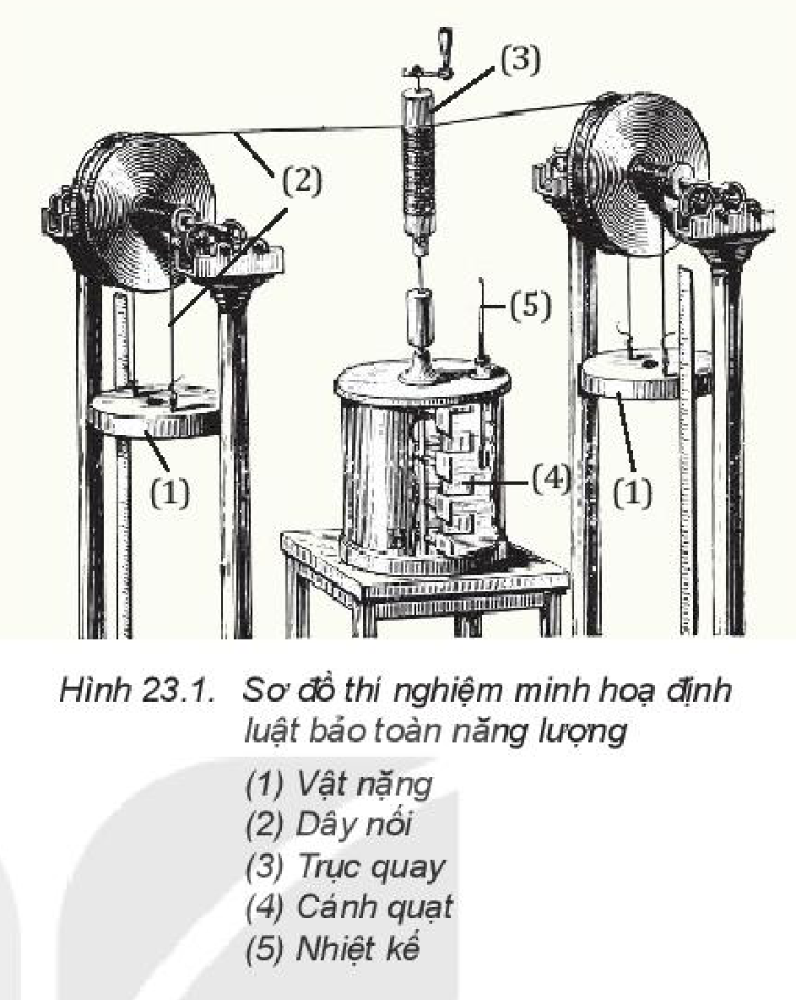
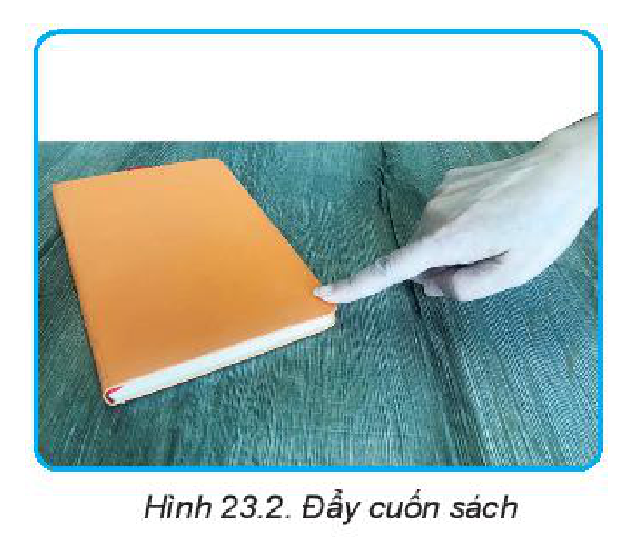
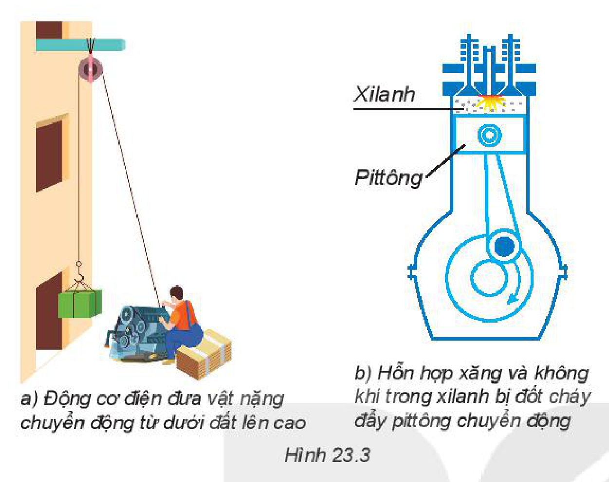
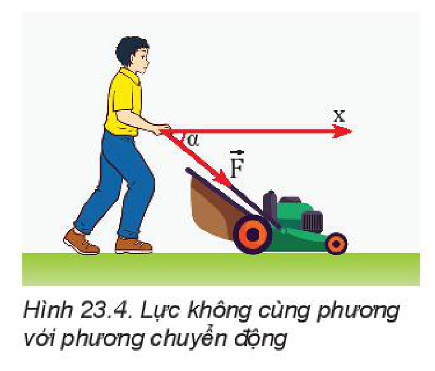
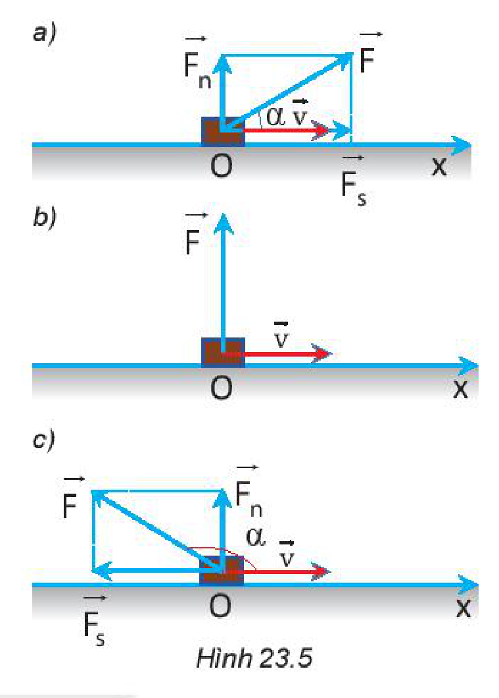
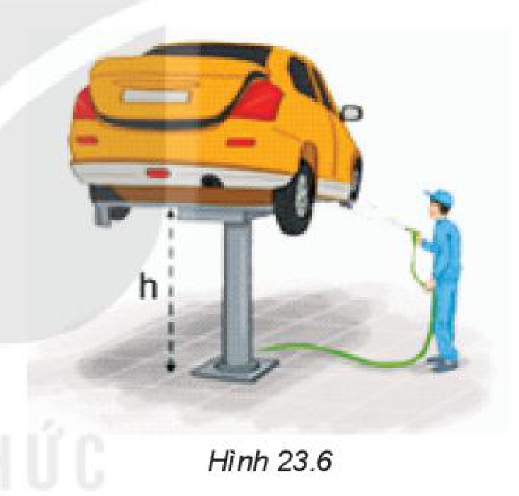
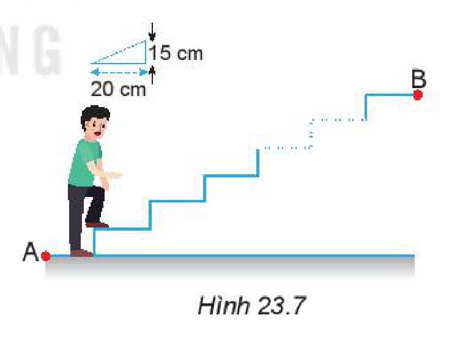
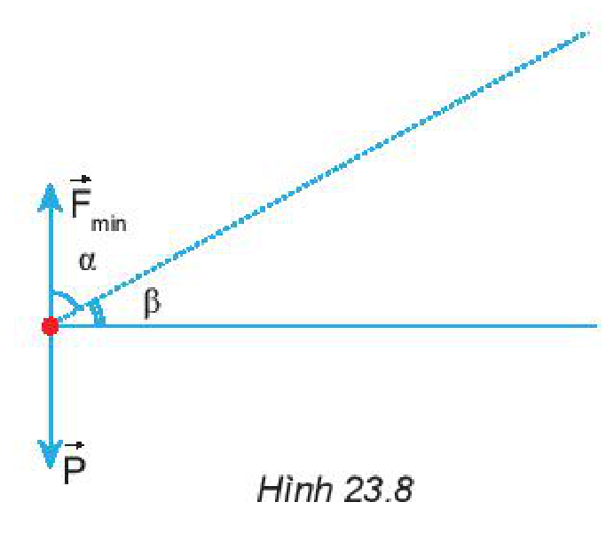

<!-- pdf:92 -->

# BÀI 23: NĂNG LƯỢNG. CÔNG CƠ HỌC

## 🔴 Mở đầu

> 
>
> Trong các động tác nâng tạ từ vị trí (1) sang vị trí (2), từ vị trí (2) sang vị trí (3), từ vị trí (3) sang vị trí (4) ở hình trên:
> - Có những quá trình truyền và chuyển hoá năng lượng nào?
> - Động tác nào có thực hiện công, không thực hiện công?

## I. NĂNG LƯỢNG

Ở trường THCS các em đã biết:

- Mọi hiện tượng xảy ra trong tự nhiên đều cần có năng lượng dưới các dạng khác nhau như: cơ năng, hoá năng, nhiệt năng, điện năng, năng lượng ánh sáng, năng lượng âm thanh, năng lượng nguyên tử.
- Năng lượng có thể chuyển hoá từ dạng này sang dạng khác hoặc truyền từ vật này sang vật khác.
<!-- term: Năng lượng -->
- Năng lượng không tự sinh ra hoặc tự mất đi mà chỉ chuyển hoá từ dạng này sang dạng khác hoặc truyền từ vật này sang vật khác.
<!-- term: Định luật bảo toàn năng lượng -->

> **Câu hỏi:**
>
> 1. Khi đun nước bằng ấm điện thì có những quá trình truyền và chuyển hoá năng lượng nào xảy ra?
> 2. Khi xoa hai tay vào nhau cho nóng thì có những quá trình truyền và chuyển hoá năng lượng nào xảy ra?
> 3. Một quả bóng cao su được ném từ độ cao $h$ xuống đất cứng và bị nảy lên. Sau mỗi lần nảy lên, độ cao giảm dần, nghĩa là cơ năng giảm dần. Điều đó có trái với định luật bảo toàn năng lượng không? Tại sao? Hãy dự đoán xem còn có hiện tượng gì nữa xảy ra với quả bóng ngoài hiện tượng bị nảy lên và rơi xuống.
> 4. Có sự truyền và chuyển hoá năng lượng nào trong quá trình bắn pháo hoa?

> **Em có biết:**
>
> Có thể phân năng lượng thành hai loại là động năng (năng lượng của vật do chuyển động mà có) và thế năng (năng lượng lưu trữ của vật). Ví dụ, **nhiệt năng** là năng lượng chuyển động hỗn loạn của các phân tử; **điện năng** là năng lượng của chuyển động có hướng của các điện tích dưới tác dụng của điện trường; năng lượng mà vật có khi ở một độ cao so với mặt đất là thế năng trọng trường,...

<!-- pdf:93 -->

*Thí nghiệm của Joule về sự truyền, chuyển hoá và bảo toàn năng lượng*

Thí nghiệm mang tính lịch sử được James Joule thực hiện vào những năm 1844 – 1854 nhằm minh hoạ định luật bảo toàn năng lượng. Sơ đồ thí nghiệm được mô tả trong Hình 23.1. Khi cho vật nặng chuyển động đi xuống, dây nối sẽ làm cho trục quay và cánh quạt quay theo. Ma sát giữa cánh quạt và nước làm cho nước nóng lên.

Ở đây có sự truyền năng lượng từ vật nặng sang nước, cụ thể là sự chuyển hoá từ cơ năng sang nhiệt năng.

Thí nghiệm đã cho thấy cơ năng của vật nặng giảm đi bao nhiêu thì nhiệt năng của nước tăng lên bấy nhiêu. Điều đó chứng tỏ, *trong quá trình truyền năng lượng từ vật này sang vật khác, chuyển hoá năng lượng từ dạng này sang dạng khác, năng lượng luôn được bảo toàn*.
<!-- term: Định luật bảo toàn năng lượng -->

> **Hoạt động:** Hãy thảo luận nhóm để tìm thêm ví dụ minh hoạ cho các quá trình chuyển hoá năng lượng sau đây:
> a) Điện năng chuyển hoá thành nhiệt năng.
> b) Nhiệt năng chuyển hoá thành điện năng.
> c) Quang năng chuyển hoá thành điện năng.
> d) Quang năng chuyển hoá thành hoá năng.

## II. CÔNG CƠ HỌC

### 1. Thực hiện công

Năng lượng có thể truyền từ vật này sang vật khác.

Ví dụ: Khi đẩy cuốn sách, ta tác dụng lực vào nó làm nó chuyển từ trạng thái đứng yên ($v = 0$; $W_\text{đ} = 0$) sang trạng thái chuyển động nhanh dần (vận tốc tăng, động năng tăng). Động năng của sách tăng là do sách đã nhận được năng lượng từ tay ta truyền sang (Hình 23.2).

Việc truyền năng lượng cho vật bằng cách tác dụng lực lên vật làm vật thay đổi trạng thái chuyển động như trên được gọi là *thực hiện công cơ học* (gọi tắt là **thực hiện công**).

<!-- pdf:94 -->

> **Hoạt động:** Hãy trao đổi với bạn để chứng minh rằng trong các ví dụ mô tả ở Hình 23.3 có sự truyền năng lượng bằng cách thực hiện công.

> **Câu hỏi:**
>
> 1. Hãy trả lời câu hỏi ở phần khởi động.
> 2. Khi cho một miếng đồng tiếp xúc với ngọn lửa thì ngọn lửa truyền năng lượng cho miếng đồng làm cho nó nóng lên. Quá trình truyền năng lượng này có phải là thực hiện công hay không? Tại sao?

### 2. Công thức tính công

**a) Khi lực không đổi và cùng hướng với chuyển động**

Ở lớp 9, chúng ta đã học công thức tính công của lực khi lực không đổi và cùng hướng với chuyển động:

$A = F \cdot s \quad (23.1)$

trong đó $A$ là **công** của lực $\vec{F}$, có đơn vị cùng với đơn vị năng lượng là **jun** (J): $1\text{ J} = 1\text{ N} \cdot 1\text{ m}$; $F$ là cường độ của lực tác dụng lên vật làm vật biến đổi chuyển động, đơn vị là niutơn (N), $s$ là quãng đường đi được của vật, đơn vị là mét (m).

Khi lực cùng hướng với chuyển động thì độ dịch chuyển $\vec{d}$ có độ lớn bằng quãng đường đi được $s$, nên công thức tính công cũng có thể viết dưới dạng:

$A = F \cdot d \quad (23.2)$

**b) Khi lực không đổi và không cùng phương với chuyển động**

Khi người đẩy xe hàng để nó chuyển động theo chiều dương của trục Ox, lực đẩy $\vec{F}$ làm với hướng chuyển động một góc $\alpha$ bất kì (Hình 23.4). Ta phân tích lực $\vec{F}$ ra hai lực thành phần vuông góc với nhau: $\vec{F}_s$ cùng hướng với chuyển động và $\vec{F}_n$ vuông góc với $\vec{F}_s$ (Hình 23.5).

Trong trường hợp này chỉ có thành phần $\vec{F}_s$ làm vật chuyển động, nên công thức tính công của lực trong trường hợp này là:

$A = F_s \cdot s = (F \cdot \cos\alpha) \cdot s = F \cdot s \cdot \cos\alpha$

<!-- pdf:95 -->

Tuỳ thuộc vào góc $\alpha$ mà có thể xảy ra các trường hợp sau:

- $0 \le \alpha < 90^\circ$: thành phần $\vec{F}_s$ của $\vec{F}$ lên phương chuyển động cùng chiều với chiều chuyển động. Công của lực được gọi là **công phát động** ($A > 0$) (Hình 23.5a).
- $\alpha = 90^\circ$: lực vuông góc với phương chuyển động, khi đó *lực không sinh công* ($A = 0$) (Hình 23.5b).
- $90^\circ < \alpha \le 180^\circ$: thành phần $\vec{F}_s$ của $\vec{F}$ lên phương chuyển động ngược chiều với chiều chuyển động, lực làm cản trở chuyển động của vật. Công của lực được gọi là **công cản** ($A < 0$) (Hình 23.5c).

### 3. Bài tập ví dụ

*Bài tập ví dụ 1*

Khi rửa gầm xe ô tô (Hình 23.6), người ta sử dụng máy nâng để nâng ô tô lên độ cao $h = 160\text{ cm}$ so với mặt sàn. Cho biết khối lượng ô tô là $m = 1,5\text{ tấn}$ và gia tốc trọng trường là $g = 10\text{ m/s}^2$. Tính công tối thiểu mà máy nâng đã thực hiện.

*Giải*

Để nâng được ô tô lên thì máy nâng phải tác dụng vào ô tô lực tối thiểu:

$\vec{F}_{\min} = -\vec{P}$

$\Rightarrow F_{\min} = P = m \cdot g = 1,5 \cdot 10^3 \cdot 10 = 1,5 \cdot 10^4\text{ N}.$

Công tối thiểu mà máy nâng đã thực hiện là:

$A = P \cdot h = 24\,000\text{ J} = 24\text{ kJ}.$

*Bài tập ví dụ 2*

Một bạn học sinh có khối lượng $50\text{ kg}$ đi lên một cầu thang gồm 20 bậc, mỗi bậc cao $15\text{ cm}$, dài $20\text{ cm}$ (Hình 23.7). Tính công tối thiểu mà bạn ấy phải thực hiện. Coi lực mà học sinh tác dụng lên mỗi bậc thang là không đổi trong quá trình di chuyển. Lấy gia tốc trọng trường là $g = 10\text{ m/s}^2$.

*Giải*

- Muốn lên cầu thang này bạn học sinh phải có lực nâng tối thiểu như Hình 23.8:

$\vec{F}_{\min} = -\vec{P}$

$\Rightarrow F_{\min} = P = m \cdot g$

Độ dịch chuyển của bạn học sinh là: $\vec{d} = \overrightarrow{\text{AB}}$.

- Công tối thiểu mà bạn ấy phải thực hiện là:

$A_{\min} = F_{\min} \cdot d \cdot \cos\alpha = F_{\min} \cdot d \cdot \sin\beta = m \cdot g \cdot d \cdot \sin\beta = m \cdot g \cdot h = 50 \cdot 10 \cdot 20 \cdot 0,15 = 1\,500\text{ J}.$

<!-- pdf:96 -->

Nhận xét: Độ lớn tối thiểu của công dùng để đưa vật lên cao luôn là: $A = P \cdot h$.

Với $h$ là độ cao vật được nâng lên không phụ thuộc vào việc được đưa lên cao theo đường thẳng đứng hay nằm nghiêng.

> **Câu hỏi:**
>
> 1. Trường hợp nào sau đây trọng lực tác dụng lên ô tô thực hiện công phát động, công cản và không thực hiện công?
>    a) Ô tô đang xuống dốc.
>    b) Ô tô đang lên dốc.
>    c) Ô tô chạy trên đường nằm ngang.
> 2. Một người kéo một thùng hàng khối lượng $80\text{ kg}$ trượt trên sàn nhà bằng một dây có phương hợp góc $30^\circ$ so với phương nằm ngang. Biết lực tác dụng lên dây bằng $150\text{ N}$. Tính công của lực đó khi hòm trượt đi được $29\text{ m}$.

## 📌 Em đã học

- Năng lượng có thể chuyển hoá từ dạng này sang dạng khác, hoặc truyền từ vật này sang vật khác và luôn được bảo toàn.
- Công là số đo phần năng lượng được truyền hoặc chuyển hoá trong quá trình thực hiện công.
- Công có đơn vị là jun (J): $1\text{ J} = 1\text{ N} \cdot 1\text{ m}$.
- Công thức tính công: $A = F \cdot s \cdot \cos\alpha$.

## ✏️ Em có thể

- Chế tạo được mô hình đơn giản minh hoạ định luật bảo toàn năng lượng.
- Giải thích được nếu một vật chuyển động lên dốc, xuống dốc hoặc trên mặt phẳng ngang thì công của trọng lực đóng vai trò gì.

> **Em có biết:**
>
> Trường hợp tổng quát, công do lực thực hiện phụ thuộc vào ba yếu tố: độ lớn của lực, góc hợp bởi vectơ lực với chiều chuyển động và độ dịch chuyển của vật. Tuy nhiên, có những lực mà công do nó thực hiện không phụ thuộc vào hình dạng đường đi mà chỉ phụ thuộc vào vị trí của điểm đầu và điểm cuối của quỹ đạo. Những lực có đặc điểm này được gọi là **lực thế** (hay **lực bảo toàn**).
>
> Trong chương trình phổ thông, các em sẽ học một số lực thế gồm: lực hấp dẫn, lực đàn hồi, lực điện.

## 📷 Danh sách hình trong bài

| Mã hình | Số hình SGK | Trang PDF | Chú thích |
| --- | --- | --- | --- |
| H10-vat_ly-b23-01 | — | 92 | Hình mở đầu: Các động tác nâng tạ từ vị trí (1) đến vị trí (4) |
| H10-vat_ly-b23-02 | Hình 23.1 | 93 | Sơ đồ thí nghiệm minh hoạ định luật bảo toàn năng lượng: (1) Vật nặng; (2) Dây nối; (3) Trục quay; (4) Cánh quạt; (5) Nhiệt kế |
| H10-vat_ly-b23-03 | Hình 23.2 | 93 | Đẩy cuốn sách |
| H10-vat_ly-b23-04 | Hình 23.3 | 94 | a) Động cơ điện đưa vật nặng chuyển động từ dưới đất lên cao; b) Hỗn hợp xăng và không khí trong xilanh bị đốt cháy đẩy pittông chuyển động |
| H10-vat_ly-b23-05 | Hình 23.4 | 94 | Lực không cùng phương với phương chuyển động |
| H10-vat_ly-b23-06 | Hình 23.5 | 95 | Các trường hợp công của lực: a) Công phát động; b) Lực không sinh công; c) Công cản |
| H10-vat_ly-b23-07 | Hình 23.6 | 95 | Máy nâng nâng ô tô khi rửa gầm xe |
| H10-vat_ly-b23-08 | Hình 23.7 | 95 | Học sinh đi lên cầu thang gồm 20 bậc |
| H10-vat_ly-b23-09 | Hình 23.8 | 95 | Biểu diễn các lực và độ dịch chuyển khi học sinh đi lên cầu thang |
