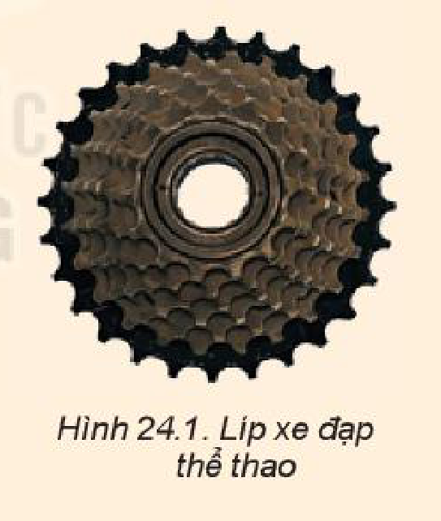
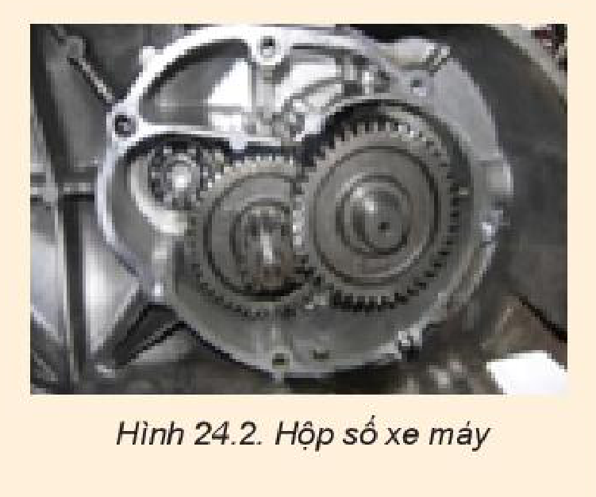

<!-- pdf:97 -->

# BÀI 24: CÔNG SUẤT

## 🔴 Mở đầu

> Để đánh giá việc thực hiện công của người hay thiết bị sinh công, người ta không chỉ quan tâm đến độ lớn của công thực hiện được mà còn quan tâm đến việc công này được thực hiện nhanh hay chậm.
> - *"Tớ thực hiện công nhanh hơn cậu vì tớ leo lên cao hơn cậu."*
> - *"Chưa chắc đâu vì cậu leo trước tớ."*
>
> Theo em, làm thế nào để xác định được sự nhanh chậm của việc thực hiện công?

## I. KHÁI NIỆM CÔNG SUẤT

> **Hoạt động:** Hai anh công nhân dùng ròng rọc để kéo xô vữa lên các tầng cao của một công trình xây dựng. Dựa vào bảng số liệu dưới đây, hãy xác định xem ai là người thực hiện công nhanh hơn. Lấy $g = 10\text{ m/s}^2$.
>
> **Bảng 24.1**
>
> | Công nhân | Khối lượng xô vữa: $m\text{ (kg)}$ | Độ cao công trình: $h\text{ (m)}$ | Công thực hiện: $A\text{ (J)}$ | Thời gian thực hiện công: $t\text{ (s)}$ |
> | --- | --- | --- | --- | --- |
> | Công nhân 1 | $m_1 = 20\text{ kg}$ | $h_1 = 10\text{ m}$ | $A_1 = \text{...?...}$ | $t_1 = 10\text{ s}$ |
> | Công nhân 2 | $m_2 = 21\text{ kg}$ | $h_2 = 11\text{ m}$ | $A_2 = \text{...?...}$ | $t_2 = 20\text{ s}$ |

Đại lượng đặc trưng cho khả năng thực hiện công nhanh hay chậm của người hoặc thiết bị sinh công, được gọi là **công suất** hay *tốc độ sinh công*.

## II. CÔNG THỨC TÍNH CÔNG SUẤT

Nếu trong thời gian $t$, công thực hiện được là $A$ thì tốc độ sinh công, tức công suất là:

$\mathscr{P} = \frac{A}{t} \quad (24.1)$

Nếu $A$ tính bằng jun (J), $t$ tính bằng giây (s) thì $\mathscr{P}$ tính bằng **oát** (W):

$1\text{ W} = \frac{1\text{ J}}{1\text{ s}}$

Các bội của oát (W) là:

$1\text{ kilôoát} = 1\text{ kW} = 10^3\text{ W}$

$1\text{ mêgaoát} = 1\text{ MW} = 10^6\text{ W}$

> **Lưu ý:** **Kilôoát giờ** ($\text{kW.h}$) không phải là đơn vị công suất mà là đơn vị công. *$1\text{ kW.h}$ là công của một thiết bị sinh công có công suất là $1\text{ kW}$ thực hiện trong $1\text{ giờ}$.*

> **Câu hỏi:** Coi công suất trung bình của trái tim là $3\text{ W}$.
> a) Trong một ngày – đêm trung bình trái tim thực hiện một công là bao nhiêu?
> b) Nếu một người sống 70 tuổi thì công của trái tim thực hiện là bao nhiêu? Một ô tô tải muốn thực hiện được công này phải thực hiện trong thời gian bao lâu? Coi công suất của xe ô tô tải là $3 \cdot 10^5\text{ W}$.

<!-- pdf:98 -->

## III. LIÊN HỆ GIỮA CÔNG SUẤT VỚI LỰC VÀ TỐC ĐỘ

Khi vật chuyển động cùng hướng với lực và lực không đổi thì:

$\mathscr{P} = \frac{A}{t} = \frac{F \cdot s}{t} = F \cdot v \quad (24.2)$

Công thức (24.2) là công thức tính công suất trung bình. Công thức tính công suất tức thời là:

$\mathscr{P}_t = F \cdot v_t \quad (24.3)$

Nếu $v$ là tốc độ trung bình của vật thì $\mathscr{P}$ là **công suất trung bình** của lực làm vật chuyển động.

Nếu $v_t$ là tốc độ tức thời của vật thì $\mathscr{P}_t$ là **công suất tức thời** của lực làm vật chuyển động.

*Bài tập ví dụ*

Một người kéo một thùng nước $15\text{ kg}$ từ giếng sâu $8\text{ m}$ lên trong $10\text{ s}$. Hãy tính công suất của người kéo. Biết thùng nước chuyển động đều và lấy $g = 10\text{ m/s}^2$.

*Giải*

Vì vật chuyển động thẳng đều nên tốc độ của vật là:

$v = \frac{s}{t} = \frac{8}{10} = 0,8\text{ m/s}$

và lực kéo vật lên bằng trọng lượng của vật:

$F = P = m \cdot g = 15 \cdot 10 = 150\text{ N}$

Công suất của người kéo bằng:

$\mathscr{P} = F \cdot v = 150 \cdot 0,8 = 120\text{ W}.$

> **Câu hỏi:**
>
> 1. Hãy giải thích tác dụng của líp nhiều tầng trong xe đạp thể thao (Hình 24.1).
>
> 
>
> 2. Hình 24.2 mô tả hộp số xe máy. Hãy giải thích tại sao khi đi xe máy trên những đoạn đường dốc hoặc có ma sát lớn ta thường đi ở số nhỏ.
>
> 
>
> 3. Động cơ của một thang máy tác dụng lực kéo $20\,000\text{ N}$ để thang máy chuyển động thẳng lên trên trong $10\text{ s}$ và quãng đường đi được tương ứng là $18\text{ m}$. Công suất trung bình của động cơ là
>    A. $36\text{ kW}$.
>    B. $3,6\text{ kW}$.
>    C. $11\text{ kW}$.
>    D. $1,1\text{ kW}$.
> 4. Một ô tô khối lượng $1\text{ tấn}$ đang hoạt động với công suất $5\text{ kW}$ và chuyển động thẳng đều với vận tốc $54\text{ km/h}$ thì lên dốc. Hỏi động cơ ô tô phải hoạt động với công suất bằng bao nhiêu để có thể lên dốc với tốc độ như cũ? Biết hệ số ma sát giữa bánh xe và mặt đường không đổi, dốc nghiêng một góc $2,3^\circ$ so với mặt đường nằm ngang và $g = 10\text{ m/s}^2$.

<!-- pdf:99 -->

> **Hoạt động:** *Thi xem ai là người có công suất lớn hơn*
>
> 1. Hãy nêu tên dụng cụ cần dùng và cách tiến hành việc đo thời gian lên cầu thang
> 2. Thảo luận trong nhóm về kế hoạch hoạt động để xác định công suất khi lên thang gác của 5 người đại diện các tổ có trọng lượng khác nhau, trong đó ghi rõ:
>    a) Mục đích của hoạt động.
>    b) Dụng cụ cần sử dụng.
>    c) Các bước tiến hành hoạt động.
>    d) Bảng ghi kết quả.
>
> **Bảng 24.2.** Mẫu bảng ghi kết quả
>
> | Tên người | Trọng lượng (N) | Độ cao (m) | Công (J) | Thời gian (s) | Công suất (W) |
> | --- | --- | --- | --- | --- | --- |
> | 1. ... | $P_1 = \text{...}$ | $h = \text{...}$ | $A_1 = \text{...}$ | $t_1 = \text{...}$ | $\mathscr{P}_1 = \text{...}$ |
> | 2. ... | $P_2 = \text{...}$ | $h = \text{...}$ | $A_2 = \text{...}$ | $t_2 = \text{...}$ | $\mathscr{P}_2 = \text{...}$ |
> | 3. ... | $P_3 = \text{...}$ | $h = \text{...}$ | $A_3 = \text{...}$ | $t_3 = \text{...}$ | $\mathscr{P}_3 = \text{...}$ |
> | 4. ... | $P_4 = \text{...}$ | $h = \text{...}$ | $A_4 = \text{...}$ | $t_4 = \text{...}$ | $\mathscr{P}_4 = \text{...}$ |
> | 5. ... | $P_5 = \text{...}$ | $h = \text{...}$ | $A_5 = \text{...}$ | $t_5 = \text{...}$ | $\mathscr{P}_5 = \text{...}$ |

## 📌 Em đã học

- Công suất là đại lượng đặc trưng cho tốc độ sinh công, được đo bằng công sinh ra trong một giây và có đơn vị là oát (W):
  $\mathscr{P} = \frac{A}{t}$
- Liên hệ giữa công suất với lực và tốc độ: $\mathscr{P} = F \cdot v$
  Công suất trung bình: $\mathscr{P} = \frac{A}{t} = \frac{F \cdot s}{t} = F \cdot v$
  Công suất tức thời: $\mathscr{P}_t = F \cdot v_t$

## ✏️ Em có thể

1. Tính được công suất của các quá trình sinh công.
2. Vận dụng khái niệm công suất để giải thích nguyên tắc hoạt động của một số thiết bị máy móc.

## 📷 Danh sách hình trong bài

| Mã hình | Số hình SGK | Trang PDF | Chú thích |
| --- | --- | --- | --- |
| H10-vat_ly-b24-01 | Hình 24.1 | 98 | Líp xe đạp thể thao |
| H10-vat_ly-b24-02 | Hình 24.2 | 98 | Hộp số xe máy |
