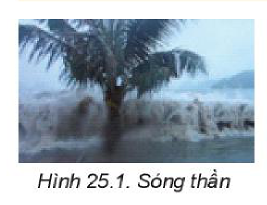
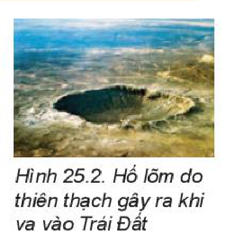
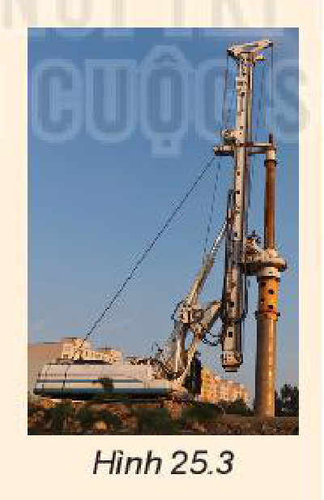
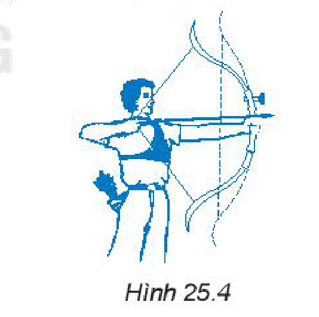
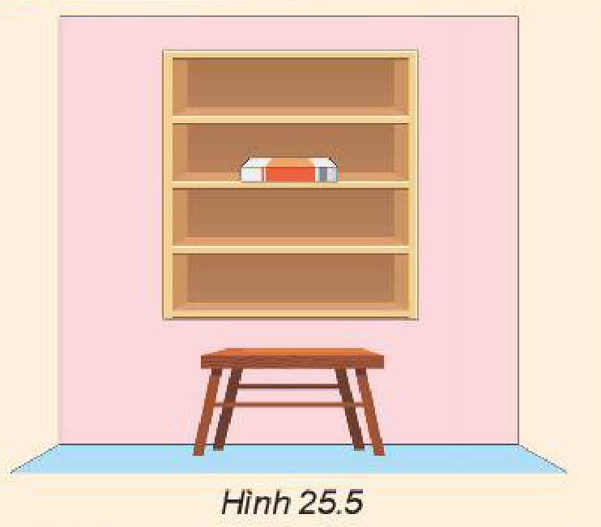
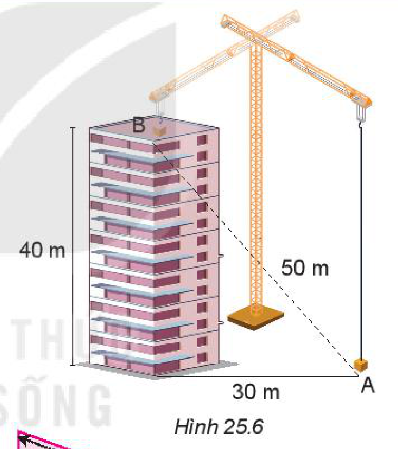
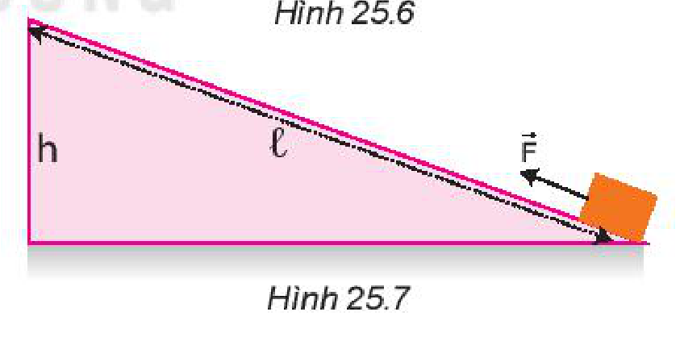

<!-- pdf:100 -->

# BÀI 25: ĐỘNG NĂNG, THẾ NĂNG

## 🔴 Mở đầu

> Hãy mô tả hoạt động của tàu lượn. Tại sao khi tàu lượn ở vị trí cao nhất của đường ray thì tốc độ của nó lại chậm nhất và ngược lại?

## I. ĐỘNG NĂNG

### 1. Khái niệm động năng

Chúng ta đã biết **động năng** của một vật là năng lượng mà vật có được do chuyển động.

Một vật có khối lượng $m$ đang chuyển động với tốc độ $v$ thì động năng là:

$W_\text{đ} = \frac{1}{2}m \cdot v^2 \quad (25.1)$

Trong hệ đơn vị SI, đơn vị động năng là jun (J).

Qua các ví dụ về năng lượng sóng, chuyển động của thiên thạch, chuyển động của mũi tên trong phần câu hỏi bên, ta thấy vật đang chuyển động có khả năng thực hiện công. Ta nói rằng vật đó mang năng lượng dưới dạng động năng.

*Bài tập ví dụ 1:* Một vận động viên quần vợt thực hiện cú giao bóng kỉ lục, quả bóng đạt tới tốc độ $196\text{ km/h}$. Biết khối lượng quả bóng là $60\text{ g}$. Tính động năng của quả bóng.

*Giải*

Động năng của quả bóng được tính theo công thức:

$W_\text{đ} = \frac{1}{2}m \cdot v^2$

Thay số :

$W_\text{đ} = \frac{1}{2} \cdot 0,06 \cdot \left(196 \cdot 1000 \cdot \frac{1}{3600}\right)^2 \approx 89\text{ J}.$

> **Câu hỏi:**
>
> 1. Năng lượng của các con sóng trong Hình 25.1 tồn tại dưới dạng nào?
>    - Tại sao sóng thần lại có sức tàn phá mạnh hơn rất nhiều so với sóng thông thường?
>    - Tại sao sóng thần chỉ gây ra sự tàn phá khi xô vào vật cản?
> 2. Khi đang bay, năng lượng của thiên thạch tồn tại dưới dạng nào?
>    - Tại sao năng lượng của thiên thạch lại rất lớn so với năng lượng của các vật thường gặp?
>    - Khi va vào Trái Đất (Hình 25.2), năng lượng của thiên thạch được chuyển hoá thành những dạng năng lượng nào?
> 3. Khi sóng đổ vào bờ nó sinh công và có thể xô đổ các vật trên bờ. Tuy nhiên, với vận động viên lướt sóng thì không bị ảnh hưởng. Tại sao?
> 4. Một mũi tên nặng $48\text{ g}$ đang chuyển động với tốc độ $10\text{ m/s}$. Tìm động năng của mũi tên.
>
> 
>
> 

<!-- pdf:101 -->

### 2. Liên hệ giữa động năng và công của lực

Xét một vật khối lượng $m$ chuyển động thẳng biến đổi đều với gia tốc $a$ từ trạng thái đứng yên dưới tác dụng của lực không đổi $F$. Sau khi đi được quãng đường $s$, vật đạt tốc độ $v$ thì: $v^2 = 2 \cdot a \cdot s$.

Vì $a = \frac{F}{m}$ nên $v^2 = \frac{2 \cdot F \cdot s}{m}$

và $\frac{1}{2} \cdot m \cdot v^2 = F \cdot s \Rightarrow W_\text{đ} = A \quad (25.2)$

Như vậy, *nếu ban đầu vật đứng yên thì động năng của vật có giá trị bằng công của lực tác dụng lên vật*.

> **Câu hỏi:**
>
> 1. Thả một quả bóng từ độ cao $h$ xuống sàn nhà. Động năng của quả bóng được chuyển hoá thành những dạng năng lượng nào ngay khi quả bóng chạm vào sàn nhà?
> 2. Một vật có khối lượng $10\text{ kg}$ đang chuyển động với tốc độ $5\text{ km/h}$ trên mặt bàn nằm ngang. Do có ma sát, vật chuyển động chậm dần đều và đi được $1\text{ m}$ thì dừng lại. Tính hệ số ma sát giữa vật và mặt bàn. Lấy gia tốc trọng trường $g = 9,8\text{ m/s}^2$.

## II. THẾ NĂNG

### 1. Khái niệm thế năng trọng trường

Chúng ta đã biết một vật đặt ở độ cao $h$ so với mặt đất thì lưu trữ năng lượng dưới dạng thế năng. Vì thế năng này liên quan đến trọng lực nên được gọi là **thế năng trọng trường** (thường được gọi tắt là *thế năng*), với độ lớn được tính bằng công thức: $W_\text{t} = P \cdot h = m \cdot g \cdot h$.

Đơn vị thế năng trọng trường là jun (J).

> **Lưu ý:** Độ lớn của thế năng trọng trường phụ thuộc vào việc chọn mốc tính độ cao. Thường người ta tính độ cao của các vật so với mặt đất được coi là có độ cao bằng $0$.

> **Câu hỏi:**
>
> Máy đóng cọc (Hình 25.3) hoạt động như sau: Búa máy được nâng lên đến một độ cao nhất định rồi thả cho rơi xuống cọc cần đóng.
>
> 
>
> 1. Khi búa đang ở một độ cao nhất định thì năng lượng của nó tồn tại dưới dạng nào? Năng lượng đó do đâu mà có?
> 2. Trong quá trình rơi, năng lượng của búa chuyển từ dạng nào sang dạng nào?
> 3. Khi chạm vào đầu cọc thì búa sinh công để làm gì?

*Bài tập ví dụ 2:* Máy đóng cọc có đầu búa nặng $0,5\text{ tấn}$, được nâng lên độ cao $10\text{ m}$ so với mặt đất. Tính thế năng của đầu búa. Lấy $g = 9,8\text{ m/s}^2$.

*Giải*

Thế năng của đầu búa được tính theo công thức:

$W_\text{t} = m \cdot g \cdot h = 500 \cdot 9,8 \cdot 10 = 49\,000\text{ J} = 49\text{ kJ}$

> **Em có biết:**
>
> Ngoài thế năng trọng trường còn có nhiều loại thế năng khác, dưới đây là một ví dụ (Hình 25.4).
>
> 
>
> Khi giương cung thì cánh cung bị biến dạng đàn hồi. Nếu người đó buông tay thì mũi tên sẽ bị dây cung đẩy đi xa. Điều này chứng tỏ khi giương cung thì cánh cung bị biến dạng đã có năng lượng dự trữ để thực hiện công đẩy mũi tên đi. Năng lượng dự trữ này được gọi là **thế năng đàn hồi**.

<!-- pdf:102 -->

Vì độ cao $h$ phụ thuộc vào vị trí được chọn làm mốc nên thế năng cũng phụ thuộc vào vị trí được chọn làm mốc.
<!-- term: Gốc thế năng -->

Trong trọng trường, hiệu thế năng giữa hai điểm chỉ phụ thuộc vào chênh lệch độ cao theo phương thẳng đứng mà không phụ thuộc vào khoảng cách giữa hai điểm.

> **Câu hỏi:**
>
> 
>
> Hình 25.5 mô tả một cuốn sách được đặt trên giá sách. Hãy so sánh thế năng của cuốn sách trong hai trường hợp: gốc thế năng là sàn nhà và gốc thế năng là mặt bàn.

### 2. Liên hệ giữa thế năng và công của lực thế

Muốn đưa một vật có khối lượng $m$ từ mặt đất lên một độ cao $h$, ta phải tác dụng vào vật lực nâng $F$ có độ lớn tối thiểu bằng trọng lượng $P$ của vật.

Công mà lực nâng $F$ thực hiện là :

$A = F \cdot s = P \cdot h = m \cdot g \cdot h = W_\text{t}$

*Vậy thế năng của vật ở độ cao $h$ có độ lớn bằng công của lực dùng để nâng đều vật lên độ cao này.*

Công trong trường hợp này được gọi là **công của lực thế**, nó không phụ thuộc vào độ lớn quãng đường đi được mà chỉ phụ thuộc vào sự chênh lệch độ cao của vị trí đầu và vị trí cuối.

> **Câu hỏi:**
>
> 1. Một chiếc cần cẩu xây dựng cẩu một khối vật liệu nặng $500\text{ kg}$ từ vị trí A ở mặt đất đến vị trí B của một toà nhà cao tầng với các thông số cho trên Hình 25.6. Lấy gia tốc trọng trường $g = 9,8\text{ m/s}^2$. Tính thế năng của khối vật liệu tại B và công mà cần cẩu đã thực hiện.
>
> 
>
> 2. Hãy chứng minh có thể dùng một mặt phẳng nghiêng để đưa một vật lên cao với một lực nhỏ hơn trọng lượng của vật (Hình 25.7). Coi ma sát không đáng kể.
>
> 

## 📌 Em đã học

- Động năng là năng lượng mà vật có được do chuyển động: $W_\text{đ} = \frac{1}{2}m \cdot v^2$ có giá trị bằng công của lực làm cho vật chuyển động từ trạng thái đứng yên đến khi đạt được tốc độ đó.
- Thế năng của vật trong trường trọng lực là năng lượng lưu trữ trong vật do độ cao của vật so với gốc thế năng: $W_\text{t} = m \cdot g \cdot h$, có giá trị bằng công của lực để đưa vật từ gốc thế năng đến độ cao đó.

## ✏️ Em có thể

Giải thích được hoạt động của máy đóng cọc dựa trên sự chuyển hoá động năng và thế năng của vật.

## 📷 Danh sách hình trong bài

| Mã hình | Số hình SGK | Trang PDF | Chú thích |
| --- | --- | --- | --- |
| H10-vat_ly-b25-01 | Hình 25.1 | 100 | Sóng thần |
| H10-vat_ly-b25-02 | Hình 25.2 | 100 | Hố lõm do thiên thạch gây ra khi va vào Trái Đất |
| H10-vat_ly-b25-03 | Hình 25.3 | 101 | Máy đóng cọc |
| H10-vat_ly-b25-04 | Hình 25.4 | 101 | Giương cung làm cánh cung biến dạng đàn hồi |
| H10-vat_ly-b25-05 | Hình 25.5 | 102 | Cuốn sách được đặt trên giá sách |
| H10-vat_ly-b25-06 | Hình 25.6 | 102 | Cần cẩu xây dựng cẩu khối vật liệu từ A đến B (Đỉnh mặt phẳng nghiêng của Hình 25.7 nhô cao hơn dòng chú thích Hình 25.6) |
| H10-vat_ly-b25-07 | Hình 25.7 | 102 | Đưa vật lên cao bằng mặt phẳng nghiêng (Đỉnh mặt phẳng nghiêng của Hình 25.7 nhô cao hơn dòng chú thích Hình 25.6) |
