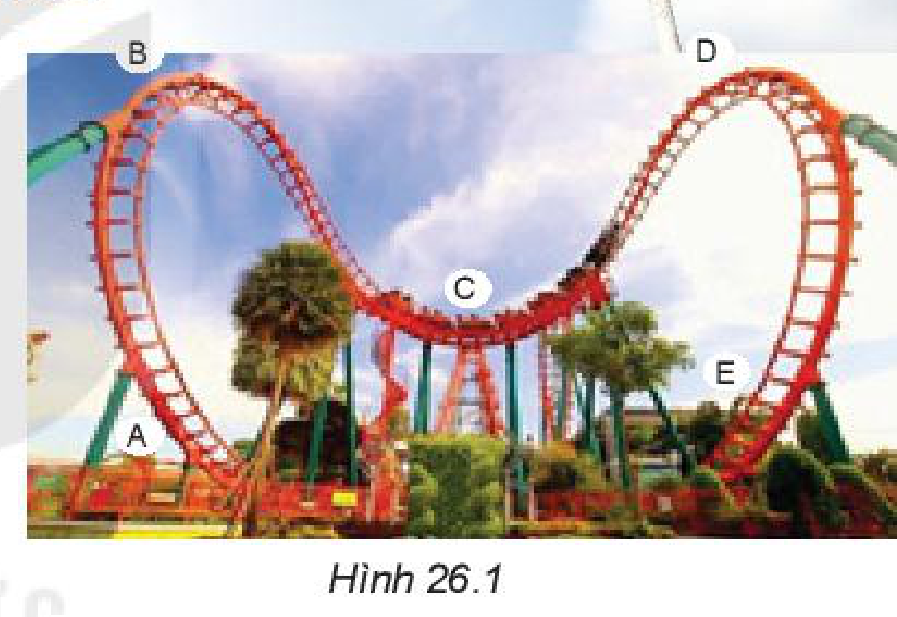
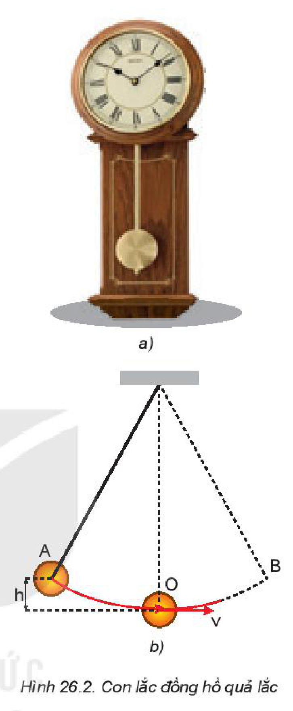
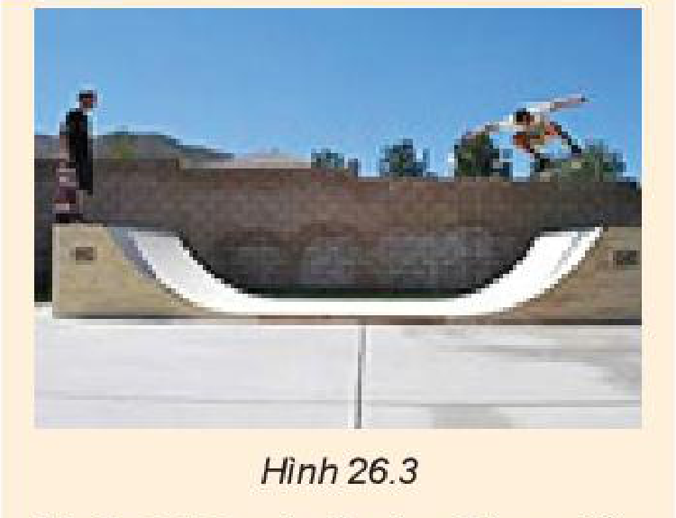
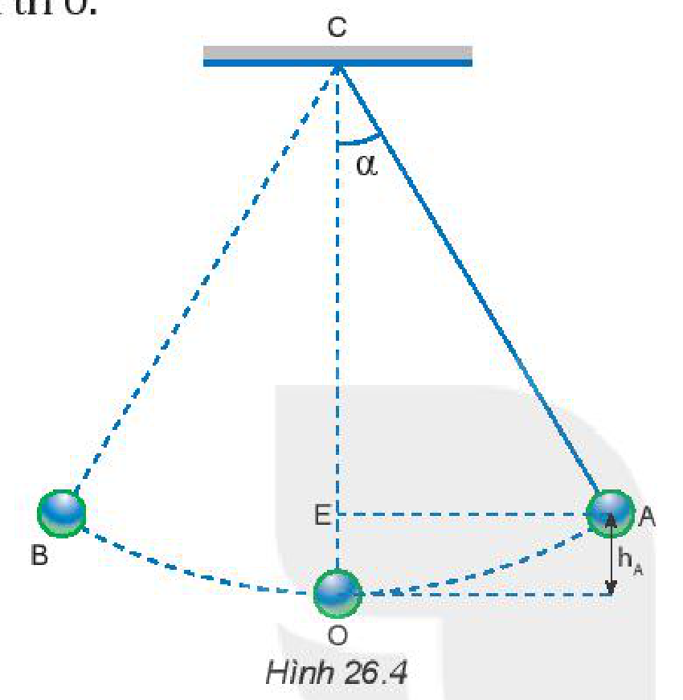
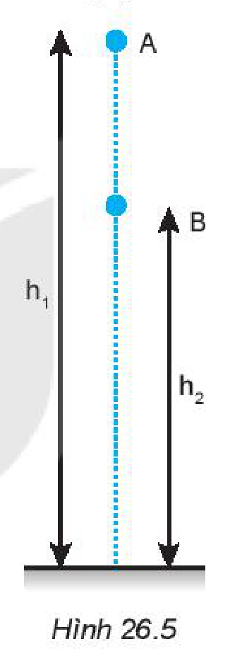
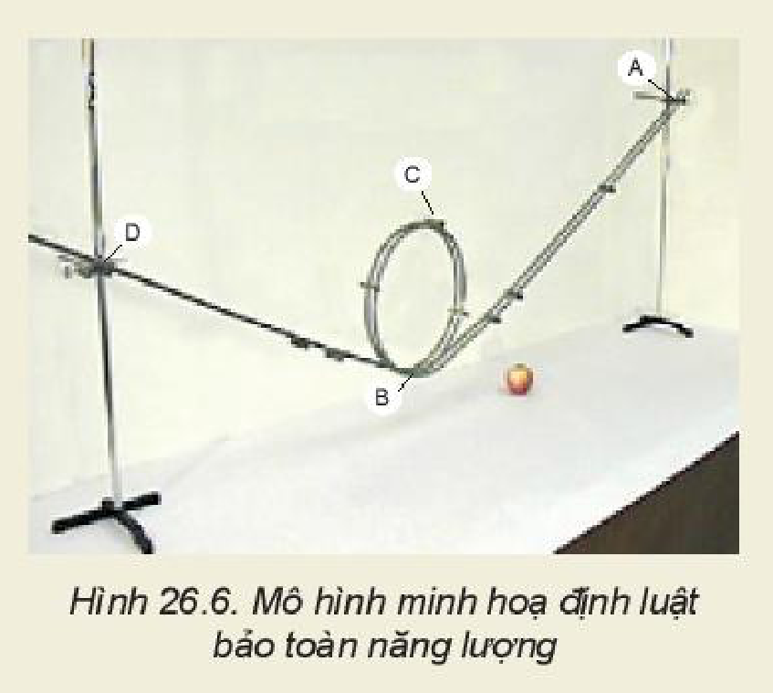

<!-- pdf:103 -->

# BÀI 26: CƠ NĂNG VÀ ĐỊNH LUẬT BẢO TOÀN CƠ NĂNG

## 🔴 Mở đầu

> Kỉ lục nhảy sào thế giới hiện nay là $6,17\text{ m}$ do vận động viên người Thụy Điển Amand Duplantis lập năm 2020, kỉ lục nhảy cao thế giới hiện nay là $2,45\text{ m}$ do vận động viên người Cuba Javier Sotomayor lập năm 1993. Tại sao vận động viên nhảy sào có thể nhảy cao hơn vận động viên nhảy cao nhiều đến thế?

## I. SỰ CHUYỂN HOÁ GIỮA ĐỘNG NĂNG VÀ THẾ NĂNG

Chúng ta đã biết ở Trung học cơ sở:

- **Cơ năng** của một vật là tổng động năng và thế năng của nó. Khi vật chuyển động trong trường trọng lực thì cơ năng có dạng:

$W_\text{c} = W_\text{đ} + W_\text{t} = \frac{1}{2}m \cdot v^2 + m \cdot g \cdot h \quad (26.1)$

- Động năng và thế năng có thể chuyển hoá qua lại lẫn nhau.

> **Câu hỏi:**
>
> 1. Khi nước chảy từ thác xuống:
>    a) Lực nào làm cho nước chảy từ đỉnh thác xuống dưới?
>    b) Lực nào sinh công trong quá trình này?
>    c) Động năng và thế năng của nó thay đổi như thế nào?
>    d) Hãy dự đoán về mối liên hệ giữa độ tăng động năng và độ giảm thế năng.
> 2. Từ một điểm ở độ cao $h$ so với mặt đất, ném một vật có khối lượng $m$ lên cao với vận tốc ban đầu $v_0$.
>    a) Khi vật đi lên có những lực nào tác dụng lên vật, lực đó sinh công cản hay công phát động?
>    b) Trong quá trình vật đi lên rồi rơi xuống thì dạng năng lượng nào tăng, dạng năng lượng nào giảm? Hãy dự đoán về mối liên hệ giữa độ tăng của động năng và độ giảm của thế năng.

> **Câu hỏi:**
>
> 1. Trên Hình 26.1 là một phần đường đi của tàu lượn siêu tốc. Em hãy phân tích sự chuyển hoá giữa động năng và thế năng của tàu lượn trên từng đoạn đường.
> 2. Trong các quá trình hoạt động của tàu lượn, ngoài động năng và thế năng còn có dạng năng lượng nào khác tham gia vào quá trình chuyển hoá?

<!-- pdf:104 -->

Như vậy động năng và thế năng có thể chuyển hoá qua lại lẫn nhau. Nếu thế năng chuyển thành động năng thì lực sẽ sinh công phát động, ngược lại, khi động năng chuyển thành thế năng thì lực sinh công cản.

Nhưng độ giảm của động năng có bằng độ tăng của thế năng, hay cơ năng không đổi không?

## II. ĐỊNH LUẬT BẢO TOÀN CƠ NĂNG

### 1. Thí nghiệm về con lắc đồng hồ

Bây giờ ta hãy xét quá trình chuyển hoá giữa động năng và thế năng trong dao động của con lắc đồng hồ (Hình 26.2a).

Mô hình đơn giản của **con lắc đồng hồ** gồm một thanh nhẹ, không dãn, một đầu được giữ cố định, đầu còn lại nối với một vật nặng (Hình 26.2b).

Đưa vật nặng lên điểm A có độ cao xác định $h$ so với điểm O rồi thả cho vật chuyển động tự do. Ta thấy vật chuyển động nhanh dần từ A xuống O, tiếp tục chuyển động chậm dần từ O lên B, rồi lại chuyển động nhanh dần từ B xuống O, chậm dần từ O lên A,...

> **Câu hỏi:**
>
> 1. Khi vật chuyển động trên cung AO thì:
>    a) Những lực nào sinh công? Công nào là công phát động, công nào là công cản?
>    b) Động năng và thế năng của vật thay đổi như thế nào?
> 2. Trả lời những câu hỏi trên cho quá trình vật chuyển động trên cung OB.
> 3. Nếu bỏ qua ma sát thì A và B luôn nằm trên cùng một độ cao. Hiện tượng này chứng tỏ điều gì?

### 2. Định luật bảo toàn cơ năng

Thí nghiệm trên cho thấy độ tăng/giảm của động năng bằng độ giảm/tăng của thế năng, nghĩa là cơ năng luôn không đổi. Từ đó, ta có thể phát biểu **định luật bảo toàn cơ năng** như sau: *Khi một vật chuyển động trong trọng trường chỉ chịu tác dụng của trọng lực thì cơ năng của vật được bảo toàn.*

> **Câu hỏi:**
>
> 
>
> Hình 26.3 mô tả vận động viên tham gia trượt ván trong máng. Bỏ qua mọi ma sát, hãy phân tích sự bảo toàn cơ năng của vận động viên này.

<!-- pdf:105 -->

*Bài tập ví dụ:*

Một con lắc đơn (Hình 26.4), biết độ dài dây treo là $\ell = 0,6\text{ m}$. Đưa vật lên vị trí A hợp với phương thẳng đứng OC một góc $\alpha = 30^\circ$ rồi thả nhẹ nhàng, vật sẽ đi xuống O (vị trí thấp nhất) rồi đi đến B, sau đó quay lại và dao động cứ thế tiếp diễn. Bỏ qua tác dụng của các lực cản, lực ma sát, lấy $g = 9,8\text{ m/s}^2$. Hãy tính độ lớn vận tốc của vật tại vị trí O.

*Giải*

Chọn mốc tính thế năng của vật tại vị trí thấp nhất O.

Gọi cơ năng tại vị trí A, O lần lượt là $W_\text{A}$ và $W_\text{O}$.

Thế năng tại vị trí A và O là:

$W_\text{tA} = m \cdot g \cdot h_\text{A}$. Từ Hình 26.4 ta có:

$h_\text{A} = \text{OC} - \text{CE} = \ell - \ell \cdot \cos\alpha = \ell \cdot (1 - \cos\alpha)$

$\Rightarrow W_\text{tA} = m \cdot g \cdot \ell(1 - \cos\alpha)$;

$W_\text{tO} = m \cdot g \cdot h_\text{O}$, vì $h_\text{O} = 0 \Rightarrow W_\text{tO} = 0$

Động năng của vật tại vị trí A và O lần lượt là:

$W_\text{đA} = 0\text{ ; } W_\text{đO} = \frac{1}{2}m \cdot v_\text{O}^2$

Áp dụng định luật bảo toàn cơ năng ta có:

$W_\text{A} = W_\text{O} \Leftrightarrow W_\text{tA} + W_\text{đA} = W_\text{tO} + W_\text{đO}$

$\Leftrightarrow m \cdot g \cdot \ell \cdot (1 - \cos\alpha) = \frac{1}{2}m \cdot v_\text{O}^2$

$\Leftrightarrow v_\text{O} = \sqrt{2 \cdot g \cdot \ell(1 - \cos\alpha)}$

Thay số ta có:

$v_\text{O} = \sqrt{2 \cdot 9,8 \cdot 0,6(1 - \cos 30^\circ)} \approx 1,26\text{ m/s}.$

> **Em có biết:**
>
> Chúng ta cũng có thể dùng các kiến thức của bài trước để chứng minh rằng khi một vật chuyển động trong trọng trường chỉ chịu tác dụng của trọng lực thì cơ năng của nó được bảo toàn.
>
> Ví dụ: Xét sự thay đổi động năng và thế năng của một vật có khối lượng $m$ rơi tự do từ vị trí A (độ cao $h_1$) xuống vị trí B (độ cao $h_2$) (Hình 26.5).
>
> 
>
> Trong quá trình chuyển động đó, công $A_{\text{AB}}$ của trọng lực được xác định bởi hiệu thế năng tại A và B:
>
> $A_{\text{AB}} = W_\text{tA} - W_\text{tB} = m \cdot g \cdot h_1 - m \cdot g \cdot h_2 \quad (1)$
>
> Nếu trong quá trình đó, vật chỉ chịu tác dụng của trọng lực thì công của trọng lực cũng được tính bằng độ biến thiên động năng từ A đến B:
>
> $A_{\text{AB}} = W_\text{đB} - W_\text{đA} = \frac{1}{2}m \cdot v_\text{B}^2 - \frac{1}{2}m \cdot v_\text{A}^2 \quad (2)$
>
> Từ (1) và (2) ta có:
>
> $W_\text{tA} - W_\text{tB} = W_\text{đB} - W_\text{đA}$
>
> $\Leftrightarrow W_\text{tA} + W_\text{đA} = W_\text{tB} + W_\text{đB}$
>
> $\Leftrightarrow W_\text{A} = W_\text{B}$
>
> Với $W_\text{A}, W_\text{B}$ lần lượt là cơ năng của vật tại A và B.

<!-- pdf:106 -->

> **Hoạt động:** Chế tạo mô hình minh hoạ định luật bảo toàn năng lượng.
>
> Dụng cụ: một viên bi, hai thanh kim loại nhẵn, hai giá đỡ có vít điều chỉnh độ cao.
>
> Chế tạo: Dùng hai thanh kim loại uốn thành đường ray và gắn lên giá đỡ để tạo được mô hình như Hình 26.6.
>
> Thí nghiệm:
> - Thả viên bi từ điểm A trên đường ray.
> - Viên bi có thể chuyển động tới điểm D không? Tại sao? Làm thí nghiệm để kiểm tra.
>
> 

> **Câu hỏi:**
>
> 1. Một vật được thả cho rơi tự do từ độ cao $h = 10\text{ m}$ so với mặt đất. Bỏ qua mọi ma sát. Ở độ cao nào thì vật có động năng bằng thế năng?
> 2. Thả một vật có khối lượng $m = 0,5\text{ kg}$ từ độ cao $h_1 = 0,8\text{ m}$ so với mặt đất. Xác định động năng và thế năng của vật ở độ cao $h_2 = 0,6\text{ m}$. Lấy $g = 9,8\text{ m/s}^2$.

## 📌 Em đã học

- Động năng và thế năng của vật có thể chuyển hoá qua lại lẫn nhau.
- Cơ năng của một vật là tổng của động năng và thế năng. Nếu vật chuyển động trong trọng trường chỉ chịu tác dụng bởi trọng lực thì cơ năng của nó được bảo toàn.

## ✏️ Em có thể

1. Vận dụng định luật bảo toàn cơ năng để giải thích một số tình huống trong đời sống, kĩ thuật.
2. Giải thích được vì sao vận động viên nhảy sào có thể nhảy lên được tới hơn $6\text{ m}$, trong khi đó vận động viên nhảy cao chỉ nhảy được tới hơn $2\text{ m}$.

## 📷 Danh sách hình trong bài

| Mã hình | Số hình SGK | Trang PDF | Chú thích |
| --- | --- | --- | --- |
| H10-vat_ly-b26-01 | Hình 26.1 | 103 | Một phần đường đi của tàu lượn siêu tốc (Ảnh Hình 26.1 tràn sát mép phải trang PDF và tiếp giáp đầu sào của ảnh trang trí đầu bài) |
| H10-vat_ly-b26-02 | Hình 26.2 | 104 | Con lắc đồng hồ quả lắc |
| H10-vat_ly-b26-03 | Hình 26.3 | 104 | Vận động viên tham gia trượt ván trong máng |
| H10-vat_ly-b26-04 | Hình 26.4 | 105 | Dao động của con lắc đơn (Nhãn C ở đỉnh con lắc Hình 26.4 nằm ngang hàng với dòng chữ 'tại vị trí O.' bên trái) |
| H10-vat_ly-b26-05 | Hình 26.5 | 105 | Vật có khối lượng $m$ rơi tự do từ vị trí A xuống vị trí B |
| H10-vat_ly-b26-06 | Hình 26.6 | 106 | Mô hình minh hoạ định luật bảo toàn năng lượng |
