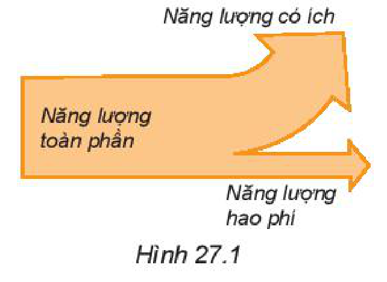
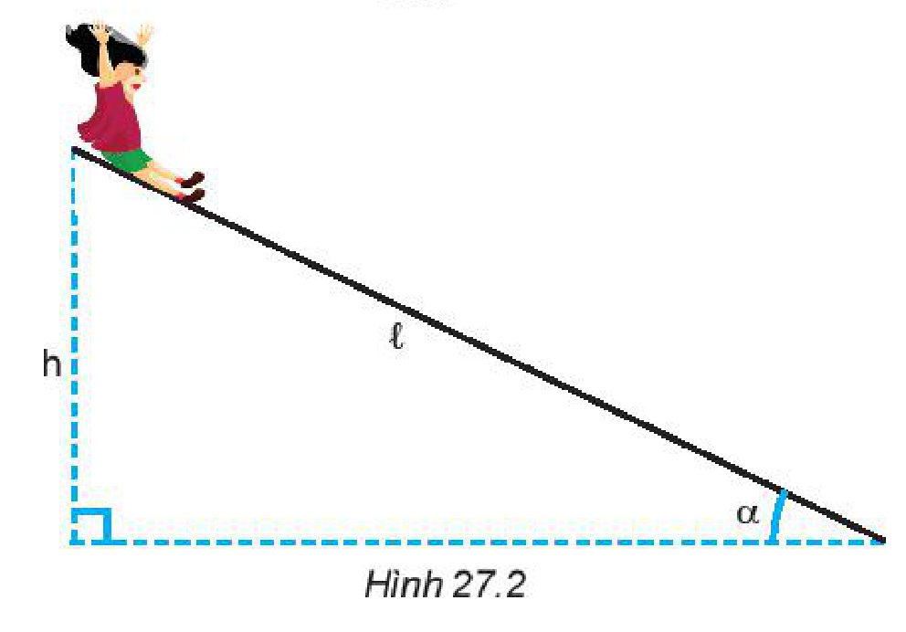
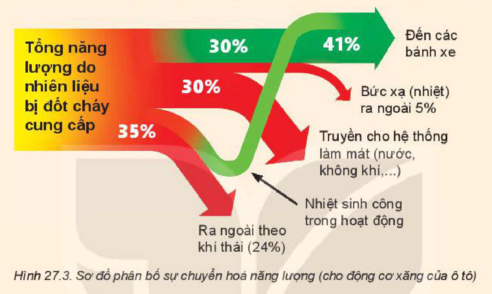

<!-- pdf:107 -->

# BÀI 27: HIỆU SUẤT

## 🔴 Mở đầu

> Theo em thì có thể có bao nhiêu phần trăm động năng của thác nước được nhà máy thuỷ điện chuyển hoá thành điện năng?
>
> 

## I. NĂNG LƯỢNG CÓ ÍCH VÀ NĂNG LƯỢNG HAO PHÍ

Chúng ta đã biết khi năng lượng được chuyển từ dạng này sang dạng khác, từ vật này sang vật khác, thì luôn có một phần bị hao phí.
<!-- term: Năng lượng hao phí -->

Trong các động cơ nhiệt thông thường có khoảng từ $60\%$ đến $70\%$ năng lượng bị hao phí, trong các động cơ điện năng lượng hao phí thấp hơn, chỉ vào khoảng $10\%$, nhưng trong các pin mặt trời thì ngược lại, chỉ có khoảng $10\%$ năng lượng của ánh sáng mặt trời được chuyển hoá thành điện năng, còn lại là năng lượng hao phí.
<!-- term: Năng lượng có ích -->
<!-- term: Năng lượng hao phí -->

> **Hoạt động:** Hãy thảo luận về các vấn đề sau:
> 1. Xác định năng lượng có ích và năng lượng hao phí khi chơi thể thao.
> 2. Nếu chơi thể thao trong thời tiết lạnh thì nhiệt năng mà cơ thể toả ra có được xem là năng lượng có ích không? Vì sao?

> **Câu hỏi:**
> 1. Trong động cơ ô tô chạy bằng xăng và trong quạt điện:
>    a) Có những sự chuyển hoá năng lượng nào?
>    b) Trong số những dạng năng lượng tạo thành, dạng năng lượng nào là có ích, dạng năng lượng nào là hao phí?
> 2. Xác định năng lượng có ích và năng lượng hao phí trong các trường hợp dưới đây:
>    a) Acquy khi nạp điện.
>    b) Acquy khi phóng điện.
>    c) Sử dụng ròng rọc để kéo vật nặng lên cao.
>    d) Bếp từ khi đang hoạt động.

## II. HIỆU SUẤT

Để đánh giá tỉ lệ giữa năng lượng có ích và năng lượng toàn phần, người ta dùng khái niệm **hiệu suất**.

$\text{Hiệu suất} = \frac{\text{Năng lượng có ích}}{\text{Năng lượng toàn phần}}$

$H = \frac{W_\text{ci}}{W_\text{tp}} \cdot 100\% \quad (27.1)$

hoặc $H = \frac{\mathscr{P}_\text{ci}}{\mathscr{P}_\text{tp}} \cdot 100\%$ với $\mathscr{P}_\text{ci}$ là **công suất có ích**, $\mathscr{P}_\text{tp}$ là **công suất toàn phần**.

<!-- pdf:108 -->

Từ công thức tính hiệu suất chung ở trên người ta có thể viết công thức tính hiệu suất cho từng trường hợp cụ thể.

Ví dụ, hiệu suất của động cơ nhiệt được viết dưới dạng:

$H = \frac{A}{Q} \cdot 100\% \quad (27.2)$

Trong đó, $A$ là công cơ học mà động cơ thực hiện được, $Q$ là nhiệt lượng mà động cơ nhận được từ nhiên liệu bị đốt cháy.

**Bảng 27.1.** Hiệu suất của một số thiết bị điện

| Thiết bị | Năng lượng đầu vào | Năng lượng đầu ra có ích | Hiệu suất |
| :--- | :--- | :--- | :---: |
| Máy phát điện | Cơ năng | Điện năng | $96\%$ |
| Tuabin nước | Cơ năng | Cơ năng | $90\%$ |
| Máy hơi nước | Hoá năng | Cơ năng | $15\%$ |
| Động cơ xăng | Hoá năng | Cơ năng | $35\%$ |
| Tuabin hơi nước | Hoá năng | Cơ năng | $28\%$ |
| Động cơ điện | Điện năng | Cơ năng | $96\%$ |
| Đèn dây tóc | Điện năng | Quang năng | $7\%$ |
| Đèn LED | Điện năng | Quang năng | $95\%$ |
| Bếp điện | Điện năng | Nhiệt năng | $90\%$ |

*Bài tập ví dụ:* Một em bé nặng $20\text{ kg}$ chơi cầu trượt từ trạng thái đứng yên ở đỉnh cầu trượt dài $4\text{ m}$, nghiêng góc $40^\circ$ so với phương nằm ngang (Hình 27.2). Khi đến chân cầu trượt, tốc độ của em bé này là $3,2\text{ m/s}$. Lấy gia tốc trọng trường là $10\text{ m/s}^2$.

a) Tính độ lớn lực ma sát tác dụng vào em bé này.

b) Tính hiệu suất của quá trình chuyển thế năng thành động năng của em bé này.

*Giải*

a) Độ lớn lực ma sát

Độ cao của đỉnh cầu trượt so với mặt đất:

$h = \ell \cdot \sin\alpha = 4 \cdot \sin 40^\circ \approx 2,57\text{ m}$

Do có ma sát nên khi trượt, một phần thế năng của em bé được chuyển hoá thành động năng, một phần thắng công cản $A$ của lực ma sát:

$m \cdot g \cdot h = \frac{m \cdot v^2}{2} + A$

Độ lớn công cản của lực ma sát:

$A = m \cdot g \cdot h - \frac{m \cdot v^2}{2} \approx 411,6\text{ J}$

Từ biểu thức tính công: $A = F \cdot s \cdot \cos\alpha$

Ta có độ lớn lực ma sát: $F = \frac{A}{\ell} \approx 102,9\text{ N}.$

b) Hiệu suất

- Năng lượng toàn phần bằng thế năng của em bé ở đỉnh cầu trượt:

$W_\text{tp} = m \cdot g \cdot h = 514\text{ J}.$

<!-- pdf:109 -->

- Năng lượng hao phí bằng độ lớn công của lực ma sát nên năng lượng có ích là:

$W_\text{ci} = W_\text{tp} - A = 102,4\text{ J}$

- Hiệu suất của quá trình biến đổi thế năng thành động năng:

$H = \frac{W_\text{ci}}{W_\text{tp}} \cdot 100\% = \frac{102,4}{514} \cdot 100\% \approx 20\%.$

> **Câu hỏi:**
> 1. Phân tích sự tiêu hao năng lượng ở động cơ đốt trong dùng trong ô tô (Hình 27.3).
>
> 
>
> 2. Hiệu suất của nhà máy điện dùng năng lượng mặt trời không bằng $\frac{1}{3}$ hiệu suất của nhà máy nhiệt điện. Tại sao người ta vẫn khuyến khích xây dựng nhà máy điện dùng năng lượng mặt trời?
> 3. Một ô tô chuyển động với vận tốc $54\text{ km/h}$ có thể đi được đoạn đường dài bao nhiêu khi tiêu thụ hết $60\text{ lít}$ xăng? Biết động cơ của ô tô có công suất $45\text{ kW}$; hiệu suất $25\%$; $1\text{ kg}$ xăng đốt cháy hoàn toàn toả ra nhiệt lượng bằng $46 \cdot 10^6\text{ J/kg}$ và khối lượng riêng của xăng là $700\text{ kg/m}^3$.

## 📌 Em đã học

- Luôn tồn tại năng lượng hao phí trong các quá trình chuyển hoá năng lượng.
- Hiệu suất được định nghĩa theo công thức: $H = \frac{W_\text{ci}}{W_\text{tp}} \cdot 100\% = \frac{\mathscr{P}_\text{ci}}{\mathscr{P}_\text{tp}} \cdot 100\%$

## ✏️ Em có thể

1. Vận dụng khái niệm hiệu suất để tính được phần năng lượng có ích và phần năng lượng hao phí trong quá trình hoạt động của các thiết bị phổ biến trong đời sống và kĩ thuật.
2. Tìm phương án giảm năng lượng hao phí khi sử dụng các thiết bị điện trong gia đình hoặc động cơ ô tô, xe máy.

## 📷 Danh sách hình trong bài

| Mã hình | Số hình SGK | Trang PDF | Chú thích |
| --- | --- | --- | --- |
| H10-vat_ly-b27-01 | Hình mở đầu | 107 | Đập nước của nhà máy thuỷ điện |
| H10-vat_ly-b27-02 | Hình 27.1 | 107 | Năng lượng toàn phần, năng lượng có ích và năng lượng hao phí của động cơ ô tô |
| H10-vat_ly-b27-03 | Hình 27.2 | 108 | Em bé chơi cầu trượt |
| H10-vat_ly-b27-04 | Hình 27.3 | 109 | Sơ đồ phân bố sự chuyển hoá năng lượng (cho động cơ xăng của ô tô) |
