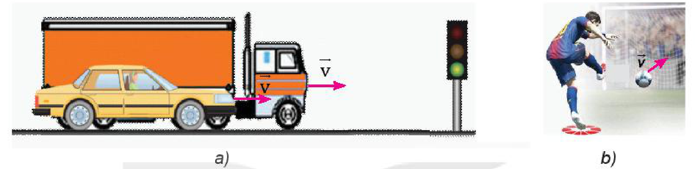
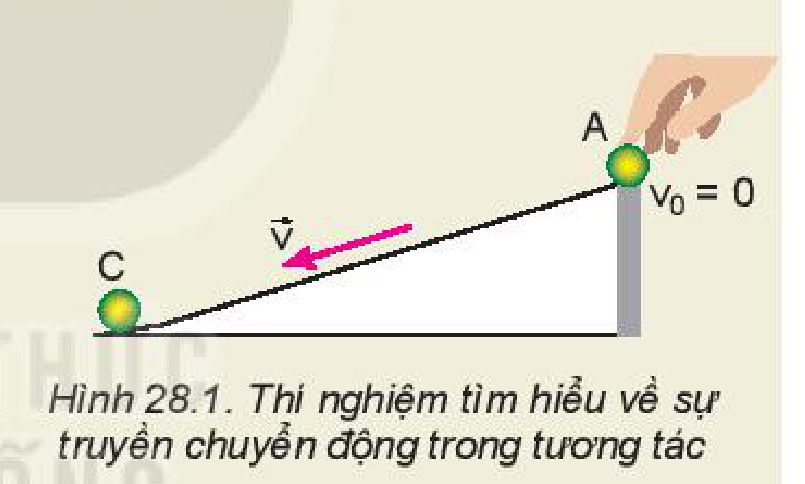
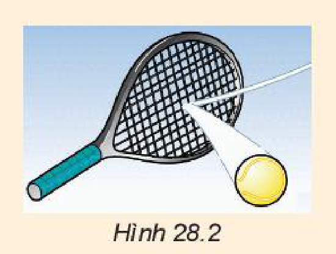

<!-- pdf:111 -->

# BÀI 28: ĐỘNG LƯỢNG

## 🔴 Mở đầu

> Quan sát hình dưới đây.
> - Hình a: Xe tải và xe ô tô con đang chạy cạnh nhau với cùng vận tốc. Khi đèn tín hiệu màu đỏ bật sáng, xe nào muốn dừng lại thì cần phải có một lực hãm lớn hơn. Tại sao?
> - Hình b: Cầu thủ đá bóng sút phạt $11\text{ m}$. Thủ môn khó bắt bóng hơn khi bóng bay tới có tốc độ lớn hay nhỏ? Tại sao?
>
> 

## I. ĐỘNG LƯỢNG

> **Hoạt động:**
>
> Thực hiện các thí nghiệm sau để tìm hiểu về sự truyền chuyển động trong tương tác giữa các vật.
>
> *Chuẩn bị:*
> - Ba viên bi A, B, C (chọn bi B nặng hơn A và C).
> - Máng trượt (có thể dùng ống nhựa cắt dọc).
> - Một vài vật (hộp giấy, quyển sách) để tạo độ dốc của máng trượt.
> - Đặt viên bi C ngay dưới chân máng trượt như Hình 28.1.
>
> 
>
> *Tiến hành:*
> - *Thí nghiệm 1:* Lần lượt thả hai viên bi: A, B (bi B nặng hơn bi A) chuyển động trên máng trượt. Quan sát và đo quãng đường dịch chuyển của viên bi C sau va chạm ứng với mỗi lần thả.
> - *Thí nghiệm 2:* Bây giờ chỉ thả viên bi A lăn xuống máng trượt nhưng tăng độ dốc của máng trượt. Quan sát và đo quãng đường dịch chuyển của viên bi C sau va chạm ứng với mỗi lần thả.
>
> *Thảo luận:*
> - Trong thí nghiệm 1, vận tốc của hai viên bi A và B khi đến chân dốc có giống nhau không? Viên bi nào đẩy viên bi C lăn xa hơn? Tại sao?
> - Trong thí nghiệm 2, ứng với độ dốc nào thì viên bi A có vận tốc lớn hơn khi va chạm với bi C? Ở trường hợp nào, viên bi C lăn xa hơn? Tại sao?

Từ hai thí nghiệm trên, ta thấy vật có khối lượng và vận tốc càng lớn thì sự truyền chuyển động trong tương tác với các vật khác càng mạnh. *Đại lượng đặc trưng cho khả năng truyền chuyển động của một vật khi tương tác với vật khác gọi là **động lượng** của vật.*

<!-- pdf:112 -->

Động lượng của một vật khối lượng $m$ đang chuyển động với vận tốc $\vec{v}$ là đại lượng được xác định bởi công thức:

$\vec{p} = m.\vec{v} \quad (28.1)$

Động lượng là một đại lượng vectơ có cùng hướng với vận tốc của vật.

Đơn vị động lượng là: $\text{kg.m/s}$.

> **Câu hỏi:**
>
> 1. Tìm thêm ví dụ minh hoạ cho ý nghĩa vật lí trên của động lượng.
> 2. a) Động lượng của xe tải hay xe ô tô con trong hình ở đầu bài lớn hơn?
>    b) Trong trường hợp sút phạt $11\text{ m}$, tại sao thủ môn khó bắt bóng hơn nếu bóng có động lượng tăng?

> **Câu hỏi:**
>
> 1. a) Nêu định nghĩa và đơn vị của động lượng.
>    b) Vẽ vectơ động lượng của một quả bóng tennis vừa bật khỏi mặt vợt (Hình 28.2).
>
> 
>
> 2. Phát biểu nào sau đây **không đúng** khi nói về động lượng?
>    A. Động lượng của một vật đặc trưng cho trạng thái chuyển động của vật đó.
>    B. Động lượng là đại lượng vectơ.
>    C. Động lượng có đơn vị là $\text{kg.m/s}$.
>    D. Động lượng của một vật chỉ phụ thuộc vào vận tốc của vật đó.
> 3. Tính độ lớn động lượng trong các trường hợp sau:
>    a) Một xe buýt khối lượng $3\text{ tấn}$ đang chuyển động với tốc độ $72\text{ km/h}$.
>    b) Một hòn đá khối lượng $500\text{ g}$ chuyển động với tốc độ $10\text{ m/s}$.
>    c) Một electron chuyển động với tốc độ $2.10^7\text{ m/s}$. Biết khối lượng electron bằng $9,1.10^{-31}\text{ kg}$.
> 4. Một xe tải có khối lượng $1,5\text{ tấn}$ chuyển động với tốc độ $36\text{ km/h}$ và một ô tô có khối lượng $750\text{ kg}$ chuyển động ngược chiều với tốc độ $54\text{ km/h}$. So sánh động lượng của hai xe.
> 5. Tại sao đơn vị của động lượng còn có thể viết là $\text{N.s}$?

## II. XUNG LƯỢNG CỦA LỰC

### 1. Xung lượng

Khi một lực $\vec{F}$ tác dụng lên một vật trong khoảng thời gian ngắn $\Delta t$ thì tích $\vec{F}.\Delta t$ được định nghĩa là xung lượng của lực $\vec{F}$ trong khoảng thời gian $\Delta t$ ấy (Lực $\vec{F}$ được xem là không đổi trong khoảng thời gian tác dụng ngắn $\Delta t$).
<!-- term: Xung lượng của lực -->

Đơn vị xung lượng của lực là $\text{N.s}$.

> **Câu hỏi:**
>
> 1. Trong các ví dụ sau, các vật đã chịu tác dụng của các lực nào trong thời gian rất ngắn?
>    - Cầu thủ thực hiện một cú đá vô lê đã đưa được bóng vào lưới đối phương.
>    - Trong môn bi-a, quả bi-a đang chuyển động thì va chạm vào thành bàn nên nó bị đổi hướng.
>    - Trong môn chơi gôn, một quả bóng gôn đang nằm yên. Sau một cú đánh, quả bóng bay đi rất nhanh.
> 2. Hãy chỉ ra sự biến đổi trạng thái chuyển động của vật trong các ví dụ trên như thế nào?
>    Tại sao lực tác dụng lên vật trong một khoảng thời gian ngắn lại có thể gây ra biến đổi đáng kể trạng thái chuyển động của vật đó?

<!-- pdf:113 -->

### 2. Liên hệ giữa xung lượng của lực và độ biến thiên động lượng

Giả sử có một lực $\vec{F}$ (không đổi) tác dụng lên một vật khối lượng $m$ đang chuyển động với vận tốc $\vec{v}_1$. Trong khoảng thời gian tác dụng $\Delta t$, vận tốc của vật biến đổi thành $\vec{v}_2$, nghĩa là vật đã có gia tốc:

$\vec{a} = \frac{\vec{v}_2 - \vec{v}_1}{\Delta t}$

Theo định luật 2 Newton:

$\vec{F} = m.\vec{a} = m\frac{\vec{v}_2 - \vec{v}_1}{\Delta t}$

Suy ra:

$\vec{F}.\Delta t = m.\vec{v}_2 - m.\vec{v}_1 = \vec{p}_2 - \vec{p}_1 \quad (28.2)$

Vế trái của (28.2) chính là xung lượng của lực trong khoảng thời gian $\Delta t$, còn vế phải là độ biến thiên động lượng của vật.
<!-- term: Độ biến thiên động lượng -->

Từ (28.2), ta có thể viết: $\vec{F}.\Delta t = \Delta\vec{p} \quad (28.3)$

Công thức (28.3) cho thấy:

Xung lượng của lực tác dụng lên vật trong một khoảng thời gian bằng độ biến thiên động lượng của vật trong khoảng thời gian đó.
<!-- term: Độ biến thiên động lượng -->

### 3. Dạng tổng quát của định luật 2 Newton
<!-- ocr-ok: đối chiếu ảnh trang PDF 113 khớp nguyên văn (OCR dính chữ Dạngtổng, luật2) -->

Từ (28.3), ta có thể viết: $\vec{F} = \frac{\Delta\vec{p}}{\Delta t} \quad (28.4)$

Công thức (28.4) cho thấy: Lực tổng hợp tác dụng lên vật bằng tốc độ thay đổi động lượng của vật.
<!-- term: Định luật 2 Newton dạng tổng quát -->

Phát biểu trên được xem như một cách diễn đạt khác của định luật 2 Newton.
<!-- term: Định luật 2 Newton dạng tổng quát -->

> **Câu hỏi:**
>
> 1. a) Xung lượng của lực gây ra tác dụng gì?
>    b) Một quả bóng khối lượng $m$ đang bay ngang với tốc độ $v$ thì đập vào một bức tường và bật trở lại với cùng tốc độ. Xung lượng của lực gây ra bởi tường lên quả bóng là
>    A. $mv$.
>    B. $-mv$.
>    C. $2mv$.
>    D. $-2mv$.
> 2. Thủ môn khi bắt bóng muốn không đau tay và khỏi ngã thì phải co tay lại và lùi người một chút theo hướng đi của quả bóng. Thủ môn làm thế để
>    A. làm giảm động lượng của quả bóng.
>    B. làm giảm độ biến thiên động lượng của quả bóng.
>    C. làm tăng xung lượng của lực quả bóng tác dụng lên tay.
>    D. làm giảm cường độ của lực quả bóng tác dụng lên tay.
> 3. Một quả bóng gôn có khối lượng $46\text{ g}$ đang nằm yên, sau một cú đánh quả bóng bay lên với tốc độ $70\text{ m/s}$. Tính xung lượng của lực và độ lớn trung bình của lực tác dụng vào quả bóng. Biết thời gian tác dụng là $0,5.10^{-3}\text{ s}$.
> 4. Hai vật có khối lượng lần lượt là $m_1 = 1\text{ kg}$ và $m_2 = 2\text{ kg}$, chuyển động với vận tốc có độ lớn lần lượt là $v_1 = 3\text{ m/s}$ và $v_2 = 2\text{ m/s}$.
>    a) Tính động lượng của mỗi vật.
>    b) Vật nào khó dừng lại hơn? Vì sao?

## 📌 Em đã học

- Động lượng của một vật khối lượng $m$ đang chuyển động với vận tốc $\vec{v}$ là đại lượng được xác định bởi công thức: $\vec{p} = m.\vec{v}$.
- Động lượng là đại lượng đặc trưng cho sự truyền tương tác giữa các vật.
- Tích $\vec{F}.\Delta t$ được gọi là xung lượng của lực tác dụng trong khoảng thời gian ngắn $\Delta t$ và bằng độ biến thiên động lượng của vật trong thời gian đó: $\vec{F}.\Delta t = \Delta\vec{p}$.

## ✏️ Em có thể

1. Mô tả và tính độ lớn động lượng của Trái Đất trong chuyển động quanh Mặt Trời, khi biết khối lượng Trái Đất và bán kính quỹ đạo.
2. Tính động lượng của hệ “tên lửa + khí” ngay trước và sau khi phụt khí, khi đã biết khối lượng, vận tốc của tên lửa và của khí phụt ra.

## 📷 Danh sách hình trong bài

| Mã hình | Số hình SGK | Trang PDF | Chú thích |
| --- | --- | --- | --- |
| H10-vat_ly-b28-01 | — | 111 | Hình mở đầu: a) Xe tải và xe ô tô con đang chạy cạnh nhau với cùng vận tốc; b) Cầu thủ đá bóng sút phạt 11 m |
| H10-vat_ly-b28-02 | Hình 28.1 | 111 | Thí nghiệm tìm hiểu về sự truyền chuyển động trong tương tác |
| H10-vat_ly-b28-03 | Hình 28.2 | 112 | Quả bóng tennis vừa bật khỏi mặt vợt |
