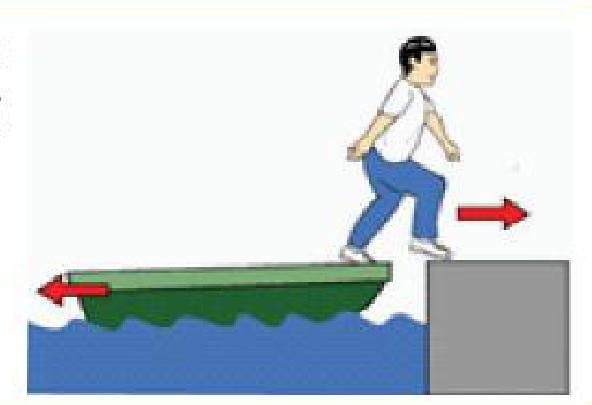
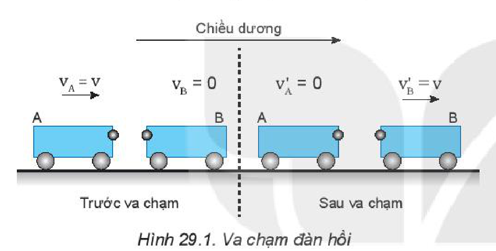
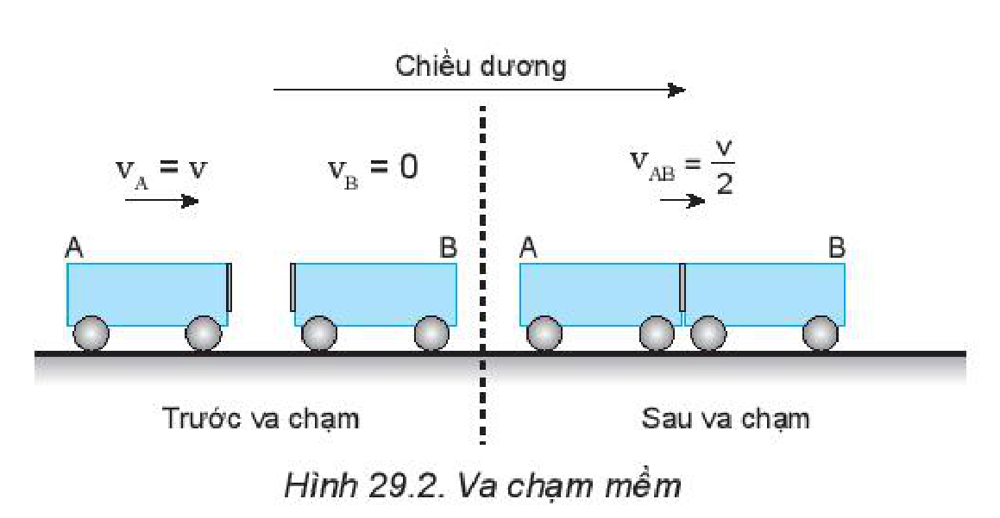
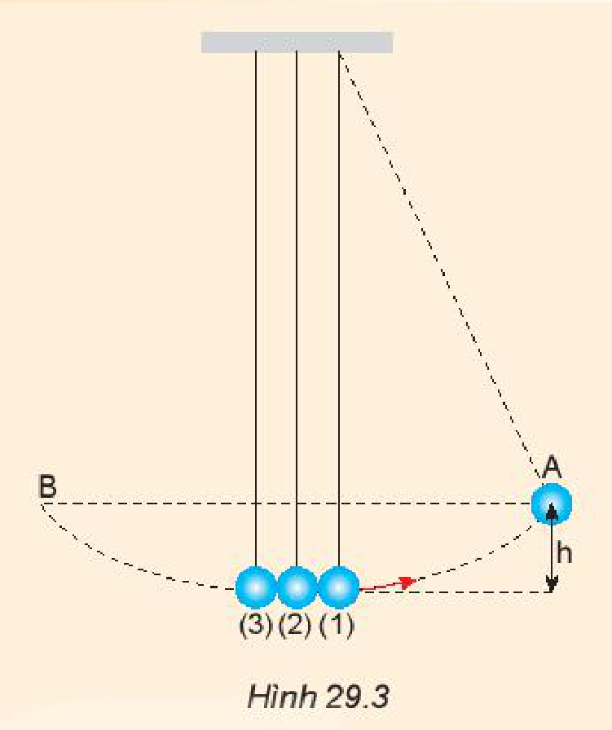
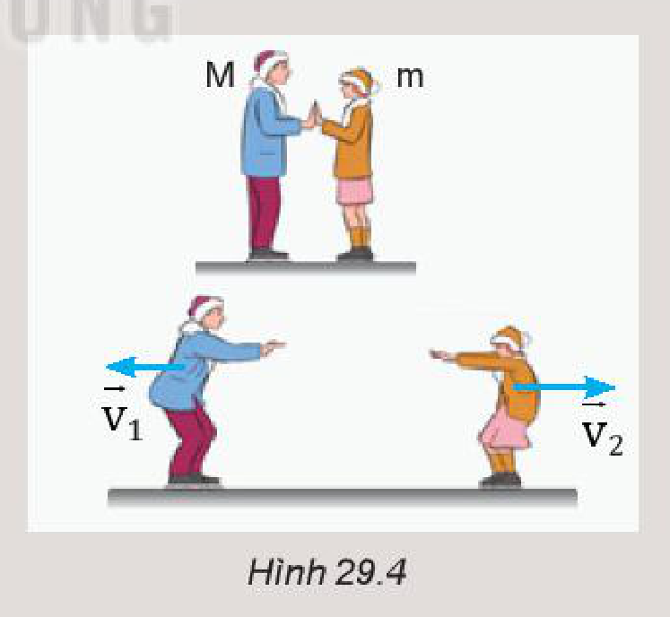

<!-- pdf:114 -->

# BÀI 29: ĐỊNH LUẬT BẢO TOÀN ĐỘNG LƯỢNG

## 🔴 Mở đầu

> Một người đang ở trong một chiếc thuyền nhỏ đứng yên, tại sao thuyền bị lùi lại khi người đó bước lên bờ?
>
> 

## I. ĐỊNH LUẬT BẢO TOÀN ĐỘNG LƯỢNG

### 1. Hệ kín (hay hệ cô lập)

*a)* Một hệ nhiều vật được gọi là *hệ kín* khi không có ngoại lực tác dụng lên hệ hoặc nếu có thì các lực ấy cân bằng nhau. Trong một hệ kín, chỉ có các *nội lực* (các lực tác dụng giữa các vật trong hệ) tương tác giữa các vật. Các nội lực này theo định luật 3 Newton trực đối nhau từng đôi một.
<!-- term: Nội lực -->
<!-- term: Ngoại lực -->

*b)* Nếu trong quá trình tương tác, các nội lực xuất hiện lớn hơn các ngoại lực rất nhiều thì có thể bỏ qua các ngoại lực và coi hệ là kín. Ví dụ như: va chạm, đạn nổ, pháo nổ,...

> **Câu hỏi:** Hãy cho ví dụ về hệ kín.

### 2. Định luật bảo toàn động lượng

Xét một hệ kín gồm hai vật trượt trên một đệm khí đến va chạm với nhau.

Vì các lực $\vec{F}_1$ và $\vec{F}_2$ là cặp nội lực trực đối nhau, nên theo định luật 3 Newton, ta viết:

$\vec{F}_1 = -\vec{F}_2 \quad (29.1)$

Dưới tác dụng của các lực $\vec{F}_1$ và $\vec{F}_2$, trong khoảng thời gian $\Delta t$, động lượng của mỗi vật có độ biến thiên lần lượt là $\Delta\vec{p}_1$ và $\Delta\vec{p}_2$.

Áp dụng công thức $\vec{F}.\Delta t = \Delta\vec{p}$ cho từng vật, ta có:

$\begin{cases} \vec{F}_1.\Delta t = \Delta\vec{p}_1 \\ \vec{F}_2.\Delta t = \Delta\vec{p}_2 \end{cases} \quad (29.2)$

Từ (29.1) và (29.2), suy ra:

$\Delta\vec{p}_1 = -\Delta\vec{p}_2 \text{ hay } \Delta\vec{p}_1 + \Delta\vec{p}_2 = \vec{0}$

Gọi $\vec{p} = \vec{p}_1 + \vec{p}_2$ là động lượng toàn phần của hệ. Ta có biến thiên động lượng toàn phần của hệ bằng tổng các biến thiên động lượng của mỗi vật: $\Delta\vec{p} = \Delta\vec{p}_1 + \Delta\vec{p}_2 = \vec{0}$
<!-- term: Động lượng toàn phần của hệ -->

Biến thiên động lượng của hệ bằng không, nghĩa là động lượng toàn phần của hệ không đổi.

$\vec{p} = \vec{p}_1 + \vec{p}_2 \text{ (không đổi)}$

Kết quả này có thể mở rộng cho hệ kín gồm nhiều vật.

<!-- pdf:115 -->

Từ đó, ta có thể phát biểu: *Động lượng toàn phần của hệ kín là một đại lượng bảo toàn.*
<!-- term: Định luật bảo toàn động lượng -->

Phát biểu trên được gọi là định luật bảo toàn động lượng.
<!-- term: Định luật bảo toàn động lượng -->

Định luật bảo toàn động lượng có nhiều ứng dụng thực tế: giải các bài toán va chạm, làm cơ sở cho nguyên tắc chuyển động phản lực.
<!-- term: Chuyển động phản lực -->

> **Câu hỏi:** Một hệ gồm hai vật có khối lượng lần lượt là $m_1$ và $m_2$, chuyển động với vận tốc có độ lớn lần lượt là $v_1$ và $v_2$ hướng vào nhau. Bỏ qua mọi ma sát và lực cản của không khí. Viết biểu thức của định luật bảo toàn động lượng cho hệ này.

## II. VA CHẠM ĐÀN HỒI VÀ VA CHẠM MỀM

Có hai kiểu va chạm thường gặp là va chạm đàn hồi và va chạm mềm.

### 1. Va chạm đàn hồi

Hình 29.1 mô tả một thí nghiệm về va chạm đàn hồi.

> **Câu hỏi:**
>
> 1. Hãy tính động lượng và động năng của hệ trước và sau va chạm đàn hồi. (Hình 29.1)
> 2. Từ kết quả tính được rút ra nhận xét gì?

Dùng hai xe A và B giống nhau, ở đầu mỗi xe có gắn một quả cầu kim loại nhỏ, cho xe A chuyển động với vận tốc $v_\text{A} = v$ tới va chạm với xe B đang đứng yên. Kết quả của va chạm làm xe A đang chuyển động thì dừng lại, còn xe B đang đứng yên thì chuyển động với đúng vận tốc $v'_\text{B} = v$ (Hình 29.1). Còn nếu xe A chuyển động đến va chạm trực diện với xe B có vận tốc $v_\text{B} = -v$, thì sau va chạm cả hai xe đổi chiều vận tốc: $v'_\text{A} = -v$ và $v'_\text{B} = v$. Đó là hai ví dụ về kiểu va chạm đàn hồi.

Va chạm như thế gọi là va chạm đàn hồi.

### 2. Va chạm mềm

Hình 29.2 mô tả một thí nghiệm về va chạm mềm.

Dùng hai xe A và B giống nhau, ở đầu mỗi xe có gắn một miếng nhựa dính. Cho xe A chuyển động với vận tốc $v_\text{A} = v$ tới va chạm với xe kia đang đứng yên. Sau va chạm, cả hai xe dính vào nhau và chuyển động với vận tốc bằng $v_\text{AB} = \frac{v}{2}$. Kiểu va chạm “dính” này gọi là va chạm mềm.

<!-- pdf:116 -->

> **Câu hỏi:**
>
> 1. Hãy tính động lượng và động năng của hệ trong Hình 29.2 trước và sau va chạm.
> 2. Từ kết quả tính được rút ra nhận xét gì?
> 3. Trong Hình 29.3, nếu kéo bi (1) lên thêm một độ cao $h$ rồi thả ra. Con lắc sẽ rơi xuống và va chạm với hai con lắc còn lại. Hãy dự đoán xem va chạm là va chạm gì. Con lắc (2), (3) lên tới độ cao nào? Làm thí nghiệm để kiểm tra.
>
> 

## 📌 Em đã học

- Một hệ nhiều vật tác dụng lẫn nhau được gọi là hệ kín (hay hệ cô lập) khi không có ngoại lực tác dụng vào hệ hoặc khi các ngoại lực cân bằng nhau.
- Định luật bảo toàn động lượng: “Động lượng toàn phần của hệ kín là một đại lượng bảo toàn”.
- Có hai kiểu va chạm thường gặp là va chạm đàn hồi và va chạm mềm.

## ✏️ Em có thể

Vận dụng định luật bảo toàn động lượng để giải thích:

1. Tại sao hai người đang đứng yên trên sân băng bị lùi ra xa nhau khi họ dùng tay đẩy vào nhau (Hình 29.4).
2. Tại sao tốc độ lùi của mỗi người có khối lượng khác nhau thì khác nhau.

## 📷 Danh sách hình trong bài

| Mã hình | Số hình SGK | Trang PDF | Chú thích |
| --- | --- | --- | --- |
| H10-vat_ly-b29-01 | — | 114 | Hình mở đầu: Người bước từ chiếc thuyền nhỏ lên bờ |
| H10-vat_ly-b29-02 | Hình 29.1 | 115 | Va chạm đàn hồi |
| H10-vat_ly-b29-03 | Hình 29.2 | 115 | Va chạm mềm |
| H10-vat_ly-b29-04 | Hình 29.3 | 116 | Thí nghiệm va chạm của các con lắc |
| H10-vat_ly-b29-05 | Hình 29.4 | 116 | Hai người đứng trên sân băng dùng tay đẩy vào nhau |
