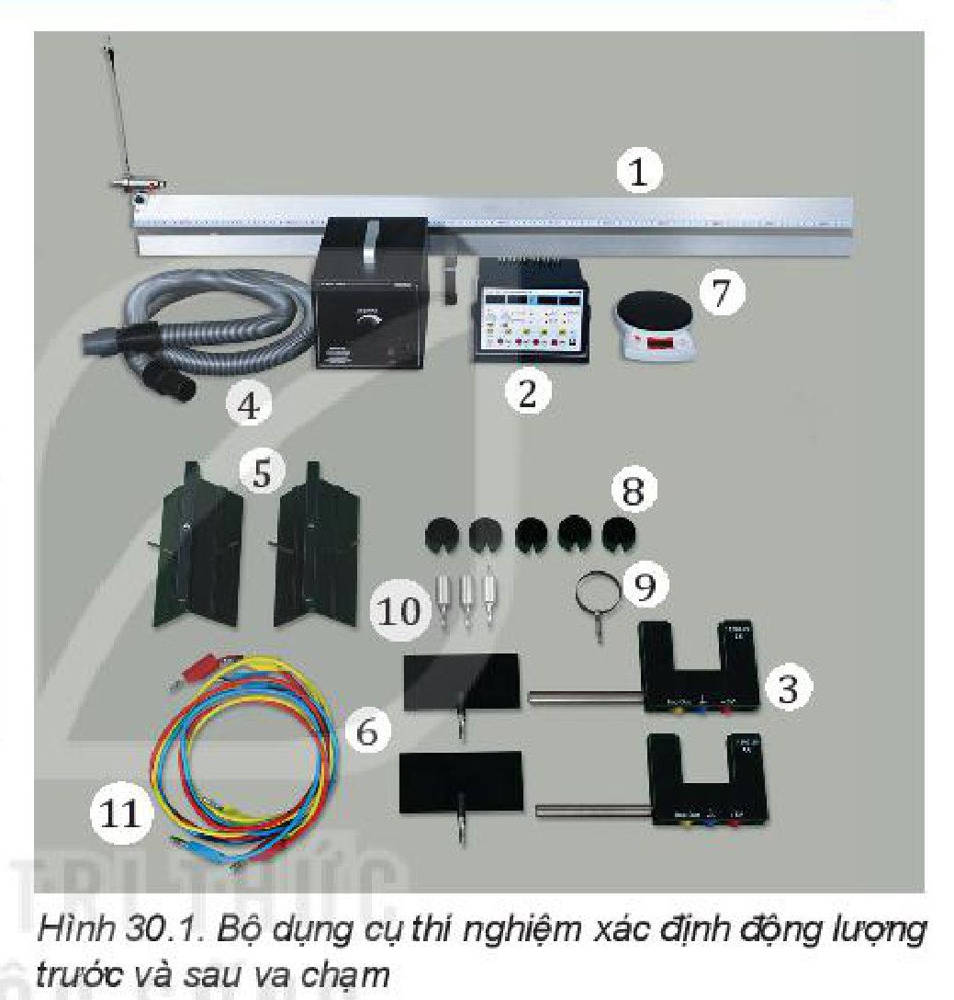
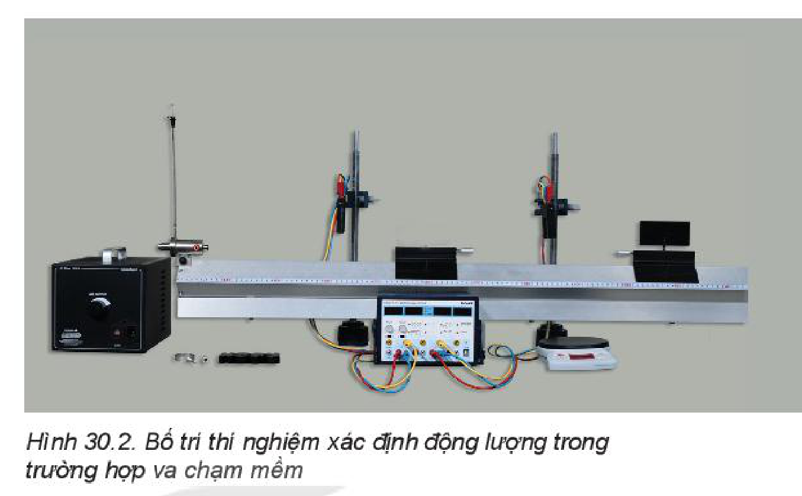
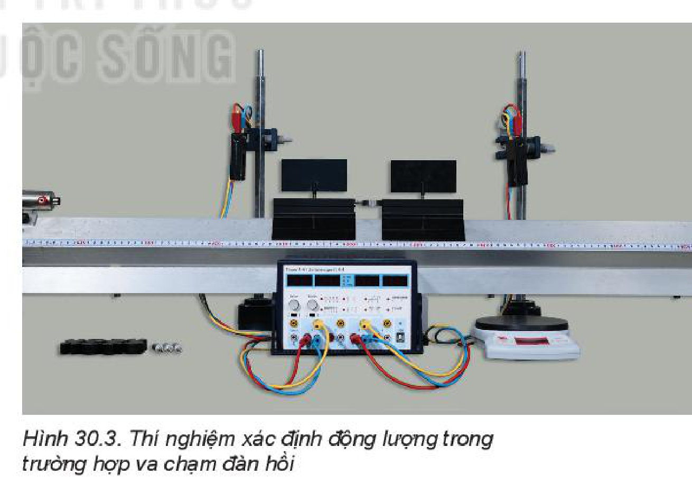
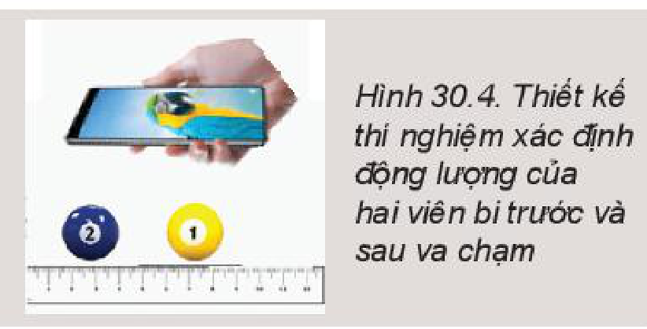

<!-- pdf:117 -->

# BÀI 30: THỰC HÀNH: XÁC ĐỊNH ĐỘNG LƯỢNG CỦA VẬT TRƯỚC VÀ SAU VA CHẠM

## 🔴 Mở đầu

> Có hai xe chuyển động va chạm vào nhau thì động lượng các xe thay đổi. Em hãy nêu các trường hợp có thể xảy ra và dự đoán sau va chạm hai xe chuyển động như thế nào. Làm thế nào xác định được động lượng của hai xe trước và sau va chạm bằng dụng cụ thí nghiệm, từ đó kiểm nghiệm định luật bảo toàn động lượng?

## I. DỤNG CỤ THÍ NGHIỆM

- Băng đệm khí (1).
- Đồng hồ đo thời gian hiện số (2).
- Hai cổng quang điện (3).
- Bơm nén khí (4).
- Hai xe trượt (5).
- Hai tấm chắn sáng (6).
- Cân điện tử (7).
- Một số quả nặng (8).
- Lò xo hoặc thanh nhựa hình chữ U để mắc dây cao su đàn hồi (9).
- Chốt ghim (10).
- Các dây nối (11).

## II. THIẾT KẾ PHƯƠNG ÁN THÍ NGHIỆM

Để hai xe va chạm trên đệm khí, có thể thực hiện như sau:

- Điều chỉnh cho băng đệm khí nằm ngang và lắp ống dẫn khí từ bơm nén khí vào băng đệm khí.
- Lắp hai cổng quang điện vào hai giá đỡ đặt cách nhau một khoảng.
- Nối dây từ hai cổng quang điện vào đồng hồ đo thời gian hiện số.
- Lắp tấm chắn sáng và các chốt cắm thích hợp lên mỗi xe và đặt hai xe lên băng đệm khí.
- Cấp điện cho bơm nén khí và đồng hồ đo thời gian hiện số.
<!-- term: Băng đệm khí -->

> **Hoạt động:**
>
> Đẩy cho hai xe chuyển động va chạm vào nhau trên đệm khí và thảo luận:
> 1. Khi hai xe chuyển động trên đệm khí nằm ngang, hệ hai xe chuyển động có phải là hệ kín không? Vì sao?
> 2. Để xác định động lượng của hai xe trước và sau va chạm cần đo các đại lượng nào?
> 3. Hãy thử các trường hợp mà em đã dự đoán và suy nghĩ làm thế nào đo được các đại lượng để xác định động lượng của hai xe trước và sau va chạm.
> 4. Thiết kế phương án thí nghiệm để xác định động lượng của hai xe trước và sau va chạm tương ứng với các trường hợp va chạm có thể xảy ra.

<!-- pdf:118 -->

## III. TIẾN HÀNH THÍ NGHIỆM

***Thí nghiệm 1: Va chạm mềm***

Hai xe chuyển động va chạm vào nhau, sau va chạm hai xe dính vào nhau và chuyển động với cùng vận tốc.

1. Bố trí thí nghiệm như Hình 30.2.
2. Lắp tấm chắn sáng vào xe và các chốt cắm thích hợp lên hai xe, sau đó cân khối lượng xe và ghi vào Bảng 30.1.
3. Cấp điện cho bơm nén khí và đồng hồ đo thời gian, điều chỉnh tốc độ của bơm nén khí thích hợp, cho đồng hồ đo thời gian hoạt động ở chế độ đo thời gian vật chắn cổng quang điện.
4. Ấn nút Reset trên mặt đồng hồ để đưa số chỉ của đồng hồ về $0.000$.
5. Đặt xe 2 lên băng đệm khí giữa hai cổng quang điện, đặt xe 1 ở khoảng bên ngoài hai cổng quang điện.
6. Đẩy xe 1 va chạm vào xe 2.
7. Lần lượt đọc trên đồng hồ các khoảng thời gian $t_1$, $t'_1$ và ghi vào Bảng 30.1.
8. Gắn thêm vào xe các gia trọng, lặp lại các bước 4, 5, 6, 7 hai lần.

> **Lưu ý:** *Chú ý:* Gắn tấm chắn cổng quang điện và điều chỉnh cho song song với băng đệm khí.
<!-- ocr-ok: đối chiếu ảnh trang PDF 118 khớp nguyên văn (OCR trộn dòng hộp Chú ý với cột trái) -->

***Thí nghiệm 2: Va chạm đàn hồi***

Hai xe đứng yên trên đệm khí, đẩy nhau nhờ lực đàn hồi của lò xo hoặc dây chun được gắn vào một xe, sau đó hai xe chuyển động về hai phía ngược nhau (Hình 30.3).

1. Bố trí thí nghiệm như Hình 30.3.
2. Gắn lò xo (hoặc thanh nhựa hình chữ U có dây cao su đàn hồi vào 1 xe). Cân hai xe và ghi vào Bảng 30.2.
3. Đặt hai xe lên băng đệm khí ở vị trí giữa hai cổng quang. Lấy sợi dây nhỏ buộc hai xe để nén lò xo lại. Ấn nút Reset trên mặt đồng hồ.
4. Cắt sợi dây để lò xo bung ra, đẩy hai xe về hai phía.
5. Lần lượt đọc trên đồng hồ các khoảng thời gian $t'_1$, $t'_2$ và ghi vào Bảng 30.2.
6. Gắn thêm vào hai xe các gia trọng, lặp lại các bước 3, 4, 5 hai lần nữa.

<!-- pdf:119 -->

## IV. KẾT QUẢ THÍ NGHIỆM

**Bảng 30.1.** Thí nghiệm va chạm mềm

Độ dài tấm cản quang: ........... (m)

| Lần | $m_1$ | $m_2$ | Trước va chạm: $t_1$ | Trước va chạm: $v_1$ | Trước va chạm: $p_1$ | Trước va chạm: $p_2$ | Trước va chạm: $p$ | Sau va chạm: $t'_1$ | Sau va chạm: $v'_1 = v'_2$ | Sau va chạm: $p'$ |
| --- | --- | --- | --- | --- | --- | --- | --- | --- | --- | --- |
| 1 | | | | | | | | | | |
| 2 | | | | | | | | | | |
| 3 | | | | | | | | | | |

**Bảng 30.2.** Thí nghiệm va chạm đàn hồi

| Lần | $m_1$ | $m_2$ | Trước va chạm: $p_1$ | Trước va chạm: $p_2$ | Sau va chạm: $t'_1$ | Sau va chạm: $t'_2$ | Sau va chạm: $v'_1$ | Sau va chạm: $v'_2$ | Sau va chạm: $p'_1$ | Sau va chạm: $p'_2$ |
| --- | --- | --- | --- | --- | --- | --- | --- | --- | --- | --- |
| 1 | | | | | | | | | | |
| 2 | | | | | | | | | | |
| 3 | | | | | | | | | | |

> **Hoạt động:**
>
> Nhận xét và đánh giá kết quả thí nghiệm
> 1. Từ Bảng 30.1 và Bảng 30.2, hãy so sánh các kết quả xác định động lượng của hai xe trước và sau va chạm trong hai thí nghiệm.
> 2. Em có thể đề xuất một phương án thí nghiệm khác để xác định động lượng của hai xe trước và sau va chạm.

## 📌 Em đã học

- Sử dụng băng đệm khí, cổng quang và đồng hồ đo thời gian hiện số có thể tiến hành thí nghiệm xác định động lượng của vật trước và sau va chạm đối với va chạm mềm, va chạm đàn hồi.
- Để tiến hành thí nghiệm chính xác, cần đặt máng ngang và giảm ma sát ít nhất có thể.

## ✏️ Em có thể

Sử dụng điện thoại thông minh và phần mềm phân tích video để xác định được vận tốc và động lượng trước và sau va chạm của hai viên bi có khối lượng xác định.

> **Em có biết:**
>
> Trong thiết kế ô tô, ngoài túi khí và dây an toàn trên ô tô, nhà sản xuất còn tạo ra “vùng hấp thụ xung lượng của lực” – đó là phần khung thép mềm hơn các vùng khác.
>
> Khi có va chạm, độ biến thiên động lượng của xe trong một khoảng thời gian bằng xung lượng của lực tác dụng lên xe trong khoảng thời gian đó: $\Delta\vec{p} = \vec{F}.\Delta t$. Vùng hấp thụ xung lượng của lực sẽ biến dạng giúp xe giảm tốc độ chậm hơn, kéo dài thời gian va chạm để giảm lực tác dụng, giúp giảm chấn thương cho người ngồi trong xe.
<!-- term: Vùng hấp thụ xung lượng của lực -->

## 📷 Danh sách hình trong bài

| Mã hình | Số hình SGK | Trang PDF | Chú thích |
| --- | --- | --- | --- |
| H10-vat_ly-b30-01 | Hình 30.1 | 117 | Bộ dụng cụ thí nghiệm xác định động lượng trước và sau va chạm |
| H10-vat_ly-b30-02 | Hình 30.2 | 118 | Bố trí thí nghiệm xác định động lượng trong trường hợp va chạm mềm |
| H10-vat_ly-b30-03 | Hình 30.3 | 118 | Thí nghiệm xác định động lượng trong trường hợp va chạm đàn hồi |
| H10-vat_ly-b30-04 | Hình 30.4 | 119 | Thiết kế thí nghiệm xác định động lượng của hai viên bi trước và sau va chạm |
