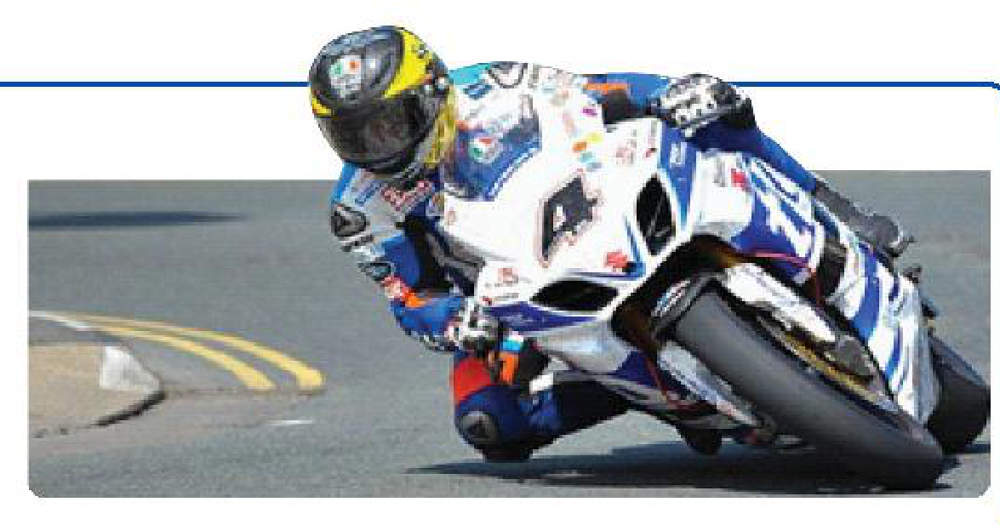
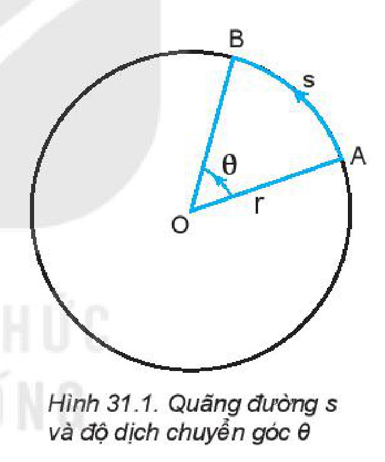
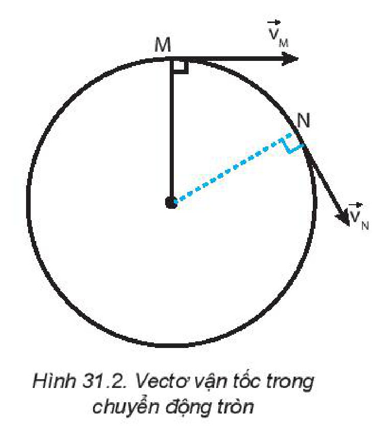
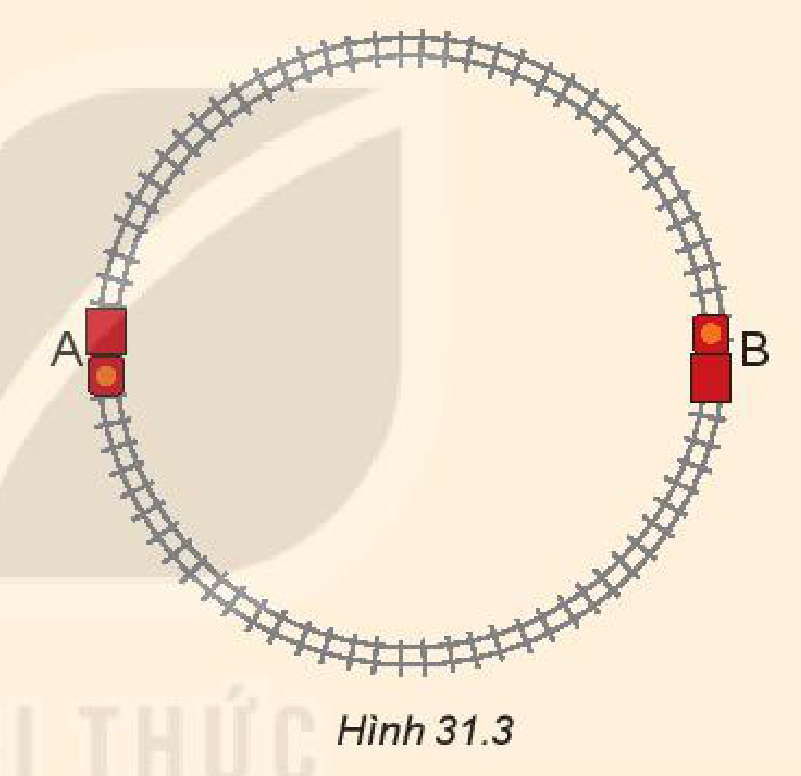

<!-- pdf:121 -->

# BÀI 31: ĐỘNG HỌC CỦA CHUYỂN ĐỘNG TRÒN ĐỀU

## 🔴 Mở đầu

> Khi xe mô tô đua vào khúc cua thì có những bộ phận nào của xe chuyển động tròn?
>
> 

## I. MÔ TẢ CHUYỂN ĐỘNG TRÒN

Trong cuộc sống hằng ngày ta gặp nhiều vật chuyển động tròn như: cánh quạt, kim đồng hồ, đu quay,...
<!-- term: Chuyển động tròn -->

Để xác định vị trí của vật chuyển động tròn ta có thể dựa vào quãng đường đi $s$ (độ dài cung tròn) hoặc độ dịch chuyển góc $\theta$ tính từ vị trí ban đầu.

Khi vật chuyển động tròn trong thời gian $t$ từ A đến B thì **độ dịch chuyển góc** của vật trong thời gian này là góc ở tâm $\theta$ chắn cung AB có độ dài $s$ bằng quãng đường đi được cũng trong thời gian đó (Hình 31.1).

Trong Toán học, ta đã biết mối quan hệ giữa độ dài cung với góc chắn tâm và bán kính đường tròn:

$\theta = \frac{s}{r} \quad (31.1)$

Trong Vật lí người ta thường dùng đơn vị góc là **rađian** (kí hiệu $\text{rad}$). Có thể dễ dàng chuyển đơn vị độ sang $\text{rad}$. Ví dụ, khi vật chuyển động được $1$ vòng tròn, ta có:

$\theta = \frac{2 \cdot \pi \cdot r}{r} = 2 \cdot \pi$

Do đó: $360^\circ = 2 \cdot \pi\text{ (rad)}$

Tương tự, ta có: $180^\circ = \pi\text{ (rad)}$.

> **Câu hỏi:**
>
> 1. Chứng minh rằng một rađian là góc ở tâm chắn cung có độ dài bằng bán kính đường tròn.
> 2. Tính quãng đường đi được khi vật chuyển động tròn có độ dịch chuyển góc $1\text{ rad}$, biết bán kính đường tròn là $2\text{ m}$.
> 3. Xét chuyển động của kim giờ đồng hồ. Tìm độ dịch chuyển góc của nó (theo độ và rađian):
>    a) Trong mỗi giờ.
>    b) Trong khoảng thời gian từ $12$ giờ đến $15$ giờ $30$ phút.

<!-- pdf:122 -->

## II. CHUYỂN ĐỘNG TRÒN ĐỀU. TỐC ĐỘ VÀ TỐC ĐỘ GÓC

### 1. Tốc độ

Trong chuyển động tròn, để đặc trưng cho sự nhanh hay chậm ta cũng dùng khái niệm tốc độ như trong chuyển động thẳng.
<!-- term: Tốc độ trong chuyển động tròn -->

**Chuyển động tròn đều** là chuyển động theo quỹ đạo tròn có tốc độ không thay đổi:

$v = \frac{s}{t} = \text{hằng số} \quad (31.2)$

> **Câu hỏi:**
>
> Dựa vào việc quan sát chuyển động của kim giây quay đều trong đồng hồ để:
> 1. So sánh tốc độ của các điểm khác nhau trên kim;
> 2. So sánh độ dịch chuyển góc trong cùng khoảng thời gian của các điểm khác nhau trên kim.

### 2. Tốc độ góc

**Tốc độ góc** trong chuyển động tròn đều bằng độ dịch chuyển góc chia cho thời gian dịch chuyển.

$\omega = \frac{\theta}{t} \quad (31.3)$

Đơn vị thường dùng của tốc độ góc là $\text{rad/s}$.

Từ công thức (31.1) và (31.2), suy ra:

$v = \omega \cdot r \quad (31.4)$

> **Câu hỏi:**
>
> 1. Hãy tính tốc độ góc của kim giờ và kim phút của đồng hồ.
> 2. Roto trong một tổ máy của nhà máy thuỷ điện Hoà Bình quay $125$ vòng mỗi phút. Hãy tính tốc độ góc của roto này theo đơn vị $\text{rad/s}$.

> **Em có biết:**
>
> Ngoài tốc độ, tốc độ góc, trong chuyển động tròn đều người ta còn quan tâm đến các đại lượng như chu kì và tần số.
>
> ***Chu kì** (kí hiệu là $T$) trong chuyển động tròn đều là thời gian để vật quay hết một vòng tròn.*
>
> ***Tần số** (kí hiệu là $f$) là số vòng vật đi được trong một giây. Đơn vị tần số là **héc** ($\text{Hz}$).*
>
> Từ các công thức trên ta có công thức tính $T$ và $f$:
>
> $T = \frac{1}{f} = \frac{2 \cdot \pi}{\omega}$

> **Câu hỏi:**
>
> 1. Biết chiều dài kim phút và kim giây của một chiếc đồng hồ lần lượt là $4\text{ cm}$ và $5\text{ cm}$. Hãy tính:
>    a) Tỉ số chu kì quay của hai kim.
>    b) Tỉ số tốc độ của đầu kim phút và đầu kim giây.
> 2. Xét một điểm nằm trên đường xích đạo trong chuyển động tự quay của Trái Đất. Biết bán kính Trái Đất tại xích đạo là $6\text{ }400\text{ km}$. Hãy tính:
>    a) Chu kì chuyển động của điểm đó.
>    b) Tốc độ và tốc độ góc của điểm đó.

## III. VẬN TỐC TRONG CHUYỂN ĐỘNG TRÒN ĐỀU

Ta đã biết trong chuyển động thẳng vận tốc tức thời $\vec{v}_t$ tại một thời điểm cho bởi:

$\vec{v}_t = \frac{\Delta \vec{d}}{\Delta t}$

Khi $\Delta t$ rất nhỏ, vectơ độ dịch chuyển $\Delta \vec{d}$ sẽ tiến tới trùng với tiếp tuyến với đường tròn. Do đó, tại mỗi thời điểm vectơ vận tốc tức thời sẽ có phương trùng với tiếp tuyến của đường tròn (Hình 31.2).
<!-- term: Vận tốc trong chuyển động tròn đều -->

<!-- pdf:123 -->

Trong chuyển động tròn đều, độ lớn của vận tốc tức thời không đổi nhưng hướng luôn thay đổi.
<!-- term: Vận tốc trong chuyển động tròn đều -->

> **Câu hỏi:**
>
> 1. Phân biệt tốc độ và vận tốc tức thời trong chuyển động tròn đều.
> 2. Nêu mối quan hệ giữa tốc độ $v$, chu kì $T$ và bán kính $r$ của một vật chuyển động tròn đều.
> 3. Một xe đồ chơi chạy với tốc độ không đổi $0,2\text{ m/s}$ trên một đường ray tròn tâm O, đường kính AB theo chiều kim đồng hồ. (Hình 31.3).
>    Xác định sự thay đổi của vận tốc khi xe đi từ A đến B.
>
> 

## 📌 Em đã học

- Chuyển động của một vật theo quỹ đạo tròn với tốc độ không đổi gọi là **chuyển động tròn đều**.
- Một **rađian** là góc ở tâm chắn cung có độ dài bằng bán kính đường tròn.
- Tốc độ, tốc độ góc và bán kính quỹ đạo liên hệ với nhau theo công thức: $v = \omega \cdot r$.
- Trong chuyển động tròn đều, độ lớn vận tốc không đổi nhưng hướng luôn thay đổi.

## ✏️ Em có thể

1. Biểu diễn được độ dịch chuyển góc theo rađian.
2. Vận dụng khái niệm tốc độ góc để giải được một số bài tập liên quan.

## 📷 Danh sách hình trong bài

| Mã hình | Số hình SGK | Trang PDF | Chú thích |
| --- | --- | --- | --- |
| H10-vat_ly-b31-01 | — | 121 | Hình mở đầu: Xe mô tô đua vào khúc cua (allow_edge_ink: ảnh xe mô tô đua ở hộp mở đầu thiết kế tràn qua đường viền trên của khung xanh) |
| H10-vat_ly-b31-02 | Hình 31.1 | 121 | Quãng đường $s$ và độ dịch chuyển góc $\theta$ |
| H10-vat_ly-b31-03 | Hình 31.2 | 123 | Vectơ vận tốc trong chuyển động tròn |
| H10-vat_ly-b31-04 | Hình 31.3 | 123 | Xe đồ chơi chạy trên đường ray tròn tâm O, đường kính AB |
