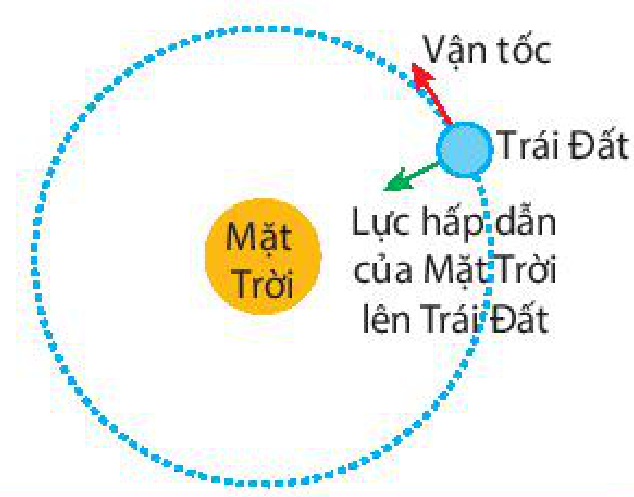
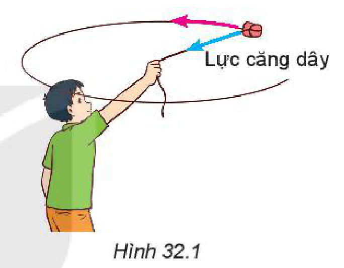
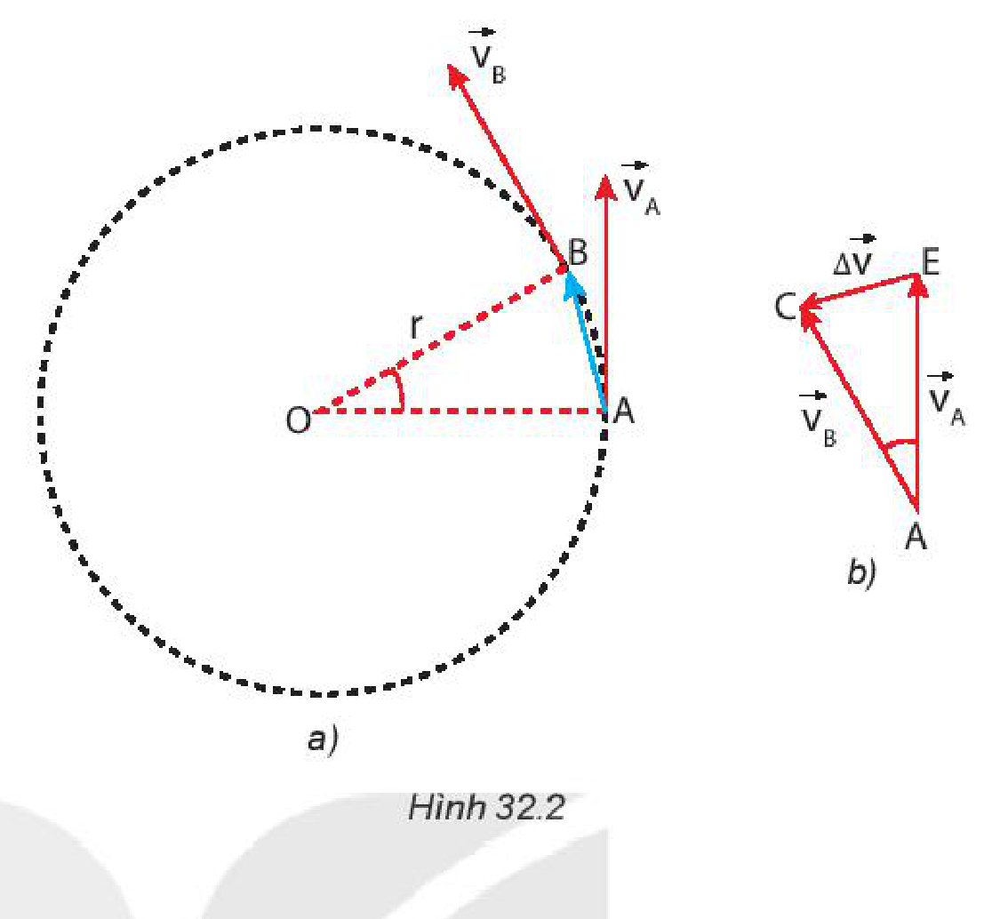
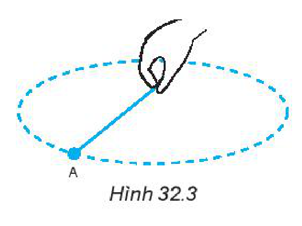
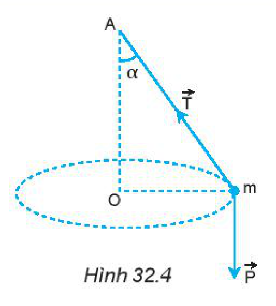
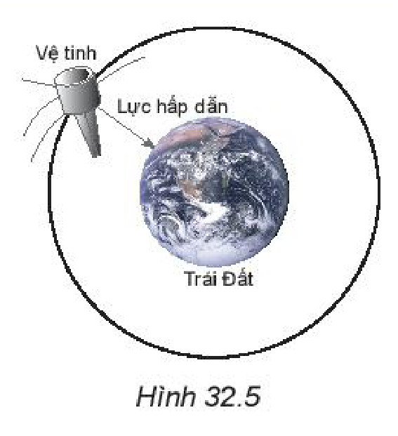
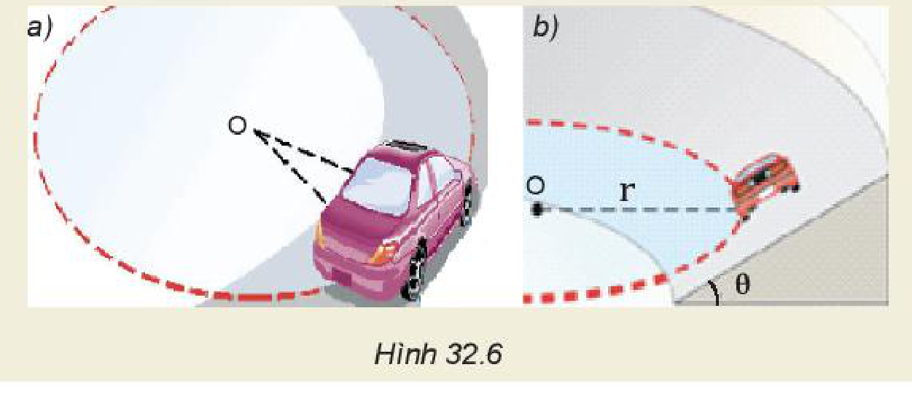
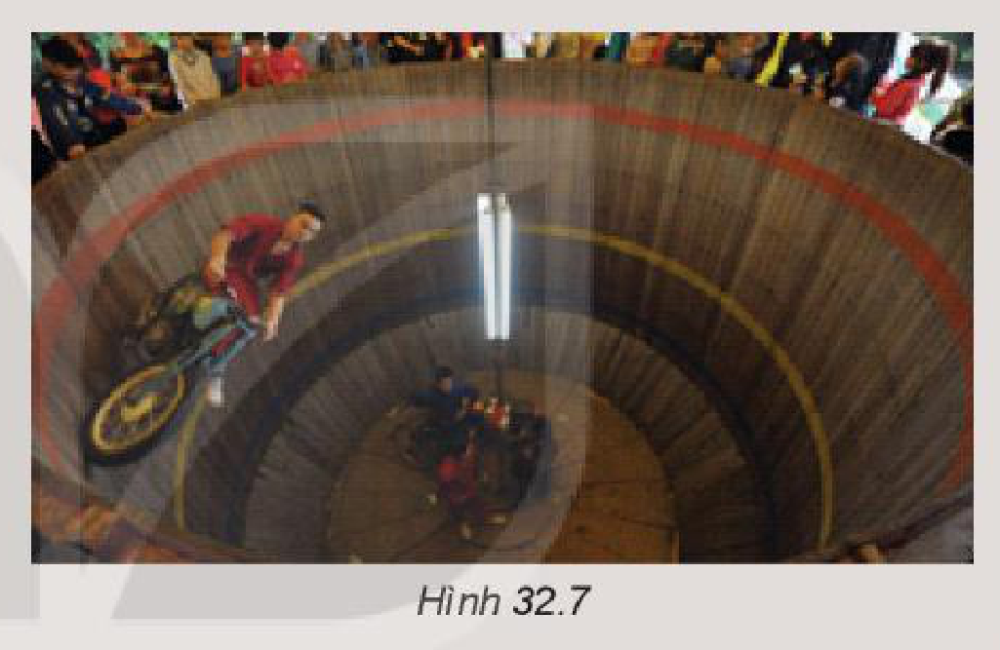
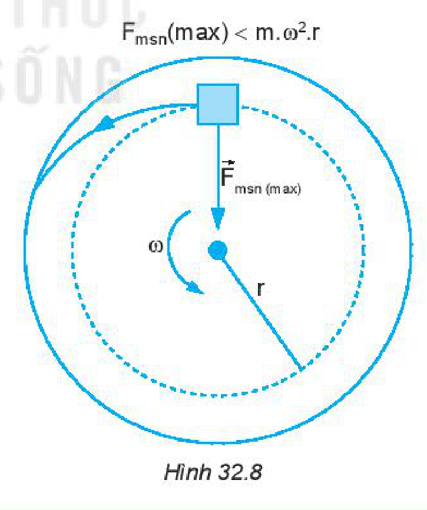

<!-- pdf:124 -->

# BÀI 32: LỰC HƯỚNG TÂM VÀ GIA TỐC HƯỚNG TÂM

## 🔴 Mở đầu

> Tại sao Trái Đất chuyển động quanh Mặt Trời? Tại sao trên những đoạn đường vòng thường phải hạn chế tốc độ của xe và mặt đường thường phải hơi nghiêng về phía tâm?
>
> 

## I. LỰC HƯỚNG TÂM

Dùng một sợi dây nhẹ không dãn buộc vào một cái tẩy. Quay dây sao cho cái tẩy chuyển động tròn trong mặt phẳng nằm ngang có tâm là đầu dây mà tay giữ (Hình 32.1).

> **Câu hỏi:**
>
> 1. Lực nào sau đây làm cái tẩy chuyển động tròn?
>    - Trọng lực tác dụng lên cái tẩy.
>    - Lực cản của không khí.
>    - Lực căng dây hướng vào tâm quỹ đạo của cái tẩy.
> 2. Nếu cái tẩy đang chuyển động mà ta buông tay ra thì:
>    - Cái tẩy tiếp tục chuyển động tròn.
>    - Cái tẩy sẽ rơi xuống đất theo phương thẳng đứng.
>    - Cái tẩy văng ra theo phương tiếp tuyến với quỹ đạo theo hướng vận tốc tại điểm đó.
> 3. Lực nào duy trì chuyển động gần tròn của Trái Đất xung quanh Mặt Trời?

*Lực (hay hợp lực) tác dụng lên vật chuyển động tròn đều hướng vào tâm quỹ đạo gọi là **lực hướng tâm**.*

> **Câu hỏi:** Tìm thêm ví dụ về lực hướng tâm.

## II. GIA TỐC HƯỚNG TÂM

Trong chuyển động tròn đều, lực hướng tâm gây gia tốc hướng vào tâm nên gia tốc này được gọi là **gia tốc hướng tâm**, kí hiệu là $a_{ht}$:

$a_{ht} = \frac{v^2}{r} = \omega^2 \cdot r \quad (32.1)$

<!-- pdf:125 -->

> **Em có biết:**
>
> Để tính độ lớn của gia tốc hướng tâm ta sử dụng công thức gia tốc:
>
> $\vec{a} = \frac{\Delta \vec{v}}{\Delta t}.$
>
> Khi vật chuyển động tròn đều từ A đến B trong thời gian $\Delta t$ thì độ dịch chuyển của vật là vectơ $\overrightarrow{\text{AB}}$ (Hình 32.2a), có độ lớn là: $d = v \cdot \Delta t$.
>
> Gọi $\vec{v}_{\text{A}}$ và $\vec{v}_{\text{B}}$ là các vectơ vận tốc tức thời tại A và B. Vì chuyển động là tròn đều nên các vectơ này có độ lớn không đổi, chỉ thay đổi về hướng. Sự thay đổi về hướng được biểu diễn bằng vectơ $\Delta \vec{v} = \vec{v}_{\text{B}} - \vec{v}_{\text{A}}$ (Hình 32.2b).
>
> 
>
> Tam giác AOB ở Hình 32.2a và tam giác EAC ở Hình 32.2b là hai tam giác cân đồng dạng nên:
>
> $\frac{\Delta v}{v} = \frac{\text{AB}}{r} \Rightarrow \frac{\Delta v}{v} = \frac{v \cdot \Delta t}{r}$
>
> Suy ra: $a_{ht} = \frac{\Delta v}{\Delta t} = \frac{v^2}{r}$. Vì $v = \omega \cdot r$ nên: $a_{ht} = \frac{v^2}{r} = \omega^2 \cdot r$

> **Câu hỏi:**
>
> 1. Tính gia tốc hướng tâm của một vệ tinh nhân tạo chuyển động tròn đều quanh Trái Đất với bán kính quỹ đạo là $7\text{ }000\text{ km}$ và tốc độ $7,57\text{ km/s}$.
> 2. Tính gia tốc hướng tâm của Mặt Trăng trong chuyển động quay quanh Trái Đất (coi Mặt Trăng chuyển động tròn đều quanh Trái Đất). Biết khoảng cách từ Mặt Trăng đến tâm Trái Đất là $3,84 \cdot 10^8\text{ m}$ và chu kì quay là $27,2\text{ ngày}$.
> 3. Kim phút của một chiếc đồng hồ dài $8\text{ cm}$. Tính gia tốc hướng tâm của đầu kim.

## III. CÔNG THỨC ĐỘ LỚN LỰC HƯỚNG TÂM

Theo định luật 2 Newton và công thức tính độ lớn của gia tốc hướng tâm ở trên ta có công thức tính độ lớn lực hướng tâm:

$F_{ht} = m \cdot a_{ht} = \frac{m \cdot v^2}{r} = m \cdot \omega^2 \cdot r \quad (32.2)$

*Ví dụ về lực hướng tâm:* Một vật nhỏ buộc vào đầu một sợi dây, nếu quay đều và nhanh, sợi dây gần như quay trong mặt phẳng nằm ngang (Hình 32.3). Nếu quay đều và chậm, sợi dây quét thành một mặt nón (Hình 32.4).

<!-- pdf:126 -->

> **Hoạt động:** Vẽ hợp lực của lực căng dây $\vec{T}$ và trọng lực $\vec{P}$, từ đó xác định lực hướng tâm trong Hình 32.4.

> **Câu hỏi:**
>
> 1. Trong trường hợp ở Hình 32.4, dây dài $0,75\text{ m}$.
>    a) Bạn A nói rằng: "Tốc độ quay càng lớn thì góc lệch của dây so với phương thẳng đứng cũng càng lớn". Hãy chứng minh điều đó.
>    b) Tính tần số quay để dây lệch góc $\alpha = 60^\circ$ so với phương thẳng đứng, lấy $g = 9,8\text{ m/s}^2$.
> 2. Hình 32.5 mô tả một vệ tinh nhân tạo quay quanh Trái Đất.
>    a) Lực nào là lực hướng tâm?
>    b) Nếu vệ tinh trên là **vệ tinh địa tĩnh** (nằm trong mặt phẳng xích đạo của Trái Đất và có tốc độ góc bằng tốc độ góc tự quay của Trái Đất quanh trục của nó). Hãy tìm gia tốc hướng tâm của vệ tinh. Cho gần đúng bán kính Trái Đất là $6\text{ }400\text{ km}$ và độ cao của vệ tinh so với mặt đất bằng $35\text{ }780\text{ km}$.

> **Hoạt động:**
>
> Hình 32.6 mô tả ô tô chuyển động trên quỹ đạo tròn trong hai trường hợp: mặt đường nằm ngang (Hình 32.6a) và mặt đường nghiêng góc $\theta$ (Hình 32.6b).
> Hãy thảo luận và cho biết:
> a) Lực nào là lực hướng tâm trong mỗi trường hợp.
> b) Lí do để ở các đoạn đường cong phải làm mặt đường nghiêng về phía tâm.
> c) Tại sao các phương tiện giao thông phải giảm tốc khi vào các cung đường tròn.
>
> 

<!-- pdf:127 -->

## 📌 Em đã học

- Gia tốc trong chuyển động tròn đều luôn hướng vào tâm quỹ đạo và có độ lớn là:
  $a_{ht} = \frac{v^2}{r} = \omega^2 \cdot r$
- Lực (hay hợp lực của các lực) tác dụng vào một vật chuyển động tròn đều và gây ra cho vật gia tốc hướng tâm gọi là **lực hướng tâm**.
  Biểu thức của lực hướng tâm:
  $F_{ht} = m \cdot a_{ht} = \frac{m \cdot v^2}{r} = m \cdot \omega^2 \cdot r.$

## ✏️ Em có thể

1. Giải thích lí do vì sao trong thực tế người ta chỉ làm cầu vồng lên chứ không làm cầu võng xuống.
2. Giải thích vì sao trong môn xiếc mô tô bay, diễn viên xiếc có thể đi mô tô trong thành của một cái lồng quay tròn mà không bị rơi (Hình 32.7).

> **Em có biết:**
>
> **Chuyển động li tâm**
>
> Một vật đặt trên mặt chiếc bàn quay. Nếu tăng tốc độ góc $\omega$ của bàn quay đến một giá trị nào đó thì lực ma sát nghỉ cực đại nhỏ hơn lực hướng tâm cần thiết ($F_{ht} = m \cdot \omega^2 \cdot r$) để giữ cho vật chuyển động tròn. Khi ấy vật trượt trên bàn ra xa tâm quay, rồi văng ra khỏi bàn theo phương tiếp tuyến với quỹ đạo. Chuyển động như vậy của vật được gọi là **chuyển động li tâm** (Hình 32.8).
>
> Giải thích tại sao thùng giặt quần áo của máy giặt có nhiều lỗ thủng ở thành xung quanh.
>
> 

## 📷 Danh sách hình trong bài

| Mã hình | Số hình SGK | Trang PDF | Chú thích |
| --- | --- | --- | --- |
| H10-vat_ly-b32-01 | — | 124 | Hình mở đầu: Chuyển động của Trái Đất quanh Mặt Trời dưới tác dụng của lực hấp dẫn |
| H10-vat_ly-b32-02 | Hình 32.1 | 124 | Quay dây cho cái tẩy chuyển động tròn trong mặt phẳng nằm ngang dưới tác dụng của lực căng dây |
| H10-vat_ly-b32-03 | Hình 32.2 | 125 | (a) Độ dịch chuyển và vectơ vận tốc tức thời tại A, B; (b) Độ biến thiên vận tốc trong chuyển động tròn đều |
| H10-vat_ly-b32-04 | Hình 32.3 | 126 | Vật nhỏ buộc vào đầu sợi dây quay đều và nhanh trong mặt phẳng gần như nằm ngang |
| H10-vat_ly-b32-05 | Hình 32.4 | 126 | Vật nhỏ buộc vào đầu sợi dây quay đều và chậm quét thành mặt nón |
| H10-vat_ly-b32-06 | Hình 32.5 | 126 | Vệ tinh nhân tạo quay quanh Trái Đất dưới tác dụng của lực hấp dẫn |
| H10-vat_ly-b32-07 | Hình 32.6 | 126 | Ô tô chuyển động trên quỹ đạo tròn: (a) mặt đường nằm ngang; (b) mặt đường nghiêng góc $\theta$ |
| H10-vat_ly-b32-08 | Hình 32.7 | 127 | Diễn viên xiếc đi mô tô trong thành của một cái lồng quay tròn |
| H10-vat_ly-b32-09 | Hình 32.8 | 127 | Chuyển động li tâm của vật đặt trên mặt bàn quay khi $F_{\text{msn}}(\text{max}) < m \cdot \omega^2 \cdot r$ |
