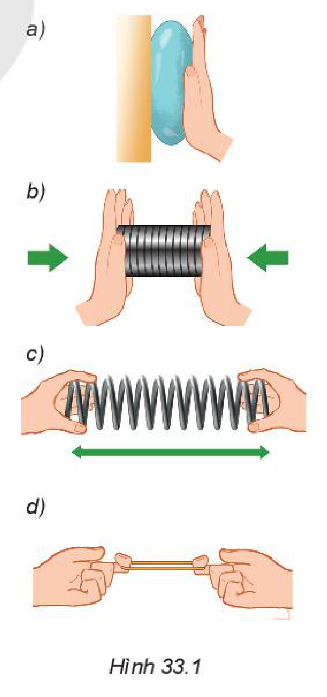
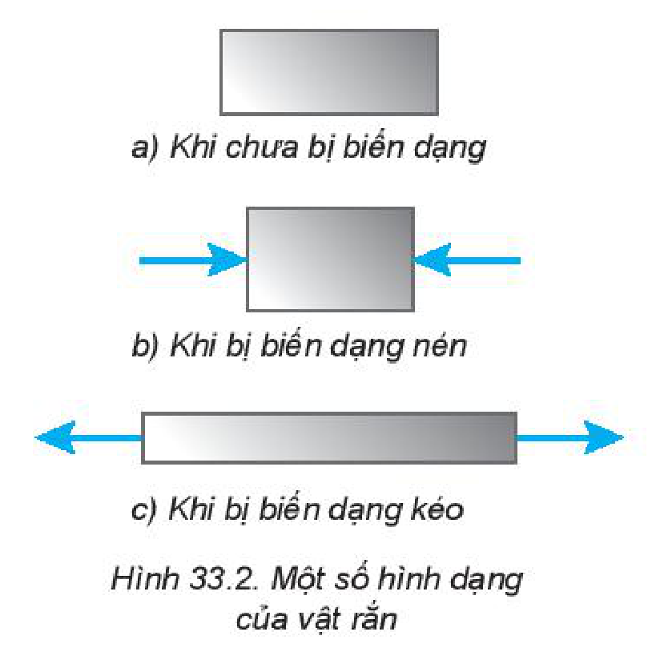
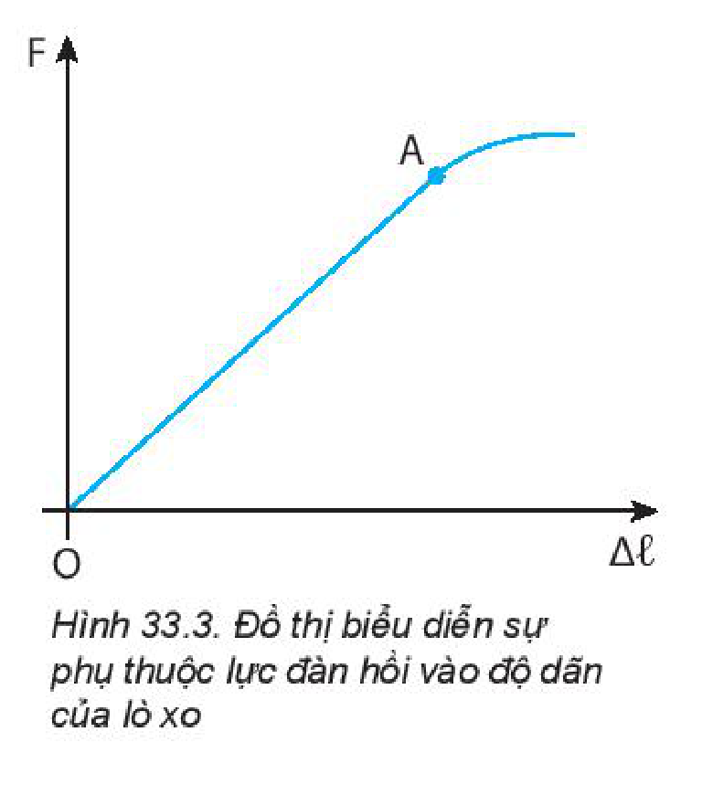
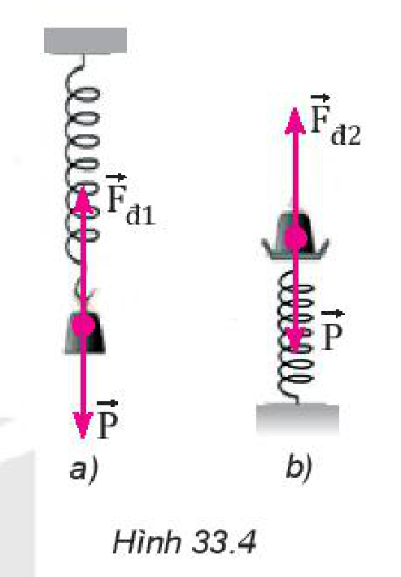
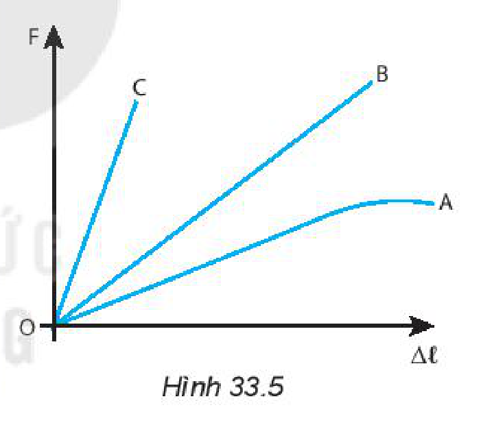

<!-- pdf:129 -->

# BÀI 33: BIẾN DẠNG CỦA VẬT RẮN

## 🔴 Mở đầu

> Bungee là một trò chơi mạo hiểm được nhiều người yêu thích. Em có biết trò chơi này được thực hiện dựa trên hiện tượng vật lí nào không?
>
> 

## I. BIẾN DẠNG ĐÀN HỒI. BIẾN DẠNG KÉO VÀ BIẾN DẠNG NÉN

Khi không có ngoại lực tác dụng, vật rắn có kích thước và hình dạng xác định. Khi có ngoại lực tác dụng, vật rắn thay đổi hình dạng và kích thước, ta nói vật rắn bị **biến dạng**.

> **Hoạt động:** Hãy làm các thí nghiệm về biến dạng sau đây:
>
> - Ép quả bóng cao su vào bức tường (Hình 33.1a).
> - Nén lò xo dọc theo trục của nó (Hình 33.1b).
> - Kéo hai đầu lò xo dọc theo trục của nó (Hình 33.1c).
> - Kéo cho vòng dây cao su dãn ra (Hình 33.1d).
>
> 1. Trong mỗi thí nghiệm trên, em hãy cho biết:
>    - Lực nào làm vật biến dạng?
>    - Biến dạng nào là biến dạng kéo? Biến dạng nào là biến dạng nén?
>    - Mức độ biến dạng phụ thuộc vào yếu tố nào?
> 2. Trong thí nghiệm với lò xo và vòng dây cao su, nếu lực kéo quá lớn thì khi thôi tác dụng lực, chúng có trở về hình dạng, kích thước ban đầu được không?

Như vậy, khi có tác dụng của ngoại lực, vật rắn sẽ bị biến dạng. Mức độ biến dạng phụ thuộc vào độ lớn của ngoại lực.

Khi không còn tác dụng của ngoại lực, nếu vật rắn lấy lại được hình dạng và kích thước ban đầu thì biến dạng của vật là **biến dạng đàn hồi**.

<!-- pdf:130 -->

Giới hạn mà trong đó vật rắn còn giữ được tính đàn hồi được gọi là **giới hạn đàn hồi** của vật rắn.

Khi vật chịu tác dụng của cặp lực nén ngược chiều nhau, vuông góc với bề mặt của vật và hướng vào phía trong vật, ta có **biến dạng nén** (Hình 33.2b).

Khi vật chịu tác dụng của cặp lực kéo ngược chiều nhau, vuông góc với bề mặt của vật và hướng ra phía ngoài vật, ta có **biến dạng kéo** (Hình 33.2c).

> **Câu hỏi:**
>
> 1. Em hãy cho biết loại biến dạng trong mỗi trường hợp sau:
>    a) Cột chịu lực trong toà nhà.
>    b) Cánh cung khi kéo dây cung.
> 2. Tìm thêm ví dụ về biến dạng nén và biến dạng kéo trong đời sống.

## II. LỰC ĐÀN HỒI. ĐỊNH LUẬT HOOKE

### 1. Lực đàn hồi của lò xo

Khi ta nén hoặc kéo hai đầu lò xo, tay ta cũng chịu tác dụng các lực từ phía lò xo. Các lực này ngược chiều với lực tay tác dụng vào lò xo và được gọi là **lực đàn hồi của lò xo**. Lực đàn hồi của lò xo chống lại nguyên nhân làm nó biến dạng và có xu hướng đưa nó về hình dạng và kích thước ban đầu.

> **Hoạt động:** Với các dụng cụ sau đây: giá đỡ thí nghiệm; các lò xo; hộp quả cân; thước đo.
>
> - Thiết kế và thực hiện phương án thí nghiệm tìm mối quan hệ giữa độ lớn của lực đàn hồi và độ biến dạng của lò xo.
> - Hãy thể hiện kết quả trên đồ thị về sự phụ thuộc của lực đàn hồi vào độ biến dạng của lò xo.
> - Thảo luận và nhận xét kết quả thu được.

### 2. Định luật Hooke

Hình 33.3 là đồ thị về sự phụ thuộc độ lớn của lực đàn hồi vào độ biến dạng của lò xo:

Đoạn $OA$ trên đồ thị cho biết sự phụ thuộc độ lớn của lực đàn hồi $F_{\text{đh}}$ vào độ biến dạng $\Delta l$ là tuyến tính, ta có thể viết sự phụ thuộc này bằng biểu thức toán học:

$$F_{\text{đh}} = k|\Delta l| \quad (33.1)$$
<!-- ocr-ok: đối chiếu ảnh trang PDF 130 khớp nguyên văn -->

Biểu thức trên là biểu thức của **định luật Hooke**: *“Trong giới hạn đàn hồi, độ lớn lực đàn hồi của lò xo tỉ lệ thuận với độ biến dạng của lò xo”*.

Trong biểu thức trên, $k$ là một hằng số với một lò xo xác định, được gọi là **hệ số đàn hồi** hay **độ cứng của lò xo**, phụ thuộc vào kích thước, hình dạng và vật liệu của lò xo. Trong hệ SI, $k$ có đơn vị là $\text{N/m}$.

<!-- pdf:131 -->

Phần đồ thị ngoài đoạn thẳng $OA$ ứng với lực đặt vào vượt quá giới hạn đàn hồi của lò xo. Khi đó lực đàn hồi không còn tỉ lệ thuận với độ biến dạng nữa. Nếu treo vật nặng có khối lượng quá lớn, tính đàn hồi của lò xo sẽ bị phá huỷ.

> **Lưu ý:** Trong công thức (33.1), nếu khi biến dạng (dãn hoặc nén) chiều dài lò xo bằng $l$ và chiều dài khi chưa biến dạng bằng $l_0$ thì **độ biến dạng** là: $\Delta l = l - l_0$, ta có thể viết lại:
>
> $$F = k|l - l_0|$$

**Bài tập ví dụ:** Một lò xo bố trí theo phương thẳng đứng và có gắn vật nặng khối lượng $200\text{ g}$. Khi vật treo ở dưới (Hình 33.4a) thì lò xo dài $17\text{ cm}$, khi vật đặt ở trên (Hình 33.4b) thì lò xo dài $13\text{ cm}$. Lấy $g = 10\text{ m/s}^2$ và bỏ qua trọng lượng của móc treo, giá đỡ vật nặng. Tính độ cứng của lò xo.

*Giải*

Trong hai trường hợp, vật nặng chịu tác dụng của lực đàn hồi và trọng lực. Xét vật nặng ở vị trí cân bằng.

Khi vật treo ở dưới lò xo: $F_{\text{đh1}} = P \Rightarrow k|0,17 - l_0| = m \cdot g \quad (1)$

Khi đặt vật ở trên lò xo: $F_{\text{đh2}} = P \Rightarrow k|0,13 - l_0| = m \cdot g \quad (2)$

Từ (1) và (2) $\Rightarrow l_0 = 0,15\text{ (m)}$. Thay vào (1) hoặc (2), tính được $k = 100\text{ (N/m)}$.

> **Hoạt động:**
>
> 1. Từ kết quả thu được trong hoạt động ở mục 1, hãy tính độ cứng của lò xo đã dùng làm thí nghiệm. Tại sao khối lượng lò xo cần rất nhỏ so với khối lượng của các vật nặng treo vào nó?
> 2. Trên Hình 33.5 là đồ thị sự phụ thuộc của độ lớn lực đàn hồi $F$ vào độ biến dạng $\Delta l$ của 3 lò xo khác nhau A, B và C.
>    a) Lò xo nào có độ cứng lớn nhất?
>    b) Lò xo nào có độ cứng nhỏ nhất?
>    c) Lò xo nào không tuân theo định luật Hooke?

## 📌 Em đã học

- Biến dạng đàn hồi. Biến dạng kéo, biến dạng nén.
- Đặc điểm biến dạng và độ cứng của lò xo.
- Liên hệ giữa lực đàn hồi và độ biến dạng của lò xo, định luật Hooke: $F = k|\Delta l|$.

## ✏️ Em có thể

Giải thích được nguyên tắc hoạt động của bộ phận giảm xóc trong ô tô, xe máy.

## 📷 Danh sách hình trong bài

| Mã hình | Số hình SGK | Trang PDF | Chú thích |
| --- | --- | --- | --- |
| H10-vat_ly-b33-01 | Mở đầu | 129 | Nhảy bungee ở Interlaken, Thuỵ sĩ |
| H10-vat_ly-b33-02 | Hình 33.1 | 129 | Các thí nghiệm về biến dạng (a, b, c, d) |
| H10-vat_ly-b33-03 | Hình 33.2 | 130 | Một số hình dạng của vật rắn |
| H10-vat_ly-b33-04 | Hình 33.3 | 130 | Đồ thị biểu diễn sự phụ thuộc lực đàn hồi vào độ dãn của lò xo |
| H10-vat_ly-b33-05 | Hình 33.4 | 131 | Lò xo bố trí theo phương thẳng đứng khi vật treo ở dưới (a) và khi vật đặt ở trên (b) |
| H10-vat_ly-b33-06 | Hình 33.5 | 131 | Đồ thị sự phụ thuộc của độ lớn lực đàn hồi $F$ vào độ biến dạng $\Delta l$ của 3 lò xo khác nhau A, B và C |
