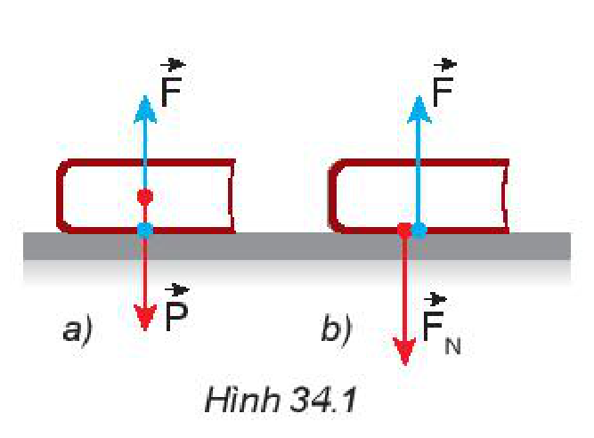
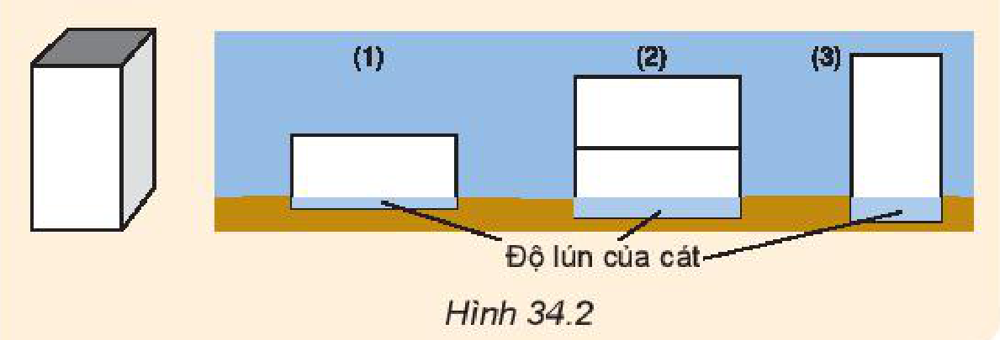
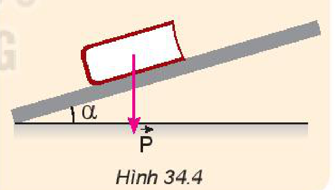
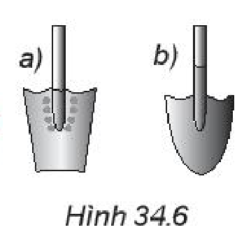
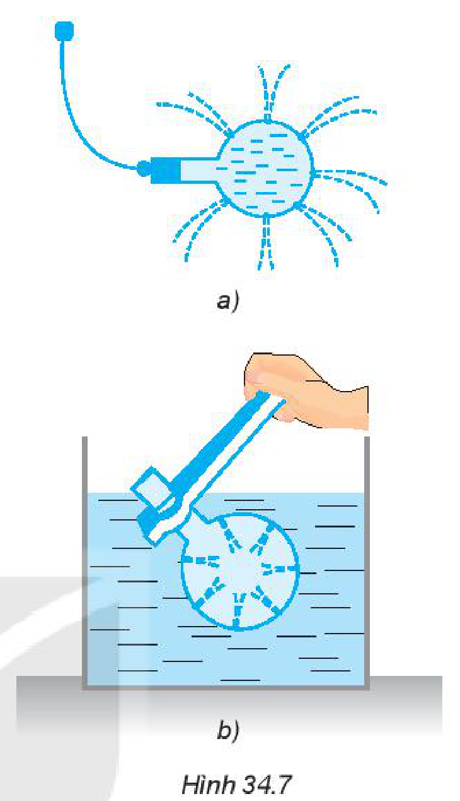
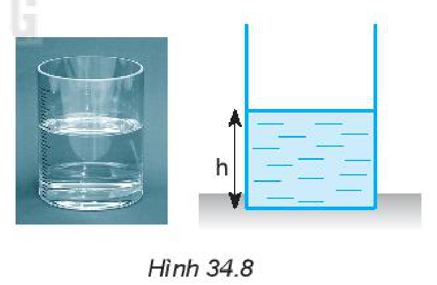
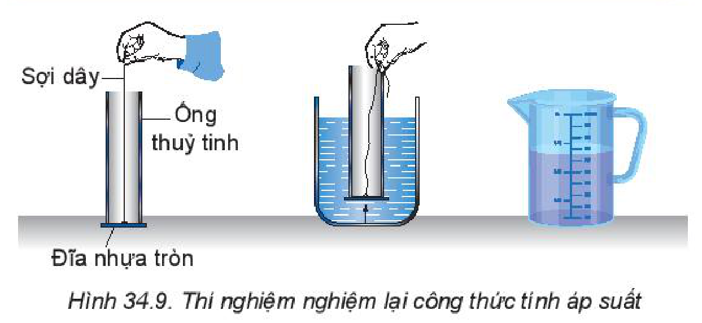
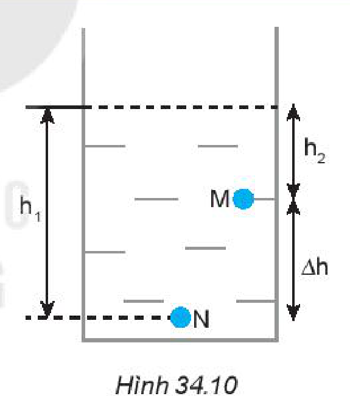
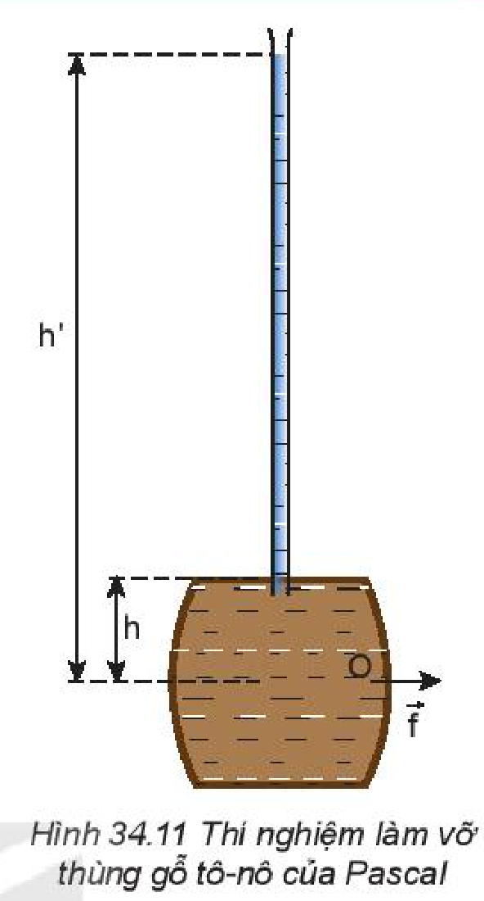

<!-- pdf:132 -->

# BÀI 34: KHỐI LƯỢNG RIÊNG. ÁP SUẤT CHẤT LỎNG

## 🔴 Mở đầu

> Khối lượng riêng của một chất lỏng và áp suất của chất lỏng có mối quan hệ như thế nào?

## I. KHỐI LƯỢNG RIÊNG

**Khối lượng riêng** của một chất là khối lượng của một đơn vị thể tích chất đó:

$$\text{Khối lượng riêng} = \frac{\text{Khối lượng}}{\text{Thể tích}}$$
$$\rho^{(1)} = \frac{m}{V} \quad (34.1)$$
<!-- ocr-ok: đối chiếu ảnh trang PDF 132 khớp nguyên văn -->

Đơn vị của khối lượng riêng trong hệ SI là $\text{kg/m}^3$ ($\text{kg.m}^{-3}$). Người ta cũng dùng đơn vị khối lượng riêng là $\text{g/cm}^3$ ($\text{g.cm}^{-3}$).

$$1\text{ g/cm}^3 = 1\text{ }000\text{ kg/m}^3$$
<!-- ocr-ok: đối chiếu ảnh trang PDF 132 khớp nguyên văn -->

*Bảng 34.1. Khối lượng riêng của một số chất ở điều kiện bình thường về nhiệt độ và áp suất*

| Chất rắn | $\rho\text{ (kg/m}^3\text{)}$ | Chất lỏng | $\rho\text{ (kg/m}^3\text{)}$ | Chất khí | $\rho\text{ (kg/m}^3\text{)}$ |
| --- | --- | --- | --- | --- | --- |
| Chì | $11\text{ }300$ | Thuỷ ngân | $13\text{ }500$ | Carbonic | $1,98$ |
| Đồng | $8\text{ }900$ | Nước | $999$ | Oxygen | $1,43$ |
| Thép | $7\text{ }800$ | Xăng | $700$ | Hydrogen | $0,09$ |
<!-- ocr-ok: đối chiếu ảnh trang PDF 132 khớp nguyên văn -->

> **Câu hỏi:**
>
> 1. Tại sao khối lượng riêng của một chất lại phụ thuộc vào nhiệt độ?
> 2. Một hợp kim đồng và bạc có khối lượng riêng là $10,3\text{ g/cm}^3$. Tính khối lượng của bạc và đồng có trong $100\text{ g}$ hợp kim. Biết khối lượng riêng của đồng là $8,9\text{ g/cm}^3$, của bạc là $10,4\text{ g/cm}^3$.

*Bảng 34.2. Khối lượng riêng của nước ở các nhiệt độ khác nhau*

| Nhiệt độ | $\rho\text{ (kg/m}^3\text{)}$ |
| --- | --- |
| $20\text{ }^\circ\text{C}$ | $999$ |
| $40\text{ }^\circ\text{C}$ | $992$ |
| $60\text{ }^\circ\text{C}$ | $983$ |
| $80\text{ }^\circ\text{C}$ | $972$ |

## II. ÁP LỰC VÀ ÁP SUẤT

### 1. Áp lực

**a) Khái niệm áp lực**

Một cuốn sách nằm yên trên mặt bàn nằm ngang chịu tác dụng của hai lực cân bằng là lực hút của Trái Đất và lực đẩy của mặt bàn (Hình 34.1a).

Do mặt bàn tác dụng lên cuốn sách lực $\vec{F}$ có phương thẳng đứng, chiều hướng lên trên và có độ lớn bằng trọng lượng $P$ của cuốn sách, nên theo định luật 3 Newton: cuốn sách tác dụng lên mặt bàn lực $\vec{F}_N$ có phương thẳng đứng, chiều hướng xuống dưới và có độ lớn bằng $F$. Lực $\vec{F}_N$ ép lên mặt bàn theo phương vuông góc với mặt bàn, được gọi là **áp lực** (Hình 34.1b).

*(1) Kí hiệu $\rho$ đọc là "rô".*
<!-- ocr-ok: đối chiếu ảnh trang PDF 132 khớp nguyên văn -->

<!-- pdf:133 -->

**b) Áp lực phụ thuộc những yếu tố nào?**

> **Câu hỏi:** Hãy dựa vào thí nghiệm vẽ ở Hình 34.2, cho biết độ lớn của áp lực phụ thuộc vào những yếu tố nào và phụ thuộc như thế nào.
>
> 

> **Câu hỏi:**
>
> 1. Trong Hình 34.3, lực nào sau đây là lực đàn hồi, lực ma sát, áp lực?
>    a) Lực của chân em bé tác dụng lên sàn nhà.
>    b) Lực của tay em bé kéo hộp đồ chơi.
>    c) Lực của hộp đồ chơi tác dụng lên sàn nhà.
>
> 
>
> 2. Chứng minh rằng áp lực của cuốn sách tác dụng lên mặt bàn nằm nghiêng một góc $\alpha$ (Hình 34.4) có độ lớn là:
>
> $$F_N = P \cdot \cos\alpha$$
>
> 

### 2. Áp suất

Do tác dụng của áp lực lên mặt bị ép càng mạnh khi cường độ của áp lực càng lớn và diện tích mặt bị ép càng nhỏ, nên để đặc trưng cho tác dụng của áp lực người ta dùng khái niệm **áp suất**, có độ lớn bằng áp lực chia cho diện tích bị ép.

$$\text{Áp suất} = \frac{\text{Áp lực}}{\text{Diện tích bị ép}}$$
$$p = \frac{F_N}{S} \quad (34.2)$$
<!-- ocr-ok: đối chiếu ảnh trang PDF 133 khớp nguyên văn -->

Đơn vị của áp suất là $\text{N/m}^2$, có tên gọi là **paxcan** (Pa):

$$1\text{ Pa} = 1\text{ N/m}^2$$
<!-- ocr-ok: đối chiếu ảnh trang PDF 133 khớp nguyên văn -->

> **Câu hỏi:**
>
> 1. Tại sao xe tăng nặng hơn ô tô nhiều lần lại có thể chạy bình thường trên đất bùn (Hình 34.5a), còn ô tô bị lún bánh và sa lầy trên chính quãng đường này (Hình 34.5b)?
> 2. Trong hai chiếc xẻng vẽ ở Hình 34.6, xẻng nào dùng để xén đất tốt hơn, xẻng nào dùng để xúc đất tốt hơn? Tại sao?
> 3. Một người nặng $50\text{ kg}$ đứng trên mặt đất nằm ngang. Biết diện tích tiếp xúc của mỗi bàn chân với đất là $0,015\text{ m}^2$. Tính áp suất người đó tác dụng lên mặt đất khi:
>    a) Đứng cả hai chân.
>    b) Đứng một chân.

*Bảng 34.3. Độ lớn của một số áp suất*

| Áp suất tại một số vị trí | $p\text{ (Pa)}$ |
| --- | --- |
| Áp suất ở tâm Trái Đất | $4 \cdot 10^{11}$ |
| Áp suất của nước ở đáy biển sâu nhất | $1,1 \cdot 10^8$ |
| Áp suất của không khí trong lốp ô tô | $4 \cdot 10^5$ |
| Áp suất khí quyển ở độ cao của mặt nước biển | $1 \cdot 10^5$ |

<!-- pdf:134 -->

## III. ÁP SUẤT CỦA CHẤT LỎNG

### 1. Sự tồn tại áp suất của chất lỏng

Khi đặt vật rắn lên mặt bàn thì vật rắn tác dụng lên mặt bàn áp suất theo phương vuông góc với mặt bàn. Khi nhấn chìm một vật vào trong nước thì nước có gây áp suất lên vật không? Nếu có thì áp suất này có giống áp suất của vật rắn không?

Ai lặn xuống nước cũng dễ cảm thấy áp suất của nước tác dụng lên cơ thể mình, càng lặn sâu thì áp suất càng mạnh. Tuy nhiên, áp suất này có phải chỉ tác dụng theo một phương như áp suất của vật rắn không?

> **Hoạt động:** Hãy dựa vào thí nghiệm với một bình cầu có các lỗ nhỏ ở thành bình trong các Hình 34.7a và 34.7b để nói về sự tồn tại áp suất của chất lỏng và đặc điểm của áp suất này so với áp suất của vật rắn.

### 2. Công thức tính áp suất của chất lỏng

Có thể xác định được công thức tính áp suất của chất lỏng dựa trên bài toán sau đây:

> **Câu hỏi:** Một khối chất lỏng đứng yên có khối lượng riêng $\rho$, hình trụ diện tích đáy $S$, chiều cao $h$ (Hình 34.8). Hãy dùng công thức tính áp suất ở trên để chứng minh rằng áp suất của khối chất lỏng trên tác dụng lên đáy bình có độ lớn là $p = \rho \cdot g \cdot h$.
>
> Trong đó:
>
> - $p$ là áp suất của chất lỏng tác dụng lên đáy bình;
> - $\rho$ là khối lượng riêng của chất lỏng;
> - $g$ là gia tốc trọng trường;
> - $h$ là chiều cao của cột chất lỏng, cũng là độ sâu của chất lỏng so với mặt thoáng.

Trên mặt thoáng của chất lỏng, còn có áp suất khí quyển $p_a$. Áp suất này được chất lỏng truyền nguyên vẹn xuống đáy bình. Do đó, đáy bình chịu áp suất $p = p_a + \rho \cdot g \cdot h$.
<!-- term: Áp suất của chất lỏng -->
<!-- term: Nguyên lí Pascal -->

Chất lỏng truyền áp suất theo mọi hướng nên áp suất mà ta tính được ở trên cũng là áp suất của chất lỏng tác dụng lên các điểm ở thành bình có khoảng cách tới mặt thoáng chất lỏng là $h$.
<!-- term: Áp suất của chất lỏng -->
<!-- term: Nguyên lí Pascal -->

<!-- pdf:135 -->

> **Câu hỏi:** Một khối hình lập phương có cạnh $0,30\text{ m}$, khối lập phương chìm $\frac{2}{3}$ trong nước. Biết khối lượng riêng của nước là $1\text{ }000\text{ kg/m}^3$. Tính áp suất của nước tác dụng lên mặt dưới của khối lập phương và xác định phương, chiều, cường độ của lực gây ra bởi áp suất này.

> **Hoạt động:** Hãy tìm cách dựa vào các dụng cụ thí nghiệm vẽ ở Hình 34.9 để nghiệm lại công thức tính áp suất của chất lỏng: $p = \rho \cdot g \cdot h$.

### 3. Phương trình cơ bản của chất lưu đứng yên

Có thể dễ dàng tính được độ chênh lệch về áp suất của chất lưu giữa 2 điểm $M$ và $N$ có độ sâu $h_1$ và $h_2$ so với mặt thoáng của chất lưu đứng yên (Hình 34.10).
Vì $p_N = p_a + \rho \cdot g \cdot h_1$ và $p_M = p_a + \rho \cdot g \cdot h_2$
nên $p_N - p_M = \rho \cdot g \cdot (h_1 - h_2)$
hay $\Delta p = \rho \cdot g \cdot \Delta h \quad (34.3)$
Phương trình (34.3) được gọi là **phương trình cơ bản của chất lưu đứng yên**.

> **Câu hỏi:**
>
> 1. Tính độ chênh lệch áp suất của nước giữa 2 điểm thuộc 2 mặt phẳng nằm ngang cách nhau $20\text{ cm}$.
> 2. Hãy dùng phương trình cơ bản của chất lưu đứng yên để chứng minh rằng áp suất ở các điểm nằm trên cùng mặt phẳng nằm ngang trong chất lỏng thì bằng nhau.
> 3. Hãy dùng phương trình cơ bản của chất lưu đứng yên để chứng minh định luật Archimedes đã học ở lớp 8 cho trường hợp vật hình hộp chữ nhật có chiều cao $h$, làm bằng vật liệu có khối lượng riêng $\rho$.

> **Hoạt động trải nghiệm:** Hãy dùng các dụng cụ sau đây:
>
> - Một lực kế.
> - Một quả nặng hình trụ có móc treo.
> - Một bình chia độ đựng nước.
>
> Thiết kế phương án thí nghiệm minh hoạ cho phương trình cơ bản của chất lưu đứng yên.

<!-- pdf:136 -->

> **Em có biết:**
>
> Phương trình cơ bản của **thuỷ tĩnh học** cho thấy sự chênh lệch của áp suất chất lỏng không phụ thuộc vào thể tích chất lỏng (tức lượng chất lỏng) mà chỉ phụ thuộc vào sự chênh lệch về độ sâu. Sự chênh lệch về áp suất với cùng một độ lớn trong một ống nước rất nhỏ, cũng giống như trong một hồ nước rộng, trong một đại dương.
>
> Chỉ cần đổ khoảng $1\text{ lít}$ nước vào đầy một ống thuỷ tinh cao khoảng $10\text{ m}$ là đủ để gây ra áp suất làm vỡ toang thùng gỗ đựng đầy nước ở dưới (Hình 34.11).
>
> 
<!-- term: Nguyên lí Pascal -->

## 📌 Em đã học

- Công thức tính khối lượng riêng: $\rho = \frac{m}{V}$. Đơn vị khối lượng riêng: $\text{kg/m}^3$; $\text{g/cm}^3$ ($1\text{ g/cm}^3 = 1\text{ }000\text{ kg/m}^3$).
- Công thức tính áp suất: $P = \frac{F_N}{S}$, trong đó $F_N$ là áp lực vuông góc với mặt bị ép, $S$ là diện tích mặt bị ép. Đơn vị của áp suất là $\text{Pa}$: $1\text{ Pa} = 1\text{ N/m}^2$.
- Công thức tính áp suất của chất lỏng: $p = p_a + \rho \cdot g \cdot h$, trong đó: $\rho$ là khối lượng riêng của chất lỏng, $g$ là gia tốc trọng trường, $h$ là độ sâu của chất lỏng.
- Phương trình cơ bản của chất lưu đứng yên: $\Delta p = \rho \cdot g \cdot \Delta h$.

## ✏️ Em có thể

Giải thích được vì sao người thợ lặn muốn lặn sâu dưới biển phải được trang bị thiết bị lặn chuyên dụng.

## 📷 Danh sách hình trong bài

| Mã hình | Số hình SGK | Trang PDF | Chú thích |
| --- | --- | --- | --- |
| H10-vat_ly-b34-01 | Hình 34.1 | 132 | Lực tác dụng lên cuốn sách nằm yên trên mặt bàn (a) và áp lực của cuốn sách tác dụng lên mặt bàn (b) |
| H10-vat_ly-b34-02 | Hình 34.2 | 133 | Thí nghiệm tìm hiểu áp lực phụ thuộc những yếu tố nào |
| H10-vat_ly-b34-03 | Hình 34.3 | 133 | Em bé kéo hộp đồ chơi trên sàn nhà |
| H10-vat_ly-b34-04 | Hình 34.4 | 133 | Cuốn sách trên mặt bàn nằm nghiêng một góc $\alpha$ |
| H10-vat_ly-b34-05 | Hình 34.5 | 133 | Xe tăng chạy trên đất bùn (a) và ô tô bị lún bánh trên đất bùn (b) |
| H10-vat_ly-b34-06 | Hình 34.6 | 133 | Hai chiếc xẻng có đầu bằng (a) và đầu nhọn (b) |
| H10-vat_ly-b34-07 | Hình 34.7 | 134 | Thí nghiệm với bình cầu có các lỗ nhỏ ở thành bình (a, b) |
| H10-vat_ly-b34-08 | Hình 34.8 | 134 | Khối chất lỏng đứng yên hình trụ có chiều cao $h$ |
| H10-vat_ly-b34-09 | Hình 34.9 | 135 | Thí nghiệm nghiệm lại công thức tính áp suất |
| H10-vat_ly-b34-10 | Hình 34.10 | 135 | Hai điểm $M$ và $N$ có độ sâu $h_2$ và $h_1$ trong chất lưu đứng yên |
| H10-vat_ly-b34-11 | Hình 34.11 | 136 | Thí nghiệm làm vỡ thùng gỗ tô-nô của Pascal |
