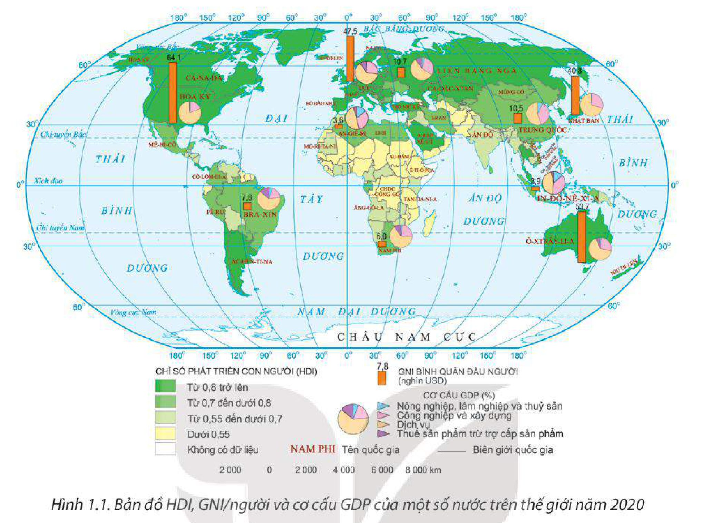
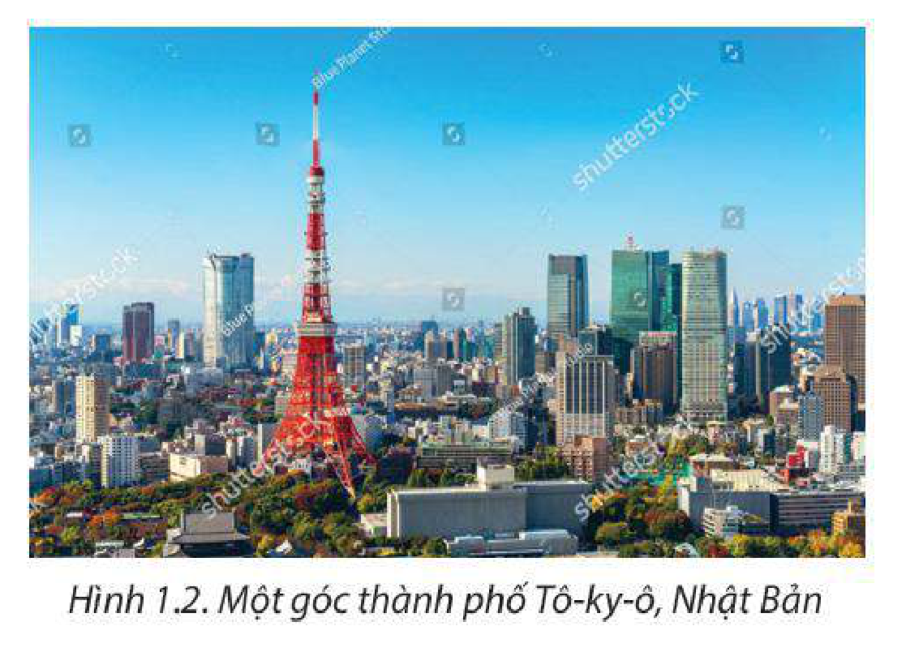

<!-- pdf:7 -->

# BÀI 1: SỰ KHÁC BIỆT VỀ TRÌNH ĐỘ PHÁT TRIỂN KINH TẾ – XÃ HỘI CỦA CÁC NHÓM NƯỚC

## 🔴 Mở đầu

Thế giới hiện nay có hơn 200 quốc gia và vùng lãnh thổ được phân chia thành các nhóm nước khác nhau. Vậy chỉ tiêu nào được sử dụng để phân chia các nhóm nước? Các nhóm nước khác nhau có sự khác biệt như thế nào về trình độ phát triển kinh tế và xã hội?

## I. CÁC NHÓM NƯỚC

<!-- term: Phân chia các nhóm nước trên thế giới -->
Theo trình độ phát triển kinh tế – xã hội, các nước trên thế giới phân chia thành nước phát triển và nước đang phát triển dựa trên các chỉ tiêu chủ yếu là tổng thu nhập quốc gia bình quân đầu người (GNI/người), cơ cấu kinh tế và chỉ số phát triển con người (HDI).

<!-- term: Tổng thu nhập quốc gia bình quân đầu người -->
– GNI/người được tính bằng cách lấy tổng thu nhập quốc gia chia cho số dân của một nước. Chỉ tiêu này phản ánh mức sống và năng suất lao động của người dân trong một nước. Dựa trên chỉ tiêu này, Ngân hàng Thế giới phân chia các nước thành nước có thu nhập cao, nước có thu nhập trung bình cao, nước có thu nhập trung bình thấp và nước có thu nhập thấp.

> 💡 EM CÓ BIẾT?
>
> Vào tháng 7 hằng năm, Ngân hàng Thế giới sẽ cập nhật phân loại các nhóm nước theo GNI/người. Theo bảng cập nhật năm 2022, nước có GNI/người năm 2021 từ 1 085 USD trở xuống là nước có thu nhập thấp; trong khoảng 1 086 USD đến 4 255 USD là nước có thu nhập trung bình thấp; trong khoảng 4 256 USD đến 13 205 USD là nước có thu nhập trung bình cao; từ 13 205 USD trở lên là nước có thu nhập cao.

<!-- term: Cơ cấu kinh tế -->
– Cơ cấu kinh tế là tập hợp các ngành, lĩnh vực và bộ phận kinh tế có quan hệ hữu cơ tương đối ổn định với nhau trong đó quan trọng nhất là cơ cấu ngành kinh tế. Cơ cấu ngành kinh tế là chỉ tiêu phản ánh mức độ đóng góp của các ngành kinh tế vào GDP của một nước, thể hiện trình độ phát triển khoa học – công nghệ, lực lượng sản xuất,... của nền sản xuất xã hội. Cơ cấu kinh tế theo ngành bao gồm: nông nghiệp, lâm nghiệp và thuỷ sản; công nghiệp và xây dựng; dịch vụ.

<!-- term: Chỉ số phát triển con người -->
– HDI là thước đo tổng hợp phản ánh sự phát triển của con người trên các phương diện: sức khoẻ, học vấn và thu nhập. Dựa vào chỉ tiêu này, Liên hợp quốc phân chia các nước thành nước có HDI rất cao (từ 0,800 trở lên), cao (từ 0,700 đến dưới 0,800), trung bình (từ 0,550 đến dưới 0,700) và thấp (dưới 0,550).

<!-- pdf:8 -->

*Hình 1.1. Bản đồ HDI, GNI/người và cơ cấu GDP của một số nước trên thế giới năm 2020*

**BẢNG 1.1. GNI/NGƯỜI, CƠ CẤU GDP VÀ HDI CỦA MỘT SỐ NƯỚC NĂM 2020**

| Nhóm nước | Nước | GNI/người *(USD)* | Cơ cấu GDP (%): Nông nghiệp, lâm nghiệp và thuỷ sản | Cơ cấu GDP (%): Công nghiệp và xây dựng | Cơ cấu GDP (%): Dịch vụ | Cơ cấu GDP (%): Thuế sản phẩm trừ trợ cấp sản phẩm | HDI |
| --- | --- | --- | --- | --- | --- | --- | --- |
| Phát triển | Đức | 47 520 | 0,7 | 26,5 | 63,3 | 9,5 | 0,944 |
| Phát triển | Hoa Kỳ | 64 140 | 0,9 | 18,4 | 80,1 | 0,6 | 0,920 |
| Phát triển | Nhật Bản | 40 810 | 1,0 | 29,0 | 69,5 | 0,5 | 0,923 |
| Đang phát triển | Bra-xin | 7 800 | 5,9 | 17,7 | 62,8 | 13,6 | 0,758 |
| Đang phát triển | Cộng hoà Nam Phi | 6 010 | 2,5 | 23,4 | 64,6 | 9,5 | 0,727 |
| Đang phát triển | Việt Nam | 3 390 | 12,7 | 36,7 | 41,8 | 8,8 | 0,710 |
<!-- ocr-ok: đối chiếu trực tiếp ảnh trang PDF 8 (trang in 6) Bảng 1.1 -->

*(Nguồn: Ngân hàng Thế giới và Liên hợp quốc, 2022)*

> ❓ Dựa vào nội dung mục I, hãy phân biệt các nước phát triển (Đức, Hoa Kỳ, Nhật Bản) và các nước đang phát triển (Bra-xin, Cộng hoà Nam Phi, Việt Nam) về các chỉ tiêu GNI/người, cơ cấu kinh tế và HDI.

<!-- pdf:9 -->

## II. SỰ KHÁC BIỆT VỀ KINH TẾ – XÃ HỘI CỦA CÁC NHÓM NƯỚC

### 1. Về kinh tế

<!-- term: Đặc điểm kinh tế của các nước phát triển -->
Các nước phát triển thường có quy mô GDP lớn và tốc độ tăng trưởng GDP khá ổn định. Nhóm nước này tiến hành công nghiệp hoá từ sớm và thường tiên phong dẫn đầu trong các cuộc cách mạng công nghiệp trên thế giới (như Anh, Hoa Kỳ, Nhật Bản, Đức,...). Ngành dịch vụ có đóng góp nhiều nhất trong GDP. Hiện nay, các nước phát triển đang tập trung vào đổi mới và phát triển các sản phẩm có hàm lượng khoa học – công nghệ và tri thức cao.

<!-- term: Đặc điểm kinh tế của các nước đang phát triển -->
Hầu hết các nước đang phát triển có quy mô GDP trung bình và thấp nhưng tốc độ tăng trưởng GDP khá cao. Cơ cấu kinh tế có sự chuyển dịch theo hướng công nghiệp hoá – hiện đại hoá với tỉ trọng các ngành công nghiệp và xây dựng, dịch vụ có xu hướng tăng. Một số nước đang phát triển bắt đầu chú trọng phát triển các lĩnh vực có hàm lượng khoa học – công nghệ và tri thức cao.

**BẢNG 1.2. QUY MÔ GDP THEO GIÁ HIỆN HÀNH VÀ TỐC ĐỘ TĂNG GDP CỦA MỘT SỐ NƯỚC NĂM 2021**

| Nhóm nước | Nước | Quy mô GDP *(tỉ USD)* | Tốc độ tăng GDP *(%)* |
| --- | --- | --- | --- |
| Phát triển | Đức | 4 223 | 2,9 |
| Phát triển | Hoa Kỳ | 22 996 | 5,7 |
| Phát triển | Nhật Bản | 4 937 | 1,6 |
| Đang phát triển | Bra-xin | 1 609 | 4,6 |
| Đang phát triển | Cộng hoà Nam Phi | 420 | 4,9 |
| Đang phát triển | Việt Nam | 363 | 2,6 |
<!-- ocr-ok: đối chiếu trực tiếp ảnh trang PDF 9 (trang in 7) Bảng 1.2 -->

*(Nguồn: Ngân hàng Thế giới, 2022)*

### 2. Về xã hội

<!-- term: Đặc điểm xã hội của các nước phát triển -->
Các nước phát triển có tỉ lệ tăng tự nhiên của dân số thấp, cơ cấu dân số già dẫn đến thiếu hụt lao động và tăng chi phí phúc lợi xã hội trong tương lai. Quá trình đô thị hoá sớm, tỉ lệ dân thành thị cao, cơ sở hạ tầng khá hiện đại và đồng bộ. Người dân có chất lượng cuộc sống, tuổi thọ trung bình và số năm đi học trung bình của người từ 25 tuổi trở lên cao. Các dịch vụ y tế, giáo dục có chất lượng tốt.

*Hình 1.2. Một góc thành phố Tô-ky-ô, Nhật Bản*

<!-- pdf:10 -->

<!-- term: Đặc điểm xã hội của các nước đang phát triển -->
Các nước đang phát triển có tỉ lệ tăng tự nhiên của dân số đang có xu hướng giảm nhưng ở một số quốc gia vẫn còn cao. Phần lớn các nước đang phát triển có cơ cấu dân số trẻ và đang có xu hướng già hoá. Tốc độ đô thị hoá diễn ra nhanh, song tỉ lệ dân thành thị chưa cao. Chất lượng cuộc sống của người dân ở mức cao, trung bình và thấp; tuổi thọ trung bình và số năm đi học trung bình của người từ 25 tuổi trở lên đang tăng dần. Các dịch vụ y tế, giáo dục đang dần được cải thiện.

**BẢNG 1.3. MỘT SỐ CHỈ TIÊU VỀ XÃ HỘI CỦA MỘT SỐ NƯỚC NĂM 2020**

| Nhóm nước | Nước | Tỉ lệ tăng tự nhiên của dân số *(%)* | Cơ cấu dân số (%): Dưới 15 tuổi | Cơ cấu dân số (%): Từ 15 đến 64 tuổi | Cơ cấu dân số (%): Từ 65 tuổi trở lên | Tỉ lệ dân thành thị *(%)* | Tuổi thọ trung bình *(năm)* | Số năm đi học trung bình của người từ 25 tuổi trở lên *(năm)* |
| --- | --- | --- | --- | --- | --- | --- | --- | --- |
| Phát triển | Đức | -0,2 | 14,0 | 64,0 | 22,0 | 77,5 | 81,1 | 14,1 |
| Phát triển | Hoa Kỳ | 0,3 | 18,4 | 65,0 | 16,6 | 82,0 | 77,4 | 13,7 |
| Phát triển | Nhật Bản | -0,3 | 12,4 | 59,2 | 28,4 | 91,8 | 84,7 | 13,4 |
| Đang phát triển | Bra-xin | 0,8 | 21,0 | 70,0 | 9,0 | 87,0 | 74,0 | 8,1 |
| Đang phát triển | Cộng hoà Nam Phi | 1,1 | 29,0 | 65,0 | 6,0 | 67,4 | 65,3 | 11,4 |
| Đang phát triển | Việt Nam | 1,0 | 23,0 | 69,0 | 8,0 | 36,8 | 75,4 | 8,4 |

*(Nguồn: Liên hợp quốc, 2022)*

> ❓ Dựa vào nội dung mục II, hãy trình bày sự khác biệt về kinh tế và xã hội giữa nhóm nước phát triển và nhóm nước đang phát triển.

## ✏️ Luyện tập

Dựa vào hình 1.1, hãy xác định các chỉ tiêu GNI/người, cơ cấu GDP và HDI của ít nhất 2 nước phát triển và 2 nước đang phát triển.

## 🚀 Vận dụng

Sưu tầm một số thông tin về kinh tế – xã hội của một nước phát triển hoặc đang phát triển mà em quan tâm.

## 📷 Danh sách hình trong bài

| Mã hình | Trang PDF | Vị trí trong bài | Chú thích gốc |
| --- | --- | --- | --- |
| H11-dia-b01-01 | 8 | Mục I | Hình 1.1. Bản đồ HDI, GNI/người và cơ cấu GDP của một số nước trên thế giới năm 2020 |
| H11-dia-b01-02 | 9 | Mục II.2 | Hình 1.2. Một góc thành phố Tô-ky-ô, Nhật Bản |
