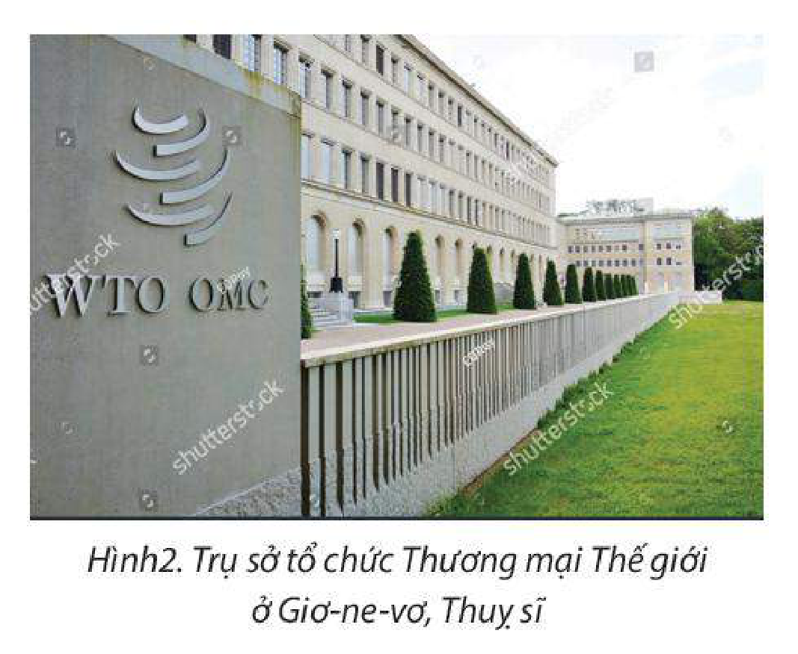

<!-- pdf:11 -->

# BÀI 2: TOÀN CẦU HOÁ VÀ KHU VỰC HOÁ KINH TẾ

## 🔴 Mở đầu

Toàn cầu hoá và khu vực hoá kinh tế là đặc trưng và xu hướng phổ biến trên thế giới, thu hút sự tham gia của rất nhiều nền kinh tế. Vậy toàn cầu hoá và khu vực hoá kinh tế là gì? Quá trình này có ảnh hưởng như thế nào đến nền kinh tế thế giới nói chung và nền kinh tế của mỗi quốc gia nói riêng?

## I. TOÀN CẦU HOÁ KINH TẾ

<!-- term: Toàn cầu hoá -->
Toàn cầu hoá là quá trình liên kết các quốc gia trên thế giới về nhiều mặt, từ kinh tế đến văn hoá, khoa học,... Trong đó, toàn cầu hoá kinh tế có tác động mạnh mẽ đến mọi mặt của nền kinh tế – xã hội thế giới.

### 1. Biểu hiện của toàn cầu hoá kinh tế

<!-- term: Biểu hiện của toàn cầu hoá kinh tế -->
– Các dòng hàng hoá – dịch vụ, vốn, lao động và tri thức ngày càng được tự do dịch chuyển. Trong quá trình toàn cầu hoá kinh tế, các nước kí kết và tham gia vào nhiều Hiệp định hợp tác song phương và đa phương.

> 💡 EM CÓ BIẾT?
>
> Theo thống kê của Tổ chức Thương mại Thế giới (WTO), tính đến 1 – 11 – 2022, thế giới có 320 hiệp định thương mại song phương và 35 hiệp định thương mại đa phương có hiệu lực.

<!-- term: Biểu hiện của toàn cầu hoá kinh tế -->
– Các giao dịch quốc tế về thương mại, đầu tư và tài chính tăng nhanh. Nhiều hình thức thương mại và đầu tư mới xuất hiện như thương mại điện tử, đầu tư phát triển bền vững,...

**BẢNG 2. TRỊ GIÁ XUẤT NHẬP KHẨU HÀNG HOÁ VÀ DỊCH VỤ TOÀN THẾ GIỚI GIAI ĐOẠN 2000 – 2020**

*(Đơn vị: tỉ USD)*

| Năm | Xuất khẩu | Nhập khẩu |
| --- | --- | --- |
| 2000 | 7 961,7 | 7 927,2 |
| 2005 | 13 014,0 | 12 804,0 |
| 2010 | 19 009,0 | 18 467,2 |
| 2015 | 21 341,8 | 20 815,8 |
| 2019 | 24 970,7 | 24 418,2 |
| 2020 | 22 594,7 | 21 949,6 |
<!-- ocr-ok: đối chiếu trực tiếp ảnh trang PDF 11 (trang in 9) Bảng 2 -->

*(Nguồn: Ngân hàng Thế giới, 2022)*

<!-- pdf:12 -->

<!-- term: Biểu hiện của toàn cầu hoá kinh tế -->
– Hình thành và phát triển các tổ chức kinh tế toàn cầu: Toàn cầu hoá kinh tế đã dẫn tới sự ra đời và phát triển các tổ chức kinh tế toàn cầu như Tổ chức Thương mại Thế giới (WTO), Quỹ Tiền tệ Quốc tế (IMF), Ngân hàng Thế giới (WB),... Các tổ chức này có vai trò ngày càng quan trọng trong việc thúc đẩy phát triển kinh tế toàn cầu và đời sống kinh tế – xã hội của các quốc gia.

*Hình 2. Trụ sở tổ chức Thương mại Thế giới ở Giơ-ne-vơ, Thuỵ sĩ*

<!-- term: Biểu hiện của toàn cầu hoá kinh tế -->
– Các công ty đa quốc gia có vai trò quan trọng: Các công ty đa quốc gia ngày càng mở rộng về phạm vi hoạt động và liên kết thành một mạng lưới sản xuất, kinh doanh toàn cầu, giữ vai trò chi phối các chuỗi giá trị toàn cầu; góp phần liên kết các quốc gia lại với nhau và làm cho quá trình toàn cầu hoá trở nên sâu sắc hơn.

<!-- term: Biểu hiện của toàn cầu hoá kinh tế -->
– Các tiêu chuẩn toàn cầu được áp dụng ngày càng rộng rãi trong quá trình sản xuất kinh doanh: Trong quá trình toàn cầu hoá, nhiều nước cùng tham gia quá trình sản xuất một sản phẩm. Do đó, sẽ có nhiều sản phẩm mà có các bộ phận được chế tạo từ nhiều quốc gia khác nhau. Chính vì vậy, các tiêu chuẩn sản xuất ngày càng được thống nhất và áp dụng rộng rãi trên thế giới.

> ❓ Dựa vào thông tin mục 1 và bảng 2, hãy trình bày các biểu hiện của toàn cầu hoá kinh tế.

### 2. Hệ quả của toàn cầu hoá kinh tế

<!-- term: Hệ quả của toàn cầu hoá kinh tế -->
– Tăng cường chuyên môn hoá và hợp tác hoá trong sản xuất, thúc đẩy phân công lao động, qua đó, lực lượng sản xuất phát triển mạnh mẽ.

<!-- term: Hệ quả của toàn cầu hoá kinh tế -->
– Tạo ra sự dịch chuyển các yếu tố sản xuất như lao động, vốn, công nghệ và tri thức. Hình thành và phát triển các mạng lưới, chuỗi liên kết toàn cầu nhằm tận dụng tối đa lợi thế của các nước, các khu vực.

<!-- term: Hệ quả của toàn cầu hoá kinh tế -->
– Có sự chuyển dịch cơ cấu kinh tế tại các nước theo hướng phát triển các ngành công nghiệp chế biến, chế tạo và dịch vụ có hàm lượng công nghệ và tri thức cao, hướng tới phát triển xanh và bền vững.

<!-- term: Hệ quả của toàn cầu hoá kinh tế -->
– Gia tăng sự phân hoá trình độ phát triển kinh tế và khoảng cách giàu nghèo trong từng nước và giữa các nước.

> ❓ Dựa vào thông tin mục 2, hãy trình bày các hệ quả của toàn cầu hoá kinh tế.

### 3. Ảnh hưởng của toàn cầu hoá kinh tế đối với các nước trên thế giới

<!-- pdf:13 -->

<!-- term: Ảnh hưởng của toàn cầu hoá kinh tế -->
Toàn cầu hoá kinh tế có ảnh hưởng tích cực và tiêu cực đến các nước trên thế giới. Cụ thể:

<!-- term: Ảnh hưởng của toàn cầu hoá kinh tế -->
– Góp phần khai thác lợi thế cạnh tranh của từng quốc gia, tăng cường chuyên môn hoá và phân công lao động trên phạm vi quốc tế, từ đó thúc đẩy tăng trưởng kinh tế.

<!-- term: Ảnh hưởng của toàn cầu hoá kinh tế -->
– Thúc đẩy các nước cải cách kinh tế, hoàn thiện cơ sở hạ tầng, thể chế phát triển kinh tế, cải thiện môi trường đầu tư và kinh doanh,...

<!-- term: Ảnh hưởng của toàn cầu hoá kinh tế -->
– Gia tăng các nguồn lực bên ngoài (vốn, lao động, công nghệ,...) cho phát triển kinh tế – xã hội.

> 💡 EM CÓ BIẾT?
>
> Hội nhập kinh tế quốc tế đã đưa Việt Nam vào tốp 20 nền thương mại hàng hoá lớn nhất thế giới vào năm 2021 và đứng thứ 17 trên thế giới về xuất khẩu. Với lợi thế về điều kiện tự nhiên, Việt Nam là quốc gia xuất khẩu dừa và hạt điều lớn nhất thế giới, xuất khẩu tiêu và quế đứng thứ hai thế giới. Ngoài ra, với lợi thế về nguồn lao động và ưu đãi từ các chính sách thu hút đầu tư trực tiếp nước ngoài, Việt Nam đã thu hút được hơn 15,66 tỉ USD vốn FDI năm 2021.
>
> *(Nguồn: Bộ Kế hoạch và Đầu tư Việt Nam)*

<!-- term: Ảnh hưởng của toàn cầu hoá kinh tế -->
– Gia tăng sự phụ thuộc lẫn nhau về kinh tế giữa các nước. Bất kì biến động lớn nào về kinh tế trên thế giới cũng ảnh hưởng tới kinh tế của một quốc gia. Sự phát triển mạnh mẽ của các ngành kinh tế cũng là một nguyên nhân gây ra các vấn đề môi trường như phát thải khí nhà kính, ô nhiễm không khí, phá huỷ các hệ sinh thái và đa dạng sinh học tại các nước. Việc phân phối và tiêu dùng hàng hoá cũng đang tạo ra một vấn đề lớn về rác thải, đặc biệt rác thải nhựa.

> ❓ Dựa vào thông tin mục 3, hãy phân tích ảnh hưởng của toàn cầu hoá kinh tế đối với các nước trên thế giới.

## II. KHU VỰC HOÁ KINH TẾ

<!-- term: Khu vực hoá kinh tế -->
Khu vực hoá kinh tế chính là quá trình liên kết và hợp tác kinh tế giữa các nước trong các khu vực trên thế giới trên cơ sở tương đồng về địa lí, văn hoá, xã hội hoặc có chung mục tiêu và lợi ích phát triển.

### 1. Biểu hiện của khu vực hoá kinh tế

<!-- term: Biểu hiện của khu vực hoá kinh tế -->
– Gia tăng số lượng và quy mô của các tổ chức khu vực trên thế giới: Các tổ chức khu vực trên thế giới ngày càng gia tăng và phát triển thông qua việc kí kết ngày càng nhiều hiệp định thương mại song phương và đa phương nhằm bổ sung các nguồn lực và điều kiện phát triển giữa các thành viên để nâng cao vị thế của khu vực trong tương quan với các khu vực khác.

<!-- term: Biểu hiện của khu vực hoá kinh tế -->
– Hợp tác khu vực ngày càng đa dạng và phát triển: Liên kết kinh tế trong các khu vực ngày càng đa dạng, tuỳ thuộc vào điều kiện và mục tiêu của các bên tham gia. Các tổ chức liên kết khu vực đã hình thành như: Diễn đàn Hợp tác Kinh tế châu Á – Thái Bình Dương, Thị trường chung Nam Mỹ, Hiệp hội các quốc gia Đông Nam Á, Liên minh châu Âu,...

> ❓ Dựa vào thông tin mục 1, hãy trình bày biểu hiện của khu vực hoá kinh tế.

### 2. Hệ quả của khu vực hoá kinh tế

<!-- pdf:14 -->

<!-- term: Hệ quả của khu vực hoá kinh tế -->
– Tạo lập một thị trường sản xuất và tiêu dùng rộng lớn, thúc đẩy đầu tư và thương mại nội khối cũng như tăng cường hợp tác, nâng cao trình độ khoa học – công nghệ trong khu vực.

<!-- term: Hệ quả của khu vực hoá kinh tế -->
– Thúc đẩy quá trình mở cửa thị trường ở các quốc gia, tạo cơ hội việc làm, thu hút các nhà đầu tư. Các doanh nghiệp ở các nước thành viên được hưởng nhiều ưu đãi hơn nhờ các hiệp định thương mại khu vực.

<!-- term: Hệ quả của khu vực hoá kinh tế -->
– Hình thành các rào cản thương mại (thuế, tiêu chuẩn chất lượng,...) đối với những nước bên ngoài khu vực.

> ❓ Dựa vào thông tin mục 2, hãy trình bày hệ quả của khu vực hoá kinh tế.

### 3. Ý nghĩa của khu vực hoá kinh tế đối với các nước trên thế giới

<!-- term: Ý nghĩa của khu vực hoá kinh tế -->
– Khu vực hoá kinh tế giúp các nước trong khu vực có thể dễ dàng liên kết với nhau và rút ngắn khoảng cách đạt được mục tiêu phát triển kinh tế.

<!-- term: Ý nghĩa của khu vực hoá kinh tế -->
– Việc liên kết với nhau để hình thành một tổ chức khu vực giúp các nước giải quyết các vấn đề chung của khu vực và nâng cao vị thế khu vực so với các khu vực khác trên thế giới. Đồng thời, khu vực hoá kinh tế còn làm tăng sức cạnh tranh của khu vực và khai thác được các lợi thế của các thành viên trong khu vực.

<!-- term: Ý nghĩa của khu vực hoá kinh tế -->
– Khu vực hoá kinh tế bổ sung cho toàn cầu hoá kinh tế và từng bước làm cho nền kinh tế thế giới trở thành một thể thống nhất.

> ❓ Dựa vào thông tin mục 3, hãy phân tích ý nghĩa của khu vực hoá kinh tế đối với các nước trên thế giới.

## ✏️ Luyện tập

Hoàn thành bảng theo mẫu sau với nội dung thể hiện hệ quả của toàn cầu hoá và khu vực hoá kinh tế.

| | Hệ quả |
| --- | --- |
| Toàn cầu hoá kinh tế | ? |
| Khu vực hoá kinh tế | ? |

## 🚀 Vận dụng

Sưu tầm thông tin về ảnh hưởng của toàn cầu hoá kinh tế đến Việt Nam.

## 📷 Danh sách hình trong bài

| Mã hình | Trang PDF | Vị trí trong bài | Chú thích gốc |
| --- | --- | --- | --- |
| H11-dia-b02-01 | 12 | Mục I.1 | Hình 2. Trụ sở tổ chức Thương mại Thế giới ở Giơ-ne-vơ, Thuỵ sĩ |
