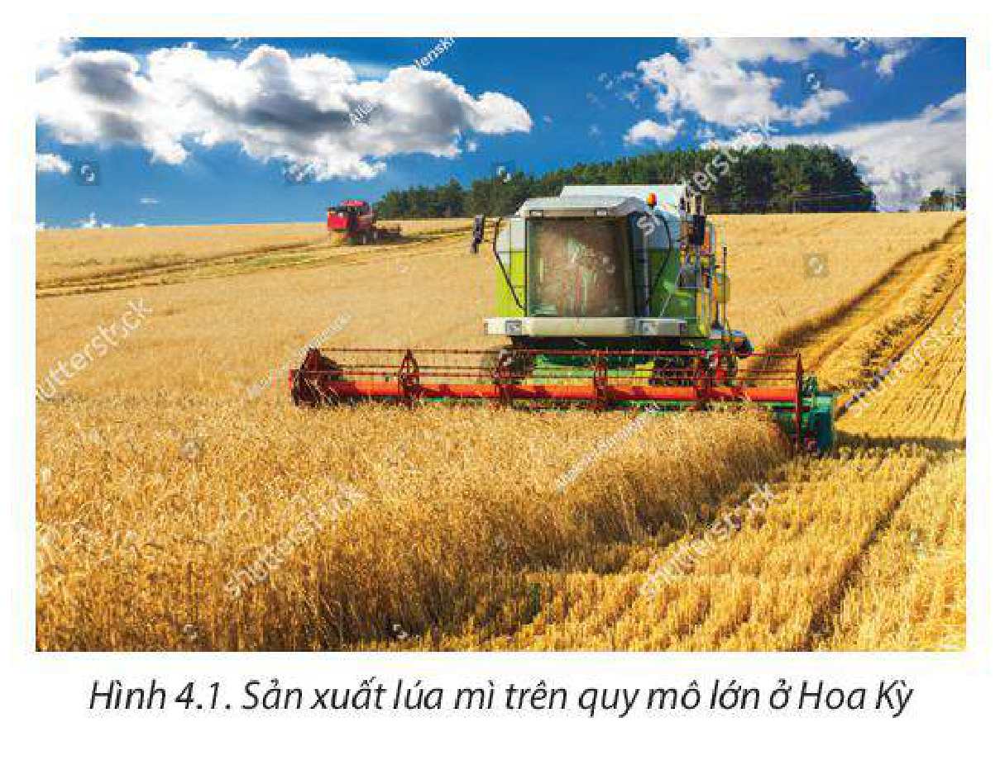
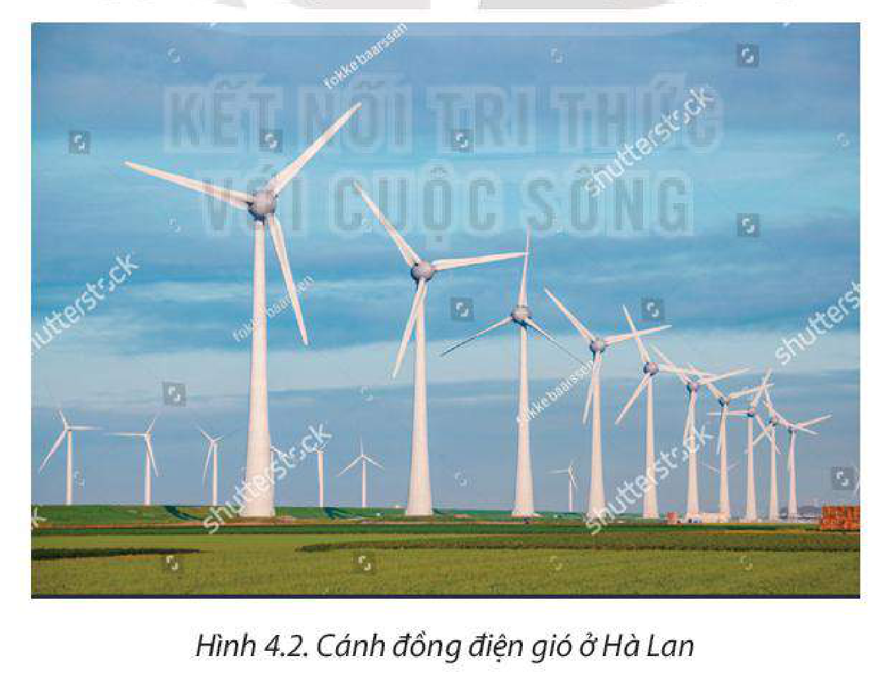
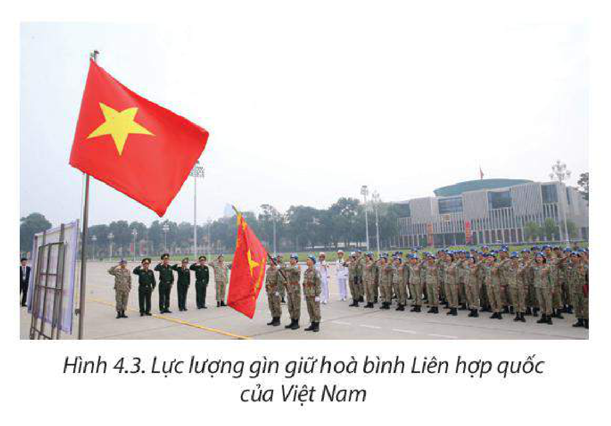

<!-- pdf:16 -->

# BÀI 4: MỘT SỐ TỔ CHỨC QUỐC TẾ VÀ KHU VỰC, AN NINH TOÀN CẦU

## 🔴 Mở đầu

Để đảm bảo một nền hoà bình trên thế giới và nhằm điều tiết, giám sát, thúc đẩy hoạt động kinh tế toàn cầu và khu vực, các nước đã hình thành các tổ chức quốc tế và khu vực. Vậy các tổ chức này có vị trí và vai trò như thế nào? Các vấn đề an ninh toàn cầu mà thế giới phải đối mặt hiện nay là gì?

## I. MỘT SỐ TỔ CHỨC QUỐC TẾ VÀ KHU VỰC

### 1. Liên hợp quốc (The United Nations – UN)

<!-- term: Liên hợp quốc -->
– UN là tổ chức quốc tế được thành lập vào năm 1945 với tôn chỉ hoạt động là bảo đảm một nền hoà bình và trật tự thế giới bền vững.

<!-- term: Liên hợp quốc -->
– Đến năm 2021, UN có 193 thành viên. Việt Nam là thành viên của tổ chức này từ năm 1977.

<!-- term: Liên hợp quốc -->
– Mục tiêu hoạt động của UN là:

<!-- term: Liên hợp quốc -->
+ Duy trì hoà bình và an ninh quốc tế.

<!-- term: Liên hợp quốc -->
+ Thúc đẩy quan hệ hữu nghị giữa các quốc gia trên cơ sở tôn trọng nguyên tắc bình đẳng về quyền lợi giữa các dân tộc và nguyên tắc dân tộc tự quyết.

+ Thực hiện hợp tác quốc tế thông qua giải quyết các vấn đề quốc tế trên cơ sở tôn trọng các quyền con người và quyền tự do cơ bản cho tất cả mọi người, không phân biệt chủng tộc, màu da, ngôn ngữ và tôn giáo.

+ Xây dựng UN là trung tâm điều hoà các nỗ lực quốc tế vì các mục tiêu chung.

### 2. Tổ chức Thương mại Thế giới (The World Trade Organization – WTO)

<!-- term: Tổ chức Thương mại Thế giới -->
– WTO được thành lập và hoạt động từ năm 1995 với tôn chỉ hoạt động là thiết lập và duy trì một nền thương mại toàn cầu tự do, thuận lợi và minh bạch.

<!-- term: Tổ chức Thương mại Thế giới -->
– Đến năm 2021, WTO có 164 thành viên. Việt Nam là thành viên thứ 150 của tổ chức này từ năm 2007.

<!-- term: Tổ chức Thương mại Thế giới -->
– Mục tiêu hoạt động của WTO là:

<!-- term: Tổ chức Thương mại Thế giới -->
+ Thúc đẩy tăng trưởng thương mại hàng hoá và dịch vụ trên thế giới phục vụ cho sự phát triển, ổn định, bền vững và bảo vệ môi trường.

<!-- pdf:17 -->

<!-- term: Tổ chức Thương mại Thế giới -->
+ Thúc đẩy sự phát triển các thể chế thị trường, giải quyết các bất đồng và tranh chấp thương mại giữa các nước thành viên trong khuôn khổ của hệ thống thương mại đa phương, phù hợp với các nguyên tắc cơ bản của Công pháp quốc tế.

<!-- term: Tổ chức Thương mại Thế giới -->
+ Nâng cao mức sống, tạo công ăn, việc làm cho người dân các nước thành viên, bảo đảm các quyền và tiêu chuẩn lao động tối thiểu.

### 3. Quỹ Tiền tệ Quốc tế (IMF)

<!-- term: Quỹ Tiền tệ Quốc tế -->
– IMF được thành lập năm 1944 với tôn chỉ hoạt động là thúc đẩy hợp tác tiền tệ toàn cầu, bảo đảm sự ổn định tài chính, tạo thuận lợi cho thương mại quốc tế, thúc đẩy việc làm, tăng trưởng kinh tế bền vững và giảm nghèo trên toàn thế giới.

<!-- term: Quỹ Tiền tệ Quốc tế -->
– Đến năm 2021, IMF có 190 thành viên. Việt Nam là thành viên của tổ chức này từ năm 1976.

– Mục tiêu hoạt động của IMF là:

+ Thúc đẩy hợp tác tiền tệ quốc tế, thúc đẩy tăng trưởng kinh tế và hỗ trợ tài chính tạm thời cho các nước thành viên khi các nước này gặp khó khăn.

+ Bảo đảm sự ổn định của hệ thống tiền tệ quốc tế – hệ thống tỉ giá và hệ thống thanh toán toàn cầu để các quốc gia và mọi người dân giao dịch được với nhau và với công dân của nước khác.

### 4. Diễn đàn Hợp tác Kinh tế châu Á – Thái Bình Dương (APEC)

<!-- term: Diễn đàn Hợp tác Kinh tế châu Á – Thái Bình Dương -->
– APEC được thành lập năm 1989 với tôn chỉ là thúc đẩy tự do thương mại, đầu tư và mở cửa trong khu vực châu Á – Thái Bình Dương.

<!-- term: Diễn đàn Hợp tác Kinh tế châu Á – Thái Bình Dương -->
– APEC gồm có 21 nền kinh tế thành viên. Việt Nam là thành viên của tổ chức này từ năm 1998.

<!-- term: Diễn đàn Hợp tác Kinh tế châu Á – Thái Bình Dương -->
– Mục tiêu hoạt động của APEC là:

<!-- term: Diễn đàn Hợp tác Kinh tế châu Á – Thái Bình Dương -->
+ Giữ vững sự tăng trưởng và phát triển trong khu vực.

<!-- term: Diễn đàn Hợp tác Kinh tế châu Á – Thái Bình Dương -->
+ Tăng cường hệ thống đa phương mở vì lợi ích của châu Á – Thái Bình Dương và các nền kinh tế khác.

+ Phát huy những tác động tích cực của sự phụ thuộc kinh tế lẫn nhau ngày càng tăng của kinh tế khu vực và thế giới, bằng cách đẩy mạnh sự giao lưu hàng hoá – dịch vụ, vốn và công nghệ.

> ❓ Dựa vào thông tin mục I, hãy trình bày về một tổ chức quốc tế hoặc khu vực (năm thành lập, số thành viên, mục tiêu hoạt động).

<!-- pdf:18 -->

## II. AN NINH TOÀN CẦU VÀ BẢO VỆ HOÀ BÌNH TRÊN THẾ GIỚI

### 1. Một số vấn đề an ninh toàn cầu

> 💡 EM CÓ BIẾT?
>
> Hội đồng Bảo an Liên hợp quốc (cơ quan chấp hành có thực quyền nhất của Liên hợp quốc) đảm nhiệm trách nhiệm hàng đầu của Liên hợp quốc là duy trì hoà bình và an ninh quốc tế.

<!-- term: An ninh toàn cầu -->
An ninh toàn cầu chính là trạng thái bình yên, ổn định và hoà bình của toàn thế giới. Nhân tố quan trọng để bảo đảm an ninh toàn cầu chính là đảm bảo an ninh con người. An ninh toàn cầu có thể chia thành hai loại là an ninh truyền thống và an ninh phi truyền thống.

<!-- term: An ninh truyền thống -->
– An ninh truyền thống là khái niệm đã có từ lâu, liên quan chủ yếu đến an ninh chính trị và quân sự như khủng bố, xung đột vũ trang, chiến tranh cục bộ,...

<!-- term: An ninh phi truyền thống -->
– An ninh phi truyền thống là khái niệm mới xuất hiện trong vài thập niên gần đây, liên quan đến các vấn đề như an ninh kinh tế, lương thực, năng lượng, nguồn nước,... Cùng với quá trình toàn cầu hoá và khu vực hoá, an ninh phi truyền thống trở thành vấn đề toàn cầu đòi hỏi các nước cần chung tay giải quyết.

**a) An ninh lương thực**

> 💡 EM CÓ BIẾT?
>
> Theo Báo cáo về Tình trạng An ninh lương thực và Dinh dưỡng trên thế giới năm 2021 của FAO, thế giới có khoảng 768 triệu người bị thiếu dinh dưỡng trong năm 2020, trong đó có hơn 50% sống ở châu Á và hơn 1/3 sống ở châu Phi.

– An ninh lương thực là việc đảm bảo mọi người có quyền tiếp cận các nguồn lương thực một cách đầy đủ, an toàn để duy trì cuộc sống khoẻ mạnh.

– An ninh lương thực luôn là vấn đề trọng yếu của tất cả các quốc gia trên thế giới trong nhiều thập kỉ qua. Có nhiều nguyên nhân dẫn đến tình trạng mất an ninh lương thực như xung đột vũ trang, chiến tranh, biến đổi khí hậu, thiên tai, dịch bệnh,... làm gián đoạn nguồn sản xuất và cung ứng lương thực, thực phẩm. Đảm bảo được an ninh lương thực sẽ đáp ứng nhu cầu tồn tại của con người và giảm tỉ lệ đói nghèo trên thế giới, góp phần thúc đẩy tăng trưởng kinh tế và làm tiền đề để ổn định chính trị – xã hội.

– Các giải pháp để đảm bảo an ninh lương thực toàn cầu:

+ Cung cấp lương thực và cứu trợ nhân đạo cho các khu vực mất an ninh lương thực nghiêm trọng.

+ Đẩy mạnh sản xuất lương thực bằng cách cơ cấu lại sản xuất, nâng cấp cơ sở vật chất – kĩ thuật nông nghiệp,..., đầu tư vào phát triển nông nghiệp bền vững.

*Hình 4.1. Sản xuất lúa mì trên quy mô lớn ở Hoa Kỳ*

<!-- pdf:19 -->

+ Nâng cao vai trò của các tổ chức quốc tế như Tổ chức Lương thực và Nông nghiệp của Liên hợp quốc (FAO), Chương trình Lương thực thế giới (WEP), Nhóm Ngân hàng Thế giới (WBG),... để giải quyết vấn đề an ninh lương thực toàn cầu.

**b) An ninh năng lượng**

– An ninh năng lượng là sự đảm bảo đầy đủ năng lượng, dưới nhiều hình thức khác nhau để phục vụ cho nhu cầu của con người và cho các hoạt động kinh tế – xã hội.

– Những thay đổi trong thị trường dầu mỏ và các năng lượng khác, cùng sự xuất hiện nhiều nguy cơ như: xung đột vũ trang, biến đổi khí hậu,... đã khiến an ninh năng lượng không được bảo đảm. Do đó, vấn đề đảm bảo an ninh năng lượng là hết sức cấp thiết, đồng thời là tiền đề quan trọng để phát triển kinh tế – xã hội.

> 💡 EM CÓ BIẾT?
>
> Theo Cơ quan Năng lượng Quốc tế (IEA), tổng tiêu thụ năng lượng trên thế giới năm 2020 là hơn 400 triệu Tê-ra-jun (TJ), trong đó năng lượng hoá thạch chiếm 64,8%. Dự báo nhu cầu tiêu thụ năng lượng toàn cầu sẽ tăng 24% vào năm 2050 so với năm 2020.

– Các giải pháp để đảm bảo an ninh năng lượng:

+ Đẩy mạnh tiết kiệm năng lượng và phát triển năng lượng tái tạo.

+ Khai thác hợp lí các nguồn tài nguyên và tìm kiếm các nguồn năng lượng mới.

+ Các quốc gia phối hợp với nhau để giải quyết các vấn đề năng lượng.

+ Tăng cường vai trò của các tổ chức quốc tế như: Tổ chức các nước xuất khẩu dầu mỏ (OPEC), Liên hợp quốc,... trong việc đàm phán, hợp tác, phân phối năng lượng.

*Hình 4.2. Cánh đồng điện gió ở Hà Lan*

**c) An ninh nguồn nước**

– An ninh nguồn nước là việc đảm bảo số lượng, chất lượng nước phục vụ dân sinh trong mọi tình huống; đáp ứng nhu cầu sử dụng nước cho các hoạt động kinh tế;

<!-- pdf:20 -->

đảm bảo mọi người dân, mọi đối tượng được tiếp cận, sử dụng nước công bằng, hợp lí. An ninh nguồn nước cũng có nghĩa là đảm bảo được khả năng ứng phó hiệu quả với các thảm hoạ, thiên tai liên quan đến nước, thích ứng với biến đổi khí hậu; bảo vệ môi trường, khắc phục tình trạng suy thoái, cạn kiệt, ô nhiễm nguồn nước.

– An ninh nguồn nước là vấn đề nổi lên hiện nay do việc sử dụng nước còn kém hiệu quả, lãng phí, ô nhiễm môi trường, biến đổi khí hậu,...

– Để đảm bảo an ninh nguồn nước, các quốc gia cần thường xuyên phối hợp, nghiên cứu, thảo luận các giải pháp đảm bảo an ninh nguồn nước. Bên cạnh đó, mỗi nước cũng cần chủ động bảo vệ nguồn nước, tránh tình trạng ô nhiễm nước, phát triển hệ thống thuỷ lợi và nâng cao công nghệ xử lí nước thải,... Các nước có chung nguồn tài nguyên nước cần chia sẻ, hợp tác và phối hợp kiểm soát nguồn nước.

**d) An ninh mạng**

> 💡 EM CÓ BIẾT?
>
> Theo số liệu của Liên hợp quốc, hiện có 138 quốc gia (trong đó có 95 nước đang phát triển) ban hành Luật An ninh mạng. Việt Nam đã ban hành Luật An ninh mạng năm 2018 để quy định về hoạt động bảo vệ an ninh quốc gia và bảo đảm trật tự, an toàn xã hội trên không gian mạng; trách nhiệm của cơ quan, tổ chức, cá nhân có liên quan.

– An ninh mạng là sự đảm bảo hoạt động trên không gian mạng không gây hại đến an ninh quốc gia, trật tự, an toàn xã hội, quyền và lợi ích hợp pháp của cơ quan, tổ chức, cá nhân.

– Cùng với sự phát triển mạnh mẽ của công nghệ thông tin và tính liên thông trong không gian mạng, an ninh mạng trở thành một thách thức đối với tất cả các quốc gia trên thế giới. Các hoạt động mất an ninh mạng diễn biến nhanh, ngày càng phức tạp và có tác động lớn đến mọi mặt đời sống, kinh tế, chính trị, an ninh, quốc phòng của mỗi quốc gia và trên toàn thế giới.

– Để bảo vệ an ninh mạng, nhiều quốc gia, tổ chức, liên minh quốc tế ban hành chiến lược an ninh mạng, luật an ninh mạng; thành lập các lực lượng chuyên trách về an ninh mạng, chiến tranh mạng, phòng chống khủng bố mạng,... Các quốc gia, các cơ quan, tổ chức quốc tế, các hãng công nghệ cần hợp tác chặt chẽ trong phòng, chống tấn công mạng và tội phạm mạng; cùng chung tay xây dựng không gian mạng an toàn, lành mạnh.

### 2. Sự cần thiết phải bảo vệ hoà bình trên thế giới

<!-- term: Hoà bình -->
Hoà bình chính là sự bình yên, tự do, hạnh phúc giữa con người và các quốc gia với nhau. Hiện nay, trên thế giới vẫn tồn tại nhiều vấn đề đe doạ hoà bình thế giới như chiến tranh, xung đột vũ trang, nội chiến, tranh chấp biên giới lãnh thổ, đói nghèo, biến đổi khí hậu,...

Bảo vệ hoà bình giúp các nước giải quyết các vấn đề an ninh toàn cầu. Bảo vệ hoà bình cũng là bảo vệ cho đất nước ngày càng thịnh vượng. Mỗi quốc gia cần có trách nhiệm duy trì và bảo vệ hoà bình tại quốc gia, khu vực và trên toàn cầu.

<!-- pdf:21 -->

*Hình 4.3. Lực lượng gìn giữ hoà bình Liên hợp quốc của Việt Nam*

> 💡 EM CÓ BIẾT?
>
> Việt Nam đã hoàn thành nhiệm vụ Uỷ viên không thường trực Hội đồng Bảo an Liên hợp quốc nhiệm kì 2020 – 2021. Đây là giai đoạn cả thế giới và khu vực trải qua nhiều biến động phức tạp, khó lường, nhất là sự bùng phát của đại dịch COVID-19.

Để bảo vệ hoà bình, các nước cần tăng cường đối thoại và hợp tác để giải quyết mâu thuẫn và xung đột trên cơ sở bảo đảm các nguyên tắc tôn trọng chủ quyền, quyền tự chủ và trách nhiệm chủ đạo của mỗi quốc gia. Các tổ chức quốc tế cũng cần gia tăng vai trò trong việc thúc đẩy và gìn giữ hoà bình trên thế giới.

> ❓ Dựa vào thông tin mục II và hiểu biết của bản thân, hãy:
>
> – Trình bày về một vấn đề an ninh toàn cầu mà em quan tâm.
>
> – Nêu sự cần thiết phải bảo vệ hoà bình trên thế giới.

## ✏️ Luyện tập

1. Hoàn thành bảng theo mẫu sau về các tổ chức UN, WTO, IMF, APEC.

| Tên tổ chức | UN | WTO | IMF | APEC |
| --- | --- | --- | --- | --- |
| Năm thành lập | ? | ? | ? | ? |
| Số thành viên | ? | ? | ? | ? |
| Mục tiêu hoạt động | ? | ? | ? | ? |
| Năm Việt Nam gia nhập | ? | ? | ? | ? |

2. Phân tích mối liên hệ giữa một vấn đề an ninh toàn cầu với việc cần phải bảo vệ hoà bình trên thế giới.

## 🚀 Vận dụng

Sưu tầm thông tin, tìm hiểu về các hoạt động của một tổ chức quốc tế hoặc khu vực mà em quan tâm.

## 📷 Danh sách hình trong bài

| Mã hình | Trang PDF | Vị trí trong bài | Chú thích gốc |
| --- | --- | --- | --- |
| H11-dia-b04-01 | 18 | Mục II.1a | Hình 4.1. Sản xuất lúa mì trên quy mô lớn ở Hoa Kỳ |
| H11-dia-b04-02 | 19 | Mục II.1b | Hình 4.2. Cánh đồng điện gió ở Hà Lan |
| H11-dia-b04-03 | 21 | Mục II.2 | Hình 4.3. Lực lượng gìn giữ hoà bình Liên hợp quốc của Việt Nam |
