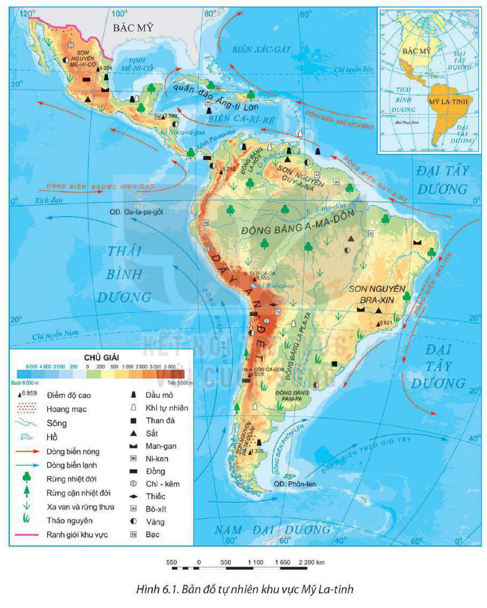
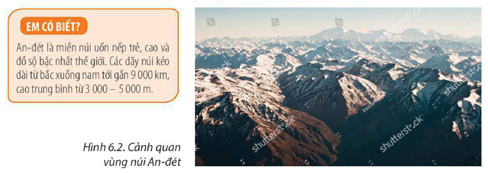
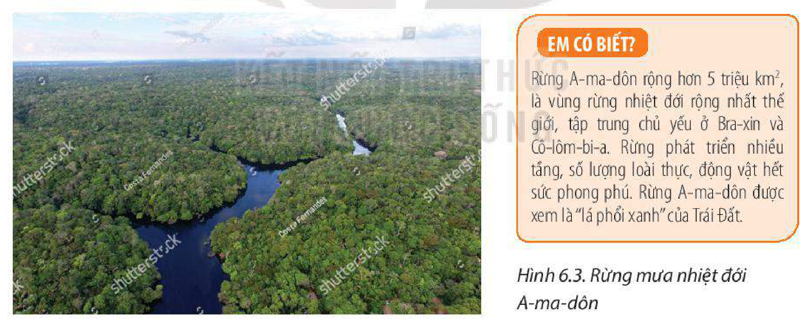
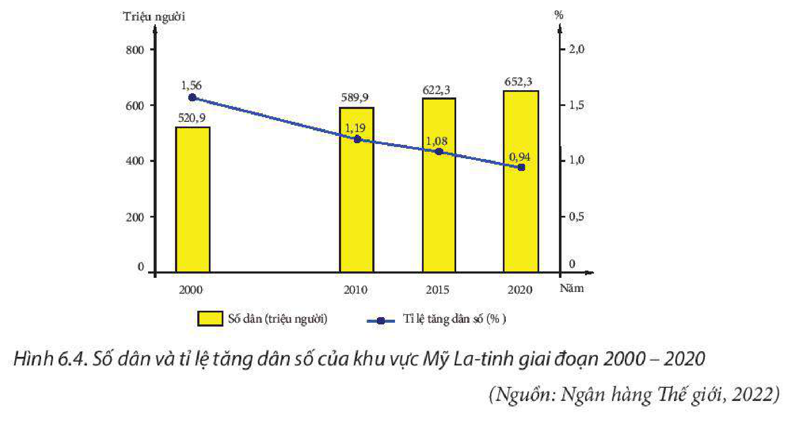
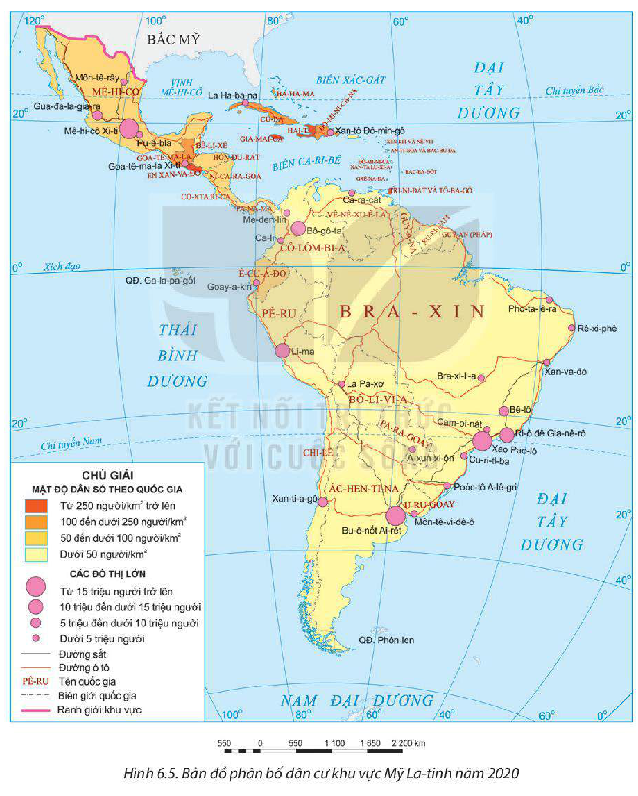

<!-- pdf:24 -->

# BÀI 6: VỊ TRÍ ĐỊA LÍ, ĐIỀU KIỆN TỰ NHIÊN, DÂN CƯ VÀ XÃ HỘI KHU VỰC MỸ LA-TINH

> **KHU VỰC MỸ LA-TINH**
> - Diện tích: khoảng 20 triệu km²
> - Số dân: 652,0 triệu người (năm 2020)

## 🔴 Mở đầu

Mỹ La-tinh là một khu vực rộng lớn thuộc châu Mỹ. Các đặc điểm về vị trí địa lí, điều kiện tự nhiên và tài nguyên thiên nhiên, dân cư, xã hội và đô thị hoá có ảnh hưởng như thế nào đến sự phát triển kinh tế – xã hội của Mỹ La-tinh?

## I. PHẠM VI LÃNH THỔ VÀ VỊ TRÍ ĐỊA LÍ

<!-- term: Phạm vi lãnh thổ và vị trí địa lí khu vực Mỹ La-tinh -->
Khu vực Mỹ La-tinh có diện tích khoảng 20 triệu km²; bao gồm: Mê-hi-cô, eo đất Trung Mỹ, các đảo và quần đảo trong vùng biển Ca-ri-bê, toàn bộ lục địa Nam Mỹ.

Lãnh thổ Mỹ La-tinh trải dài từ khoảng vĩ độ 33°B đến gần vĩ độ 54°N, tiếp giáp với ba đại dương: phía đông là Đại Tây Dương, phía tây là Thái Bình Dương và phía nam là Nam Đại Dương.

Mỹ La-tinh nằm hoàn toàn ở bán cầu Tây, tách biệt với các châu lục khác. Phía bắc giáp khu vực Bắc Mỹ (gồm Hoa Kỳ và Ca-na-đa), là thị trường tiêu thụ rộng lớn và nơi cung cấp nguồn đầu tư quan trọng cho các nước Mỹ La-tinh.

Nhờ tiếp giáp với nhiều biển và đại dương, khu vực Mỹ La-tinh thuận lợi phát triển kinh tế biển, hợp tác trong khu vực và với các khu vực khác trên thế giới; trong đó, kênh đào Pa-na-ma có vai trò đặc biệt quan trọng đối với phát triển kinh tế và giao thương.

> 💡 EM CÓ BIẾT?
>
> Kênh Pa-na-ma cắt qua eo đất Pa-na-ma là con đường giao thông ngắn nhất nối Thái Bình Dương và Đại Tây Dương. Tổng chiều dài của kênh là 64 km.
<!-- ocr-ok: đối chiếu trực tiếp ảnh trang PDF 24 (trang in 22), hộp EM CÓ BIẾT xếp song song cột chữ nên OCR ghép lẫn dòng -->

> ❓ Dựa vào thông tin mục I và hình 6.1, hãy:
> – Xác định phạm vi lãnh thổ và vị trí địa lí của khu vực Mỹ La-tinh trên bản đồ.
> – Phân tích ảnh hưởng của phạm vi lãnh thổ và vị trí địa lí đến sự phát triển kinh tế – xã hội của khu vực Mỹ La-tinh.

<!-- pdf:25 -->

## II. ĐIỀU KIỆN TỰ NHIÊN VÀ TÀI NGUYÊN THIÊN NHIÊN

### 1. Địa hình và đất

<!-- term: Địa hình và đất khu vực Mỹ La-tinh -->
Nhìn chung, khu vực Mỹ La-tinh có cấu trúc địa hình tương đối đa dạng, phức tạp, với nhiều dạng địa hình.

*Hình 6.1. Bản đồ tự nhiên khu vực Mỹ La-tinh*

– Phía tây là miền núi cao, bao gồm: sơn nguyên Mê-hi-cô và vùng núi trẻ Trung Mỹ, hệ thống núi An-đét cao và đồ sộ bậc nhất thế giới chạy sát bờ Thái Bình Dương.

<!-- pdf:26 -->

Địa hình núi cao, chia cắt mạnh gây khó khăn cho hoạt động sản xuất, cư trú và giao thông; đồng thời các dãy núi cao ngăn ảnh hưởng của biển vào sâu trong nội địa. Vùng núi cũng là nơi có nhiều thiên tai (động đất, núi lửa,...).

> 💡 EM CÓ BIẾT?
>
> An-đét là miền núi uốn nếp trẻ, cao và đồ sộ bậc nhất thế giới. Các dãy núi kéo dài từ bắc xuống nam tới gần 9 000 km, cao trung bình từ 3 000 – 5 000 m.

*Hình 6.2. Cảnh quan vùng núi An-đét*

– Phía đông là miền núi thấp, sơn nguyên và đồng bằng, bao gồm: sơn nguyên Guy-a-na và sơn nguyên Bra-xin, bề mặt nhiều nơi phủ đất feralit hình thành từ dung nham núi lửa; phần trung tâm sơn nguyên Guy-a-na và phần đông sơn nguyên Bra-xin được nâng lên thành một số dãy núi. Các đồng bằng La-nốt, La Pla-ta là những vùng đất thấp, bề mặt được bồi đắp phù sa dày, khá bằng phẳng. Riêng đồng bằng A-ma-dôn có phần lớn diện tích là đầm lầy, rừng rậm phát triển.

Vùng núi thấp, sơn nguyên và đồng bằng phía đông thuận lợi trồng cây lương thực, cây công nghiệp, chăn nuôi gia súc.

– Vùng biển Ca-ri-bê có nhiều đảo, đất màu mỡ thuận lợi trồng cây công nghiệp, cây ăn quả nhiệt đới và phát triển du lịch.

### 2. Khí hậu

<!-- term: Khí hậu khu vực Mỹ La-tinh -->
– Khí hậu của phần lớn lãnh thổ Mỹ La-tinh có tính chất nóng, ẩm. Do phạm vi lãnh thổ trải dài trên nhiều vĩ độ và đặc điểm địa hình nên khí hậu Mỹ La-tinh phân hoá đa dạng thành nhiều đới và kiểu khí hậu khác nhau.

– Các đới và kiểu khí hậu:

+ Đới khí hậu xích đạo quanh năm nóng, ẩm, bao gồm phần phía tây đồng bằng A-ma-dôn, duyên hải phía tây Cô-lôm-bi-a và Ê-cu-a-đo.

+ Đới khí hậu cận xích đạo một năm có hai mùa (mùa khô và mùa mưa) rõ rệt, bao gồm toàn bộ phần phía bắc Nam Mỹ, đông và nam đồng bằng A-ma-dôn, bắc sơn nguyên Bra-xin.

+ Đới khí hậu nhiệt đới quanh năm nóng, lượng mưa giảm dần từ đông sang tây, có ở khu vực Trung Mỹ, phía nam đồng bằng A-ma-dôn.

+ Đới khí hậu cận nhiệt có mùa hạ nóng, mùa đông ấm và đới khí hậu ôn đới mát mẻ quanh năm, bao gồm toàn bộ phần lãnh thổ phía nam của lục địa Nam Mỹ.

+ Các vùng núi cao ở phía tây lục địa Nam Mỹ có kiểu khí hậu núi cao.

<!-- pdf:27 -->

– Nhìn chung, khí hậu Mỹ La-tinh thuận lợi để phát triển nông nghiệp, nhất là nông nghiệp nhiệt đới với các loại cây ăn quả (chuối, dứa, xoài,...), cây công nghiệp (cao su, cà phê, mía,...). Khí hậu Mỹ La-tinh cũng gây một số khó khăn cho đời sống và sản xuất: một số khu vực có khí hậu khắc nghiệt (hoang mạc A-ta-ca-ma quá khô hạn, phía tây đồng bằng A-ma-dôn quá ẩm ướt,...); vùng biển Ca-ri-bê và dải đất Trung Mỹ hằng năm chịu ảnh hưởng của bão nhiệt đới và lũ lụt.

### 3. Sông, hồ

<!-- term: Sông, hồ khu vực Mỹ La-tinh -->
– Mạng lưới sông ở Mỹ La-tinh khá phát triển, có nhiều sông lớn và dài, phần lớn các sông nhiều nước quanh năm như A-ma-dôn, Ô-ri-nô-cô,... Sông ngòi có giá trị về nhiều mặt: là đường giao thông quan trọng, nguồn nước tưới tiêu, tiềm năng thuỷ điện lớn và là các địa điểm du lịch hấp dẫn.

– Các hồ ở Mỹ La-tinh đa số là hồ nhỏ, nằm trên các độ cao lớn, có nguồn gốc kiến tạo, núi lửa, băng hà. Một số hồ có ý nghĩa về du lịch (hồ Ti-ti-ca-ca, Ni-ca-ra-goa,...).

> 💡 EM CÓ BIẾT?
>
> Hồ Ti-ti-ca-ca nằm ở độ cao 3 800 m, diện tích 8 300 km² (lớn nhất Nam Mỹ). Xưa kia, nơi đây là trung tâm văn minh của người In-ca.

### 4. Sinh vật

<!-- term: Sinh vật khu vực Mỹ La-tinh -->
Thảm thực vật của Mỹ La-tinh rất đa dạng, bao gồm: rừng nhiệt đới (rừng mưa nhiệt đới, rừng nhiệt đới gió mùa,...), rừng cận nhiệt đới, xa van và rừng thưa, hoang mạc và bán hoang mạc,... Giới động vật Mỹ La-tinh rất phong phú, có nhiều loài đặc hữu như thú ăn kiến, cá sấu Nam Mỹ, vẹt, lạc đà Nam Mỹ (La-ma),...

> 💡 EM CÓ BIẾT?
>
> Rừng A-ma-dôn rộng hơn 5 triệu km², là vùng rừng nhiệt đới rộng nhất thế giới, tập trung chủ yếu ở Bra-xin và Cô-lôm-bi-a. Rừng phát triển nhiều tầng, số lượng loài thực, động vật hết sức phong phú. Rừng A-ma-dôn được xem là “lá phổi xanh” của Trái Đất.

*Hình 6.3. Rừng mưa nhiệt đới A-ma-dôn*

Rừng ở Mỹ La-tinh là nguồn cung cấp gỗ quan trọng cho nền kinh tế và có ý nghĩa đặc biệt về đa dạng sinh học, điều hoà khí hậu,... Tuy nhiên, diện tích rừng tự nhiên đang có xu hướng giảm do bị khai phá để lấy gỗ, lấy đất canh tác và làm đường giao thông,...

### 5. Khoáng sản

<!-- term: Khoáng sản khu vực Mỹ La-tinh -->
Mỹ La-tinh là khu vực giàu tài nguyên khoáng sản, tập trung chủ yếu ở vùng núi An-đét và phía đông nam sơn nguyên Bra-xin. Khoáng sản phong phú về chủng loại; có trữ lượng lớn là sắt (Bra-xin – trữ lượng 80 tỉ tấn,...); chì – kẽm, bạc (Bô-li-vi-a, Pê-ru,

<!-- pdf:28 -->

Ác-hen-ti-na); đồng (Chi-lê); dầu mỏ, khí tự nhiên (Vê-nê-du-ê-la, Cô-lôm-bi-a, vùng biển Ca-ri-bê,...). Ngoài ra còn có thiếc, man-gan, ni-ken,...

Tài nguyên khoáng sản là cơ sở để phát triển nhiều ngành công nghiệp và xuất khẩu. Tuy nhiên, nhiều loại khoáng sản có nguy cơ cạn kiệt do bị khai thác quá mức.

### 6. Biển

<!-- term: Biển khu vực Mỹ La-tinh -->
Mỹ La-tinh giáp ba đại dương, có vùng biển rộng. Tài nguyên sinh vật biển phong phú tạo thuận lợi cho ngành khai thác thuỷ sản phát triển, nhất là ở vùng biển Thái Bình Dương. Dọc bờ biển có nhiều địa điểm thuận lợi để xây dựng cảng biển, phát triển giao thông vận tải biển. Nhiều nơi, nhất là khu vực Ca-ri-bê có các bãi biển đẹp, nước trong xanh thuận lợi phát triển du lịch biển.

> ❓ Dựa vào thông tin mục II và hình 6.1, hãy:
> – Nêu một số đặc điểm nổi bật của điều kiện tự nhiên và tài nguyên thiên nhiên ở khu vực Mỹ La-tinh.
> – Phân tích ảnh hưởng của một trong những điều kiện tự nhiên và tài nguyên thiên nhiên đối với sự phát triển kinh tế – xã hội Mỹ La-tinh.

## III. DÂN CƯ VÀ XÃ HỘI

### 1. Dân cư

<!-- term: Dân cư khu vực Mỹ La-tinh -->
Mỹ La-tinh có số dân 652 triệu người (năm 2020). Các nước đông dân nhất là Bra-xin (211,8 triệu người), Mê-hi-cô (127,8 triệu người); nhưng cũng có nước chỉ vài chục nghìn dân như Đô-mi-ni-ca-na.

Trước đây khu vực Mỹ La-tinh có tỉ lệ tăng dân số thuộc loại cao, hiện nay đã giảm nhiều, tỉ lệ tăng dân số cả khu vực năm 2020 là 0,94% và có sự chênh lệch giữa các quốc gia.

*Hình 6.4. Số dân và tỉ lệ tăng dân số của khu vực Mỹ La-tinh giai đoạn 2000 – 2020 (Nguồn: Ngân hàng Thế giới, 2022)*

<!-- pdf:29 -->

Mỹ La-tinh là một trong những khu vực có sự đa dạng về chủng tộc bậc nhất trên thế giới, bao gồm người Ơ-rô-pê-ô-ít, người Môn-gô-lô-ít, người Nê-grô-ít và người lai giữa các chủng tộc.

Mỹ La-tinh đang trong thời kì dân số vàng và có sự thay đổi theo hướng già hoá dân số, số người trong độ tuổi từ 15 đến 64 tuổi chiếm 67,2% và số người từ 65 tuổi trở lên chiếm 8,9% tổng số dân (năm 2020).

*Hình 6.5. Bản đồ phân bố dân cư khu vực Mỹ La-tinh năm 2020*

<!-- pdf:30 -->

**BẢNG 6.1. CƠ CẤU DÂN SỐ THEO TUỔI Ở KHU VỰC MỸ LA-TINH GIAI ĐOẠN 2000 – 2020**

*(Đơn vị: %)*

| Nhóm tuổi \ Năm | 2000 | 2010 | 2015 | 2020 |
| :--- | :---: | :---: | :---: | :---: |
| Dưới 15 tuổi | 32,2 | 27,7 | 25,6 | 23,9 |
| Từ 15 đến 64 tuổi | 62,1 | 65,5 | 66,6 | 67,2 |
| Từ 65 tuổi trở lên | 5,7 | 6,8 | 7,8 | 8,9 |

*(Nguồn: Liên hợp quốc, 2022)*

Mật độ dân số trung bình của khu vực Mỹ La-tinh khoảng 32 người/km² (năm 2020), thuộc loại thấp so với nhiều khu vực khác trên thế giới. Dân cư tập trung đông ở các đảo lớn trong vùng biển Ca-ri-bê, các vùng ven biển, các đồng bằng màu mỡ,... Trong khi ở các khu vực núi cao, rừng mưa nhiệt đới, vùng khô hạn,... dân cư rất thưa thớt.

Nhìn chung, nhờ số dân đông, cơ cấu dân số vàng nên Mỹ La-tinh có lực lượng lao động dồi dào tạo thuận lợi lớn để phát triển kinh tế, thu hút đầu tư,... Tuy nhiên, đối với nhiều nước Mỹ La-tinh, phân bố dân cư không hợp lí dẫn tới khó khăn trong khai thác tài nguyên thiên nhiên và phát triển kinh tế. Những khó khăn khác đòi hỏi phải giải quyết là an ninh xã hội, vấn đề việc làm, di cư,...

> ❓ Dựa vào thông tin mục 1 và các hình 6.4, 6.5, hãy:
> – Trình bày đặc điểm nổi bật về dân cư của khu vực Mỹ La-tinh.
> – Phân tích ảnh hưởng của đặc điểm dân cư đối với việc phát triển kinh tế – xã hội ở Mỹ La-tinh.

### 2. Đô thị hoá

<!-- term: Đô thị hoá ở khu vực Mỹ La-tinh -->
Quá trình đô thị hoá ở Mỹ La-tinh gắn liền với quá trình nhập cư và lịch sử khai thác lãnh thổ. Các đô thị phát triển từ thế kỉ XVI sau khi thực dân Tây Ban Nha và Bồ Đào Nha xâm chiếm Mỹ La-tinh.

Tỉ lệ dân đô thị của Mỹ La-tinh tương đối cao so với các khu vực khác của thế giới, nhất là với các nước đang phát triển. Năm 1950 có khoảng 40% dân số Mỹ La-tinh sống ở đô thị, năm 2020 lên tới khoảng 80%. Một số nước có tỉ lệ dân đô thị chiếm hơn 90% dân số như U-ru-goay, Ác-hen-ti-na,...

Mỹ La-tinh là khu vực tập trung nhiều đô thị đông dân bậc nhất thế giới. Năm 2020, Mỹ La-tinh có khoảng 60 đô thị với số dân trên 1 triệu người, trong đó 6 siêu đô thị có trên 10 triệu dân là Xao Pao-lô (22,0 triệu), Mê-hi-cô Xi-ti (21,8 triệu), Bu-ê-nốt Ai-rét (15,2 triệu), Ri-ô đê Gia-nê-rô (13,5 triệu), Bô-gô-ta (11 triệu), Li-ma (10,7 triệu).

Đô thị hoá thúc đẩy sự phát triển công nghiệp, dịch vụ, lan toả lối sống đô thị trong dân cư,... nhưng cũng làm nảy sinh một số vấn đề kinh tế – xã hội. Đô thị hoá tự phát gây ra các hậu quả như thất nghiệp, ô nhiễm môi trường, tệ nạn xã hội, vấn đề an ninh trật tự,...

<!-- pdf:31 -->

> ❓ Dựa vào thông tin mục 2, hãy trình bày vấn đề đô thị hoá ở Mỹ La-tinh và phân tích ảnh hưởng của đô thị hoá đến phát triển kinh tế – xã hội.

### 3. Xã hội

<!-- term: Xã hội khu vực Mỹ La-tinh -->
– Khu vực Mỹ La-tinh có nền văn hoá độc đáo, thường gọi là “văn hoá Mỹ La-tinh”, với nhiều lễ hội, ẩm thực, âm nhạc, vũ điệu độc đáo được hình thành từ sự kết hợp văn hoá của những nền văn minh cổ đại (In-ca, May-a, A-dơ-tếch) với văn hoá của các chủng tộc di dân tới Mỹ La-tinh. Văn hoá đa dạng, đặc sắc là điểm nhấn thu hút khách du lịch quốc tế.

– Cùng với sự phát triển kinh tế, chất lượng cuộc sống của người dân các nước Mỹ La-tinh đã chuyển biến theo chiều hướng tích cực.

**BẢNG 6.2. TUỔI THỌ TRUNG BÌNH VÀ SỐ NĂM ĐI HỌC TRUNG BÌNH CỦA NGƯỜI TỪ 25 TUỔI TRỞ LÊN CỦA MỘT SỐ QUỐC GIA KHU VỰC MỸ LA-TINH NĂM 2000 VÀ NĂM 2020**

| Quốc gia | Tuổi thọ trung bình *(năm)* - Năm 2000 | Tuổi thọ trung bình *(năm)* - Năm 2020 | Số năm đi học trung bình của người từ 25 tuổi trở lên *(năm)* - Năm 2000 | Số năm đi học trung bình của người từ 25 tuổi trở lên *(năm)* - Năm 2020 |
| :--- | :---: | :---: | :---: | :---: |
| Ác-hen-ti-na | 74,2 | 76,9 | 8,9 | 11,1 |
| Bra-xin | 69,7 | 76,2 | 5,3 | 8,1 |
| Mê-hi-cô | 73,6 | 75,2 | 6,7 | 9,2 |
| Pa-na-ma | 74,0 | 76,7 | 7,9 | 10,5 |

*(Nguồn: Liên hợp quốc, 2022)*

– Bên cạnh sự tiến bộ xã hội, ở nhiều nước Mỹ La-tinh vẫn còn một số vấn đề tồn tại: chênh lệch giàu nghèo (tỉ lệ người nghèo cao, mức độ chênh lệch giữa nhóm giàu và nhóm nghèo lớn), xung đột xã hội xuất hiện ở một số quốc gia,...

> ❓ Dựa vào thông tin mục 3, hãy:
> – Trình bày một số đặc điểm xã hội của khu vực Mỹ La-tinh.
> – Phân tích ảnh hưởng của các đặc điểm xã hội đến phát triển kinh tế – xã hội ở Mỹ La-tinh.

## ✏️ Luyện tập

1. Mỹ La-tinh có thuận lợi gì để phát triển công nghiệp khai thác khoáng sản và du lịch?
2. Dựa vào hình 6.4, nhận xét sự thay đổi số dân và tỉ lệ tăng dân số của khu vực Mỹ La-tinh giai đoạn 2000 – 2020.

## 🚀 Vận dụng

Tìm hiểu một số nét văn hoá độc đáo của Mỹ La-tinh (nền văn minh In-ca, lễ hội Ca-na-van,...) và ảnh hưởng của chúng tới hoạt động du lịch.

## 📷 Danh sách hình trong bài

| Mã hình | Trang PDF | Vị trí trong bài | Chú thích gốc |
| --- | --- | --- | --- |
| H11-dia-b06-01 | 25 | Mục II.1 | Hình 6.1. Bản đồ tự nhiên khu vực Mỹ La-tinh |
| H11-dia-b06-02 | 26 | Mục II.1 | Hình 6.2. Cảnh quan vùng núi An-đét |
| H11-dia-b06-03 | 27 | Mục II.4 | Hình 6.3. Rừng mưa nhiệt đới A-ma-dôn |
| H11-dia-b06-04 | 28 | Mục III.1 | Hình 6.4. Số dân và tỉ lệ tăng dân số của khu vực Mỹ La-tinh giai đoạn 2000 – 2020 (Nguồn: Ngân hàng Thế giới, 2022) |
| H11-dia-b06-05 | 29 | Mục III.1 | Hình 6.5. Bản đồ phân bố dân cư khu vực Mỹ La-tinh năm 2020 |
