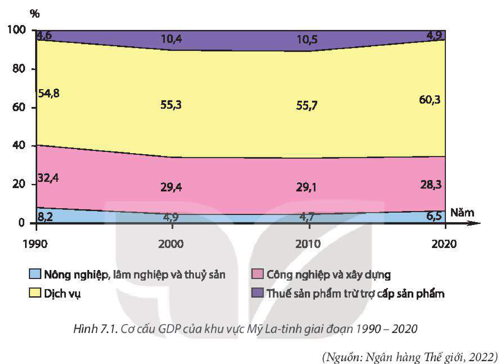
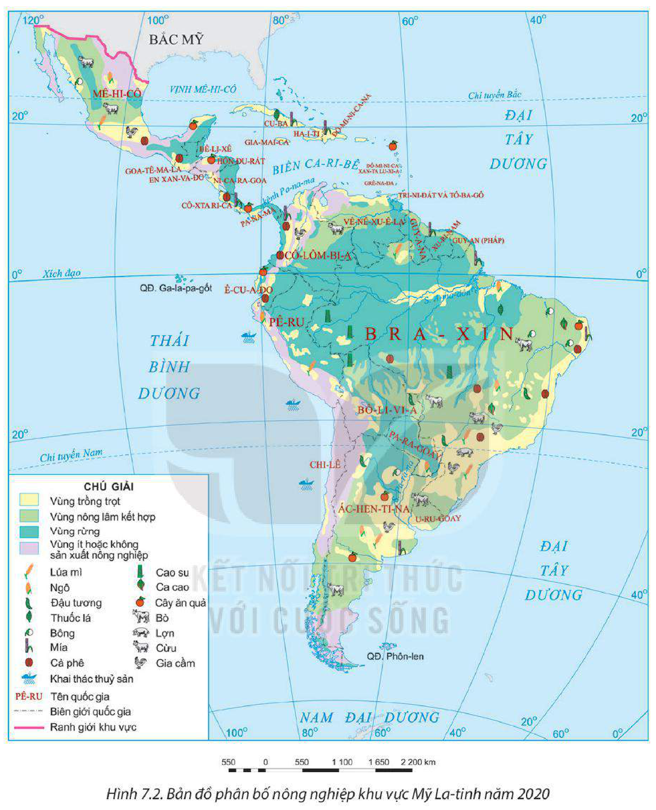
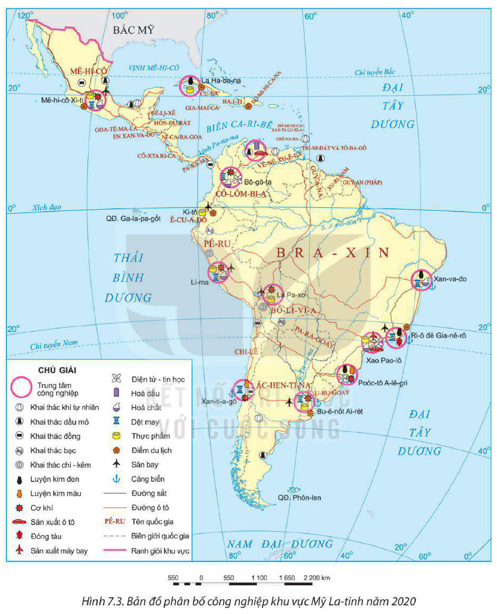

<!-- pdf:32 -->

# BÀI 7: KINH TẾ KHU VỰC MỸ LA-TINH

## 🔴 Mở đầu

Những năm gần đây, kinh tế – xã hội của khu vực Mỹ La-tinh có nhiều chuyển biến theo hướng tích cực. Kinh tế Mỹ La-tinh phát triển ra sao? Các ngành kinh tế có đặc điểm gì nổi bật?

## I. TÌNH HÌNH PHÁT TRIỂN KINH TẾ

### 1. Quy mô GDP

<!-- term: Quy mô GDP khu vực Mỹ La-tinh -->
Khu vực Mỹ La-tinh đóng góp khoảng 6% vào GDP thế giới (năm 2020). Quy mô GDP của các nước trong khu vực có sự chênh lệch lớn, các nước có quy mô GDP lớn nhất khu vực năm 2020 là Bra-xin (1 448,7 tỉ USD), Mê-hi-cô (1 073,9 tỉ USD).

**BẢNG 7.1. QUY MÔ GDP VÀ GDP/NGƯỜI THEO GIÁ HIỆN HÀNH CỦA MỘT SỐ QUỐC GIA MỸ LA-TINH NĂM 2000 VÀ NĂM 2020**

| Quốc gia | GDP *(tỉ USD)* - Năm 2000 | GDP *(tỉ USD)* - Năm 2020 | GDP/người *(USD)* - Năm 2000 | GDP/người *(USD)* - Năm 2020 |
| :--- | :---: | :---: | :---: | :---: |
| Ác-hen-ti-a | 284,2 | 389,3 | 7 708 | 8 579 |
| Bra-xin | 655,5 | 1 448,7 | 3 749 | 6 797 |
| Mê-hi-cô | 707,9 | 1 073,9 | 7 158 | 8 329 |
| Chi-lê | 78,3 | 252,9 | 5 100 | 13 232 |
<!-- ocr-ok: đối chiếu trực tiếp ảnh trang PDF 32 (trang in 30), bảng 7.1 -->

*(Nguồn: Ngân hàng Thế giới, 2022)*

### 2. Tốc độ tăng GDP

<!-- term: Tốc độ tăng GDP khu vực Mỹ La-tinh -->
Khu vực Mỹ La-tinh tiến hành công nghiệp hoá khá sớm (thế kỉ XIX). Nền kinh tế phụ thuộc nhiều vào nước ngoài về nguồn vốn, công nghệ, thị trường, cùng với các bất ổn về chính trị, xã hội đã khiến tốc độ tăng trưởng GDP luôn biến động.

**BẢNG 7.2. TỐC ĐỘ TĂNG GDP CỦA KHU VỰC MỸ LA-TINH GIAI ĐOẠN 1961 – 2020**

| Năm | 1961 | 1980 | 2000 | 2010 | 2020 |
| :--- | :---: | :---: | :---: | :---: | :---: |
| Tốc độ tăng GDP (%) | 6,2 | 6,7 | 3,6 | 6,4 | -6,7 |
<!-- ocr-ok: đối chiếu trực tiếp ảnh trang PDF 32 (trang in 30), bảng 7.2 -->

*(Nguồn: Ngân hàng Thế giới, 2022)*

<!-- pdf:33 -->

### 3. Cơ cấu kinh tế

<!-- term: Cơ cấu kinh tế khu vực Mỹ La-tinh -->
Từ năm 1990 đến nay, nhiều nước Mỹ La-tinh chuyển sang nền kinh tế thị trường. Cơ cấu kinh tế có sự chuyển dịch theo hướng tăng tỉ trọng ngành dịch vụ.

*Hình 7.1. Cơ cấu GDP của khu vực Mỹ La-tinh giai đoạn 1990 – 2020 (Nguồn: Ngân hàng Thế giới, 2022)*

> ❓ Dựa vào nội dung mục I, hãy trình bày và giải thích tình hình phát triển kinh tế của khu vực Mỹ La-tinh.

## II. CÁC NGÀNH KINH TẾ

### 1. Nông nghiệp

<!-- term: Nông nghiệp khu vực Mỹ La-tinh -->
Mỹ La-tinh có điều kiện thuận lợi để phát triển nông nghiệp. Cơ cấu cây trồng của Mỹ La-tinh rất đa dạng gồm cả cây lương thực, cây công nghiệp và cây ăn quả. Các cây lương thực chính là ngô, lúa mì. Năm 2020, Mỹ La-tinh sản xuất hơn 208 triệu tấn lương thực; các nước sản xuất lương thực hàng đầu là Bra-xin, Ác-hen-ti-na, Pa-ra-goay, Mê-hi-cô. Cây công nghiệp là thế mạnh trong nông nghiệp Mỹ La-tinh. Các cây công nghiệp chính là cà phê, ca cao, đậu tương, mía, thuốc lá, bông, cao su,... Các vật nuôi chủ yếu ở Mỹ La-tinh là bò, gia cầm; các nước có ngành chăn nuôi phát triển nhất là Bra-xin, Mê-hi-cô, Ác-hen-ti-na, Cô-lôm-bi-a.

Hiện nay, nông nghiệp Mỹ La-tinh đang phát triển theo hướng chuyên môn hoá, hiện đại hoá (đẩy mạnh ứng dụng khoa học – công nghệ).

<!-- pdf:34 -->

*Hình 7.2. Bản đồ phân bố nông nghiệp khu vực Mỹ La-tinh năm 2020*

### 2. Công nghiệp

<!-- term: Công nghiệp khu vực Mỹ La-tinh -->
Công nghiệp đóng góp quan trọng vào GDP của khu vực Mỹ La-tinh. Công nghiệp khai khoáng rất phát triển dựa trên nguồn tài nguyên khoáng sản đa dạng, phong phú. Mỹ La-tinh là nơi sản xuất 45% lượng đồng, 50% lượng bạc, 21% lượng kẽm của thế giới.

<!-- pdf:35 -->

Mỹ La-tinh cũng là khu vực khai thác nhiều dầu mỏ và khí tự nhiên của thế giới, nổi bật là các nước: Vê-nê-xu-ê-la, Mê-hi-cô,...

*Hình 7.3. Bản đồ phân bố công nghiệp khu vực Mỹ La-tinh năm 2020*

Trong những năm gần đây, công nghiệp chế biến, chế tạo được chú trọng phát triển, nhiều sản phẩm đạt trình độ công nghệ cao (sản xuất ô tô, máy bay,...). Các nước phát triển mạnh nhất là Ác-hen-ti-na, Bra-xin, Chi-lê, Mê-hi-cô.

<!-- pdf:36 -->

### 3. Dịch vụ

<!-- term: Dịch vụ khu vực Mỹ La-tinh -->
Ngành dịch vụ đóng góp nhiều nhất vào GDP của khu vực và tỉ trọng có xu hướng tăng. Lĩnh vực dịch vụ quan trọng của Mỹ La-tinh là ngoại thương. Các sản phẩm xuất khẩu chủ yếu là quặng khoáng sản, dầu thô, các sản phẩm nông nghiệp nhiệt đới, thịt, sữa,... Năm 2020, trị giá xuất khẩu hàng hoá và dịch vụ đạt 1 189,1 tỉ USD, trị giá nhập khẩu hàng hoá và dịch vụ đạt 1 146,5 tỉ USD. Các đối tác thương mại chính của Mỹ La-tinh là Hoa Kỳ, EU, Trung Quốc.

Mỹ La-tinh là khu vực thu hút lượng lớn khách du lịch nhờ có cảnh quan thiên nhiên đa dạng, nền văn hoá đặc sắc. Năm 2019, Mỹ La-tinh đón gần 202 triệu khách du lịch quốc tế, doanh thu từ khách quốc tế đạt hơn 75,6 tỉ USD.

*Hình 7.4. Một phần bãi biển Cô-pa-ca-ba-na ở Ri-ô đê Gia-nê-rô (Bra-xin)*

> ❓ Dựa vào nội dung mục II, hãy:
> – Trình bày đặc điểm nổi bật của một ngành kinh tế (nông nghiệp, công nghiệp, dịch vụ) ở khu vực Mỹ La-tinh.
> – Kể tên một số sản phẩm nông nghiệp, công nghiệp chủ yếu của khu vực.

## ✏️ Luyện tập

1. Dựa vào bảng 7.2, vẽ biểu đồ thể hiện tốc độ tăng GDP của khu vực Mỹ La-tinh giai đoạn 1961 – 2020. Nêu nhận xét.
2. Hoàn thành bảng thể hiện sự phân bố một số nông sản của Mỹ La-tinh theo mẫu sau.

| Tên nông sản | Sự phân bố |
| :---: | :---: |
| ? | ? |
| ? | ? |
<!-- ocr-ok: đối chiếu trực tiếp ảnh trang PDF 36 (trang in 34), bảng mẫu câu 2 phần Luyện tập -->

## 🚀 Vận dụng

Tìm hiểu về một loại nông sản xuất khẩu nổi bật (cà phê, ca cao, đậu tương,...) của Mỹ La-tinh.

## 📷 Danh sách hình trong bài

| Mã hình | Trang PDF | Vị trí trong bài | Chú thích gốc |
| --- | --- | --- | --- |
| H11-dia-b07-01 | 33 | Mục I.3 | Hình 7.1. Cơ cấu GDP của khu vực Mỹ La-tinh giai đoạn 1990 – 2020 (Nguồn: Ngân hàng Thế giới, 2022) |
| H11-dia-b07-02 | 34 | Mục II.1 | Hình 7.2. Bản đồ phân bố nông nghiệp khu vực Mỹ La-tinh năm 2020 |
| H11-dia-b07-03 | 35 | Mục II.2 | Hình 7.3. Bản đồ phân bố công nghiệp khu vực Mỹ La-tinh năm 2020 |
| H11-dia-b07-04 | 36 | Mục II.3 | Hình 7.4. Một phần bãi biển Cô-pa-ca-ba-na ở Ri-ô đê Gia-nê-rô (Bra-xin) |
