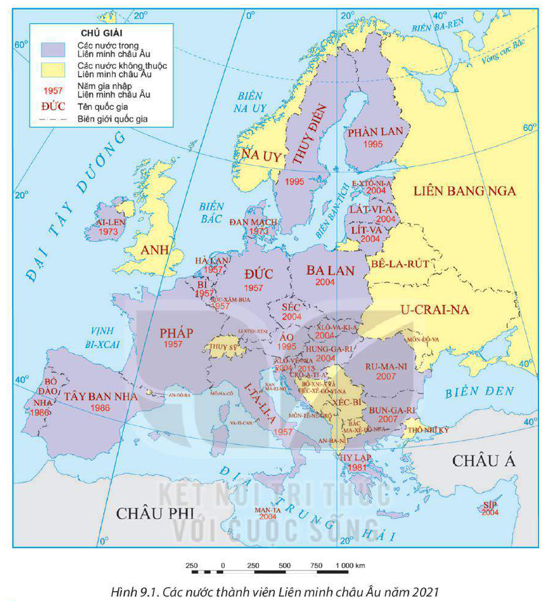
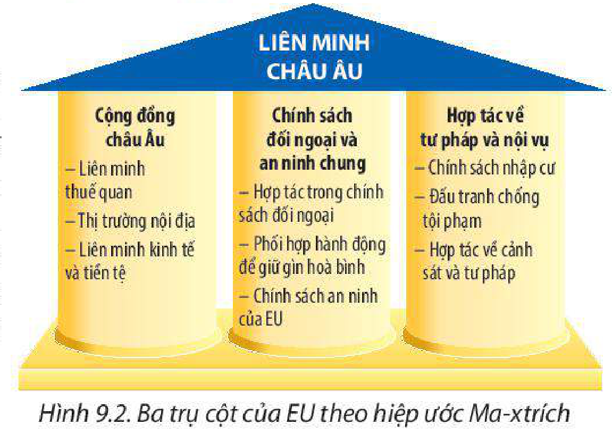
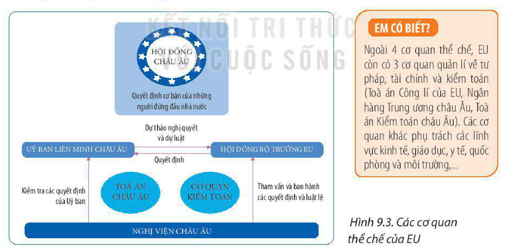
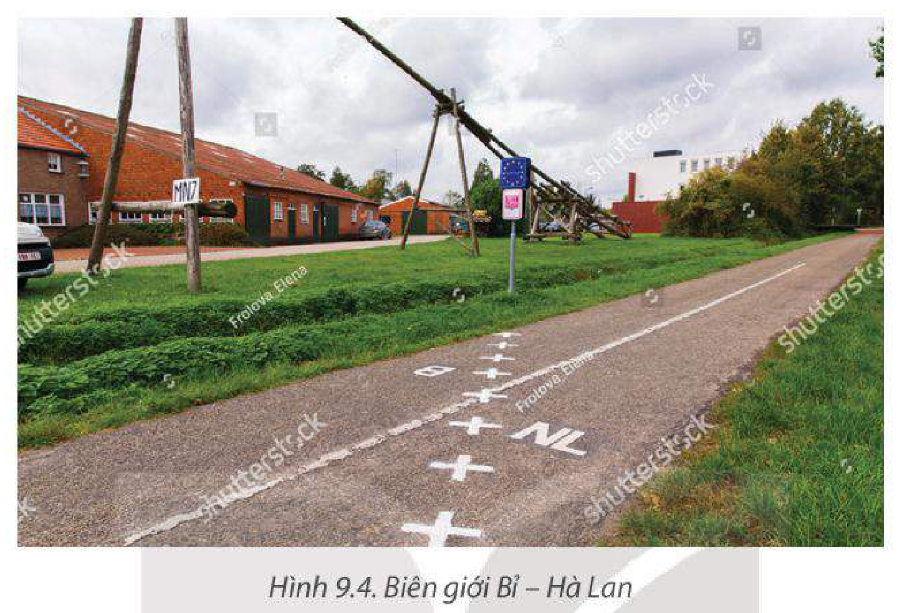

<!-- pdf:39 -->

# BÀI 9: LIÊN MINH CHÂU ÂU – MỘT LIÊN KẾT KINH TẾ KHU VỰC LỚN

> **LIÊN MINH CHÂU ÂU (EU)**
> - Số thành viên: 27 (năm 2021)
> - Trụ sở: Brúc-xen (Bỉ)

## 🔴 Mở đầu

Liên minh châu Âu (EU) là một liên kết kinh tế khu vực lớn, đạt nhiều thành tựu về hợp tác khu vực trên thế giới. Vậy EU hoạt động với mục tiêu và thể chế như thế nào? Vị thế của EU trong nền kinh tế thế giới và sự hợp tác, liên kết trong EU được thể hiện ra sao?

## I. QUY MÔ, MỤC TIÊU VÀ THỂ CHẾ HOẠT ĐỘNG CỦA EU

### 1. Quy mô

<!-- term: Quy mô Liên minh châu Âu -->
Năm 1957, Cộng đồng kinh tế châu Âu được thành lập với 6 quốc gia thành viên. Năm 1967, tổ chức này hợp nhất với Cộng đồng Than và Thép châu Âu và Cộng đồng Nguyên tử châu Âu thành Cộng đồng châu Âu (tiền thân của EU). Ngày 1 – 11 – 1993, Hiệp ước Ma-xtrích có hiệu lực, là cột mốc đánh dấu sự thành lập chính thức của EU. Nhìn chung, trải qua quá trình phát triển lâu dài, quy mô của EU ngày càng mở rộng cả về số thành viên, diện tích, số dân và GDP. Năm 2021, EU có 27 quốc gia thành viên, chiếm khoảng 5,8% số dân và đóng góp 17,8% GDP toàn thế giới.

> 💡 EM CÓ BIẾT?
>
> Cộng hoà Síp, về mặt địa lí thuộc khu vực Tây Nam Á nhưng đã gia nhập EU từ năm 2004.
>
> Sau 47 năm là thành viên, Anh đã rời khỏi EU vào tháng 1 – 2020, sau đó Anh đã kí Hiệp định Thương mại và Hợp tác với EU.

**BẢNG 9.1. QUY MÔ CỦA EU QUA CÁC NĂM**

| Năm | Số thành viên *(quốc gia)* | Diện tích *(nghìn km²)* | Số dân *(triệu người)* | GDP *(nghìn tỉ USD)* |
| :---: | :---: | :---: | :---: | :---: |
| 1957 | 6 | 1 282,7 | 167,0 | 1,1 |
| 1993 | 12 | 2 452,6 | 349,1 | 6,8 |
| 1995 | 15 | 3 313,5 | 445,9 | 8,3 |
| 2004 | 25 | 4 666,7 | 457,2 | 11,4 |
| 2007 | 27 | 5 015,5 | 495,0 | 14,7 |
| 2013 | 28 | 5 072,1 | 506,0 | 15,3 |
| 2021 | 27 | 4 829,6 | 447,7 | 17,1 |

*(Nguồn: Liên minh châu Âu và Ngân hàng Thế giới, 2022)*

<!-- pdf:40 -->

*Hình 9.1. Các nước thành viên Liên minh châu Âu năm 2021*

> ❓ Dựa vào thông tin mục 1, bảng 9.1 và hình 9.1, hãy xác định quy mô của EU.

### 2. Mục tiêu của EU

<!-- term: Mục tiêu của Liên minh châu Âu -->
Mục tiêu của EU khi thành lập được thể hiện qua Hiệp ước Ma-xtrích (1993). EU xây dựng và phát triển liên minh kinh tế và tiền tệ với một đơn vị tiền tệ chung; liên minh chính trị với chính sách đối ngoại, an ninh chung và hợp tác về tư pháp, nội vụ. Với ba trụ cột về kinh tế, chính trị và tư pháp, Hiệp ước hướng đến xây dựng EU thành khu vực tự do và liên kết chặt chẽ.

*Hình 9.2. Ba trụ cột của EU theo hiệp ước Ma-xtrích*

<!-- pdf:41 -->

> 💡 EM CÓ BIẾT?
>
> Để phù hợp với quá trình hợp tác, phát triển và mở rộng thành viên, EU đã điều chỉnh các mục tiêu của mình, thể hiện ở Hiệp ước Li-xbon (2009). Mục tiêu chung hiện nay của EU là xây dựng một khu vực dân chủ hơn, hiệu quả hơn và có khả năng giải quyết tốt hơn các vấn đề toàn cầu.
>
> **Mục tiêu trong khu vực:**
> – Thúc đẩy hoà bình, tự do, an ninh và hạnh phúc của công dân.
> – Thúc đẩy tiến bộ khoa học – công nghệ.
> – Thiết lập một thị trường nội bộ, một liên minh kinh tế và tiền tệ.
> – Phát triển bền vững dựa trên tăng trưởng kinh tế cân bằng, có tính cạnh tranh cao và tiến bộ xã hội.
>
> **Mục tiêu trên thế giới:**
> – Duy trì và phát huy các giá trị và lợi ích của EU.
> – Đóng góp cho hoà bình, an ninh và phát triển bền vững của Trái Đất.
> – Thương mại tự do và công bằng, xoá đói giảm nghèo.

> ❓ Dựa vào thông tin mục 2, hãy xác định mục tiêu của EU.

### 3. Thể chế hoạt động của EU

<!-- term: Thể chế hoạt động của Liên minh châu Âu -->
Theo Hiệp ước Ma-xtrích, bốn cơ quan thể chế của EU là Hội đồng châu Âu, Nghị viện châu Âu, Uỷ ban Liên minh châu Âu (nay là Uỷ ban châu Âu) và Hội đồng Bộ trưởng EU (nay là Hội đồng Liên minh châu Âu).

*Hình 9.3. Các cơ quan thể chế của EU*

> 💡 EM CÓ BIẾT?
>
> Ngoài 4 cơ quan thể chế, EU còn có 3 cơ quan quản lí về tư pháp, tài chính và kiểm toán (Toà án Công lí của EU, Ngân hàng Trung ương châu Âu, Toà án Kiểm toán châu Âu). Các cơ quan khác phụ trách các lĩnh vực kinh tế, giáo dục, y tế, quốc phòng và môi trường,...

Từ sau Hiệp ước Li-xbon, quyền lực của các cơ quan thể chế được tăng cường nhằm ra quyết định và điều hành hoạt động của EU.

<!-- term: Hội đồng châu Âu -->
– Hội đồng châu Âu là cơ quan quyền lực cao nhất của EU, gồm 27 nguyên thủ các nước thành viên. Hội đồng thường họp 4 lần trong năm, giải quyết các vấn đề quan

<!-- pdf:42 -->

trọng nhất: quyết định đường lối chính trị của EU; trao đổi về thể chế, hiến pháp, chính sách kinh tế, tiền tệ; đặt ra đường lối an ninh và đối ngoại chung. Tuy nhiên, Hội đồng không phải là cơ quan thông qua các dự thảo luật của EU.

<!-- term: Nghị viện châu Âu -->
– Nghị viện châu Âu là cơ quan làm luật của EU, đại diện cho công dân EU. Nhiệm vụ của Nghị viện là lập pháp, giám sát và tài chính.

<!-- term: Uỷ ban châu Âu -->
– Uỷ ban châu Âu là cơ quan điều hành, đại diện cho lợi ích chung của EU. Uỷ ban gồm Chủ tịch, Uỷ viên và các ban chức năng. Uỷ ban có nhiệm vụ đề xuất, giám sát thực hiện các dự luật và quản lí ngân sách, vừa hoà giải tranh chấp trong nội bộ vừa đại diện cho EU trong đối ngoại, đàm phán quốc tế.

<!-- term: Hội đồng Liên minh châu Âu -->
– Hội đồng Liên minh châu Âu là cơ quan làm luật của EU, đại diện cho các chính phủ và là nơi các bộ trưởng EU họp để thảo luận về các dự thảo luật. Hội đồng Liên minh có 250 tiểu ban và nhóm công tác phụ trách 10 lĩnh vực khác nhau: kinh tế, tài chính, an ninh,...

Trải qua quá trình liên kết, quyền lực của EU ngày càng được tăng cường. Các nước thành viên có hiến pháp riêng nhưng phải phù hợp với hiến pháp của EU. EU có thể giao dịch với tư cách là một quốc gia với các quốc gia khác. Như vậy, thể chế của EU ngày càng hoàn thiện theo hướng gắn kết chặt chẽ hơn. Các mục tiêu toàn diện và thể chế minh bạch, dân chủ làm cho EU ngày càng đoàn kết, thịnh vượng và nâng cao vị thế trên thế giới.

> ❓ Dựa vào thông tin mục 3 và hình 9.3, hãy xác định thể chế hoạt động của EU thông qua bốn cơ quan ra quyết định và điều hành chính.

## II. VỊ THẾ CỦA EU TRONG NỀN KINH TẾ THẾ GIỚI

### 1. Quy mô nền kinh tế

<!-- term: Vị thế của EU trong nền kinh tế thế giới -->
– Năm 2021, GDP của EU chiếm 17,8% GDP toàn cầu và lớn thứ ba trên thế giới, sau Hoa Kỳ và Trung Quốc. GDP/người đạt mức cao (38 234 USD), gấp 3,1 lần mức trung bình toàn thế giới.

– Ba nền kinh tế lớn nhất EU là Cộng hoà Liên bang Đức, Pháp, I-ta-li-a cũng là những cường quốc kinh tế trên thế giới và thuộc nhóm các quốc gia có nền kinh tế phát triển nhất thế giới (G7).

### 2. Một số lĩnh vực dịch vụ

– Thương mại: EU là một trung tâm thương mại lớn trên thế giới. EU hội nhập sâu rộng vào thị trường toàn cầu và trở thành đối tác thương mại hàng đầu của 80 quốc gia. Các hoạt động thương mại của EU tác động đến thị trường toàn cầu là xuất nhập khẩu hàng hoá và dịch vụ, mua sắm công và quyền sở hữu trí tuệ. Năm 2021, trị giá xuất khẩu hàng hoá và dịch vụ của EU cao nhất thế giới, chiếm 31,0% trị giá toàn cầu.

– Đầu tư nước ngoài: EU có giá trị đầu tư ra nước ngoài cao thứ hai trên thế giới (sau Hoa Kỳ, năm 2021). Đầu tư của EU tập trung nhiều vào các lĩnh vực dịch vụ, khai thác dầu khí và chế tạo, do đó ảnh hưởng lớn đến việc hiện đại hoá, chuyển đổi năng lượng

<!-- pdf:43 -->

và chuỗi giá trị toàn cầu. Nguồn vốn Hỗ trợ phát triển chính thức (ODA) của EU cao nhất thế giới (19,0 tỉ USD, năm 2021), hỗ trợ phát triển bền vững ở các khu vực nghèo hơn trên thế giới. EU góp phần cải thiện môi trường đầu tư ở các nước theo hướng bình đẳng, minh bạch và thuận lợi hơn.

– Tài chính ngân hàng: Hoạt động tài chính của EU tác động đến các quy định, sự minh bạch, dịch vụ và công nghệ tài chính của thế giới. Sức mạnh tài chính của EU thể hiện ở các lĩnh vực: ngân hàng, bảo hiểm và thị trường vốn. Các thành phố Phrăng-phuốc (Cộng hoà Liên bang Đức), Pa-ri (Pháp), Am-xtéc-đam (Hà Lan) là những trung tâm tài chính lớn của EU và thế giới.

**BẢNG 9.2. MỘT SỐ CHỈ TIÊU KINH TẾ THEO GIÁ HIỆN HÀNH CỦA CÁC TRUNG TÂM KINH TẾ LỚN TRÊN THẾ GIỚI NĂM 2021**

*(Đơn vị: tỉ USD)*

| Chỉ tiêu | EU | Hoa Kỳ | Trung Quốc | Nhật Bản | Thế giới |
| :--- | :---: | :---: | :---: | :---: | :---: |
| GDP | 17 177,4 | 23 315,1 | 17 734,1 | 4 940,9 | 96 513,1 |
| Đầu tư ra nước ngoài | 397,6 | 403,1 | 145,2 | 146,8 | 1 707,6 |
| Trị giá xuất khẩu hàng hoá và dịch vụ | 8 651,9 | 2 539,6 | 3 553,5 | 910,5 | 27 876,8 |
<!-- ocr-ok: đối chiếu trực tiếp ảnh trang PDF 43 (trang in 41), bảng 9.2 -->

*(Nguồn: Ngân hàng Thế giới, 2022)*

### 3. Một số lĩnh vực sản xuất

Một số ngành sản xuất của EU có vị trí cao trên thế giới và dẫn đầu xu hướng hiện đại hoá là chế tạo máy, hoá chất, hàng không – vũ trụ, sản xuất hàng tiêu dùng,... Một số sản phẩm công nghiệp của EU chiếm thị phần xuất khẩu lớn trên thế giới năm 2021 là dược phẩm (62,9%), máy bay (69,3%), ô tô (49,7%), máy công cụ (55,1%),...

> 💡 EM CÓ BIẾT?
>
> Với vị thế về kinh tế của mình, EU có vai trò đặc biệt trong các tổ chức quốc tế. EU là thành viên và có đóng góp quan trọng trong WTO, ASEM, OECD, G20. EU có thể tác động đến nhiều tổ chức, diễn đàn kinh tế (IMF, WB, UNCTAD,...) thông qua các nước thành viên và các cơ quan của mình.

> ❓ Dựa vào nội dung mục II, hãy phân tích vị thế của EU trong nền kinh tế thế giới.

## III. MỘT SỐ BIỂU HIỆN CỦA HỢP TÁC VÀ LIÊN KẾT TRONG EU

### 1. Thiết lập một EU tự do, an ninh và công lí

<!-- term: Thị trường chung EU -->
– Tự do: Bốn quyền tự do của EU là tự do di chuyển, tự do lưu thông dịch vụ, tự do lưu thông hàng hoá và tự do lưu thông tiền vốn. Công dân EU có quyền tự do sinh sống, làm việc và được đảm bảo an toàn ở bất kì đâu trong EU.

<!-- pdf:44 -->

Trên cơ sở bốn quyền tự do, EU xây dựng thị trường chung. Thị trường chung EU vận hành theo nguyên tắc hợp tác chặt chẽ, cạnh tranh bình đẳng và thủ tục minh bạch, hợp lí. Thị trường chung thúc đẩy chuyên môn hoá, tạo việc làm, giảm bớt rào cản thương mại và cải thiện kinh doanh.

*Hình 9.4. Biên giới Bỉ – Hà Lan*

– An ninh: EU có chính sách quốc phòng và an ninh chung nhằm bảo vệ hoà bình, an ninh và ổn định trong khu vực. Các hoạt động hợp tác về an ninh chung phòng chống tội phạm, khủng bố, nhập cư bất hợp pháp và dịch bệnh được tăng cường.

– Công lí: EU thiết lập các thủ tục chung giúp thực thi công lí nhanh chóng, bình đẳng và đảm bảo rằng các phán quyết ở quốc gia này có thể áp dụng được ở quốc gia khác.

### 2. Hình thành một liên minh kinh tế và tiền tệ với đồng tiền chung Ơ-rô

<!-- term: Liên minh kinh tế và tiền tệ EU -->
– Liên minh kinh tế và tiền tệ: Đây là mức độ cao nhất trong hợp tác khu vực. Các quốc gia thành viên liên minh thống nhất thực hiện một chính sách kinh tế chung, một hệ thống tiền tệ chung (bao gồm cả ngân hàng chung, đồng tiền chung) và chính sách tiền tệ chung. Do đó thương mại của EU được tăng cường, lao động và hàng hoá di chuyển dễ dàng hơn, giá cả minh bạch và cạnh tranh công bằng hơn.

– Đồng Ơ-rô: Trên thế giới, đồng tiền chung có thể bảo vệ nền kinh tế và hệ thống tài chính của EU khỏi những khủng hoảng, giảm sự phụ thuộc vào các loại tiền tệ khác và thuận tiện cho sản xuất, kinh doanh. Trong khu vực, đồng Ơ-rô thúc đẩy đầu tư xuyên biên giới, ổn định tài chính và giúp các quốc

> 💡 EM CÓ BIẾT?
>
> Sau khi một số nước Đông Âu gia nhập EU, các ngành công nghiệp sử dụng nhiều vốn và công nghệ ở các nước Tây Âu và các ngành công nghiệp sử dụng nhiều lao động ở các nước Đông Âu bổ trợ cho nhau. Ví dụ trong ngành may mặc: các nước Đông Âu tổ chức sản xuất dệt may còn các nước Tây Âu thiết kế và marketing thương hiệu.
>
> Ơ-rô-dôn gồm 19 quốc gia (năm 2021) sử dụng một đồng tiền chung Ơ-rô. Các thành viên phải phối hợp với nhau trong chính sách kinh tế và tiền tệ để duy trì ổn định và thịnh vượng.

<!-- pdf:45 -->

gia hỗ trợ lẫn nhau. Dù vậy, đồng tiền chung vẫn tiềm ẩn những rủi ro gây khó khăn cho nền kinh tế một số nước.

### 3. Hợp tác chuyển đổi kĩ thuật số và phát triển bền vững

<!-- term: Hợp tác chuyển đổi kĩ thuật số và phát triển bền vững ở EU -->
– Chuyển đổi kĩ thuật số: EU cùng hợp tác để tiếp cận và điều tiết thị trường toàn cầu, thiết lập tiêu chuẩn công nghệ và truy cập, kiểm soát dữ liệu. Những lĩnh vực hợp tác công nghệ của EU là trí tuệ nhân tạo (AI), điện toán đám mây, thiết bị di động và công nghệ lượng tử.

– Phát triển bền vững: Các nước EU thống nhất thực hiện mục tiêu phát triển kinh tế xanh. Các hoạt động tập trung vào xây dựng nền kinh tế tăng trưởng cân bằng, hướng tới tiến bộ xã hội, bảo vệ môi trường, khai thác hiệu quả tài nguyên thiên nhiên và thúc đẩy tiến bộ khoa học – công nghệ. Ví dụ: EU không nhập khẩu sản phẩm từ đánh bắt trái phép hoặc lao động cưỡng chế, đầu tư cho giáo dục và chăm sóc sức khoẻ ở tất cả các khu vực trong EU, giảm sử dụng các-bon trong tất cả hoạt động kinh tế,...

> 💡 EM CÓ BIẾT?
>
> Thoả thuận Xanh của EU được phê duyệt vào năm 2020, là một bộ chính sách của Uỷ ban châu Âu đưa ra nhằm giải quyết các thách thức liên quan đến khí hậu và môi trường. Trong đó đặt ra mục tiêu vào năm 2030, giảm phát thải khí nhà kính của châu Âu ít nhất 55% (so với mức của năm 1990), tạo ra một nền kinh tế mà không phụ thuộc vào việc sử dụng tài nguyên thiên nhiên.
<!-- ocr-ok: đối chiếu trực tiếp ảnh trang PDF 45 (trang in 43), hộp EM CÓ BIẾT xếp song song cột chữ nên OCR ghép lẫn dòng -->

Hiện nay, EU đang phải đối mặt với sự cạnh tranh của các trung tâm kinh tế khác, sự chênh lệch về trình độ phát triển giữa các thành viên,... Tuy nhiên, sức mạnh tổng hợp của các quốc gia và chiến lược phát triển bền vững đã định hình vị thế đặc biệt của EU trong nền kinh tế thế giới.

> ❓ Dựa vào thông tin mục III, hãy phân tích một số biểu hiện của hợp tác và liên kết trong khu vực EU.

## ✏️ Luyện tập

1. Dựa vào bảng 9.2, vẽ biểu đồ thể hiện tỉ lệ giá trị đầu tư ra nước ngoài và trị giá xuất khẩu hàng hoá và dịch vụ của EU so với thế giới. Nêu nhận xét.
2. Hãy chứng minh sự hợp tác, liên kết chặt chẽ của EU trong việc thiết lập một EU tự do.

## 🚀 Vận dụng

Em hãy tìm hiểu và viết báo cáo về trao đổi thương mại một mặt hàng giữa Việt Nam và EU (hàng nông sản, may mặc, điện tử, hàng tiêu dùng,...).

## 📷 Danh sách hình trong bài

| Mã hình | Trang PDF | Vị trí trong bài | Chú thích gốc |
| --- | --- | --- | --- |
| H11-dia-b09-01 | 40 | Mục I.1 | Hình 9.1. Các nước thành viên Liên minh châu Âu năm 2021 |
| H11-dia-b09-02 | 40 | Mục I.2 | Hình 9.2. Ba trụ cột của EU theo hiệp ước Ma-xtrích |
| H11-dia-b09-03 | 41 | Mục I.3 | Hình 9.3. Các cơ quan thể chế của EU |
| H11-dia-b09-04 | 44 | Mục III.1 | Hình 9.4. Biên giới Bỉ – Hà Lan |
