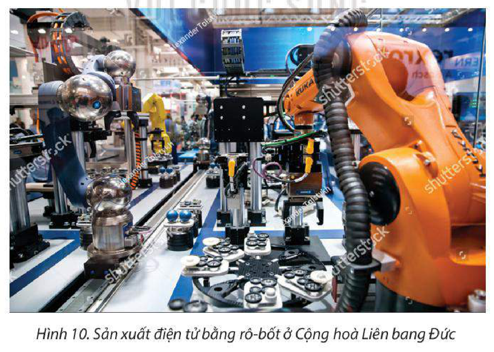

<!-- pdf:46 -->

# BÀI 10: THỰC HÀNH: VIẾT BÁO CÁO VỀ SỰ PHÁT TRIỂN CÔNG NGHIỆP CỦA CỘNG HOÀ LIÊN BANG ĐỨC

## 1. Nội dung

Viết báo cáo tìm hiểu sự phát triển công nghiệp của Cộng hoà Liên bang Đức.

## 2. Nguồn tư liệu

– Thông tin thu thập trên internet về sự phát triển công nghiệp của Cộng hoà Liên bang Đức.

– Sách, báo, tạp chí,... có nội dung liên quan.

## 3. Gợi ý cấu trúc báo cáo

> CÔNG NGHIỆP CỘNG HOÀ LIÊN BANG ĐỨC
>
> **1. Khái quát chung**
>
> Khái quát về ngành công nghiệp của Cộng hoà Liên bang Đức (vai trò, vị thế của ngành trong nền kinh tế Cộng hoà Liên bang Đức và trên thế giới).
>
> **2. Sự phát triển công nghiệp của Cộng hoà Liên bang Đức**
>
> – Các điều kiện phát triển ngành công nghiệp.
>
> – Hiện trạng phát triển: giá trị sản xuất, tốc độ tăng trưởng, cơ cấu, các ngành nổi bật và phân bố sản xuất ngành công nghiệp.
>
> – Hướng phát triển.

## 4. Thông tin tham khảo

**BẢNG 10.1. TÌNH HÌNH SẢN XUẤT CÔNG NGHIỆP CỦA CỘNG HOÀ LIÊN BANG ĐỨC GIAI ĐOẠN 2000 – 2020**

| Chỉ tiêu \ Năm | 2000 | 2005 | 2010 | 2015 | 2020 |
| :--- | :---: | :---: | :---: | :---: | :---: |
| Giá trị sản xuất công nghiệp *(tỉ Ơ-rô)* | 539,8 | 750,2 | 912,8 | 910,2 | 1 120 |
| Tỉ lệ đóng góp trong công nghiệp của EU (%) | 29,2 | 26,0 | 27,3 | 29,5 | 28,5 |

*(Nguồn: Liên minh châu Âu, 2022)*

<!-- pdf:47 -->

**BẢNG 10.2. TRỊ GIÁ VÀ TỈ LỆ TRỊ GIÁ XUẤT KHẨU CỦA MỘT SỐ SẢN PHẨM CÔNG NGHIỆP CỘNG HOÀ LIÊN BANG ĐỨC SO VỚI EU NĂM 2020**

| Chỉ tiêu \ Sản phẩm | Xe có động cơ | Máy móc, thiết bị | Máy tính, linh kiện điện tử | Dược phẩm | Hoá chất |
| :--- | :---: | :---: | :---: | :---: | :---: |
| Trị giá xuất khẩu *(triệu Ơ-rô)* | 108 336 | 97 003 | 52 739 | 50 085 | 46 363 |
| Tỉ lệ trong tổng trị giá xuất khẩu sản phẩm của EU (%) | 52,5 | 38,7 | 32,6 | 23,3 | 27,4 |
<!-- ocr-ok: đối chiếu trực tiếp ảnh trang PDF 47 (trang in 45), bảng 10.2 -->

*(Nguồn: Liên minh châu Âu, 2022)*

<!-- term: Công nghiệp Cộng hoà Liên bang Đức -->
> Công nghiệp và xây dựng chiếm khoảng 30% GDP và sử dụng khoảng 24% lực lượng lao động của Cộng hoà Liên bang Đức.
>
> Cộng hoà Liên bang Đức nổi bật về công nghiệp cơ khí chế tạo (sản xuất ô tô, máy móc,...), điện tử – tin học và hoá chất.
>
> – Công nghiệp cơ khí chế tạo là động lực tăng trưởng quan trọng nhất của ngành công nghiệp Cộng hoà Liên bang Đức. Năm 2021, giá trị sản xuất của ngành này là 260 tỉ Ơ-rô, đóng góp đáng kể vào GDP đất nước. Trong đó, 81% máy móc được xuất khẩu.
>
> – Công nghiệp điện tử – tin học có vai trò quan trọng trong nền kinh tế 4.0, thúc đẩy nghiên cứu và phát triển, đóng góp khoảng 3% GDP và khoảng 10% tổng trị giá xuất khẩu của Cộng hoà Liên bang Đức.

*Hình 10. Sản xuất điện tử bằng rô-bốt ở Cộng hoà Liên bang Đức*

## 📷 Danh sách hình trong bài

| Mã hình | Trang PDF | Vị trí trong bài | Chú thích gốc |
| --- | --- | --- | --- |
| H11-dia-b10-01 | 47 | Mục 4 | Hình 10. Sản xuất điện tử bằng rô-bốt ở Cộng hoà Liên bang Đức |
