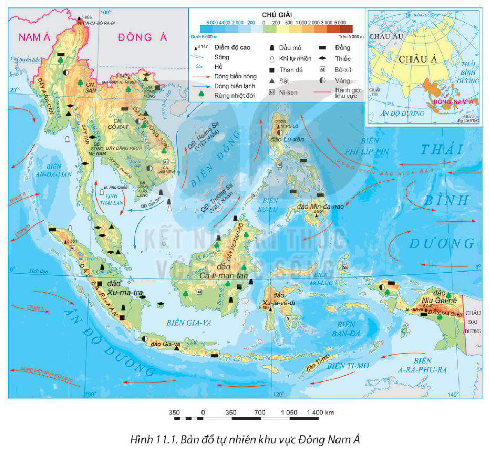
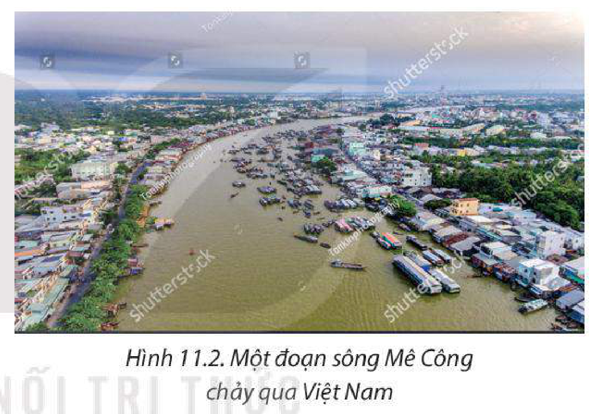
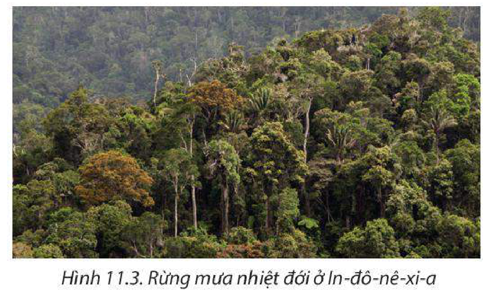
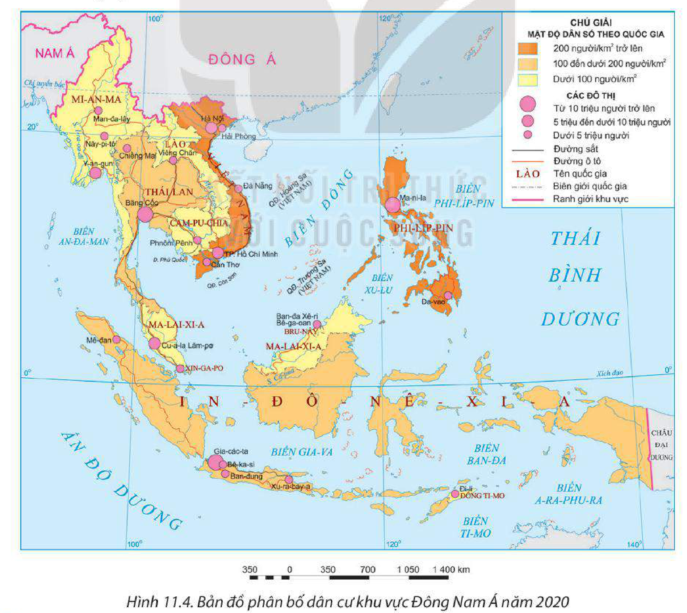
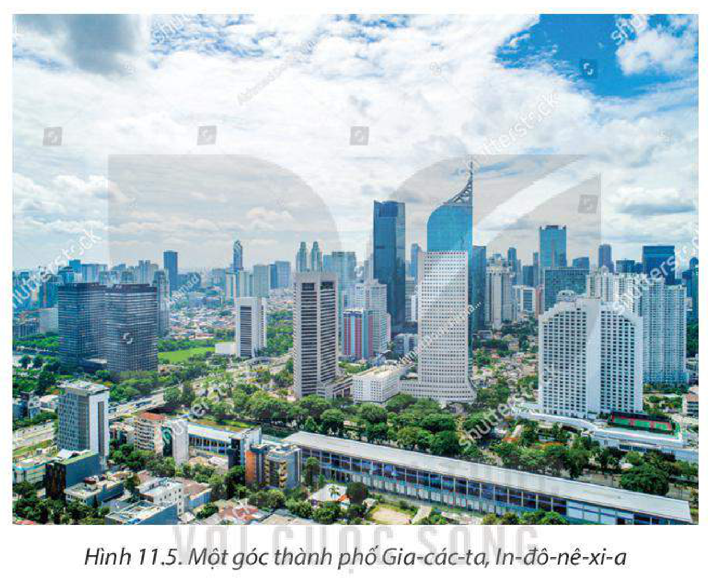

<!-- pdf:48 -->

# BÀI 11: VỊ TRÍ ĐỊA LÍ, ĐIỀU KIỆN TỰ NHIÊN, DÂN CƯ VÀ XÃ HỘI KHU VỰC ĐÔNG NAM Á

> **KHU VỰC ĐÔNG NAM Á**
> - Diện tích: khoảng 4,5 triệu km²
> - Số dân: 668,4 triệu người (năm 2020)

## 🔴 Mở đầu

Đông Nam Á đang là điểm đến hấp dẫn của các nhà đầu tư và có nền kinh tế phát triển năng động trên thế giới. Các đặc điểm về vị trí địa lí và điều kiện tự nhiên, dân cư và xã hội đã có ảnh hưởng như thế nào đến quá trình phát triển kinh tế của khu vực này?

## I. PHẠM VI LÃNH THỔ VÀ VỊ TRÍ ĐỊA LÍ

<!-- term: Phạm vi lãnh thổ và vị trí địa lí khu vực Đông Nam Á -->
Khu vực Đông Nam Á bao gồm 11 quốc gia, có diện tích khoảng 4,5 triệu km², bao gồm hai bộ phận: Đông Nam Á lục địa và Đông Nam Á hải đảo.

Khu vực Đông Nam Á nằm ở phía đông nam của châu Á, trong khoảng vĩ độ từ 28°B đến 10°N và trong khoảng kinh độ từ 92°Đ đến 152°Đ; phía bắc giáp khu vực Đông Á, phía tây giáp khu vực Nam Á và vịnh Ben-gan, phía đông giáp Thái Bình Dương, phía nam giáp Ô-xtrây-li-a và Ấn Độ Dương. Khu vực là cầu nối giữa lục địa Á – Âu với lục địa Ô-xtrây-li-a, nơi giao thoa giữa các luồng sinh vật và các vành đai sinh khoáng tạo nên một khu vực có tài nguyên thiên nhiên phong phú, thuận lợi cho giao lưu, phát triển kinh tế. Tuy nhiên, đây cũng là khu vực thường xuyên chịu ảnh hưởng của các thiên tai như bão, động đất, núi lửa, sóng thần,...

Khu vực Đông Nam Á có nhiều tuyến đường biển quốc tế quan trọng đi qua, đặc biệt có eo biển Ma-lắc-ca là một trong những đầu mối hàng hải lớn, góp phần vận chuyển hàng hoá từ châu Âu, châu Phi, Nam Á, Tây Nam Á đến Đông Á và ngược lại.

Đông Nam Á có vị trí địa – chính trị quan trọng, là nơi giao thoa của các nền văn hoá lớn khiến khu vực có nền văn hoá đa dạng và đặc sắc, đồng thời ảnh hưởng trực tiếp đến vấn đề bảo vệ chủ quyền và an ninh quốc phòng trong khu vực.

> ❓ Dựa vào thông tin mục I và hình 11.1, hãy:
> – Nêu đặc điểm vị trí địa lí và phạm vi lãnh thổ khu vực Đông Nam Á.
> – Phân tích những thuận lợi và khó khăn của vị trí địa lí và phạm vi lãnh thổ đến phát triển kinh tế – xã hội của khu vực.

<!-- pdf:49 -->

## II. ĐIỀU KIỆN TỰ NHIÊN VÀ TÀI NGUYÊN THIÊN NHIÊN

### 1. Địa hình và đất

<!-- term: Địa hình và đất khu vực Đông Nam Á -->
Đông Nam Á lục địa: Địa hình bị chia cắt mạnh bởi các dãy núi chạy theo hướng tây bắc – đông nam hoặc bắc – nam. Ngoài ra, còn có các đồng bằng châu thổ do các hệ thống sông lớn bồi đắp và mở rộng dần về phía biển như đồng bằng sông Hồng (Việt Nam), đồng bằng sông Mê Nam (Thái Lan), đồng bằng sông Xa-lu-en, đồng bằng sông I-ra-oa-đi (Mi-an-ma), đồng bằng sông Mê Công,... Địa hình bị chia cắt, gây khó khăn cho giao lưu kinh tế. Đất chủ yếu là đất feralit ở miền đồi núi và đất phù sa ở các đồng bằng, thuận lợi phát triển nền nông nghiệp với cơ cấu cây trồng đa dạng.

*Hình 11.1. Bản đồ tự nhiên khu vực Đông Nam Á*

Đông Nam Á hải đảo: Địa hình chủ yếu là núi trẻ với nhiều núi lửa; các đồng bằng phần lớn nhỏ hẹp nằm ven biển, một số đồng bằng lớn có ở các đảo Ca-li-man-tan, Xu-ma-tra, Niu Ghi-nê,... Đất ở Đông Nam Á hải đảo khá màu mỡ.

<!-- pdf:50 -->

### 2. Khí hậu

<!-- term: Khí hậu khu vực Đông Nam Á -->
Đại bộ phận khu vực Đông Nam Á nằm trong các đới khí hậu xích đạo và nhiệt đới nên có nhiệt độ cao (trung bình từ 21°C đến 27°C), độ ẩm lớn (trung bình trên 80%), lượng mưa nhiều (trung bình từ 1 000 mm đến 2 000 mm). Đông Nam Á lục địa và phần lớn lãnh thổ Phi-líp-pin có kiểu khí hậu nhiệt đới gió mùa là chủ yếu. Khu vực Đông Nam Á hải đảo có khí hậu nhiệt đới gió mùa, khí hậu xích đạo và cận xích đạo. Ngoài ra, ở các khu vực có địa hình núi cao, khí hậu có sự phân hoá theo đai cao.

Nhìn chung, khí hậu trong khu vực thuận lợi cho phát triển nền nông nghiệp nhiệt đới, du lịch và cư trú. Tuy nhiên, khu vực Đông Nam Á chịu ảnh hưởng của thiên tai như bão, áp thấp nhiệt đới, lũ lụt,... Biến đổi khí hậu và mực nước biển dâng đang trực tiếp ảnh hưởng đến nhiều quốc gia, đặc biệt ở các khu vực ven biển.

### 3. Sông, hồ

<!-- term: Sông, hồ khu vực Đông Nam Á -->
Đông Nam Á lục địa có mạng lưới sông ngòi dày đặc với nhiều sông lớn như: Mê Công, I-ra-oa-đi, Hồng, Mê Nam,... Chế độ nước sông theo mùa. Ở Đông Nam Á hải đảo, sông thường ngắn và có nhiều nước. Các sông có vai trò cung cấp nước cho sinh hoạt, sản xuất và là địa bàn đánh bắt, nuôi trồng thuỷ sản; một số sông thuận lợi cho giao thông vận tải phát triển, tiềm năng lớn về thuỷ điện,...

*Hình 11.2. Một đoạn sông Mê Công chảy qua Việt Nam*

Đông Nam Á có nhiều hồ tự nhiên, trong đó hồ Tôn-lê Sáp (Cam-pu-chia) là hồ nước ngọt lớn nhất khu vực, ngoài ra còn có hồ In-lê (Mi-an-ma), hồ Mê-ra (Ma-lai-xi-a), hồ Tô-ba (In-đô-nê-xi-a),... Các hồ trong khu vực Đông Nam Á có vai trò điều tiết dòng chảy, là nơi trữ nước ngọt cho sinh hoạt và sản xuất, mặt nước cho hoạt động khai thác và nuôi trồng thuỷ sản, nhiều hồ có cảnh quan đẹp thuận lợi để phát triển du lịch,...

### 4. Sinh vật

<!-- term: Sinh vật khu vực Đông Nam Á -->
Đông Nam Á là khu vực có tài nguyên sinh vật và mức độ đa dạng sinh học phong phú bậc nhất thế giới. Diện tích rừng nhiệt đới của Đông Nam Á khoảng 2 triệu km² với hai hệ sinh thái chính là rừng mưa nhiệt đới và rừng nhiệt đới gió mùa. Trong rừng có nhiều

*Hình 11.3. Rừng mưa nhiệt đới ở In-đô-nê-xi-a*

<!-- pdf:51 -->

loại gỗ quý, trữ lượng lớn như lim, nghiến, táu,... Đây là cơ sở quan trọng để cung cấp nguồn nguyên, vật liệu cho các ngành kinh tế, đặc biệt là ngành công nghiệp chế biến và xuất khẩu gỗ. Tuy nhiên, tài nguyên sinh vật trong khu vực đang bị khai thác quá mức, đặc biệt là nạn phá rừng để lấy gỗ và đất cho canh tác nông nghiệp đang trở thành vấn đề cấp bách tại nhiều quốc gia.

### 5. Khoáng sản

<!-- term: Khoáng sản khu vực Đông Nam Á -->
Do nằm trong vành đai sinh khoáng nên tài nguyên khoáng sản của khu vực đa dạng, nhiều loại có trữ lượng lớn như thiếc, than đá, sắt, bô-xít, dầu mỏ, khí tự nhiên,... Khoáng sản là tài nguyên quan trọng cung cấp nguyên, nhiên liệu cho nhiều ngành công nghiệp: nhiệt điện, luyện kim, hoá dầu,... và tạo ra nguồn hàng xuất khẩu có giá trị cho nhiều nước.

> 💡 EM CÓ BIẾT?
>
> Ma-lai-xi-a chiếm tới 50% trữ lượng thiếc toàn thế giới. In-đô-nê-xi-a chiếm khoảng 7,5% trữ lượng đồng, 13% trữ lượng sắt, 5% trữ lượng ni-ken toàn cầu và nằm trong số 6 quốc gia có trữ lượng than đá lớn nhất thế giới. Việt Nam giàu sắt, than đá, dầu mỏ, bô-xít. Phi-líp-pin giàu quặng crôm và ni-ken nhất khu vực.

### 6. Biển

<!-- term: Biển khu vực Đông Nam Á -->
Đông Nam Á có vùng biển rộng lớn thuộc Ấn Độ Dương và Thái Bình Dương; vùng biển giàu hải sản, khoáng sản, có nhiều bãi biển đẹp, nhiều vịnh biển có thể xây dựng các cảng nước sâu,... tạo thuận lợi cho hầu hết quốc gia trong khu vực phát triển các ngành kinh tế biển.

> ❓ Dựa vào thông tin mục II và hình 11.1, hãy:
> – Trình bày đặc điểm tự nhiên và tài nguyên thiên nhiên của khu vực Đông Nam Á.
> – Phân tích ảnh hưởng của một trong các điều kiện tự nhiên và tài nguyên thiên nhiên đến phát triển kinh tế – xã hội của khu vực.

## III. DÂN CƯ VÀ XÃ HỘI

### 1. Dân cư

<!-- term: Dân cư khu vực Đông Nam Á -->
Đông Nam Á có số dân đông, chiếm khoảng 8% số dân thế giới (năm 2020). Tỉ lệ tăng tự nhiên của dân số trong khu vực có xu hướng giảm nhưng vẫn còn ở mức cao. Dân số đông tạo nên thị trường tiêu thụ lớn, thu hút các nhà đầu tư, thúc đẩy kinh tế phát triển. Tuy nhiên, quy mô dân số lớn đang là sức ép đối với nhiều nước trong việc nâng cao chất lượng cuộc sống, bảo vệ môi trường và giải quyết việc làm.

Khu vực Đông Nam Á có cơ cấu giới tính tương đối cân bằng. Năm 2020, tỉ lệ nam chiếm 49,98% và tỉ lệ nữ chiếm 50,02% tổng số dân. Khu vực Đông Nam Á có cơ cấu dân số trẻ, tạo nên nguồn lao động dồi dào, dự trữ lao động lớn. Một số quốc gia đang trong quá trình già hoá dân số, đặt ra các vấn đề về an sinh xã hội và chăm sóc y tế,... Do đó, các quốc gia trong khu vực cần có những chính sách dân số và phát triển kinh tế phù hợp.

<!-- pdf:52 -->

**BẢNG 11.1. QUY MÔ, CƠ CẤU VÀ TỈ LỆ TĂNG TỰ NHIÊN CỦA DÂN SỐ KHU VỰC ĐÔNG NAM Á GIAI ĐOẠN 2000 – 2020**

| Chỉ tiêu \ Năm | 2000 | 2010 | 2020 |
| :--- | :---: | :---: | :---: |
| Quy mô dân số *(triệu người)* | 525,0 | 596,8 | 668,4 |
| Cơ cấu dân số (%): | | | |
| – Dưới 15 tuổi | 31,8 | 28,0 | 25,2 |
| – Từ 15 đến 64 tuổi | 63,3 | 66,0 | 67,7 |
| – Từ 65 tuổi trở lên | 4,9 | 6,0 | 7,1 |
| Tỉ lệ tăng tự nhiên của dân số (%) | 1,6 | 1,3 | 1,1 |

*(Nguồn: Liên hợp quốc, 2022)*

Đông Nam Á có nhiều nhóm dân tộc khác nhau. Đông Nam Á lục địa là nơi cư trú của người Việt, Thái, Miến Điện,... Người Mã Lai là nhóm dân tộc lớn nhất ở khu vực Đông Nam Á hải đảo. Người Hoa sinh sống rải rác trên toàn khu vực, tập trung nhiều hơn ở khu vực Đông Nam Á hải đảo. Sự đa dạng về dân tộc tạo nên sự phong phú trong văn hoá, tập quán sản xuất.

*Hình 11.4. Bản đồ phân bố dân cư khu vực Đông Nam Á năm 2020*

<!-- pdf:53 -->

Đông Nam Á có dân cư sinh sống đông đúc, mật độ dân số trung bình là 148 người/km² (năm 2020). Đồng bằng và các vùng ven biển có dân cư tập trung đông, vùng núi có dân cư thưa thớt. Xin-ga-po là nước có mật độ dân số cao nhất (8 019 người/km²), Lào là nước có mật độ dân số thấp nhất (32 người/km²) khu vực năm 2020.

Tỉ lệ dân thành thị của khu vực chưa cao (năm 2020 là 49%), có sự phân hoá giữa các quốc gia và có xu hướng tăng nhanh ở nhiều quốc gia (Phi-líp-pin, In-đô-nê-xi-a). Các siêu đô thị của khu vực bao gồm: Ma-ni-la (Phi-líp-pin), Băng Cốc (Thái Lan), Gia-các-ta (In-đô-nê-xi-a). Đô thị là nơi thu hút dân cư và lao động, thúc đẩy tăng trưởng và chuyển dịch cơ cấu kinh tế. Tuy nhiên, một số đô thị không cung cấp đủ việc làm, nơi ở, các dịch vụ cơ bản, hệ thống giao thông và cơ sở hạ tầng bị quá tải.

*Hình 11.5. Một góc thành phố Gia-các-ta, In-đô-nê-xi-a*

> ❓ Dựa vào thông tin mục 1 và hình 11.4, hãy:
> – Nêu đặc điểm dân cư nổi bật của khu vực Đông Nam Á.
> – Phân tích tác động của đặc điểm dân cư tới phát triển kinh tế – xã hội khu vực.

### 2. Xã hội

<!-- term: Xã hội khu vực Đông Nam Á -->
Phong tục, tập quán, sinh hoạt văn hoá của người dân các nước Đông Nam Á có nhiều nét tương đồng, đó là cơ sở thuận lợi để các quốc gia hợp tác cùng phát triển.

Đông Nam Á có sự xuất hiện của hầu hết các tôn giáo lớn trên thế giới như: Thiên chúa giáo, Phật giáo, Hồi giáo, Ấn Độ giáo,...

Mức sống của người dân các nước trong khu vực và giữa các bộ phận dân cư trong một nước vẫn còn chênh lệch nhiều. Xin-ga-po, Bru-nây là những nước có mức sống cao nhất trong khu vực.

<!-- pdf:54 -->

**BẢNG 11.2. TUỔI THỌ TRUNG BÌNH VÀ SỐ NĂM ĐI HỌC TRUNG BÌNH CỦA NGƯỜI TỪ 25 TUỔI TRỞ LÊN CỦA MỘT SỐ NƯỚC KHU VỰC ĐÔNG NAM Á VÀ THẾ GIỚI NĂM 2000 VÀ NĂM 2020**

| Quốc gia | Tuổi thọ trung bình *(năm)* - Năm 2000 | Tuổi thọ trung bình *(năm)* - Năm 2020 | Số năm đi học trung bình của người từ 25 tuổi trở lên *(năm)* - Năm 2000 | Số năm đi học trung bình của người từ 25 tuổi trở lên *(năm)* - Năm 2020 |
| :--- | :---: | :---: | :---: | :---: |
| Bru-nây | 74,1 | 74,8 | 8,3 | 9,2 |
| Lào | 58,4 | 68,5 | 3,9 | 5,4 |
| Mi-an-ma | 60,2 | 66,8 | 3,5 | 6,4 |
| Xin-ga-po | 79,1 | 82,9 | 9,2 | 11,9 |
| Việt Nam | 72,5 | 75,4 | 5,6 | 8,4 |
| Thế giới | 68 | 73 | 4,5 | 8,6 |

*(Nguồn: Liên hợp quốc, 2022)*

Khu vực Đông Nam Á có tình hình chính trị, xã hội tương đối ổn định là điều kiện thuận lợi để giao lưu hợp tác và phát triển kinh tế – xã hội.

> ❓ Dựa vào thông tin mục 2, hãy:
> – Nêu một số đặc điểm xã hội của khu vực Đông Nam Á.
> – Cho biết ảnh hưởng của đặc điểm xã hội tới phát triển kinh tế – xã hội khu vực.

## ✏️ Luyện tập

1. Thiên nhiên nhiệt đới có ảnh hưởng như thế nào đến sản xuất nông nghiệp khu vực Đông Nam Á?
2. Dựa vào bảng 11.2, hãy so sánh và rút ra nhận xét về số năm đi học trung bình của người từ 25 tuổi trở lên của một số nước Đông Nam Á.

## 🚀 Vận dụng

Sưu tầm thông tin về điều kiện tự nhiên, dân cư và xã hội của một nước ở khu vực Đông Nam Á.

## 📷 Danh sách hình trong bài

| Mã hình | Trang PDF | Vị trí trong bài | Chú thích gốc |
| --- | --- | --- | --- |
| H11-dia-b11-01 | 49 | Mục II.1 | Hình 11.1. Bản đồ tự nhiên khu vực Đông Nam Á |
| H11-dia-b11-02 | 50 | Mục II.3 | Hình 11.2. Một đoạn sông Mê Công chảy qua Việt Nam |
| H11-dia-b11-03 | 50 | Mục II.4 | Hình 11.3. Rừng mưa nhiệt đới ở In-đô-nê-xi-a |
| H11-dia-b11-04 | 52 | Mục III.1 | Hình 11.4. Bản đồ phân bố dân cư khu vực Đông Nam Á năm 2020 |
| H11-dia-b11-05 | 53 | Mục III.1 | Hình 11.5. Một góc thành phố Gia-các-ta, In-đô-nê-xi-a |
