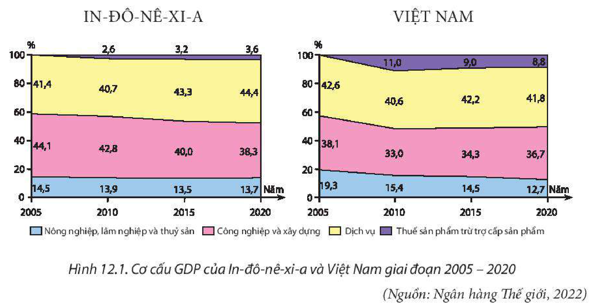
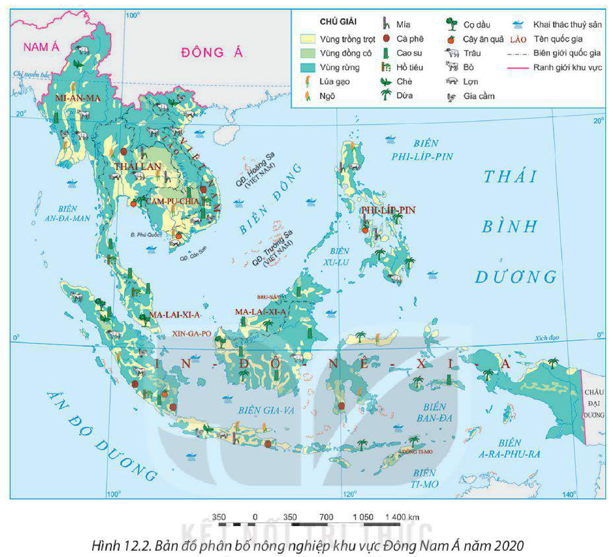
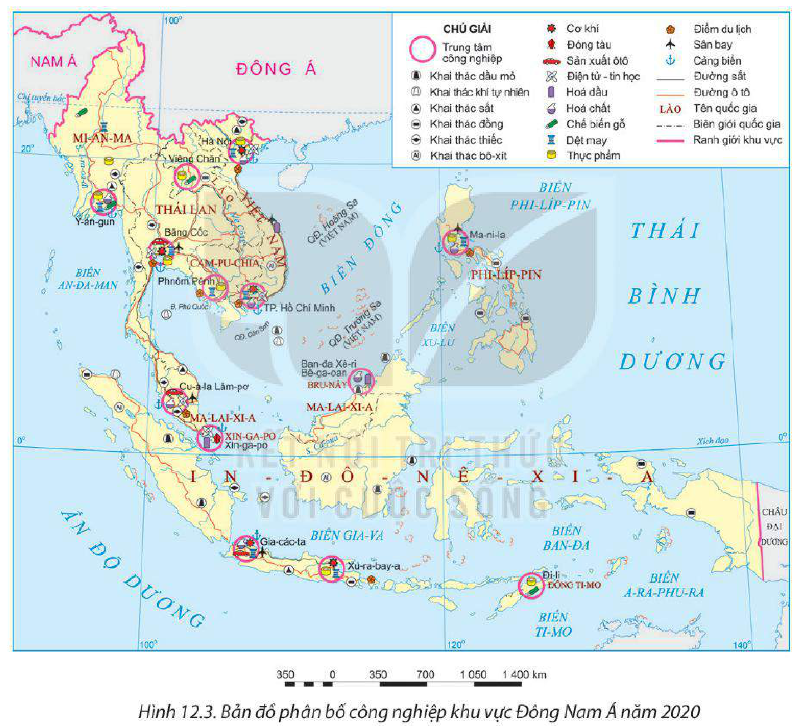
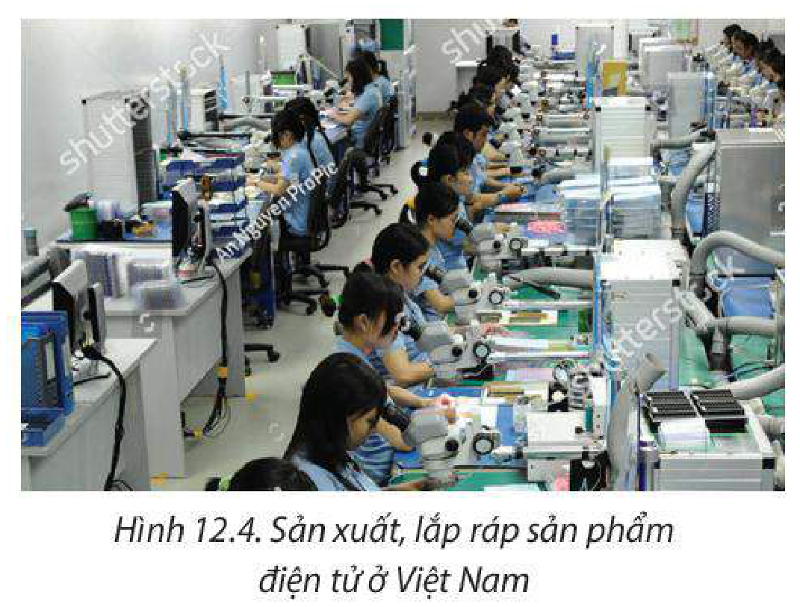

<!-- pdf:55 -->

# BÀI 12: KINH TẾ KHU VỰC ĐÔNG NAM Á

## 🔴 Mở đầu

Những năm gần đây, kinh tế – xã hội khu vực Đông Nam Á có nhiều chuyển biến tích cực, vai trò và vị thế của khu vực ngày càng được nâng cao. Kinh tế khu vực Đông Nam Á phát triển ra sao? Các ngành kinh tế có đặc điểm gì nổi bật?

## I. TÌNH HÌNH PHÁT TRIỂN KINH TẾ

<!-- term: Tình hình phát triển kinh tế khu vực Đông Nam Á -->
Khu vực Đông Nam Á có quy mô GDP tăng liên tục trong giai đoạn 2000 – 2020. Tuy nhiên, so với thế giới, quy mô GDP các nước Đông Nam Á còn nhỏ, năm 2020 chiếm khoảng 3,6% GDP toàn cầu.

Đông Nam Á là khu vực có nền kinh tế phát triển năng động bậc nhất thế giới, với tốc độ tăng trưởng kinh tế tăng cao hơn mức trung bình của thế giới.

**BẢNG 12.1. QUY MÔ GDP THEO GIÁ HIỆN HÀNH VÀ TỐC ĐỘ TĂNG GDP CỦA KHU VỰC ĐÔNG NAM Á VÀ THẾ GIỚI GIAI ĐOẠN 2000 – 2020**

| Năm | 2000 | 2010 | 2019 | 2020 |
| :--- | :---: | :---: | :---: | :---: |
| GDP *(tỉ USD)* | | | | |
| – Đông Nam Á | 614,9 | 2 017,3 | 3 314,1 | 3 083,3 |
| – Thế giới | 33 830,9 | 66 596,1 | 87 652,9 | 84 906,8 |
| Tốc độ tăng GDP (%) | | | | |
| – Đông Nam Á | 7,0 | 7,8 | 4,5 | -1,1 |
| – Thế giới | 4,5 | 4,5 | 2,6 | -3,3 |

*(Nguồn: Ngân hàng Thế giới, 2022)*

Cơ cấu kinh tế của hầu hết các nước trong khu vực đang chuyển dịch theo hướng công nghiệp hoá, hiện đại hoá. Một số quốc gia đang chú trọng phát triển nền kinh tế tri thức, đẩy mạnh hoạt động nghiên cứu và phát triển.

<!-- pdf:56 -->

*Hình 12.1. Cơ cấu GDP của In-đô-nê-xi-a và Việt Nam giai đoạn 2005 – 2020 (Nguồn: Ngân hàng Thế giới, 2022)*

Thành tựu trong phát triển kinh tế khu vực là do các nước tận dụng được các lợi thế về vị trí địa lí, điều kiện tự nhiên và tài nguyên thiên nhiên, lực lượng lao động cũng như thu hút được các nguồn đầu tư bên ngoài. Tuy nhiên, giữa các quốc gia còn có sự chênh lệch lớn về trình độ phát triển kinh tế cũng như đang phải đối mặt với nhiều thách thức trong bối cảnh toàn cầu hoá.

> ❓ Dựa vào nội dung mục I, hãy trình bày và giải thích tình hình phát triển kinh tế của khu vực Đông Nam Á.

## II. CÁC NGÀNH KINH TẾ

Hiện nay, phần lớn các quốc gia trong khu vực Đông Nam Á đang có sự chuyển dịch cơ cấu kinh tế theo ngành cũng như nội bộ từng ngành nhằm khai thác tốt hơn các tiềm năng và đem lại hiệu quả kinh tế cao.

### 1. Nông nghiệp, lâm nghiệp và thuỷ sản

Đông Nam Á có nền nông nghiệp nhiệt đới với cơ cấu sản phẩm đa dạng. Tuy tỉ trọng ngày càng giảm đi trong cơ cấu GDP nhưng ngành nông nghiệp, lâm nghiệp và thuỷ sản vẫn đóng vai trò quan trọng trong nền kinh tế của hầu hết các quốc gia Đông Nam Á. Ngành này vừa đảm bảo nhu cầu lương thực, thực phẩm cho số dân đông, vừa tạo ra các mặt hàng xuất khẩu đem lại nguồn ngoại tệ lớn cho nhiều nước. Một số quốc gia đang đẩy mạnh phát triển nền nông nghiệp sản xuất hàng hoá quy mô lớn.

**a) Nông nghiệp**

<!-- term: Nông nghiệp khu vực Đông Nam Á -->
– Trồng trọt là ngành chính trong sản xuất nông nghiệp của phần lớn các nước Đông Nam Á. Các cây trồng chính là lúa gạo, cây công nghiệp và cây ăn quả.

<!-- pdf:57 -->

*Hình 12.2. Bản đồ phân bố nông nghiệp khu vực Đông Nam Á năm 2020*

Lúa gạo là cây lương thực truyền thống và quan trọng nhất của khu vực. Sản lượng lúa ngày càng tăng, nhờ vậy các quốc gia Đông Nam Á đã cơ bản giải quyết được nhu cầu về lương thực và có xuất khẩu. In-đô-nê-xi-a là nước có sản lượng lúa gạo lớn nhất khu vực (54,6 triệu tấn, đứng thứ ba thế giới năm 2020). Thái Lan và Việt Nam là hai quốc gia xuất khẩu gạo hàng đầu thế giới.

Đông Nam Á trồng nhiều cây công nghiệp, có giá trị xuất khẩu cao; đứng hàng đầu thế giới là cao su, cọ dầu, cà phê, hồ tiêu. Cao su được trồng ở Ma-lai-xi-a, In-đô-nê-xi-a, Thái Lan và Việt Nam. Cọ dầu được trồng nhiều ở In-đô-nê-xi-a và Ma-lai-xi-a. Cà phê và hồ tiêu được trồng nhiều ở Việt Nam, In-đô-nê-xi-a, Ma-lai-xi-a, Thái Lan.

Cây ăn quả rất đa dạng (xoài, chôm chôm, sầu riêng, dứa, chuối,...), được trồng ở hầu hết các nước trong khu vực; là mặt hàng xuất khẩu, mang lại nguồn thu ngoại tệ đáng kể cho các nước.

– Ngành chăn nuôi hiện đang được chú trọng phát triển do chất lượng cuộc sống được nâng lên và đem lại hiệu quả kinh tế cao. Trâu, bò được nuôi nhiều ở Mi-an-ma, In-đô-nê-xi-a, Thái Lan và Việt Nam. Lợn được nuôi nhiều ở Việt Nam, Phi-líp-pin, Thái Lan, In-đô-nê-xi-a. Chăn nuôi gia cầm phổ biến ở hầu hết các nước.

<!-- pdf:58 -->

**BẢNG 12.2 MỘT SỐ NÔNG SẢN CỦA KHU VỰC ĐÔNG NAM Á VÀ THẾ GIỚI GIAI ĐOẠN 2000 – 2020**

| Nông sản \ Năm | 2000 | 2010 | 2020 |
| :--- | :---: | :---: | :---: |
| – Lúa gạo *(triệu tấn)* | | | |
| + Đông Nam Á | 152,1 | 196,7 | 190,1 |
| + Thế giới | 598,7 | 694,5 | 769,2 |
| – Cao su *(triệu tấn)* | | | |
| + Đông Nam Á | 5,3 | 8,0 | 10,7 |
| + Thế giới | 7,1 | 10,8 | 14,0 |
| – Đàn lợn *(triệu con)* | | | |
| + Đông Nam Á | 52,4 | 72,4 | 65,6 |
| + Thế giới | 898,7 | 971,1 | 937,5 |

*(Nguồn: Tổ chức Lương thực và Nông nghiệp Liên hợp quốc, 2022)*

**b) Lâm nghiệp**

<!-- term: Lâm nghiệp khu vực Đông Nam Á -->
Lâm nghiệp là ngành kinh tế quan trọng của một số quốc gia như In-đô-nê-xi-a, Lào, Thái Lan, Mi-an-ma và Việt Nam. Sản lượng gỗ tròn khai thác của khu vực có xu hướng tăng, năm 2000 là 299,1 triệu m³ và đạt 302,0 triệu m³ năm 2020 (chiếm khoảng 7,7% tổng sản lượng gỗ tròn khai thác toàn thế giới).

Hiện nay, khu vực Đông Nam Á đang hướng tới giảm khai thác gỗ rừng tự nhiên, tăng diện tích và sản lượng khai thác gỗ rừng trồng, xây dựng và bảo vệ các vườn quốc gia để hướng đến phát triển ngành lâm nghiệp bền vững, bảo tồn đa dạng sinh học.

**c) Thuỷ sản**

<!-- term: Thuỷ sản khu vực Đông Nam Á -->
Khu vực có diện tích mặt nước lớn nên thuỷ sản là ngành kinh tế truyền thống và được phát triển mạnh. Năm 2020, Đông Nam Á đóng góp khoảng 25% tổng sản lượng thuỷ sản toàn cầu. Các quốc gia sản xuất thuỷ sản lớn trong khu vực là In-đô-nê-xi-a, Việt Nam và Phi-líp-pin. Các sản phẩm thuỷ sản xuất khẩu chủ lực của khu vực là tôm, cá ngừ đại dương, cá da trơn,...

Hoạt động khai thác thuỷ sản của các quốc gia trong khu vực đang phát triển theo hướng công nghiệp hoá, hiện đại hoá và bền vững thông qua áp dụng các tiêu chuẩn kĩ thuật đánh bắt toàn cầu. Suy giảm nguồn tài nguyên thuỷ sản là thách thức lớn, ảnh hưởng trực tiếp đến đời sống của hàng chục triệu người dân trong khu vực.

Một số quốc gia như Thái Lan, Việt Nam, Phi-líp-pin đang chú trọng phát triển nuôi trồng thuỷ sản để đáp ứng được nhu cầu ngày càng tăng và bảo vệ được nguồn lợi thuỷ sản tự nhiên.

> ❓ Khai thác thông tin mục 1 và hình 12.2, hãy trình bày sự phát triển và phân bố ngành nông nghiệp, lâm nghiệp, thuỷ sản của khu vực Đông Nam Á.

<!-- pdf:59 -->

### 2. Công nghiệp

<!-- term: Công nghiệp khu vực Đông Nam Á -->
Công nghiệp đóng vai trò quan trọng trong nền kinh tế của các quốc gia Đông Nam Á: thúc đẩy chuyển dịch cơ cấu kinh tế theo hướng công nghiệp hoá, hiện đại hoá; tạo nhiều việc làm; tăng nguồn thu ngoại tệ từ xuất khẩu,... Các ngành công nghiệp quan trọng của khu vực là cơ khí chế tạo, điện tử – tin học, chế biến thực phẩm, sản xuất hàng tiêu dùng và khai thác khoáng sản. Một số trung tâm công nghiệp lớn của khu vực là Băng Cốc (Thái Lan), Gia-các-ta (In-đô-nê-xi-a), Thành phố Hồ Chí Minh (Việt Nam),...

*Hình 12.3. Bản đồ phân bố công nghiệp khu vực Đông Nam Á năm 2020*

– Công nghiệp cơ khí chế tạo được coi là động lực chính thúc đẩy tăng trưởng kinh tế và tăng khả năng cạnh tranh của khu vực. Công nghiệp cơ khí chế tạo là thế mạnh của Thái Lan, In-đô-nê-xi-a, Xin-ga-po và Việt Nam.

<!-- pdf:60 -->

– Công nghiệp điện tử – tin học đang trở thành ngành mũi nhọn của nhiều nước trong khu vực, như: Xin-ga-po, Thái Lan, Ma-lai-xi-a, Việt Nam,... Ngành này phát triển dựa trên tiềm năng về nguồn lao động trẻ, có trình độ kĩ thuật và thu hút đầu tư nước ngoài. Hiện nay, các nước trong khu vực đang tham gia vào chuỗi giá trị toàn cầu trong lĩnh vực điện tử – tin học.

*Hình 12.4. Sản xuất, lắp ráp sản phẩm điện tử ở Việt Nam*

– Công nghiệp chế biến thực phẩm và công nghiệp sản xuất hàng tiêu dùng được phát triển dựa trên thế mạnh về các sản phẩm nông nghiệp nhiệt đới, thị trường tiêu thụ lớn và nguồn lao động dồi dào. Đây là các ngành công nghiệp đóng vai trò quan trọng trong nền kinh tế; phân bố ở tất cả các quốc gia trong khu vực, nhất là các nước đông dân như In-đô-nê-xi-a, Thái Lan, Việt Nam và Phi-líp-pin.

– Công nghiệp khai thác khoáng sản là ngành công nghiệp quan trọng của nhiều nước trong khu vực. Khai thác thiếc trong khu vực chiếm hơn một nửa sản lượng thế giới, phát triển ở Ma-lai-xi-a, In-đô-nê-xi-a, Mi-an-ma, Thái Lan. Khai thác dầu mỏ và khí tự nhiên phát triển mạnh ở Bru-nây, Ma-lai xi-a, In-đô-nê-xi-a, Việt Nam.

> ❓ Khai thác thông tin mục 2 và hình 12.3, hãy trình bày và giải thích sự phát triển ngành công nghiệp của khu vực Đông Nam Á.

### 3. Dịch vụ

Dịch vụ ngày càng có vai trò quan trọng, được các quốc gia trong khu vực chú ý phát triển, thể hiện ở sự tăng tỉ trọng lao động và giá trị của ngành trong cơ cấu GDP.

**a) Thương mại**

<!-- term: Thương mại khu vực Đông Nam Á -->
Thương mại có vai trò điều tiết, thúc đẩy các ngành sản xuất phát triển.

– Nội thương phát triển nhanh, thể hiện ở trị giá và khối lượng hàng hoá, dịch vụ trao đổi trên thị trường ngày càng lớn, hình thành các hình thức mới như siêu thị, trung tâm thương mại và sự phát triển nhanh của thương mại điện tử. Các nước có ngành nội thương phát triển là Xin-ga-po, In-đô-nê-xi-a, Ma-lai-xi-a và Thái Lan.

> 💡 EM CÓ BIẾT?
>
> Từ năm 2010 đến năm 2020, thương mại nội khối ASEAN đã tăng từ 500 tỉ USD lên 630 tỉ USD.
<!-- ocr-ok: đối chiếu trực tiếp ảnh trang PDF 60 (trang in 58), hộp EM CÓ BIẾT xếp song song cột chữ nên OCR ghép lẫn dòng -->

– Ngoại thương đóng vai trò then chốt đối với tất cả các quốc gia trong khu vực. Các đối tác thương mại lớn nhất của khu vực là Trung Quốc, Hoa Kỳ và Hàn Quốc. Hầu hết các quốc gia trong khu vực đều có trị giá xuất khẩu lớn hơn trị giá nhập khẩu (xuất siêu). Các mặt hàng xuất khẩu chính của khu vực là hàng nông sản, thuỷ sản, khoáng sản,

<!-- pdf:61 -->

dệt may,... Mặt hàng nhập khẩu chủ yếu là máy móc, hàng tiêu dùng,... Các nước có hoạt động ngoại thương phát triển nhất là Xin-ga-po, Việt Nam, Ma-lai-xi-a, In-đô-nê-xi-a và Thái Lan. Thương mại giữa các quốc gia trong khu vực chiếm khoảng 25% tổng trị giá xuất nhập khẩu của toàn khu vực.

**BẢNG 12.3. TRỊ GIÁ XUẤT NHẬP KHẨU HÀNG HOÁ VÀ DỊCH VỤ CỦA KHU VỰC ĐÔNG NAM Á GIAI ĐOẠN 2010 – 2020**

*(Đơn vị: tỉ USD)*

| Trị giá \ Năm | 2010 | 2015 | 2020 |
| :--- | :---: | :---: | :---: |
| Xuất khẩu | 1 244,9 | 1 506,0 | 1 676,3 |
| Nhập khẩu | 1 114,4 | 1 381,5 | 1 526,6 |
<!-- ocr-ok: đối chiếu trực tiếp ảnh trang PDF 61 (trang in 59), bảng 12.3 -->

*(Nguồn: Ngân hàng Thế giới, 2022)*

**b) Giao thông vận tải**

<!-- term: Giao thông vận tải khu vực Đông Nam Á -->
Giao thông vận tải được chú ý phát triển và hiện đại hoá nhằm phục vụ sản xuất, đời sống của nhân dân mỗi nước và tạo sự hấp dẫn đối với các nhà đầu tư nước ngoài.

– Giao thông đường bộ được đầu tư, hiện đại hoá mạnh mẽ, đáp ứng nhu cầu sản xuất tăng nhanh. Hành lang Đông – Tây, đường cao tốc Xuyên Á kết nối Việt Nam, Lào, Thái Lan, Mi-an-ma,... là những tuyến đường liên kết quan trọng trong khu vực.

– Đường sắt khá phổ biến ở các quốc gia Đông Nam Á lục địa. Tổng chiều dài đường sắt của khu vực là 20 000 km (năm 2020). Nhiều quốc gia đang nỗ lực nâng cấp mạng lưới đường sắt sang đường sắt cao tốc như Xin-ga-po, Ma-lai-xi-a.

– Giao thông đường biển đóng vai trò quan trọng. Khối lượng vận chuyển đạt 2,8 tỉ tấn (năm 2019), số cảng biển là hơn 500 (năm 2020). Một số cảng biển lớn của khu vực là Hải Phòng, Sài Gòn (Việt Nam), Y-an-gun (Mi-an-ma), Băng Cốc (Thái Lan), Xin-ga-po (Xin-ga-po),... Xin-ga-po là một trong những cảng biển nhộn nhịp nhất thế giới.

– Giao thông hàng không đang phát triển. Các quốc gia đều tích cực nâng cấp vận tải hàng không nội địa và quốc tế. Các sân bay lớn nhất khu vực là Chan-gi (Xin-ga-po), Xu-va-na-bu-mi (Thái Lan), Cu-a-la Lăm-pơ (Ma-lai-xi-a), Tân Sơn Nhất, Nội Bài (Việt Nam),...

**c) Tài chính ngân hàng**

<!-- term: Tài chính ngân hàng khu vực Đông Nam Á -->
Tài chính ngân hàng của hầu hết các quốc gia trong khu vực đang trong quá trình phát triển và hội nhập với thế giới. Ngành này dần trở thành động lực thúc đẩy kinh tế các nước trong khu vực. Những thuận lợi về nguồn lao động và thị trường quy mô lớn đang thúc đẩy sự phát triển nhanh và đa dạng của ngành. Các trung tâm tài chính lớn trong khu vực là Xin-ga-po, Cu-a-la Lăm-pơ, Băng Cốc, Gia-các-ta, Thành phố Hồ Chí Minh,...

<!-- pdf:62 -->

**d) Du lịch**

<!-- term: Du lịch khu vực Đông Nam Á -->
Du lịch có vai trò ngày càng quan trọng ở Đông Nam Á. Số lượng khách du lịch và doanh thu du lịch ngày càng tăng. Năm 2019, ngành du lịch đóng góp hơn 393 tỉ USD vào GDP của khu vực. Đông Nam Á là một trong những điểm đến phổ biến của khách du lịch quốc tế và thu hút khoảng 10% tổng lượng khách du lịch toàn cầu. Các quốc gia có ngành du lịch phát triển mạnh là Thái Lan, Việt Nam, In-đô-nê-xi-a, Xin-ga-po,... Một số điểm du lịch nổi tiếng trong khu vực là đền Ăng-co Vát (Cam-pu-chia), vịnh Hạ Long (Việt Nam), Ba-li (In-đô-nê-xi-a), Ba-gan (Mi-an-ma), Cu-a-la Lăm-pơ (Ma-lai-xi-a), Băng Cốc (Thái Lan),...

*Hình 12.5. Bãi biển Ba-li, In-đô-nê-xi-a*

> ❓ Dựa vào nội dung mục 3, hãy trình bày và giải thích sự phát triển và phân bố ngành dịch vụ của khu vực Đông Nam Á.

## ✏️ Luyện tập

Dựa vào bảng 12.2, hãy vẽ biểu đồ thể hiện sản lượng cao su của khu vực Đông Nam Á và thế giới trong giai đoạn 2000 – 2020. Nêu nhận xét.

## 🚀 Vận dụng

Tìm hiểu thông tin về một sản phẩm nông nghiệp xuất khẩu của khu vực Đông Nam Á.

## 📷 Danh sách hình trong bài

| Mã hình | Trang PDF | Vị trí trong bài | Chú thích gốc |
| --- | --- | --- | --- |
| H11-dia-b12-01 | 56 | Mục I | Hình 12.1. Cơ cấu GDP của In-đô-nê-xi-a và Việt Nam giai đoạn 2005 – 2020 (Nguồn: Ngân hàng Thế giới, 2022) |
| H11-dia-b12-02 | 57 | Mục II.1 | Hình 12.2. Bản đồ phân bố nông nghiệp khu vực Đông Nam Á năm 2020 |
| H11-dia-b12-03 | 59 | Mục II.2 | Hình 12.3. Bản đồ phân bố công nghiệp khu vực Đông Nam Á năm 2020 |
| H11-dia-b12-04 | 60 | Mục II.2 | Hình 12.4. Sản xuất, lắp ráp sản phẩm điện tử ở Việt Nam |
| H11-dia-b12-05 | 62 | Mục II.3 | Hình 12.5. Bãi biển Ba-li, In-đô-nê-xi-a |
