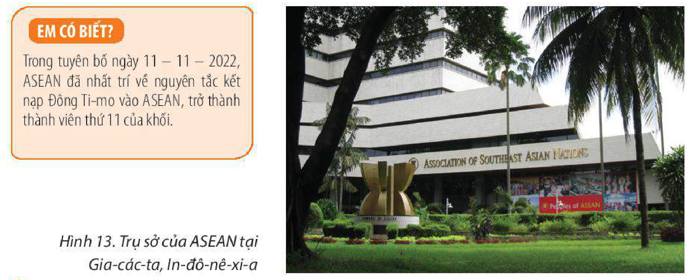

<!-- pdf:63 -->

# BÀI 13: HIỆP HỘI CÁC QUỐC GIA ĐÔNG NAM Á (ASEAN)

## 🔴 Mở đầu

Hiệp hội các quốc gia Đông Nam Á (ASEAN) được thành lập cách đây hơn nửa thế kỉ nhằm thúc đẩy hợp tác liên chính phủ trong tất cả các lĩnh vực. ASEAN có gì giống và khác biệt so với các tổ chức liên kết khu vực khác trên thế giới? Những thành tựu và thách thức mà ASEAN đã đạt được và đang đối mặt là gì?

## I. MỤC TIÊU VÀ CƠ CHẾ HOẠT ĐỘNG CỦA ASEAN

<!-- term: Hiệp hội các quốc gia Đông Nam Á -->
ASEAN được thành lập ngày 8 – 8 – 1967 tại Băng Cốc (Thái Lan) với sự tham gia của 5 quốc gia thành viên ban đầu là In-đô-nê-xi-a, Ma-lai-xi-a, Phi-líp-pin, Xin-ga-po và Thái Lan. Hiện nay, 10/11 quốc gia trong khu vực là thành viên của ASEAN. Năm 2015, Cộng đồng ASEAN ra đời dựa trên ba trụ cột là Cộng đồng Chính trị – An ninh, Cộng đồng Kinh tế và Cộng đồng Văn hoá – Xã hội đánh dấu bước phát triển mới trong sự phát triển của Hiệp hội.

### 1. Mục tiêu

<!-- term: Mục tiêu của ASEAN -->
Năm 2008, Hiến chương ASEAN chính thức có hiệu lực đã khẳng định lại các mục tiêu cơ bản trong Tuyên bố ASEAN vào năm 1967 (Tuyên bố Băng Cốc), đồng thời bổ sung thêm 15 mục tiêu. Các mục tiêu chính của ASEAN được quy định trong Hiến chương bao gồm:

– Thúc đẩy tăng trưởng kinh tế, tiến bộ xã hội và phát triển văn hoá của các nước thành viên, thu hẹp khoảng cách phát triển.

– Thúc đẩy hoà bình và ổn định trong khu vực, duy trì một khu vực không có vũ khí hạt nhân và vũ khí huỷ diệt hàng loạt.

– Thúc đẩy hợp tác, tích cực và hỗ trợ lẫn nhau giữa các nước thành viên về vấn đề cùng quan tâm (kinh tế, văn hoá, xã hội, giáo dục, khoa học, hành chính,...).

– Duy trì hợp tác chặt chẽ cùng có lợi giữa ASEAN với các nước hoặc tổ chức quốc tế khác.

Theo Hiến chương, mục tiêu chung là đoàn kết và hợp tác vì một ASEAN hoà bình, an ninh, ổn định, cùng phát triển hướng đến “Một Tầm nhìn, Một Bản sắc, Một Cộng đồng”.

> 💡 EM CÓ BIẾT?
>
> Mục tiêu của ASEAN thể hiện trong Tuyên bố Băng Cốc là phát triển kinh tế – văn hoá thông qua những nỗ lực hợp tác chung giữa các nước thành viên, trên tinh thần duy trì hoà bình và ổn định khu vực.
>
> Lá cờ ASEAN tượng trưng cho sự hoà bình, bền vững, đoàn kết và năng động của ASEAN. Bốn màu của lá cờ là: xanh, đỏ, trắng và vàng. Màu xanh tượng trưng cho hoà bình và sự ổn định. Màu đỏ thể hiện dũng khí và sự năng động. Màu trắng nói lên sự thuần khiết. Màu vàng tượng trưng cho sự thịnh vượng.

<!-- pdf:64 -->

> ❓ Dựa vào thông tin mục 1 và kiến thức đã học ở bài 9, hãy:
> – Nêu mục tiêu của ASEAN.
> – So sánh mục tiêu của ASEAN và EU.

### 2. Cơ chế hoạt động

<!-- term: Cơ chế hoạt động của ASEAN -->
Nguyên tắc chủ đạo và phương thức hoạt động của ASEAN là không can thiệp vào công việc nội bộ, tham vấn và ra quyết định bằng đồng thuận.

**BẢNG 13.1. CÁC CƠ QUAN CỦA ASEAN**

| Cơ quan | Chức năng, nhiệm vụ |
| --- | --- |
| Cấp cao ASEAN | Đây là cơ quan hoạch định chính sách cao nhất của ASEAN. Cơ quan này xem xét, đưa ra các chỉ đạo về chính sách và quyết định các vấn đề quan trọng liên quan đến việc thực hiện các mục tiêu của ASEAN, đến lợi ích của các quốc gia thành viên. Hội nghị Cấp cao ASEAN được tổ chức 2 lần một năm do quốc gia thành viên giữ chức Chủ tịch ASEAN chủ trì và có thể được triệu tập khi cần thiết. |
| Hội đồng Điều phối ASEAN | Chuẩn bị các cuộc họp Cấp cao ASEAN (các Bộ trưởng ngoại giao ASEAN), điều phối việc thực hiện các thoả thuận và quyết định của Hội nghị Cấp cao ASEAN, xem xét và theo dõi tổng thể tất cả các hoạt động của ASEAN. |
| Các Hội đồng Cộng đồng ASEAN | Các Hội đồng Cộng đồng ASEAN có nhiệm vụ đảm bảo việc thực hiện các quyết định có liên quan của Hội nghị Cấp cao ASEAN, điều phối công việc trong các lĩnh vực phụ trách. |
| Các cơ quan chuyên ngành cấp Bộ trưởng ASEAN | Các cơ quan này thực hiện những thoả thuận và quyết định của Cấp cao ASEAN trong phạm vi phụ trách, tăng cường hợp tác trong các lĩnh vực thuộc phạm vi chức trách để hỗ trợ liên kết và xây dựng Cộng đồng ASEAN. |

> 💡 EM CÓ BIẾT?
>
> Trong tuyên bố ngày 11 – 11 – 2022, ASEAN đã nhất trí về nguyên tắc kết nạp Đông Ti-mo vào ASEAN, trở thành thành viên thứ 11 của khối.

*Hình 13. Trụ sở của ASEAN tại Gia-các-ta, In-đô-nê-xi-a*

> ❓ Dựa vào thông tin mục 2, hãy trình bày cơ chế hoạt động của ASEAN.

<!-- pdf:65 -->

## II. MỘT SỐ HỢP TÁC CỦA ASEAN

### 1. Hợp tác về kinh tế

Các quốc gia Đông Nam Á cùng hợp tác nhằm khai thác lợi thế về điều kiện tự nhiên, tài nguyên thiên nhiên và dân cư – xã hội để phát triển kinh tế, xây dựng Đông Nam Á trở thành một khu vực phát triển năng động.

– Hợp tác kinh tế nội khối

Trong quá trình hợp tác, các tổ chức được hình thành như:

<!-- term: Khu vực thương mại tự do ASEAN -->
+ Khu vực thương mại tự do (AFTA) được thành lập vào năm 1992 bằng cách xoá bỏ các hàng rào thuế quan và tăng cường giao lưu kinh tế giữa các nước trong khu vực. AFTA là hiệp định được triển khai rất thành công giữa các nước, đưa ASEAN trở thành một trong những khu vực phát triển kinh tế năng động nhất trên thế giới.

<!-- term: Hiệp định Thương mại hàng hoá ASEAN -->
+ Hiệp định Thương mại hàng hoá ASEAN (ATIGA) được kí năm 2009 nhằm tăng cường cam kết về một nền thương mại khu vực mở và hội nhập.

<!-- term: Cộng đồng Kinh tế ASEAN -->
+ Cộng đồng Kinh tế ASEAN (AEC) chính thức được ra đời tại Cu-a-la Lăm-pơ (Ma-lai-xi-a) năm 2015.

+ Hầu hết các quốc gia đều đã thành lập các khu kinh tế đặc biệt (SEZ) nhằm phát huy lợi thế thương mại biên giới như: Thái Lan, In-đô-nê-xi-a, Phi-líp-pin, Việt Nam,...

– Hợp tác kinh tế giữa ASEAN và các quốc gia, khu vực trên thế giới

Các quốc gia trong ASEAN đã và đang tích cực đẩy mạnh hợp tác kinh tế với nhiều nước, khu vực trên thế giới, thông qua:

+ Triển khai nhiều hình thức liên kết kinh tế, thương mại với nhiều đối tác lớn như Hoa Kỳ, Nhật Bản, Trung Quốc, Ấn Độ, Ô-xtrây-li-a, EU,...

+ Thành lập các quỹ hợp tác khu vực và quốc tế như: Quỹ hợp tác đầu tư ASEAN – Trung Quốc, Quỹ liên kết ASEAN – Nhật Bản, Quỹ hợp tác ASEAN – Hàn Quốc, Quỹ tài chính Xanh xúc tác ASEAN,...

### 2. Hợp tác về văn hoá, y tế

<!-- term: Cộng đồng Văn hoá – Xã hội ASEAN -->
– Hợp tác về văn hoá thông qua xây dựng Cộng đồng Văn hoá – Xã hội ASEAN (ASCC) với mục tiêu xây dựng một cộng đồng các dân tộc ASEAN hài hoà, đoàn kết và chia sẻ, hướng tới người dân, chăm lo về thể chất, phúc lợi, môi trường sống ngày càng tốt hơn của người dân, thu hẹp khoảng cách phát triển và tạo dựng một bản sắc chung của khu vực. Hợp tác văn hoá ASEAN hướng đến xây dựng một cộng đồng văn hoá “Thống nhất trong đa dạng”. Các hoạt động hợp tác tiêu biểu: Liên hoan nghệ thuật ASEAN, Dự án dịch các tác phẩm văn học ASEAN, Số hoá di sản ASEAN, Dự án sách ảnh ASEAN,...

– Các hoạt động hợp tác trong lĩnh vực giáo dục đào tạo được thể hiện qua các hoạt động trao đổi nhân sự, cung cấp dịch vụ giáo dục xuyên biên giới, trao đổi thông tin, cải cách thể chế, phát triển các quan hệ đối tác được Hội nghị Bộ trưởng giáo dục ASEAN (ASED) giám sát. Hình thành Tổ chức Mạng lưới các trường đại học ASEAN (AUN),

<!-- pdf:66 -->

Tổ chức các Hội nghị Bộ trưởng giáo dục ASEAN (SEAMEO),... Ngoài ra, ASEAN còn đẩy mạnh hợp tác giáo dục đào tạo với các quốc gia ngoài ASEAN, đặc biệt là các quốc gia Đông Á.

– Các quốc gia đã thành lập Kho dự phòng vật tư y tế khẩn cấp khu vực (năm 2020), Quỹ ASEAN ứng phó COVID-19,...

– Tổ chức các hoạt động thể thao của khu vực như: SEA Games, ASEAN Para Games,...

> ❓ Dựa vào thông tin mục II, hãy trình bày một số hợp tác về kinh tế, văn hoá, y tế giữa các nước ASEAN.

## III. THÀNH TỰU VÀ THÁCH THỨC

Qua hơn 50 năm hình thành và phát triển, ASEAN đã đạt được những thành tựu to lớn, thể hiện qua quá trình hợp tác khu vực ngày càng sâu rộng trong nhiều lĩnh vực và tăng cường uy tín trên thế giới. Bên cạnh những thành tựu, ASEAN cũng phải đối mặt với không ít thách thức.

**BẢNG 13.2. THÀNH TỰU VÀ THÁCH THỨC CỦA ASEAN**

| Lĩnh vực | Thành tựu | Thách thức |
| --- | --- | --- |
| Kinh tế | – Trở thành một khu vực kinh tế năng động và có tốc độ phát triển cao trên thế giới. – Hội nhập sâu rộng vào nền kinh tế toàn cầu. – Thông qua nhiều thoả thuận và Hiệp định quan trọng, đặc biệt là Hiệp định Đối tác Kinh tế Toàn diện khu vực (RCEP). | Trình độ phát triển còn chênh lệch, liên kết kinh tế chưa cao. |
| Văn hoá, xã hội | – Đời sống nhân dân được cải thiện. – Chất lượng, thể lực lao động ngày càng tăng. – Phát triển cơ sở hạ tầng và những phong cách sống tích cực. – Chỉ số phát triển con người được cải thiện. | Vẫn còn tình trạng đói nghèo. Các vấn đề tôn giáo, dân tộc, ô nhiễm môi trường,... |
| An ninh, chính trị | – Tạo dựng được một môi trường hoà bình, ổn định trong khu vực. – Hợp tác quốc phòng được đẩy mạnh, hợp tác đảm bảo an ninh biển được đảm bảo. | Các diễn biến phức tạp trên Biển Đông. |

> ❓ Dựa vào thông tin mục III, hãy phân tích các thành tựu và thách thức của ASEAN.

## IV. SỰ HỢP TÁC VÀ VAI TRÒ CỦA VIỆT NAM TRONG ASEAN

### 1. Sự hợp tác của Việt Nam trong ASEAN

<!-- term: Sự hợp tác của Việt Nam trong ASEAN -->
Việt Nam gia nhập Hiệp hội ASEAN vào ngày 28 – 7 – 1995, từ đó đã tích cực thúc đẩy các cơ chế hợp tác chung và có nhiều hoạt động hợp tác trên các lĩnh vực kinh tế, văn hoá, bảo vệ môi trường, an ninh khu vực, thông qua:

<!-- pdf:67 -->

– Các hội nghị: Hội nghị Bộ trưởng Kinh tế ASEAN, Hội nghị Hội đồng Cộng đồng Văn hoá – Xã hội ASEAN (ASCC), Hội nghị Bộ trưởng Quốc phòng các nước ASEAN (ADMM), Hội nghị Bộ trưởng Môi trường ASEAN, Hội nghị Bộ trưởng Văn hoá ASEAN,...

– Các hiệp ước, hiệp định, tuyên bố: Hiệp ước về Khu vực Đông Nam Á không vũ khí hạt nhân, Hiệp định Đối tác Kinh tế Toàn diện Khu vực (RCEP), Hiệp định Thương mại hàng hoá ASEAN (ATIGA), Tuyên bố về ứng xử của các bên ở Biển Đông (DOC),...

– Các diễn đàn: Diễn đàn Kinh tế ASEAN, Diễn đàn Văn hoá Thanh niên ASEAN, Diễn đàn Du lịch ASEAN, Diễn đàn Biển ASEAN,...

– Các dự án, chương trình phát triển: Dự án hợp tác về Mạng lưới Điện ASEAN, Dự án hợp tác văn hoá đa dân tộc ASEAN, Chương trình nghị sự phát triển bền vững,...

– Các hoạt động văn hoá, thể thao: Giao lưu văn hoá, nghệ thuật ASEAN mở rộng, Liên hoan giọng hát vàng Hà Nội – ASEAN (1996), Liên hoan Nghệ thuật ASEAN, Liên hoan nghệ thuật ASEAN +3, Liên hoan Âm nhạc truyền thống các nước ASEAN, Liên hoan phim ASEAN, Tuần Văn hoá ASEAN, tham dự Đại hội Thể thao Đông Nam Á (SEA Games),...

### 2. Vai trò của Việt Nam

<!-- term: Vai trò của Việt Nam trong ASEAN -->
Việt Nam được đánh giá là một trong những thành viên tích cực nhất, đưa ra nhiều sáng kiến nhằm thúc đẩy tăng cường liên kết nội và ngoại khối, đóng góp chủ động vào sự phát triển chung của cộng đồng.

– Vai trò trong việc kết nạp các thành viên mới Lào, Mi-an-ma và Cam-pu-chia vào ASEAN; xây dựng triển khai các thoả thuận hợp tác kinh tế nội khối.

– Thúc đẩy kí kết các Tuyên bố, thể chế: phối hợp cùng các quốc gia xây dựng Hiến chương ASEAN (2008), Tuyên bố về ứng xử của các bên ở Biển Đông (DOC) và Bộ Quy tắc ứng xử ở Biển Đông (COC); biên soạn, công bố thể chế Hội nghị Bộ trưởng Quốc phòng ASEAN mở rộng (2010); các cơ chế ASEAN+; mở rộng Hội nghị Cấp cao Đông Á với sự tham gia của Liên bang Nga và Hoa Kỳ (năm 2010); kí kết Hiệp định Đối tác Kinh tế toàn diện Khu vực (RCEP) tại Hà Nội (2020).

– Đảm nhiệm nhiều vai trò và đăng cai nhiều hội nghị tiêu biểu: Chủ nhà Hội nghị cấp cao ASEAN 6, Chủ tịch Uỷ ban thường trực ASEAN (2000 – 2001), Chủ tịch ASEAN (năm 2010, năm 2020), Chủ tịch luân phiên Uỷ ban các nước ASEAN (2022), Chủ tịch kênh giáo dục ASEAN nhiệm kì 2022 – 2023.

> ❓ Dựa vào thông tin mục IV, hãy:
> – Chứng minh sự hợp tác đa dạng của Việt Nam trong ASEAN.
> – Nêu vai trò của Việt Nam trong ASEAN.

## ✏️ Luyện tập

Vì sao nói Việt Nam là một trong những quốc gia tích cực nhất trong ASEAN?

## 🚀 Vận dụng

Tìm hiểu về Hiến chương của ASEAN.

## 📷 Danh sách hình trong bài

| Mã hình | Số hình | Trang PDF | Chú thích |
| --- | --- | --- | --- |
| H11-dia-b13-01 | Hình 13 | 64 | Hình 13. Trụ sở của ASEAN tại Gia-các-ta, In-đô-nê-xi-a |
