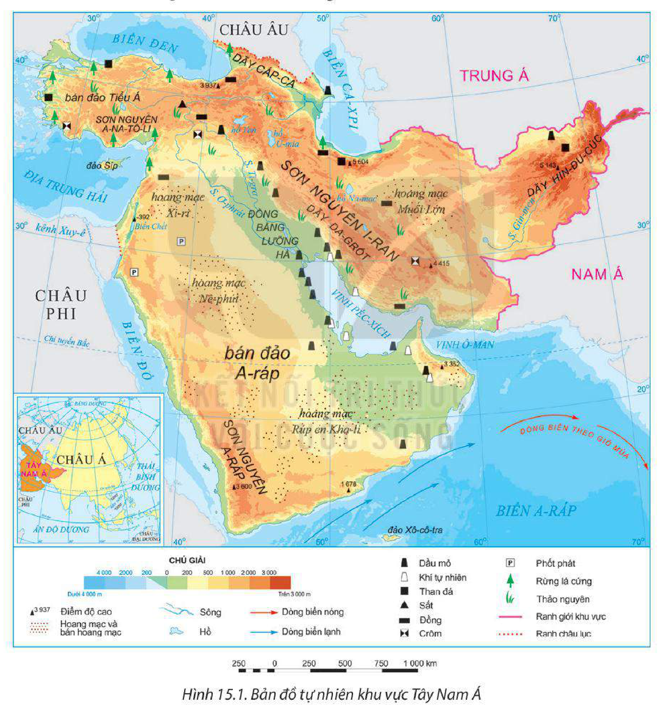
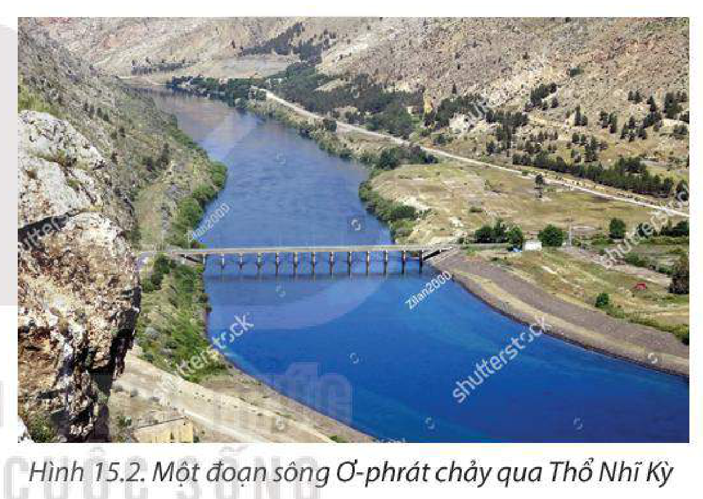
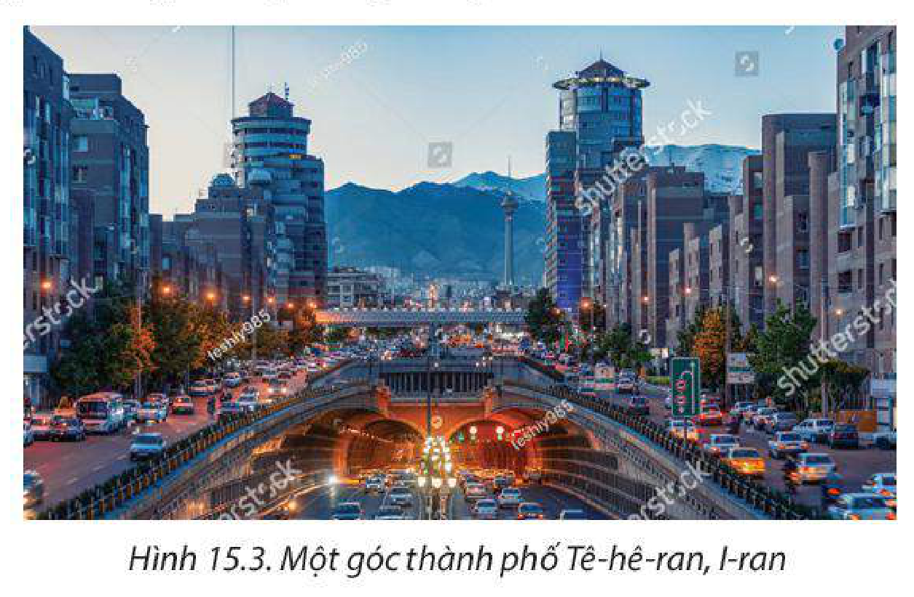
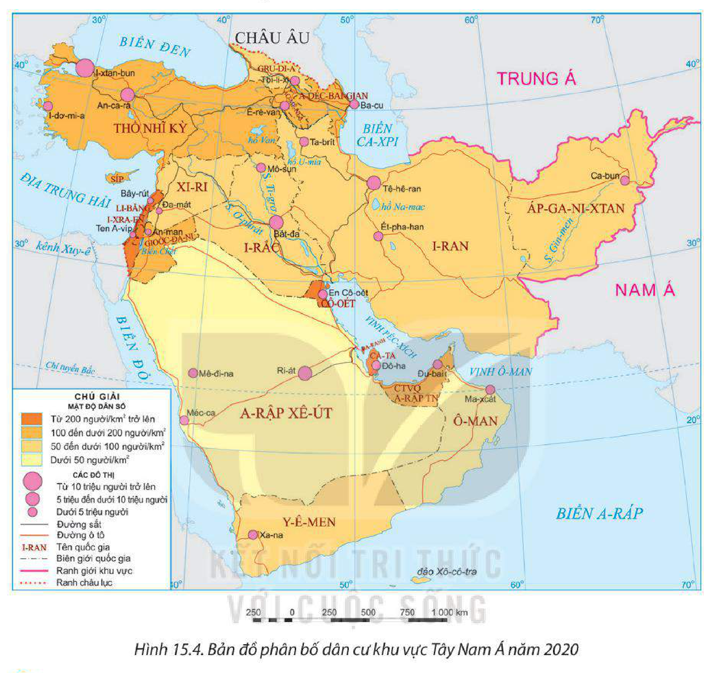

<!-- pdf:69 -->

# BÀI 15: VỊ TRÍ ĐỊA LÍ, ĐIỀU KIỆN TỰ NHIÊN, DÂN CƯ VÀ XÃ HỘI KHU VỰC TÂY NAM Á

> **KHU VỰC TÂY NAM Á**
>
> Diện tích đất: khoảng 7 triệu km²
>
> Số dân: 402,5 triệu người (năm 2020)

## 🔴 Mở đầu

Khu vực Tây Nam Á nằm ở ngã ba của ba châu lục: châu Á, châu Âu và châu Phi. Khu vực Tây Nam Á có các hoang mạc rộng lớn, sở hữu trữ lượng dầu mỏ phong phú bậc nhất thế giới nhưng còn tồn tại những vấn đề chính trị, xung đột tôn giáo và sắc tộc mang tính lịch sử. Các đặc điểm tự nhiên và dân cư, xã hội có ảnh hưởng như thế nào đến phát triển kinh tế – xã hội của khu vực?

## I. PHẠM VI LÃNH THỔ VÀ VỊ TRÍ ĐỊA LÍ

<!-- term: Phạm vi lãnh thổ khu vực Tây Nam Á -->
Tây Nam Á gồm 20 quốc gia có diện tích đất khoảng 7 triệu km².

<!-- term: Vị trí địa lí khu vực Tây Nam Á -->
Khu vực Tây Nam Á nằm ở phía tây nam của châu Á, trong khoảng vĩ độ từ 12°B đến 42°B và trong khoảng kinh độ từ 27°Đ đến 73°Đ, vị trí được ví như cầu nối giữa ba châu lục: châu Á, châu Âu và châu Phi, ở vị trí tiếp xúc của các mảng kiến tạo lớn, trên vành đai sinh khoáng Địa Trung Hải. Tây Nam Á tiếp giáp với nhiều biển và vịnh biển (Biển Đỏ, biển A-ráp, vịnh Péc-xích, Địa Trung Hải, Biển Đen), thông ra Đại Tây Dương ở phía bắc và Ấn Độ Dương ở phía nam.

<!-- term: Kênh Xuy-ê -->
Kênh Xuy-ê nối liền Địa Trung Hải với Ấn Độ Dương có ý nghĩa quan trọng đối với hàng hải quốc tế, giúp rút ngắn quãng đường di chuyển từ các khu vực ven Đại Tây Dương sang các khu vực ven Ấn Độ Dương.

Phạm vi lãnh thổ và vị trí địa lí đã tạo nên một khu vực Tây Nam Á có khí hậu chủ yếu là khô nóng nhưng có tài nguyên khoáng sản phong phú. Đặc biệt, Tây Nam Á có vị trí địa chính trị quan trọng do nằm giữa ba châu lục; án ngữ các tuyến đường giao thông quan trọng bậc nhất thế giới, có tuyến đường biển huyết mạch dẫn đến các mỏ dầu khí trữ lượng lớn của các quốc gia vùng vịnh Péc-xích.

> ❓ Dựa vào thông tin mục I và hình 15.1, hãy:
> – Trình bày đặc điểm phạm vi lãnh thổ và vị trí địa lí của khu vực Tây Nam Á.
> – Phân tích ảnh hưởng của vị trí địa lí đến phát triển kinh tế – xã hội của khu vực.

<!-- pdf:70 -->

## II. ĐIỀU KIỆN TỰ NHIÊN VÀ TÀI NGUYÊN THIÊN NHIÊN

### 1. Địa hình và đất

Khu vực Tây Nam Á có các dạng địa hình: núi, sơn nguyên và đồng bằng.

<!-- term: Địa hình núi và sơn nguyên Tây Nam Á -->
Địa hình núi, sơn nguyên bao gồm: dãy Cáp-ca, dãy Hin-đu Cúc, sơn nguyên I-ran, sơn nguyên A-na-tô-li, sơn nguyên A-ráp. Giữa các dãy núi là các thung lũng. Địa hình chia cắt, hiểm trở gây khó khăn cho giao thông, trồng trọt và cư trú. Đất chủ yếu là đất nâu đỏ xa van, có thể phát triển chăn nuôi gia súc.

*Hình 15.1. Bản đồ tự nhiên khu vực Tây Nam Á*

<!-- term: Địa hình đồng bằng Tây Nam Á -->
Địa hình đồng bằng bao gồm: đồng bằng Lưỡng Hà do sông Ti-grơ và Ơ-phrát bồi đắp là đồng bằng lớn nhất của khu vực, các đồng bằng nhỏ ở ven vịnh Péc-xích, Địa Trung Hải,... Các đồng bằng tương đối bằng phẳng, đất phù sa màu mỡ, thuận lợi phát triển nông nghiệp và cư trú.

<!-- pdf:71 -->

<!-- term: Hoang mạc Tây Nam Á -->
Tây Nam Á có nhiều hoang mạc lớn như Xi-ri, Nê-phút, Rúp-en Kha-li. Đất chủ yếu là đất xám hoang mạc và bán hoang mạc, không thuận lợi cho canh tác.

### 2. Khí hậu

<!-- term: Khí hậu khu vực Tây Nam Á -->
Tây Nam Á nằm trong đới khí hậu cận nhiệt và đới khí hậu nhiệt đới, với kiểu khí hậu lục địa là chủ yếu nên khô nóng vào mùa hè, khô lạnh vào mùa đông.

Khí hậu có sự phân hoá theo chiều bắc – nam. Vùng phía bắc có khí hậu cận nhiệt: ven Địa Trung Hải có lượng mưa trung bình năm khoảng 500 mm, càng vào sâu trong lục địa lượng mưa càng giảm. Vùng phía nam có khí hậu nhiệt đới, chênh lệch nhiệt độ giữa hai mùa và giữa ngày – đêm lớn, lượng mưa trung bình dao động từ 100 – 300 mm/năm. Ở các khu vực miền núi, sơn nguyên khí hậu phân hoá theo độ cao.

Nhìn chung, khí hậu Tây Nam Á ít thuận lợi cho cư trú và trồng trọt. Vùng ven biển khí hậu thuận lợi hơn cho hoạt động trồng trọt và cư trú.

### 3. Sông, hồ

<!-- term: Sông, hồ khu vực Tây Nam Á -->
Mạng lưới sông ngòi của Tây Nam Á thưa thớt và phần lớn bắt nguồn từ vùng núi và sơn nguyên ở phía bắc. Hai con sông lớn Ti-grơ (dài 1 900 km) và Ơ-phrát (dài 2 800 km) hình thành nên đồng bằng màu mỡ thuận lợi cho canh tác nông nghiệp, đây cũng là nơi phát triển nền văn minh Lưỡng Hà cổ đại. Các con sông khác ít nước, thường chỉ có nước vào mùa mưa gây nên tình trạng thiếu nước cho sản xuất và sinh hoạt.

*Hình 15.2. Một đoạn sông Ơ-phrát chảy qua Thổ Nhĩ Kỳ*

Các hồ lớn và có giá trị của khu vực Tây Nam Á là hồ Van (Thổ Nhĩ Kỳ), hồ Ga-li-lê (I-xra-en), Biển Chết (hồ chứa nước có độ mặn cao nhất thế giới),...

Nước ngầm là nguồn cung cấp nước quan trọng cho các quốc gia khu vực Tây Nam Á. Tuy nhiên nguồn nước ngầm trong khu vực thường nằm ở độ sâu lớn, khó khai thác.

### 4. Khoáng sản

<!-- term: Khoáng sản khu vực Tây Nam Á -->
Khu vực Tây Nam Á sở hữu trên 50% trữ lượng dầu mỏ và khoảng 40% trữ lượng khí tự nhiên của thế giới (năm 2020), tập trung ở các quốc gia vùng vịnh Péc-xích. Ngoài ra, Tây Nam Á còn có những tài nguyên khoáng sản khác như than đá, sắt, crôm, đồng, phốt phát,...

> 💡 EM CÓ BIẾT?
>
> Vịnh Péc-xích nằm giữa sơn nguyên I-ran và bán đảo A-ráp. Các quốc gia giáp vịnh là: I-rắc, Cô-oét, A-rập Xê-út, Ca-ta, Ba-ranh, Các Tiểu vương quốc A-rập Thống nhất. Vùng thềm lục địa và duyên hải của vịnh Péc-xích có nguồn tài nguyên dầu mỏ, khí tự nhiên trữ lượng hàng đầu thế giới. Đây là tiền đề quan trọng để các quốc gia ven vịnh Péc-xích phát triển kinh tế – xã hội.

<!-- pdf:72 -->

**BẢNG 15.1. TRỮ LƯỢNG DẦU MỎ VÀ KHÍ TỰ NHIÊN CỦA MỘT SỐ QUỐC GIA KHU VỰC TÂY NAM Á NĂM 2020**

| Trữ lượng \ Quốc gia | A-rập Xê-út | I-ran | I-rắc | Cô-oét | Các Tiểu vương quốc A-rập Thống nhất | Ca-ta |
| --- | --- | --- | --- | --- | --- | --- |
| Dầu mỏ *(tỉ tấn)* | 40,9 | 21,7 | 19,6 | 14,0 | 13,0 | 2,6 |
| *– So với thế giới (%)* | 17,2 | 9,1 | 8,4 | 5,9 | 5,6 | 1,5 |
| Khí tự nhiên *(nghìn tỉ m³)* | 6,0 | 32,1 | 3,5 | 1,7 | 5,9 | 24,7 |
| *– So với thế giới (%)* | 3,2 | 17,1 | 1,9 | 0,9 | 3,2 | 13,1 |
<!-- ocr-ok: đối chiếu trực tiếp ảnh trang PDF 72 (Bảng 15.1), OCR đọc lỗi tiêu đề cột và số liệu trong bảng -->

*(Nguồn: Tập đoàn dầu khí BP, 2022)*

Dầu khí là động lực phát triển kinh tế của nhiều quốc gia trong khu vực; tuy nhiên, đây là một trong những nguyên nhân chính dẫn đến mâu thuẫn, tranh chấp kéo dài.

### 5. Sinh vật

<!-- term: Sinh vật khu vực Tây Nam Á -->
Sinh vật của khu vực Tây Nam Á nghèo nàn. Hoang mạc và bán hoang mạc là cảnh quan điển hình của khu vực này nên thực vật chủ yếu là cây bụi gai, động vật phần lớn là các loài bò sát và gặm nhấm nhỏ. Khu vực ven Địa Trung Hải có rừng lá cứng. Tây Nam Á có một số khu bảo tồn, vườn quốc gia nhằm bảo tồn nguồn gen và có giá trị phát triển du lịch như: E-in A-dat (I-xra-en), Khu bảo tồn sa mạc Đu-bai (Các Tiểu vương quốc A-rập Thống nhất),...

### 6. Biển

<!-- term: Tài nguyên biển khu vực Tây Nam Á -->
Tây Nam Á tiếp giáp nhiều biển, bao gồm: Địa Trung Hải, Biển Đen, Biển Đỏ, biển A-ráp, là điều kiện thuận lợi để phát triển các ngành kinh tế biển. Tuyến đường biển từ Địa Trung Hải qua Biển Đỏ đến Ấn Độ Dương là tuyến đường thương mại trên biển quan trọng. Thông qua Biển Đen và biển Ca-xpi, khu vực Tây Nam Á dễ dàng kết nối với các khu vực khác của châu Á và các nước châu Âu. Ngoài ra, một số vùng biển có thể phát triển ngành thuỷ sản và du lịch biển.

> ❓ Dựa vào thông tin mục II và hình 15.1, hãy:
> – Trình bày đặc điểm điều kiện tự nhiên và tài nguyên thiên nhiên của khu vực Tây Nam Á.
> – Phân tích thuận lợi và khó khăn của điều kiện tự nhiên và tài nguyên thiên nhiên đến phát triển kinh tế – xã hội của khu vực.

## III. DÂN CƯ VÀ XÃ HỘI

### 1. Dân cư

<!-- term: Dân cư khu vực Tây Nam Á -->
Tây Nam Á là khu vực ít dân. Năm 2020, số dân của khu vực là 402,5 triệu người, chiếm 5,2% số dân toàn thế giới. Tỉ lệ tăng tự nhiên của dân số khu vực còn khá cao (1,6% năm 2020).

<!-- pdf:73 -->

Phần lớn dân cư khu vực Tây Nam Á là người Ả-rập (hơn 50% số dân). Ngoài ra còn có các dân tộc khác như Thổ Nhĩ Kỳ, Ba Tư, Do Thái, Cuốc,...

Tây Nam Á có tỉ lệ nam nhiều hơn nữ trong tổng số dân và có xu hướng tăng. Năm 2020, tỉ lệ nam chiếm 52%, tỉ lệ nữ chiếm 48% tổng số dân. Khu vực này có nhiều quốc gia đứng đầu thế giới về tỉ lệ nam nhiều hơn nữ như: Ca-ta, Các Tiểu vương quốc A-rập Thống nhất, Ô-man, Ba-ranh, A-rập Xê-út.

Tây Nam Á có cơ cấu dân số trẻ, nhiều quốc gia trong khu vực đang bước vào thời kì cơ cấu dân số vàng nên có lực lượng lao động dồi dào. Đây là nguồn lực quan trọng để phát triển kinh tế.

> 💡 EM CÓ BIẾT?
>
> Các quốc gia có người Ả-rập chiếm số đông trong dân cư được gọi là các nước Ả-rập, bao gồm: Ba-ranh, I-rắc, Cô-oét, Gioóc-đa-ni, Li-băng, Ô-man, Ca-ta, Pa-le-xtin, A-rập Xê-út, Xi-ri, Các Tiểu vương quốc A-rập Thống nhất, Y-ê-men.
>
> Khoảng 90% lực lượng lao động của Các Tiểu vương quốc A-rập Thống nhất là lao động nhập cư, đến từ các quốc gia như: Băng-la-đét, Ấn Độ, Pa-ki-xtan, Phi-líp-pin.

**BẢNG 15.2. SỐ DÂN VÀ CƠ CẤU DÂN SỐ THEO TUỔI KHU VỰC TÂY NAM Á GIAI ĐOẠN 2000 – 2020**

| Chỉ tiêu \ Năm | 2000 | 2010 | 2020 |
| --- | --- | --- | --- |
| Số dân *(triệu người)* | 271,0 | 335,1 | 402,5 |
| Cơ cấu dân số *(%)*: | | | |
| – Dưới 15 tuổi | 36,4 | 31,0 | 28,7 |
| – Từ 15 đến 64 tuổi | 59,1 | 64,2 | 65,6 |
| – Từ 65 tuổi trở lên | 4,5 | 4,8 | 5,7 |

*(Nguồn: Liên hợp quốc, 2022)*

<!-- term: Phân bố dân cư và đô thị hoá khu vực Tây Nam Á -->
Tây Nam Á có mật độ dân số khá thấp (khoảng 60 người/km², năm 2020) và có sự chênh lệch giữa các vùng, các quốc gia. Vùng phía bắc, đồng bằng, ven biển và những vùng khai thác dầu mỏ quan trọng là những nơi tập trung đông dân nhất.

Tỉ lệ dân thành thị của khu vực cao, năm 2020 là 72% (trung bình thế giới là 56,2%). Các quốc gia có tỉ lệ dân thành thị cao nhất là Cô-oét (100%), I-xra-en (92,6%), Gioóc-đa-ni (91,4%); thấp nhất là Y-ê-men (37,9%). Các thành phố lớn nhất của khu vực là I-xtan-bun (Thổ Nhĩ Kỳ), Bát-đa (I-rắc),

*Hình 15.3. Một góc thành phố Tê-hê-ran, I-ran*

<!-- pdf:74 -->

Tê-hê-ran (I-ran), Ri-át (A-rập Xê-út). Các thành phố là những trung tâm kinh tế phát triển, thu hút dân cư và lao động.

*Hình 15.4. Bản đồ phân bố dân cư khu vực Tây Nam Á năm 2020*

> ❓ Dựa vào thông tin mục 1 và hình 15.4, hãy:
> – Nêu đặc điểm dân cư của khu vực Tây Nam Á.
> – Phân tích ảnh hưởng của đặc điểm dân cư tới phát triển kinh tế – xã hội khu vực.

### 2. Xã hội

<!-- term: Xã hội khu vực Tây Nam Á -->
Tây Nam Á là nơi khởi nguồn của ba tôn giáo chính là Do Thái giáo, Ki-tô giáo và Hồi giáo. Hồi giáo là tôn giáo phổ biến trên toàn khu vực.

Tây Nam Á là nơi xuất hiện của một trong những nền văn minh cổ đại, cũng là nơi có nhiều di sản vật thể và phi vật thể nổi tiếng thế giới được UNESCO công nhận như: thành cổ Pê-tra (Gioóc-đa-ni), thành cổ Shi-bam (Y-ê-men), thành phố di sản Sa-ma-ra

<!-- pdf:75 -->

(I-rắc),... Khu vực có nhiều lễ hội, phong tục tập quán truyền thống đặc sắc. Đây là điều kiện thuận lợi để phát triển ngành du lịch.

Chất lượng cuộc sống dân cư trong khu vực ngày càng nâng cao nhưng có sự phân hoá giữa các nước, các nhóm dân cư trong một nước.

**BẢNG 15.3. TUỔI THỌ TRUNG BÌNH VÀ SỐ NĂM ĐI HỌC TRUNG BÌNH CỦA MỘT SỐ QUỐC GIA KHU VỰC TÂY NAM Á NĂM 2000 VÀ NĂM 2020**

| Quốc gia | Tuổi thọ trung bình *(năm)* - Năm 2000 | Tuổi thọ trung bình *(năm)* - Năm 2020 | Số năm đi học trung bình của người từ 25 tuổi trở lên *(năm)* - Năm 2000 | Số năm đi học trung bình của người từ 25 tuổi trở lên *(năm)* - Năm 2020 |
| --- | --- | --- | --- | --- |
| I-xra-en | 79,8 | 82,4 | 10,6 | 13,3 |
| Các Tiểu vương quốc A-rập Thống nhất | 74,4 | 78,9 | 8,4 | 12,7 |
| I-ran | 69,7 | 74,8 | 8,5 | 10,6 |
| Y-ê-men | 62,6 | 64,7 | 1,2 | 3,2 |

*(Nguồn: Liên hợp quốc, 2022)*

Tây Nam Á có các xung đột sắc tộc, tôn giáo,... xảy ra trong một quốc gia hoặc giữa các quốc gia, đồng thời chịu sự can thiệp của một số cường quốc trên thế giới. Tình hình an ninh chính trị bất ổn đã tác động tiêu cực đến phát triển kinh tế – xã hội của khu vực.

> ❓ Dựa vào thông tin mục 2, hãy phân tích ảnh hưởng của đặc điểm xã hội đến phát triển kinh tế – xã hội khu vực Tây Nam Á.

## ✏️ Luyện tập

1. Điều kiện tự nhiên và tài nguyên thiên nhiên của khu vực Tây Nam Á thuận lợi để phát triển những ngành kinh tế nào?

2. Dựa vào bảng 15.2, vẽ biểu đồ thể hiện cơ cấu dân số theo tuổi của khu vực Tây Nam Á năm 2000 và 2020. Nêu nhận xét.

## 🚀 Vận dụng

Sưu tầm thông tin, viết một bài giới thiệu ngắn về cảnh quan hoang mạc hoặc một nền văn minh cổ đại của khu vực Tây Nam Á.

## 📷 Danh sách hình trong bài

| Mã hình | Số hình | Trang PDF | Chú thích |
| --- | --- | --- | --- |
| H11-dia-b15-01 | Hình 15.1 | 70 | Hình 15.1. Bản đồ tự nhiên khu vực Tây Nam Á |
| H11-dia-b15-02 | Hình 15.2 | 71 | Hình 15.2. Một đoạn sông Ơ-phrát chảy qua Thổ Nhĩ Kỳ |
| H11-dia-b15-03 | Hình 15.3 | 73 | Hình 15.3. Một góc thành phố Tê-hê-ran, I-ran |
| H11-dia-b15-04 | Hình 15.4 | 74 | Hình 15.4. Bản đồ phân bố dân cư khu vực Tây Nam Á năm 2020 |
