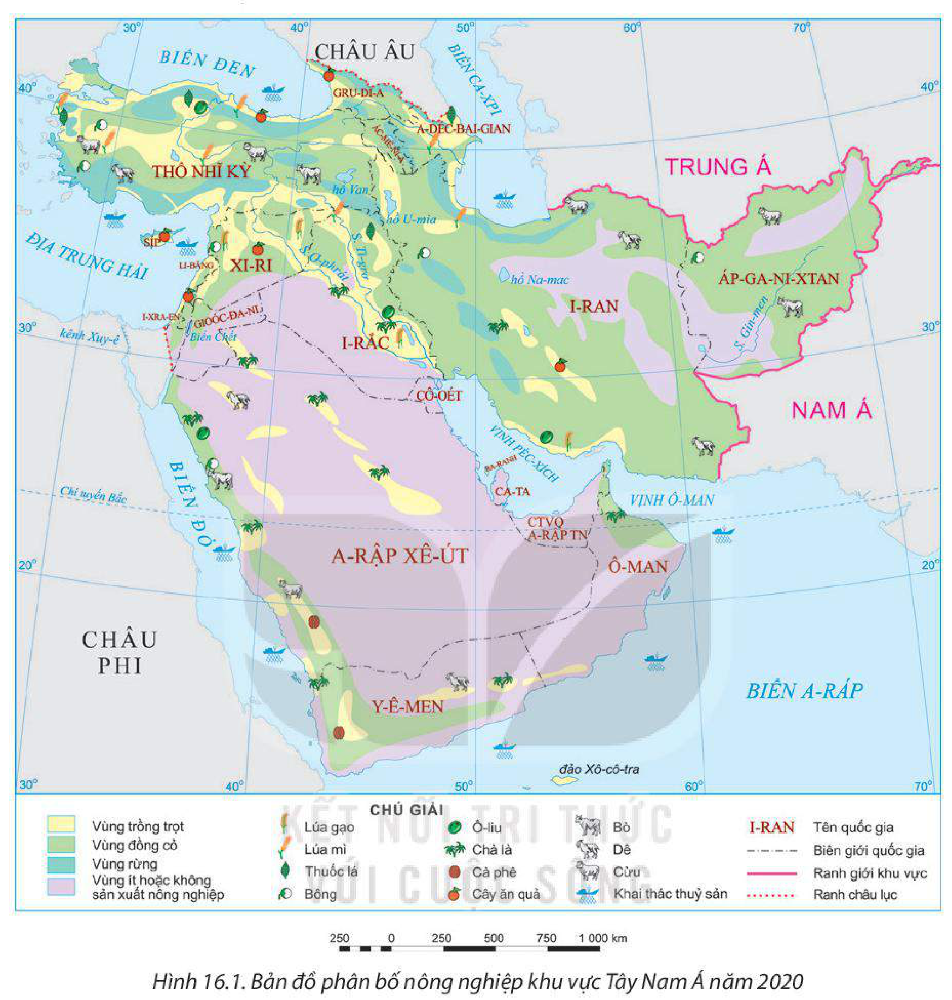
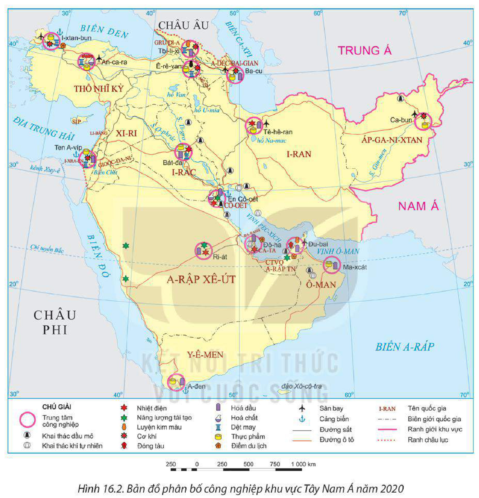
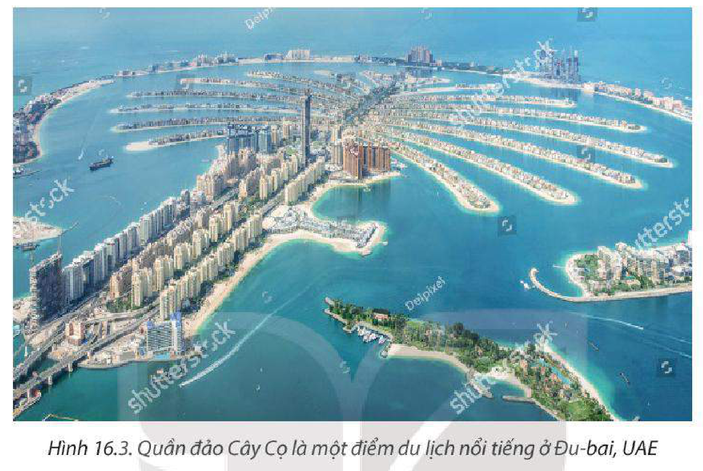

<!-- pdf:76 -->

# BÀI 16: KINH TẾ KHU VỰC TÂY NAM Á

## 🔴 Mở đầu

Tuy điều kiện tự nhiên không thuận lợi cho sản xuất nông nghiệp, nhưng khu vực Tây Nam Á có nguồn dầu mỏ và khí tự nhiên dồi dào là động lực để phát triển kinh tế – xã hội. Kinh tế khu vực Tây Nam Á có đặc điểm như thế nào và phát triển ra sao?

## I. TÌNH HÌNH PHÁT TRIỂN KINH TẾ

### 1. Quy mô

<!-- term: Quy mô kinh tế khu vực Tây Nam Á -->
– Khu vực Tây Nam Á có quy mô GDP tăng liên tục trong giai đoạn 2000 – 2020. Năm 2020, GDP toàn khu vực là 3 184,4 tỉ USD, chiếm 3,7% GDP toàn cầu.

**BẢNG 16.1. QUY MÔ GDP THEO GIÁ HIỆN HÀNH CỦA KHU VỰC TÂY NAM Á VÀ THẾ GIỚI GIAI ĐOẠN 2000 – 2020**
*(Đơn vị: tỉ USD)*

| Năm | 2000 | 2005 | 2010 | 2015 | 2020 |
| --- | --- | --- | --- | --- | --- |
| Tây Nam Á | 1 083,1 | 1 613,4 | 3 260,9 | 3 417,9 | 3 184,2 |
| Thế giới | 33 830,9 | 47 779,7 | 66 596,1 | 75 179,2 | 84 906,8 |
<!-- ocr-ok: đối chiếu trực tiếp ảnh trang PDF 76 (Bảng 16.1), OCR bỏ sót hàng tiêu đề năm và đọc dính số liệu -->

*(Nguồn: Ngân hàng Thế giới, 2022)*

– Quy mô GDP giữa các quốc gia có sự khác biệt rất lớn. Sự chênh lệch về trình độ phát triển kinh tế giữa các quốc gia khu vực Tây Nam Á chủ yếu do sự phân bố tài nguyên dầu mỏ không đều giữa các quốc gia, chính sách phát triển và mức độ đầu tư khoa học – công nghệ của các quốc gia khác nhau, sự tác động của các cường quốc trên thế giới,...

**BẢNG 16.2. QUY MÔ GDP THEO GIÁ HIỆN HÀNH CỦA MỘT SỐ QUỐC GIA KHU VỰC TÂY NAM Á NĂM 2000 VÀ NĂM 2020**
*(Đơn vị: tỉ USD)*

| Quốc gia \ Năm | 2000 | 2020 | Quốc gia \ Năm | 2000 | 2020 |
| --- | --- | --- | --- | --- | --- |
| A-rập Xê-út | 189,5 | 703,4 | I-rắc | 48,4 | 184,4 |
| A-déc-bai-gian | 5,3 | 42,7 | I-xra-en | 132,4 | 407,1 |
| Ca-ta | 17,7 | 144,4 | Li-băng | 17,3 | 25,9 |
| Cô-oét | 37,7 | 106,0 | Ô-man | 19,5 | 74,0 |
| Gioóc-đa-ni | 8,5 | 43,7 | Thổ Nhĩ Kỳ | 274,3 | 720,0 |
| Gru-di-a | 3,0 | 15,8 | Y-ê-men | 9,6 | 18,8 |
| I-ran | 96,2 | 203,4 | Các Tiểu vương quốc A-rập Thống nhất | 104,3 | 358,8 |

<!-- pdf:77 -->

*(Nguồn: Ngân hàng Thế giới, 2022)*

### 2. Tăng trưởng kinh tế

<!-- term: Tăng trưởng kinh tế khu vực Tây Nam Á -->
– Thế kỉ XX, nhiều quốc gia khu vực Tây Nam Á chuyển từ nền kinh tế chủ yếu dựa vào sản xuất nông nghiệp và hàng thủ công sang nền kinh tế dựa vào ngành công nghiệp dầu khí. Hiện nay, sự tăng trưởng kinh tế của khu vực có nhiều biến động do ảnh hưởng từ sự bất ổn xã hội, cuộc chiến giá dầu,...

**BẢNG 16.3. TỐC ĐỘ TĂNG TRƯỞNG GDP CỦA KHU VỰC TÂY NAM Á VÀ THẾ GIỚI GIAI ĐOẠN 2010 – 2020**
*(Đơn vị: %)*

| Năm | 2010 | 2015 | 2020 |
| --- | --- | --- | --- |
| Tây Nam Á | 6,0 | 1,1 | -6,3 |
| Thế giới | 4,5 | 3,0 | -3,3 |
<!-- ocr-ok: đối chiếu trực tiếp ảnh trang PDF 77 (Bảng 16.3), OCR bỏ sót hàng tiêu đề năm và đọc lỗi số liệu -->

*(Nguồn: Ngân hàng Thế giới, 2022)*

– Bước sang thế kỉ XXI, một số quốc gia giảm dần sự lệ thuộc vào dầu khí và chuyển dịch theo hướng phát triển nền kinh tế tri thức, đẩy mạnh nghiên cứu và phát triển.

### 3. Cơ cấu kinh tế

<!-- term: Cơ cấu kinh tế khu vực Tây Nam Á -->
– Ngành nông nghiệp chiếm khoảng 10% GDP và 25% lực lượng lao động của khu vực (năm 2020). Sản xuất nông nghiệp của khu vực Tây Nam Á tương đối khó khăn do khí hậu khô hạn, diện tích đất canh tác ít. Các quốc gia có nền nông nghiệp tiên tiến, đẩy mạnh phát triển nông nghiệp công nghệ cao như I-ra-en, Các Tiểu vương quốc A-rập Thống nhất, Thổ Nhĩ Kì.

– Ngành công nghiệp và dịch vụ chiếm hơn 80% GDP và có xu hướng tăng.

> ❓ Dựa vào nội dung mục I, hãy trình bày và giải thích tình hình phát triển kinh tế của khu vực Tây Nam Á.

## II. MỘT SỐ HOẠT ĐỘNG KINH TẾ NỔI BẬT

### 1. Nông nghiệp

<!-- term: Nông nghiệp khu vực Tây Nam Á -->
Các sản phẩm trồng trọt chính là cây lương thực (lúa gạo, lúa mì), cây công nghiệp (bông, thuốc lá, cà phê, ô-liu,...), cây ăn quả,... Các quốc gia có ngành trồng trọt phát triển nhất là Thổ Nhĩ Kỳ, I-ran, I-rắc, A-rập Xê-út, I-xra-en,...

<!-- pdf:78 -->

*Hình 16.1. Bản đồ phân bố nông nghiệp khu vực Tây Nam Á năm 2020*

Chăn nuôi nhìn chung kém phát triển. Chăn thả vẫn là hình thức chăn nuôi phổ biến trong khu vực. Các quốc gia có diện tích đồng cỏ rộng lớn để phát triển chăn nuôi gia súc (bò, dê, cừu,...) là A-rập Xê-út, Xi-ri, Y-ê-men, I-ran, Áp-ga-ni-xtan, Thổ Nhĩ Kỳ,...

Khai thác và nuôi trồng thuỷ sản được phát triển ở ven Địa Trung Hải (Thổ Nhĩ Kỳ), Biển Đỏ (A-rập Xê-út), vịnh Péc-xích (Ô-man),...

### 2. Công nghiệp

<!-- term: Công nghiệp khu vực Tây Nam Á -->
Công nghiệp chiếm hơn 40% GDP của Tây Nam Á (năm 2020).

Công nghiệp khai thác, chế biến dầu khí là ngành then chốt và đóng góp lớn vào quy mô GDP của nhiều quốc gia Tây Nam Á. Công nghiệp dệt, may phát triển khá mạnh do

<!-- pdf:79 -->

có nguồn nguyên liệu bông từ Thổ Nhĩ Kỳ, Xi-ri, I-ran, I-rắc. Công nghiệp thực phẩm và sản xuất hàng tiêu dùng chưa thực sự phát triển nên phải nhập khẩu nhiều thực phẩm và hàng tiêu dùng.

*Hình 16.2. Bản đồ phân bố công nghiệp khu vực Tây Nam Á năm 2020*

### 3. Dịch vụ

<!-- term: Dịch vụ khu vực Tây Nam Á -->
Dịch vụ đóng góp hơn 40% giá trị GDP của khu vực Tây Nam Á và có xu hướng tăng.

Khu vực Tây Nam Á có vị trí địa lí rất thuận lợi để phát triển giao thông quốc tế. Hàng hải là một thế mạnh của khu vực với các cảng lớn là Ten A-víp (I-xra-en), En Cô-oét (Cô-oét), I-xtan-bun (Thổ Nhĩ Kỳ), A-đen (Y-ê-men),... Đường hàng không là loại hình giao thông chính trong khu vực, các sân bay lớn nhất là Đu-bai (Các Tiểu vương quốc A-rập Thống nhất), Đô-ha (Ca-ta), An-ca-ra (Thổ Nhĩ Kỳ), Ba-cu (A-déc-bai-gian),...

<!-- pdf:80 -->

Hoạt động ngoại thương nổi bật nhất là xuất khẩu dầu khí với hơn 2/3 các mặt hàng xuất khẩu là nhiên liệu, dầu nhờn và các sản phẩm hoá chất; đối tác thương mại chủ yếu của khu vực là các nước châu Á, EU, Hoa Kỳ. Mặt hàng nhập khẩu chính là nguyên liệu thô, nông sản,...

*Hình 16.3. Quần đảo Cây Cọ là một điểm du lịch nổi tiếng ở Đu-bai, UAE*

Trong những năm gần đây, nhiều quốc gia Tây Nam Á thu hút được số lượng lớn du khách do đầu tư phát triển cơ sở hạ tầng và có những chính sách khuyến khích phát triển du lịch. Tổng lượng khách du lịch đến Tây Nam Á năm 2019 là 146 triệu, trong đó đứng đầu là Thổ Nhĩ Kỳ (45 triệu).

> ❓ Dựa vào thông tin mục II và hình 16.1, 16.2, hãy trình bày đặc điểm nổi bật của một số ngành kinh tế ở khu vực Tây Nam Á.

## ✏️ Luyện tập

Dựa vào bảng 16.3, vẽ biểu đồ thể hiện tốc độ tăng GDP của khu vực Tây Nam Á giai đoạn 2010 – 2020 và nêu nhận xét, giải thích.

## 🚀 Vận dụng

Tìm kiếm thông tin về một hoạt động kinh tế của khu vực Tây Nam Á (các ứng dụng khoa học – công nghệ trong sản xuất nông nghiệp, du lịch, xuất khẩu,...).

## 📷 Danh sách hình trong bài

| Mã hình | Số hình | Trang PDF | Chú thích |
| --- | --- | --- | --- |
| H11-dia-b16-01 | Hình 16.1 | 78 | Hình 16.1. Bản đồ phân bố nông nghiệp khu vực Tây Nam Á năm 2020 |
| H11-dia-b16-02 | Hình 16.2 | 79 | Hình 16.2. Bản đồ phân bố công nghiệp khu vực Tây Nam Á năm 2020 |
| H11-dia-b16-03 | Hình 16.3 | 80 | Hình 16.3. Quần đảo Cây Cọ là một điểm du lịch nổi tiếng ở Đu-bai, UAE |
