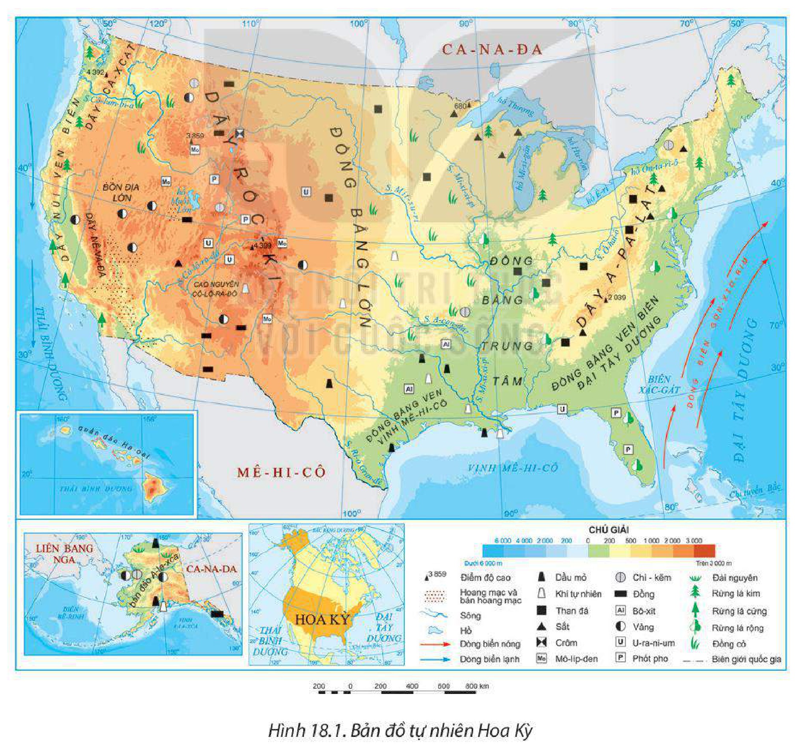
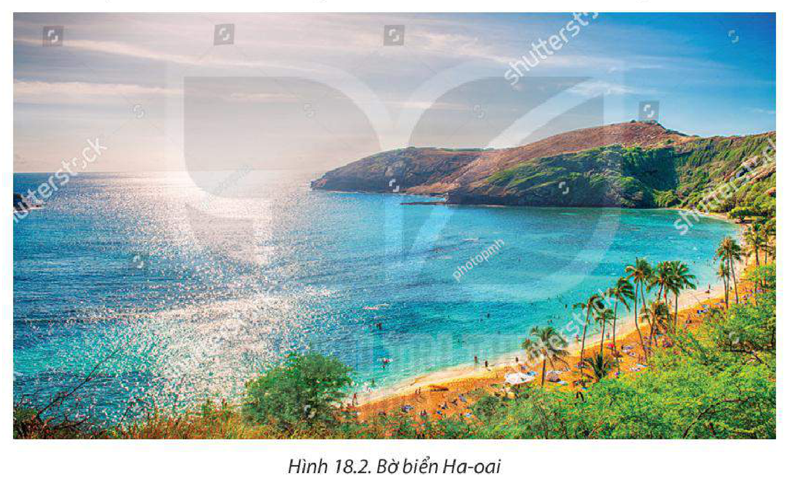
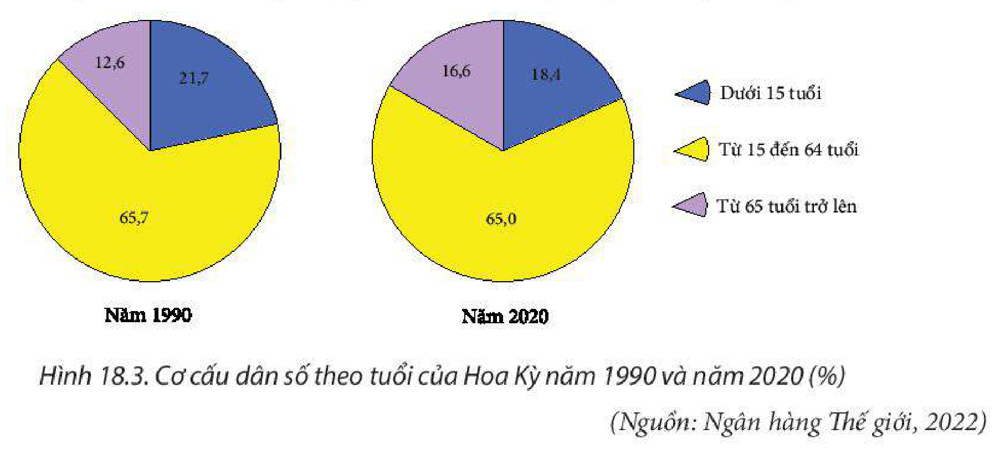
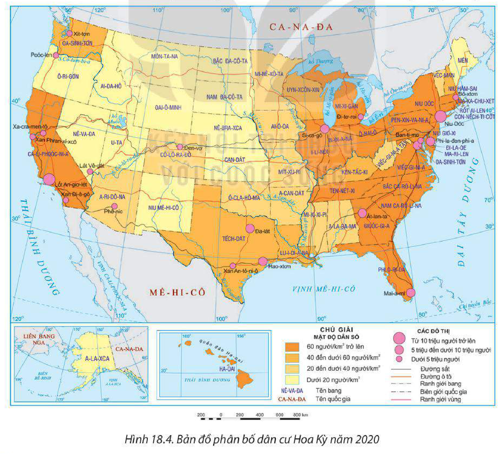
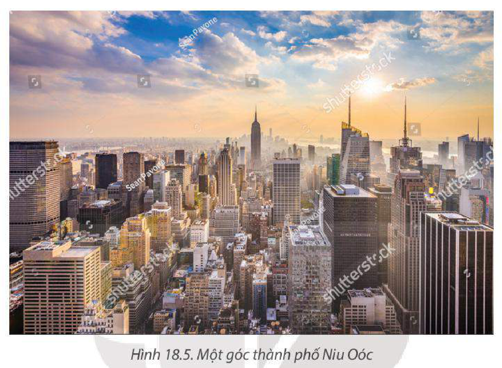

<!-- pdf:83 -->

# BÀI 18: VỊ TRÍ ĐỊA LÍ, ĐIỀU KIỆN TỰ NHIÊN VÀ DÂN CƯ HOA KỲ

> **HỢP CHÚNG QUỐC HOA KỲ (HOA KỲ)**
>
> Diện tích: khoảng 9,5 triệu km²
>
> Số dân: 331,5 triệu người (năm 2020)
>
> Thủ đô: Oa-sinh-tơn

## 🔴 Mở đầu

Hoa Kỳ là một đất nước rộng lớn; điều kiện tự nhiên và dân cư, có nhiều thuận lợi, góp phần đưa Hoa Kỳ trở thành một cường quốc của thế giới. Tự nhiên và dân cư và xã hội Hoa Kỳ có đặc điểm như thế nào?

## I. VỊ TRÍ ĐỊA LÍ

<!-- term: Phạm vi lãnh thổ Hoa Kỳ -->
– Hoa Kỳ là quốc gia có diện tích rộng lớn, khoảng 9,5 triệu km². Lãnh thổ Hoa Kỳ bao gồm: phần lãnh thổ trung tâm Bắc Mỹ, bán đảo A-la-xca và quần đảo Ha-oai. Phần trung tâm Bắc Mỹ có diện tích khoảng 8 triệu km², chiều bắc – nam kéo dài từ khoảng vĩ độ 25°B đến vĩ độ 49°B, chiều đông – tây từ khoảng kinh độ 125°T đến kinh độ 67°T. A-la-xca là bán đảo rộng lớn ở tây bắc châu Mỹ, có diện tích hơn 1,5 triệu km². Quần đảo Ha-oai nằm giữa Thái Bình Dương với diện tích hơn 16 nghìn km². Lãnh thổ rộng lớn, thiên nhiên phân hoá, tạo điều kiện phát triển kinh tế đa dạng.

<!-- term: Vị trí địa lí Hoa Kỳ -->
– Hoa Kỳ nằm hoàn toàn ở bán cầu Tây, cách xa các trung tâm kinh tế khác; giáp Bắc Băng Dương ở phía bắc, Đại Tây Dương ở phía đông và Thái Bình Dương ở phía tây, dễ dàng giao lưu với các nước khác trên thế giới bằng đường biển; tiếp giáp Ca-na-đa và Mê-hi-cô là những quốc gia có nguồn tài nguyên phong phú, đồng thời là những thị trường tiêu thụ rộng lớn.

Vị trí địa lí đã tạo điều kiện thuận lợi cho Hoa Kỳ giao lưu, phát triển kinh tế.

> ❓ Dựa vào thông tin mục I và hình 18.1, hãy:
> – Nêu đặc điểm vị trí địa lí của Hoa Kỳ.
> – Phân tích thuận lợi, khó khăn của vị trí địa lí đến sự phát triển kinh tế – xã hội Hoa Kỳ.

<!-- pdf:84 -->

## II. ĐIỀU KIỆN TỰ NHIÊN VÀ TÀI NGUYÊN THIÊN NHIÊN

### 1. Địa hình và đất

– Phần lãnh thổ trung tâm Bắc Mỹ có địa hình đa dạng và phân hoá từ tây sang đông:

<!-- term: Miền núi phía tây Hoa Kỳ -->
+ Phía tây là một bộ phận của hệ thống núi Coóc-đi-e với nhiều dãy núi trẻ, cao trung bình trên 3 000 m như Rốc-ki, Nê-va-đa,... Xen giữa các dãy núi là các bồn địa và cao nguyên, hoang mạc và bán hoang mạc; đất chủ yếu là đất đỏ nâu, đất xám hoang mạc và bán hoang mạc. Địa hình không thuận lợi cho giao thông và cư trú nhưng có nhiều cảnh đẹp hấp dẫn du khách,... Ven Thái Bình Dương có các thung lũng và đồng bằng nhỏ hẹp đất màu mỡ, rất thuận lợi để trồng cây ăn quả, chăn nuôi gia súc, gia cầm,...

> 💡 EM CÓ BIẾT?
>
> Hệ thống núi Coóc-đi-e là một trong những miền núi lớn trên thế giới; nằm ở phía tây lục địa Bắc Mỹ, kéo dài 9 000 km từ A-la-xca đến Mê-hi-cô. Hệ thống này có nhiều dãy núi cao, đồ sộ, hiểm trở như Rốc-ki, Nê-va-đa nằm ở lãnh thổ Hoa Kỳ.

*Hình 18.1. Bản đồ tự nhiên Hoa Kỳ*

<!-- pdf:85 -->

<!-- term: Miền núi A-pa-lát và đồng bằng duyên hải Đại Tây Dương -->
+ Phía đông là dãy A-pa-lát và vùng đồng bằng duyên hải Đại Tây Dương. A-pa-lát là dãy núi già, độ cao trung bình 1 000 – 1 500 m, có nhiều thung lũng rộng, tương đối thuận lợi cho cư trú và sản xuất nông nghiệp, được khai thác từ khá sớm. Đồng bằng ven biển Đại Tây Dương có diện tích khá lớn và bằng phẳng, đất phù sa màu mỡ thích hợp trồng cây lương thực, cây ăn quả.

<!-- term: Vùng đồng bằng ở giữa Hoa Kỳ -->
+ Ở giữa là vùng rộng lớn, địa hình gồm: đồng bằng Trung tâm, đồng bằng Lớn, đồng bằng ven vịnh Mê-hi-cô. Các loại đất chủ yếu ở đây là đất đen, đất phù sa, đất nâu xám rừng lá rộng,... nhìn chung thuận lợi cho phát triển nông nghiệp và cư trú.

<!-- term: Địa hình A-la-xca và Ha-oai -->
– A-la-xca có địa hình rất đa dạng, nhiều dãy núi trẻ xen kẽ các đồng bằng. Địa hình chia cắt, không thuận lợi cho giao thông và cư trú.

– Quần đảo Ha-oai có nguồn gốc núi lửa, trong đó một số núi lửa còn hoạt động, địa hình chủ yếu là đồi núi, các dạng địa hình bờ biển,... thuận lợi để phát triển du lịch.

*Hình 18.2. Bờ biển Ha-oai*

### 2. Khí hậu

<!-- term: Khí hậu Hoa Kỳ -->
Khí hậu Hoa Kỳ có sự phân hoá đa dạng thành nhiều đới, kiểu khí hậu khác nhau. Phần lãnh thổ phía bắc chủ yếu nằm trong đới khí hậu ôn đới với hai kiểu khí hậu chính là ôn đới lục địa và ôn đới hải dương. Phần lãnh thổ phía nam chủ yếu nằm trong đới khí hậu cận nhiệt, với hai kiểu khí hậu chính là cận nhiệt địa trung hải và cận nhiệt hải dương. Ở các vùng núi cao, khí hậu có sự phân hoá theo độ cao. A-la-xca có khí hậu cận cực, Ha-oai có khí hậu nhiệt đới.

Nhìn chung, khí hậu Hoa Kỳ thuận lợi cho sản xuất và cư trú. Sự phân hoá khí hậu tạo thuận lợi cho nông nghiệp có cơ cấu cây trồng và vật nuôi đa dạng, gồm các sản phẩm nông nghiệp, cận nhiệt và ôn đới. Tuy nhiên, Hoa Kỳ cũng có nhiều thiên tai như bão nhiệt đới, bão tuyết, vòi rồng, lốc xoáy, mưa đá,... ảnh hưởng đến sản xuất và đời sống.

<!-- pdf:86 -->

### 3. Sông, hồ

<!-- term: Sông, hồ Hoa Kỳ -->
Hoa Kỳ có nhiều sông lớn như: Mi-xi-xi-pi, Mít-xu-ri, Cô-lô-ra-đô, Cô-lum-bi-a,... Các sông chủ yếu chảy ra Đại Tây Dương và Thái Bình Dương; do có nhiều nguồn cung cấp nước khác nhau nên chế độ nước sông phức tạp. Các sông ở Hoa Kỳ có giá trị về nhiều mặt: thuỷ lợi, giao thông, thuỷ điện, du lịch,...

<!-- term: Vùng Ngũ Hồ -->
Hoa Kỳ có nhiều hồ lớn. Đặc biệt, vùng Ngũ Hồ nằm ở biên giới giữa Hoa Kỳ với Ca-na-đa là một hệ thống gồm 5 hồ với tổng diện tích khoảng 245 000 km², có ý nghĩa điều hoà khí hậu, cung cấp nước cho sinh hoạt, giao thông, đánh cá, du lịch.

### 4. Sinh vật

<!-- term: Sinh vật Hoa Kỳ -->
Thảm thực vật của Hoa Kỳ rất đa dạng, thay đổi từ bắc xuống nam và từ tây sang đông: Đài nguyên và đài nguyên rừng phân bố ở A-la-xca. Rừng lá kim chủ yếu ở phía tây, ven Thái Bình Dương. Rừng lá rộng phân bố ở phía đông, ven Đại Tây Dương. Khu vực phía tây nam phát triển rừng lá cứng. Tổng diện tích rừng của Hoa Kỳ năm 2020 là 309,8 triệu ha, chiếm 7,6% diện tích rừng thế giới, là cơ sở để phát triển các ngành lâm nghiệp, công nghiệp chế biến lâm sản,...

Động vật tự nhiên ở Hoa Kỳ đa dạng, các loài tiêu biểu là đại bàng đầu trắng, bò Bi-dông, gấu nâu,...

### 5. Khoáng sản

<!-- term: Khoáng sản Hoa Kỳ -->
Hoa Kỳ có tài nguyên khoáng sản phong phú và giàu có bậc nhất thế giới với đầy đủ các nhóm khoáng sản quan trọng: năng lượng (than đá, dầu mỏ, khí tự nhiên,...) tập trung ở phía đông bắc và ven vịnh Mê-hi-cô, kim loại đen (sắt, crôm, mô-líp-đen,...) phân bố ở phía nam vùng Ngũ Hồ, kim loại màu (đồng, vàng, chì – kẽm,...) phân bố chủ yếu ở phía tây; khoáng sản phi kim loại (phốt phát,...) phân bố rải rác ở phía tây và phía đông nam. Nhiều loại khoáng sản của Hoa Kỳ có trữ lượng hàng đầu thế giới, là cơ sở để phát triển ngành công nghiệp khai thác, chế biến khoáng sản.

**BẢNG 18.1. TRỮ LƯỢNG MỘT SỐ LOẠI KHOÁNG SẢN CỦA HOA KỲ NĂM 2020**

| Khoáng sản | Trữ lượng |
| --- | --- |
| Dầu mỏ *(tỉ tấn)* | 8,2 |
| Khí tự nhiên *(nghìn tỉ m³)* | 445,6 |
| Than đá *(tỉ tấn)* | 248,9 |
| Đồng *(triệu tấn)* | 85 |
| Chì – kẽm *(triệu tấn)* | 28 |

*(Nguồn: Cục Khảo sát Địa chất Hoa Kỳ, 2022)*

<!-- pdf:87 -->

### 6. Biển

<!-- term: Tài nguyên biển Hoa Kỳ -->
Hoa Kỳ tiếp giáp với hai đại dương lớn là Đại Tây Dương và Thái Bình Dương, với các biển, vịnh biển lớn như: vịnh Mê-hi-cô, vịnh A-la-xca, biển Xác-gát,... Biển là tài nguyên rất quan trọng đối với Hoa Kỳ, đây là cơ sở để phát triển nhiều ngành kinh tế biển. Tài nguyên sinh vật biển phong phú, nhiều loài có giá trị kinh tế cao, tạo thuận lợi phát triển ngành khai thác thuỷ sản. Ven biển có nhiều vịnh, thuận lợi để xây dựng các cảng biển; nhiều bãi biển đẹp để phát triển du lịch biển. Thềm lục địa Hoa Kỳ chứa nguồn tài nguyên khoáng sản lớn, đặc biệt là dầu mỏ và khí tự nhiên.

> ❓ Dựa vào nội dung mục II và hình 18.1, hãy:
> – Trình bày đặc điểm điều kiện tự nhiên và tài nguyên thiên nhiên của Hoa Kỳ.
> – Phân tích ảnh hưởng của điều kiện tự nhiên và tài nguyên thiên nhiên đến phát triển kinh tế – xã hội ở Hoa Kỳ.

## III. DÂN CƯ

### 1. Quy mô và cơ cấu dân số

<!-- term: Quy mô và cơ cấu dân số Hoa Kỳ -->
– Hoa Kỳ là nước đông dân, đứng thứ ba trên thế giới (331,5 triệu người, năm 2020). Dân số đông tạo nên nguồn lao động và thị trường tiêu thụ lớn, thúc đẩy kinh tế phát triển.

**BẢNG 18.2. SỐ DÂN VÀ TỈ LỆ TĂNG DÂN SỐ CỦA HOA KỲ GIAI ĐOẠN 1960 – 2020**

| Năm | 1960 | 1980 | 2000 | 2010 | 2020 |
| --- | --- | --- | --- | --- | --- |
| Số dân *(triệu người)* | 186,7 | 229,5 | 282,2 | 309,0 | 331,5 |
| Tỉ lệ tăng dân số *(%)* | 1,6 | 0,94 | 1,14 | 0,88 | 0,59 |

*(Nguồn: Liên hợp quốc, 2022)*

– Hoa Kỳ có cơ cấu dân số già. Tỉ lệ người từ 65 tuổi trở lên có xu hướng tăng, người trong nhóm tuổi lao động chiếm tỉ lệ cao, tạo thuận lợi cho phát triển kinh tế nhưng cũng nảy sinh những khó khăn như giải quyết việc làm, tăng chi phí cho y tế và phúc lợi xã hội,...

*Hình 18.3. Cơ cấu dân số theo tuổi của Hoa Kỳ năm 1990 và năm 2020 (%)*
*(Nguồn: Ngân hàng Thế giới, 2022)*

<!-- pdf:88 -->

### 2. Chủng tộc và vấn đề nhập cư

<!-- term: Chủng tộc và nhập cư Hoa Kỳ -->
Dân cư Hoa Kỳ gồm nhiều chủng tộc và dân tộc đến từ khắp nơi trên thế giới với nhiều phong tục, tập quán khác nhau, hình thành một nền văn hoá đa dạng, góp phần tạo nên sự phong phú, linh hoạt trong đời sống và kinh tế – xã hội nhưng cũng gây khó khăn nhất định trong việc quản lí xã hội.

Trong lịch sử, Hoa Kỳ là đất nước của những người nhập cư, người nhập cư đến từ các châu lục khác nhau và đem lại cho Hoa Kỳ nguồn lao động có trình độ cao, giàu kinh nghiệm sản xuất. Tỉ lệ tăng dân số Hoa Kỳ đang có xu hướng giảm, từ 1,6% năm 1960 còn 0,59% năm 2020.

> 💡 EM CÓ BIẾT?
>
> Chủ nhân đầu tiên của Hoa Kỳ là người Anh-điêng. Vào thế kỉ XVII, người châu Âu (Pháp, Tây Ban Nha, Anh, Nga,...) đến định cư, sau đó họ đưa người châu Phi sang làm việc trong các đồn điền. Người châu Á (Trung Quốc, Nhật Bản) đến Hoa Kỳ từ nửa sau của thế kỉ XIX. Sang thế kỉ XX, người nhập cư tới Hoa Kỳ từ khắp nơi trên thế giới.
<!-- ocr-ok: đối chiếu trực tiếp ảnh trang PDF 88, OCR đọc trộn hộp Em có biết với cột văn bản bên phải -->

### 3. Phân bố dân cư

<!-- term: Phân bố dân cư và đô thị hoá Hoa Kỳ -->
– Mật độ dân số trung bình năm 2020 của Hoa Kỳ là 35 người/km², thuộc loại thấp so với thế giới. Tuy nhiên, phân bố dân cư ở Hoa Kỳ không đều. Dân cư tập trung đông ở các bang ven biển, đặc biệt là ven Đại Tây Dương; thưa thớt ở các bang nội địa và vùng núi phía tây.

*Hình 18.4. Bản đồ phân bố dân cư Hoa Kỳ năm 2020*

<!-- pdf:89 -->

– Hoa Kỳ có trình độ đô thị hoá cao. Năm 2020, tỉ lệ dân thành thị của Hoa Kỳ là 82,7%. Dân cư không tập trung quá đông ở đô thị trung tâm mà chủ yếu sống ở vùng phụ cận và các đô thị vệ tinh. Các đô thị lớn của Hoa Kỳ năm 2020 là Niu Oóc (18,8 triệu người), Lốt An-giơ-lét (12,4 triệu người), Si-ca-gô (8,9 triệu người), Hao-xtơn (6,4 triệu người).

*Hình 18.5. Một góc thành phố Niu Oóc*

> ❓ Dựa vào thông tin mục III và hình 18.4, hãy:
> – Nêu đặc điểm dân cư của Hoa Kỳ.
> – Phân tích tác động của đặc điểm dân cư tới phát triển kinh tế – xã hội ở Hoa Kỳ.

## ✏️ Luyện tập

1. Lập sơ đồ thể hiện những thuận lợi về điều kiện tự nhiên và tài nguyên thiên nhiên để phát triển kinh tế của Hoa Kỳ.

2. Dựa vào bản đồ phân bố dân cư Hoa Kỳ (hình 18.4), nhận xét về sự phân bố các đô thị ở Hoa Kỳ.

## 🚀 Vận dụng

Sưu tầm thông tin về tác động của sự đa dạng chủng tộc và nhập cư đối với phát triển kinh tế – xã hội của Hoa Kỳ.

## 📷 Danh sách hình trong bài

| Mã hình | Số hình | Trang PDF | Chú thích |
| --- | --- | --- | --- |
| H11-dia-b18-01 | Hình 18.1 | 84 | Hình 18.1. Bản đồ tự nhiên Hoa Kỳ |
| H11-dia-b18-02 | Hình 18.2 | 85 | Hình 18.2. Bờ biển Ha-oai |
| H11-dia-b18-03 | Hình 18.3 | 87 | Hình 18.3. Cơ cấu dân số theo tuổi của Hoa Kỳ năm 1990 và năm 2020 (%) |
| H11-dia-b18-04 | Hình 18.4 | 88 | Hình 18.4. Bản đồ phân bố dân cư Hoa Kỳ năm 2020 |
| H11-dia-b18-05 | Hình 18.5 | 89 | Hình 18.5. Một góc thành phố Niu Oóc |
