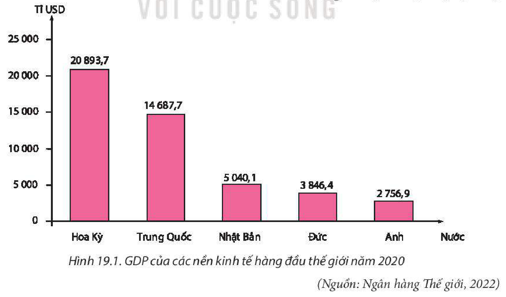
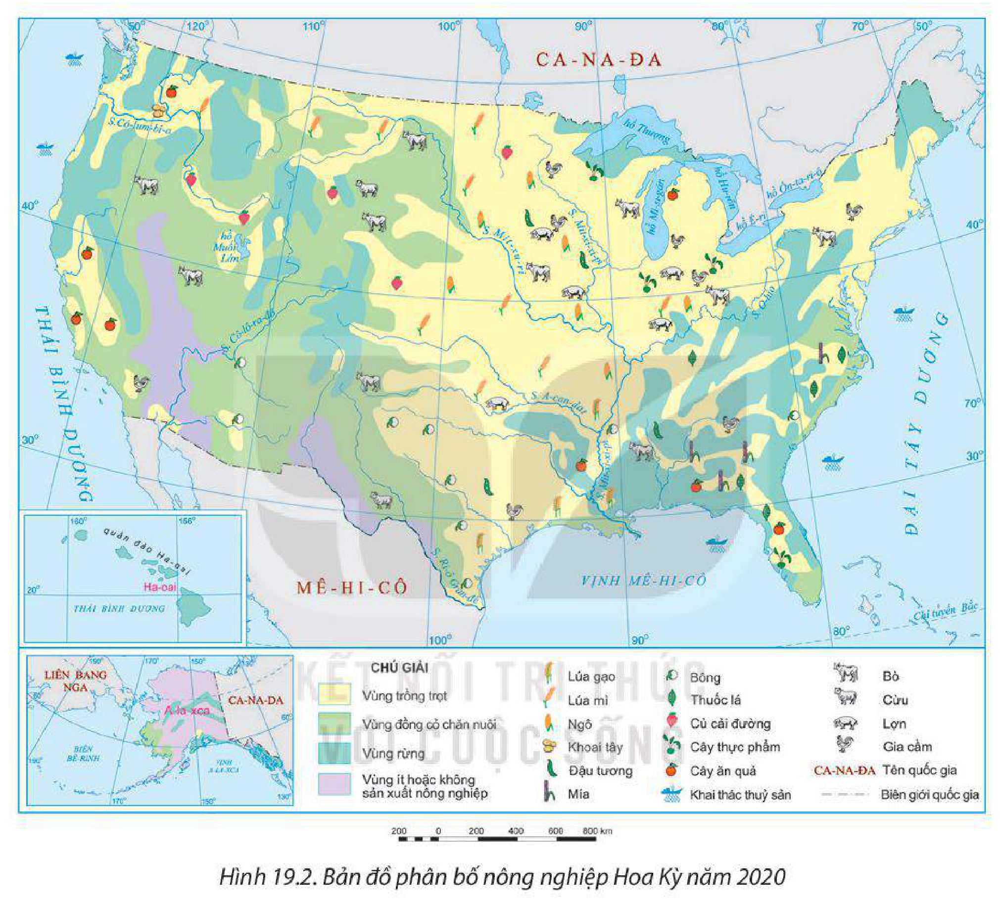
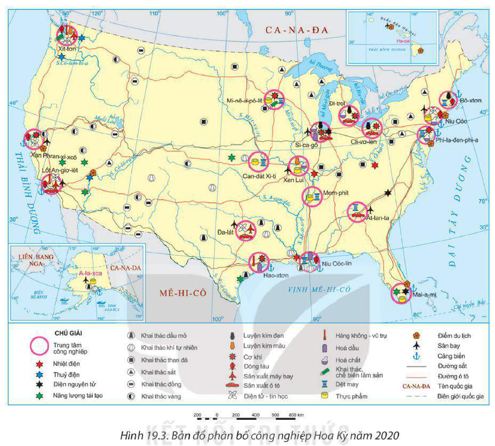
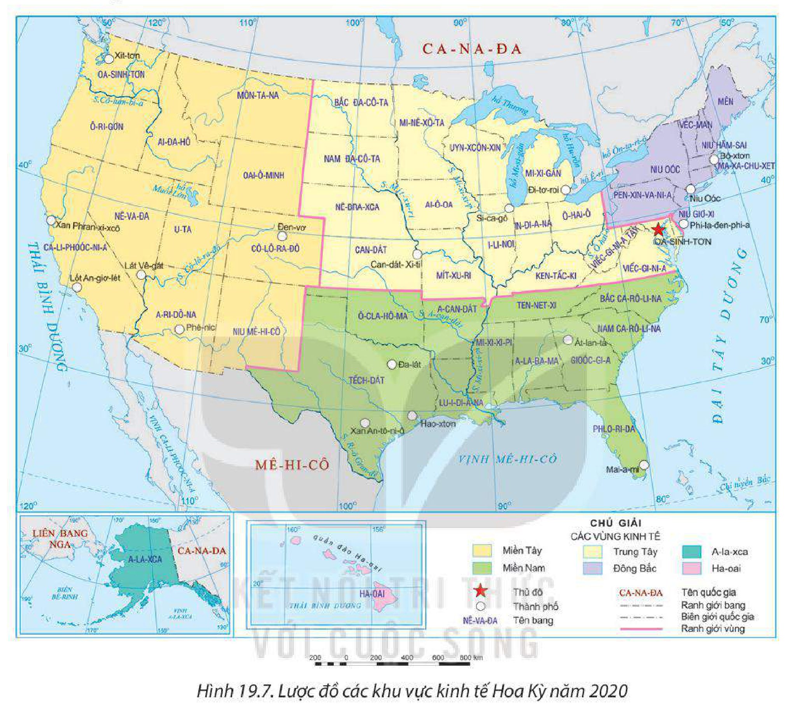

<!-- pdf:90 -->

# BÀI 19: KINH TẾ HOA KỲ

## 🔴 Mở đầu

Từ cuối thế kỉ XIX, Hoa Kỳ đã vươn lên trở thành nền kinh tế đứng đầu thế giới. Thành tựu của nền kinh tế Hoa Kỳ được thể hiện ở sự phát triển của các ngành kinh tế. Kinh tế Hoa Kỳ phát triển như thế nào? Nguyên nhân nào dẫn đến sự phát triển đó?

## I. NỀN KINH TẾ HÀNG ĐẦU THẾ GIỚI

### 1. Biểu hiện

<!-- term: Quy mô kinh tế Hoa Kỳ -->
Quy mô GDP của Hoa Kỳ lớn nhất thế giới, GDP bình quân đầu người cao hàng đầu thế giới (hơn 63 nghìn USD năm 2020).

**BẢNG 19.1. MỘT SỐ CHỈ TIÊU KINH TẾ CỦA HOA KỲ GIAI ĐOẠN 1970 – 2020**

| Chỉ tiêu \ Năm | 1970 | 1990 | 2000 | 2019 | 2020 |
| --- | --- | --- | --- | --- | --- |
| GDP theo giá hiện hành *(tỉ USD)* | 1 073,3 | 5 963,1 | 10 250,9 | 21 372,6 | 20 893,7 |
| *– Tỉ trọng so với GDP thế giới (%)* | 35,8 | 26,1 | 30,3 | 24,4 | 24,6 |
| Tốc độ tăng GDP *(%)* | -0,3 | 1,9 | 4,1 | 2,3 | -3,4 |
<!-- ocr-ok: đối chiếu trực tiếp ảnh trang PDF 90 (Bảng 19.1), OCR bỏ sót hàng tiêu đề năm trong bảng -->

*(Nguồn: Ngân hàng Thế giới, 2022)*

*Hình 19.1. GDP của các nền kinh tế hàng đầu thế giới năm 2020*
*(Nguồn: Ngân hàng Thế giới, 2022)*

<!-- pdf:91 -->

<!-- term: Cơ cấu kinh tế Hoa Kỳ -->
Kinh tế Hoa Kỳ có cơ cấu rất đa dạng. Dịch vụ chiếm tỉ trọng rất cao trong cơ cấu GDP. Hiện nay, Hoa Kỳ đang tập trung vào các lĩnh vực có trình độ khoa học – công nghệ cao, hoạt động nghiên cứu và phát triển.

**BẢNG 19.2. CƠ CẤU GDP CỦA HOA KỲ GIAI ĐOẠN 2000 – 2020**
*(Đơn vị: %)*

| Ngành \ Năm | 2000 | 2010 | 2020 |
| --- | --- | --- | --- |
| Nông nghiệp, lâm nghiệp và thuỷ sản | 1,2 | 1,0 | 0,9 |
| Công nghiệp và xây dựng | 22,5 | 19,3 | 18,4 |
| Dịch vụ | 72,8 | 76,3 | 80,1 |
| Thuế sản phẩm trừ trợ cấp sản phẩm | 3,5 | 3,4 | 0,6 |

*(Nguồn: Ngân hàng Thế giới, 2022)*

Nền kinh tế Hoa Kỳ có ảnh hưởng lớn tới kinh tế các nước trên thế giới. Những biến động lớn của nền kinh tế Hoa Kỳ trong các lĩnh vực thị trường tài chính, xuất nhập khẩu,... đều tác động tới kinh tế thế giới. Nhiều lĩnh vực kinh tế của Hoa Kỳ (nhất là lĩnh vực công nghệ cao) đứng đầu và mang tính dẫn dắt đối với kinh tế thế giới như công nghệ thông tin, hàng không – vũ trụ, dược phẩm,... Nhiều sản phẩm kinh tế của Hoa Kỳ đứng đầu thế giới về quy mô và giá trị. Hoa Kỳ có vai trò quan trọng trong nhiều tổ chức, diễn đàn kinh tế của thế giới.

### 2. Nguyên nhân

<!-- term: Nguyên nhân phát triển kinh tế Hoa Kỳ -->
Kinh tế Hoa Kỳ phát triển mạnh là nhờ các nguyên nhân sau:

<!-- term: Nguyên nhân phát triển kinh tế Hoa Kỳ -->
– Vị trí địa lí thuận lợi cho giao lưu, trao đổi hàng hoá.

<!-- term: Nguyên nhân phát triển kinh tế Hoa Kỳ -->
– Tài nguyên thiên nhiên phong phú.

<!-- term: Nguyên nhân phát triển kinh tế Hoa Kỳ -->
– Nguồn lao động dồi dào, có trình độ kĩ thuật, năng suất lao động cao.

<!-- term: Nguyên nhân phát triển kinh tế Hoa Kỳ -->
– Tham gia toàn cầu hoá kinh tế, phát triển nền kinh tế tri thức từ sớm, kinh tế thị trường phát triển ở mức độ rất cao.

<!-- term: Nguyên nhân phát triển kinh tế Hoa Kỳ -->
– Quá trình sản xuất luôn gắn liền với nghiên cứu khoa học – kĩ thuật.

> ❓ Dựa vào nội dung mục I, hãy giải thích đặc điểm kinh tế hàng đầu thế giới của Hoa Kỳ.

## II. CÁC NGÀNH KINH TẾ

### 1. Nông nghiệp, lâm nghiệp và thuỷ sản

Hoa Kỳ có nền nông nghiệp phát triển bậc nhất thế giới. Tuy chỉ chiếm 0,9% GDP và sử dụng gần 1% tổng số lao động của cả nước nhưng sản xuất nông nghiệp của Hoa Kỳ vẫn tạo ra khối lượng sản phẩm đứng hàng đầu thế giới.

<!-- pdf:92 -->

**a) Nông nghiệp**

<!-- term: Nông nghiệp Hoa Kỳ -->
Nông nghiệp Hoa Kỳ có quy mô lớn, năng suất cao. Hình thức sản xuất chủ yếu là các trang trại với quy mô rất lớn, chủ yếu sử dụng máy móc và kĩ thuật hiện đại. Các cây trồng chính là lúa mì, lúa gạo, ngô, đậu tương, cây ăn quả,... Các vật nuôi chính là bò, lợn, gia cầm,... Hoa Kỳ là nước xuất khẩu nông sản lớn trên thế giới.

*Hình 19.2. Bản đồ phân bố nông nghiệp Hoa Kỳ năm 2020*

**BẢNG 19.3. MỘT SỐ SẢN PHẨM NÔNG NGHIỆP CỦA HOA KỲ GIAI ĐOẠN 2000 – 2020**

| Sản phẩm \ Năm | 2000 | 2010 | 2020 |
| --- | --- | --- | --- |
| Ngô *(triệu tấn)* | 251,9 | 315,6 | 360,3 |
| Lúa mì *(triệu tấn)* | 60,6 | 60,1 | 49,7 |
| Đậu tương *(triệu tấn)* | 75,1 | 90,7 | 112,5 |
| Đàn bò *(triệu con)* | 98,2 | 94,1 | 93,8 |
| Đàn lợn *(triệu con)* | 59,1 | 64,9 | 77,3 |

*(Nguồn: Tổ chức Lương thực và Nông nghiệp Liên hợp quốc, 2022)*

<!-- pdf:93 -->

Phía nam Ngũ Hồ là vùng chuyên canh cây thực phẩm, chăn nuôi bò sữa. Đồng bằng Trung tâm chuyên canh lúa mì, ngô. Phía nam, ven vịnh Mê-hi-cô trồng lúa gạo, bông, đậu tương, cây ăn quả. Đồng bằng Lớn chăn nuôi bò thịt,...

**b) Lâm nghiệp**

<!-- term: Lâm nghiệp Hoa Kỳ -->
Ngành lâm nghiệp Hoa Kỳ có quy mô lớn và mang tính công nghiệp. Sản lượng gỗ tròn của Hoa Kỳ lớn nhất thế giới với 429,7 triệu m³ (năm 2020). Trồng rừng ngày càng được chú trọng phát triển. Lâm nghiệp tập trung ở vùng núi Rốc-ki, ven vịnh Mê-hi-cô,...

**c) Thuỷ sản**

<!-- term: Thuỷ sản Hoa Kỳ -->
Ngành khai thác thuỷ sản của Hoa Kỳ phát triển mạnh do có nguồn lợi thuỷ sản dồi dào, phương tiện và công nghệ khai thác hiện đại. Năm 2020, sản lượng thuỷ sản khai thác của Hoa Kỳ đạt 4,3 triệu tấn (đứng thứ sáu trên thế giới). Sản lượng thuỷ sản nuôi trồng còn thấp (0,5 triệu tấn) và đang có xu hướng tăng, nhằm đáp ứng nhu cầu ngày càng lớn, đồng thời giúp bảo vệ và duy trì nguồn lợi thuỷ sản tự nhiên.

> ❓ Dựa vào thông tin mục 1 và hình 19.2, hãy trình bày sự phát triển và phân bố của ngành nông nghiệp, lâm nghiệp và thuỷ sản Hoa Kỳ.

### 2. Công nghiệp

<!-- term: Công nghiệp Hoa Kỳ -->
Hoa Kỳ là cường quốc công nghiệp của thế giới. Năm 2020, công nghiệp và xây dựng chiếm 18,4% GDP. Tuy chỉ có hơn 10% lực lượng lao động làm việc trong ngành công nghiệp nhưng giá trị sản xuất công nghiệp của Hoa Kỳ đứng thứ hai thế giới. Đây là ngành tạo nguồn hàng xuất khẩu chủ yếu của Hoa Kỳ.

Công nghiệp Hoa Kỳ có cơ cấu rất đa dạng, trong đó nhiều ngành có trình độ khoa học – công nghệ và kĩ thuật cao, sản lượng đứng hàng đầu thế giới.

– Công nghiệp năng lượng: Than chủ yếu khai thác ở khu vực phía đông (vùng núi A-pa-lát). Dầu mỏ và khí tự nhiên khai thác chủ yếu ở bang Tếch-dát, ven vịnh Mê-hi-cô, bán đảo A-la-xca. Sản lượng điện của Hoa Kỳ đứng thứ hai thế giới với cơ cấu đa dạng: thuỷ điện, nhiệt điện, điện nguyên tử,... Hiện nay, Hoa Kỳ là quốc gia dẫn đầu thế giới về phát triển năng lượng tái tạo, đặc biệt là năng lượng mặt trời.

**BẢNG 19.4. MỘT SỐ SẢN PHẨM CÔNG NGHIỆP CỦA HOA KỲ GIAI ĐOẠN 2000 – 2020**

| Sản phẩm \ Năm | 2000 | 2010 | 2020 |
| --- | --- | --- | --- |
| Than đá *(triệu tấn)* | 974,0 | 983,7 | 484,7 |
| Dầu mỏ *(triệu tấn)* | 347,6 | 333,1 | 712,7 |
| Khí tự nhiên *(tỉ m³)* | 518,6 | 575,2 | 914,6 |
| Điện *(tỉ kWh)* | 4 052,3 | 4 394,3 | 4 286,6 |
<!-- ocr-ok: đối chiếu trực tiếp ảnh trang PDF 93 (Bảng 19.4), OCR bỏ sót hàng tiêu đề năm và đọc lỗi số liệu -->

*(Nguồn: Tập đoàn dầu khí BP, năm 2022)*

<!-- pdf:94 -->

*Hình 19.3. Bản đồ phân bố công nghiệp Hoa Kỳ năm 2020*

– Công nghiệp chế biến có vai trò đặc biệt quan trọng, chiếm phần lớn trị giá xuất khẩu của Hoa Kỳ. Các ngành công nghiệp truyền thống (hoá chất, dệt may, thực phẩm, luyện kim, sản xuất ô tô, đóng tàu,...) có xu hướng giảm tỉ trọng; trong khi các ngành công nghiệp hiện đại với công nghệ cao (hàng không – vũ trụ, điện tử – tin học,...) đang được đầu tư phát triển mạnh và tăng tỉ trọng.

+ Công nghiệp hàng không – vũ trụ của Hoa Kỳ phát triển hàng đầu thế giới. Các sản phẩm nổi bật là máy bay, linh kiện, tàu vũ trụ, vệ tinh,... Các trung tâm ven vịnh Mê-hi-cô (Hao-xtơn, Đa-lát,...) và ven Thái Bình Dương (Lốt An-giơ-lét, Xít-tơn,...) có công nghiệp hàng không – vũ trụ phát triển.

+ Ngành điện tử – tin học rất phát triển với các sản phẩm linh kiện điện tử, phần mềm, chất bán dẫn,... chiếm lĩnh thị trường thế giới; tập trung ở khu vực đông bắc và phía tây.

<!-- term: Vành đai Mặt Trời -->
Hoạt động sản xuất công nghiệp của Hoa Kỳ tập trung mạnh nhất ở khu vực đông bắc. Từ cuối thế kỉ XX, có sự chuyển dịch dần sản xuất công nghiệp về các bang phía nam và ven Thái Bình Dương, hình thành Vành đai Mặt Trời.

<!-- pdf:95 -->

> ❓ Dựa vào thông tin mục 2 và hình 19.3, hãy trình bày sự phát triển và phân bố của ngành công nghiệp Hoa Kỳ.

### 3. Dịch vụ

<!-- term: Dịch vụ Hoa Kỳ -->
Dịch vụ là ngành kinh tế có vai trò quan trọng nhất trong nền kinh tế Hoa Kỳ với quy mô và mức độ hiện đại đứng đầu thế giới. Năm 2020, khu vực dịch vụ chiếm 80,1% GDP và thu hút khoảng 80% lực lượng lao động. Hoạt động dịch vụ của Hoa Kỳ rất đa dạng, bao gồm nhiều lĩnh vực, không chỉ ở trong nước mà còn mở rộng trên toàn thế giới.

**a) Thương mại**

<!-- term: Thương mại Hoa Kỳ -->
– Nội thương Hoa Kỳ có quy mô đứng đầu thế giới. Thị trường nội địa có sức mua lớn, là động lực cho nền kinh tế.

– Hoa Kỳ là cường quốc về ngoại thương với tổng trị giá xuất nhập khẩu hàng hoá năm 2020 chiếm 10,7% toàn thế giới.

**BẢNG 19.5. TRỊ GIÁ XUẤT NHẬP KHẨU HÀNG HOÁ CỦA HOA KỲ GIAI ĐOẠN 2000 – 2020**
*(Đơn vị: tỉ USD)*

| Trị giá \ Năm | 2000 | 2005 | 2010 | 2015 | 2020 |
| --- | --- | --- | --- | --- | --- |
| Xuất khẩu | 781,9 | 901,1 | 1 278,5 | 1 502,5 | 1 424,9 |
| Nhập khẩu | 1 259,3 | 1 732,7 | 1 969,2 | 2 315,3 | 2 406,9 |
| Tổng | 2 041,2 | 2 633,8 | 3 247,7 | 3 817,8 | 3 831,8 |
<!-- ocr-ok: đối chiếu trực tiếp ảnh trang PDF 95 (Bảng 19.5), OCR đọc lỗi các số liệu trong bảng -->

*(Nguồn: Ngân hàng Thế giới, 2022)*

Các mặt hàng xuất khẩu chính của Hoa Kỳ gồm: sản phẩm nông nghiệp (đậu tương, ngô, hoa quả,...), sản phẩm công nghiệp (hoá chất, máy móc, thiết bị giao thông, thiết bị thông tin, dược phẩm, hàng tiêu dùng,...). Các mặt hàng nhập khẩu chính gồm: sản phẩm nông nghiệp (thuỷ sản, hoa quả,...), nguyên liệu thô (dầu thô,...), thiết bị công nghiệp, hàng tiêu dùng,... Các đối tác thương mại chính là Ca-na-đa, Mê-hi-cô, EU, Trung Quốc, Nhật Bản,...

**b) Giao thông vận tải**

<!-- term: Giao thông vận tải Hoa Kỳ -->
Hệ thống giao thông vận tải của Hoa Kỳ hiện đại bậc nhất thế giới, trải rộng trên khắp lãnh thổ, phục vụ đắc lực cho phát triển kinh tế – xã hội.

– Đường ô tô giữ vai trò chủ yếu trong vận chuyển bằng đường bộ. Hoa Kỳ có khoảng 6,5 triệu km đường ô tô, lớn nhất thế giới. Đặc biệt, hệ thống đường cao tốc có chất lượng tốt, thuận lợi cho việc thông thương giữa các bang.

– Hoa Kỳ có số lượng sân bay nhiều nhất thế giới, các sân bay lớn nhất là Át-lan-ta, Si-ca-gô, Lốt An-giơ-lét, Đa-lát,...

<!-- pdf:96 -->

– Đường sắt và tàu điện ngầm rất phát triển, có chiều dài lớn nhất thế giới (hơn 239 nghìn km). Hệ thống đường sắt được tự động hoá cao và trải rộng khắp đất nước, chuyên chở khoảng 30% lượng vận chuyển hàng hoá trong nước.

– Đường sông, hồ có trên 41 nghìn km, gồm ba hệ thống chính là hệ thống sông Mi-xi-xi-pi, hệ thống Ngũ Hồ và hệ thống các sông ven biển.

– Đường biển có vai trò hết sức quan trọng trong ngoại thương. Các cảng hoạt động nhộn nhịp nhất là Niu Oóc-lin, Lốt An-giơ-lét, Hao-xtơn, Niu Oóc,...

**c) Tài chính ngân hàng**

<!-- term: Tài chính ngân hàng Hoa Kỳ -->
Hoa Kỳ là một trong những thị trường tài chính lớn nhất và có ảnh hưởng nhất thế giới. Ngành này chiếm hơn 20% GDP, thu hút khoảng 4% lực lượng lao động toàn quốc (năm 2020).

Các tổ chức tài chính ngân hàng của Hoa Kỳ hoạt động rộng khắp thế giới, đem lại nguồn thu lớn và nhiều lợi thế cho kinh tế Hoa Kỳ.

Trung tâm tài chính quan trọng nhất của Hoa Kỳ là thành phố Niu Oóc (nơi có Phố Uôn).

*Hình 19.4. Một góc Phố Uôn*

**d) Du lịch**

<!-- term: Du lịch Hoa Kỳ -->
Du lịch là một trong những ngành dịch vụ quan trọng của Hoa Kỳ, phát triển nhờ nguồn tài nguyên du lịch phong phú, cơ sở vật chất cho du lịch có chất lượng cao, hiện đại. Năm 2019, Hoa Kỳ thu hút 79,4 triệu lượt khách du lịch quốc tế (đứng thứ ba thế giới). Doanh thu từ khách du lịch quốc tế đạt 193,3 tỉ USD (đứng đầu thế giới).

*Hình 19.5. Vườn quốc gia Gran Ca-ny-on*

*Hình 19.6. Thác Ni-a-ga-ra*
<!-- ocr-ok: đối chiếu trực tiếp ảnh trang PDF 96, OCR đọc nhầm Ni-a-ga-ra thành N-qa-ga-ra -->

> ❓ Dựa vào nội dung mục 3, hãy trình bày sự phát triển của các ngành dịch vụ (thương mại, giao thông vận tải, tài chính ngân hàng, du lịch) của Hoa Kỳ.

<!-- pdf:97 -->

## III. SỰ PHÂN HOÁ LÃNH THỔ KINH TẾ

<!-- term: Phân hoá lãnh thổ kinh tế Hoa Kỳ -->
Đất nước Hoa Kỳ được phân thành các khu vực kinh tế. Mỗi khu vực có đặc điểm nổi bật riêng biệt.

*Hình 19.7. Lược đồ các khu vực kinh tế Hoa Kỳ năm 2020*

**BẢNG 19.6. CÁC KHU VỰC KINH TẾ CỦA HOA KỲ**

| Khu vực kinh tế | Đặc điểm nổi bật |
| --- | --- |
| Đông Bắc | – Kinh tế phát triển sớm nhất và mạnh nhất ở Hoa Kỳ. – Công nghiệp dệt, luyện kim, hoá chất, chế tạo máy, đóng tàu,... phát triển. – Tập trung nhiều công ty tài chính, bảo hiểm, thương mại, các cảng biển lớn nhất đất nước. – Các trung tâm kinh tế lớn trong vùng: Niu Oóc, Phi-la-đen-phi-a, Bô-xtơn,... |
| Trung Tây | – Kinh tế phát triển tương đối sớm. – Có các vành đai rau và chăn nuôi bò sữa ở phía nam Ngũ Hồ; vành đai ngô, lúa mì,... ở Đồng bằng Trung tâm. – Công nghiệp chế biến phát triển. – Nhiều trung tâm dịch vụ lớn của cả nước. – Các trung tâm kinh tế lớn trong vùng: Đi-troi, Si-ca-gô, Can-dát Xi-ti,... |
| Phía Nam | – Hoạt động kinh tế phát triển mạnh từ cuối thế kỉ XX với sự xuất hiện của Vành đai Mặt Trời. – Sản xuất các loại nông sản nhiệt đới và cận nhiệt đới. – Các ngành công nghiệp truyền thống là chế biến thực phẩm, sản xuất máy nông nghiệp, khai thác và chế biến dầu khí,... Các ngành công nghiệp hiện đại là hàng không – vũ trụ, điện tử – tin học,... – Phát triển các lĩnh vực dịch vụ thông tin, phần mềm máy tính,... – Các trung tâm kinh tế lớn trong vùng: Át-lan-ta, Hao-xtơn, Mai-a-mi,... |
| Phía Tây | – Phía tây nam là một trong những vùng sản xuất nông nghiệp hàng đầu của Hoa Kỳ. Phía tây bắc rất phát triển khai thác hải sản. Đồng bằng Lớn chăn nuôi bò thịt với quy mô lớn. – Từ giữa thế kỉ XX, công nghiệp phát triển nhanh ở các bang phía tây nam ven Thái Bình Dương. Đặc biệt, thung lũng Si-li-côn nổi tiếng với công nghệ thông tin. – Phát triển du lịch. – Các trung tâm kinh tế lớn trong vùng: Lốt An-giơ-lét, Xan Phran-xi-xcô, Xít-tơn. |

<!-- pdf:98 -->

*(Nguồn: Cục Điều tra Dân số Hoa Kỳ)*

Ngoài ra còn có các khu vực kinh tế: A-la-xca và Ha-oai. A-la-xca có hoạt động kinh tế chủ yếu là khai thác dầu khí, đánh cá, khai thác gỗ và nuôi tuần lộc. Ha-oai có du lịch là ngành kinh tế chính, ngoài ra còn phát triển trồng cây công nghiệp nhiệt đới.

> ❓ Dựa vào nội dung mục III, hãy trình bày sự phân hoá lãnh thổ kinh tế Hoa Kỳ.

## ✏️ Luyện tập

Dựa vào bảng 19.2, vẽ biểu đồ cơ cấu GDP của Hoa Kỳ năm 2000 và năm 2020. Nhận xét về sự thay đổi cơ cấu GDP của Hoa Kỳ.

## 🚀 Vận dụng

Khai thác thông tin (qua internet, sách báo,...) về một hoạt động kinh tế của Hoa Kỳ mà em quan tâm (tài chính, công nghiệp điện tử – tin học, du lịch,...).

## 📷 Danh sách hình trong bài

| Mã hình | Số hình | Trang PDF | Chú thích |
| --- | --- | --- | --- |
| H11-dia-b19-01 | Hình 19.1 | 90 | Hình 19.1. GDP của các nền kinh tế hàng đầu thế giới năm 2020 |
| H11-dia-b19-02 | Hình 19.2 | 92 | Hình 19.2. Bản đồ phân bố nông nghiệp Hoa Kỳ năm 2020 |
| H11-dia-b19-03 | Hình 19.3 | 94 | Hình 19.3. Bản đồ phân bố công nghiệp Hoa Kỳ năm 2020 |
| H11-dia-b19-04 | Hình 19.4 | 96 | Hình 19.4. Một góc Phố Uôn |
| H11-dia-b19-05 | Hình 19.5 | 96 | Hình 19.5. Vườn quốc gia Gran Ca-ny-on |
| H11-dia-b19-06 | Hình 19.6 | 96 | Hình 19.6. Thác Ni-a-ga-ra |
| H11-dia-b19-07 | Hình 19.7 | 97 | Hình 19.7. Lược đồ các khu vực kinh tế Hoa Kỳ năm 2020 |
