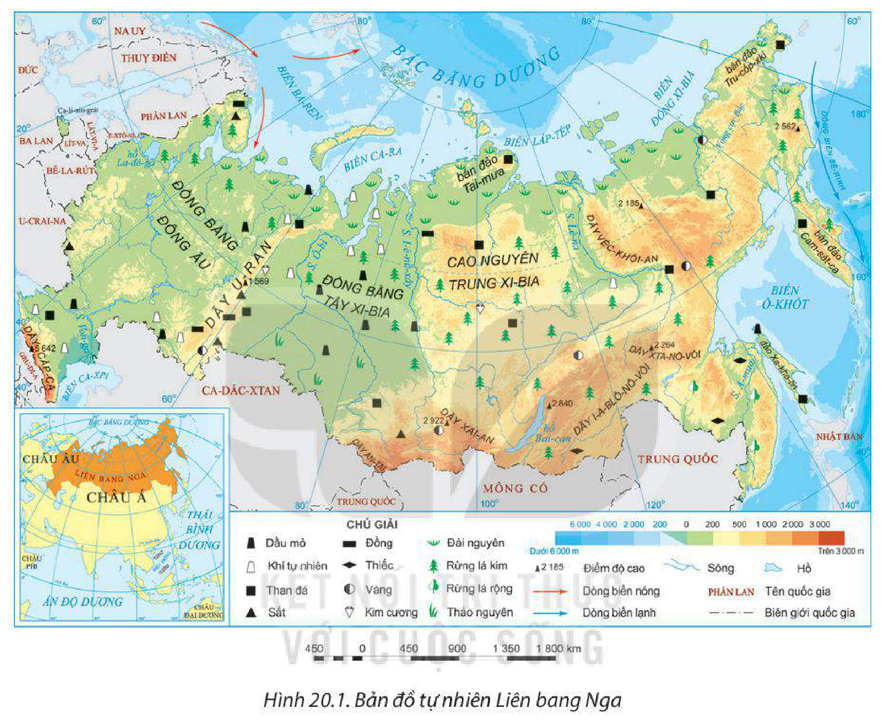
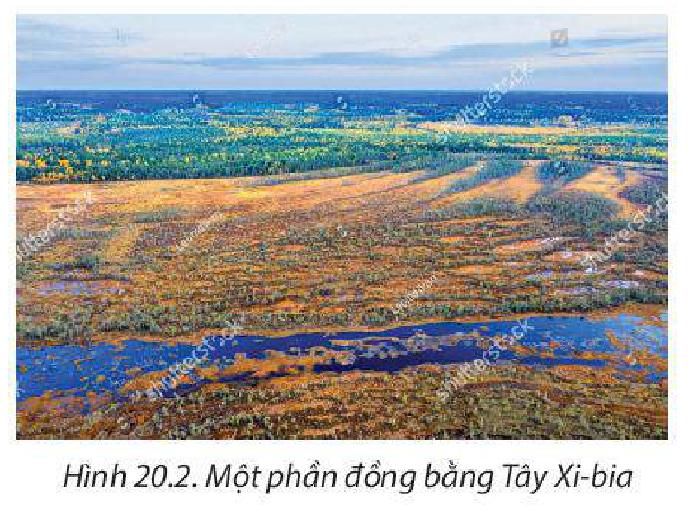
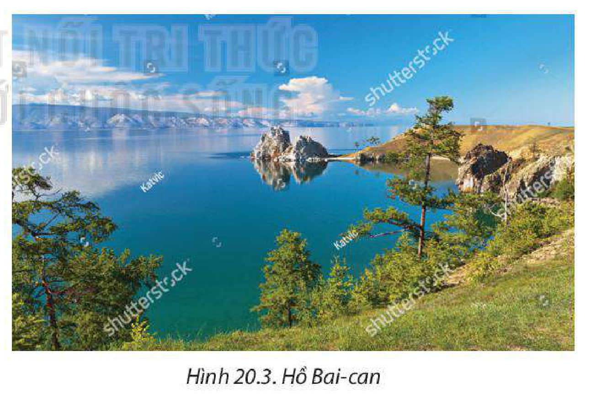
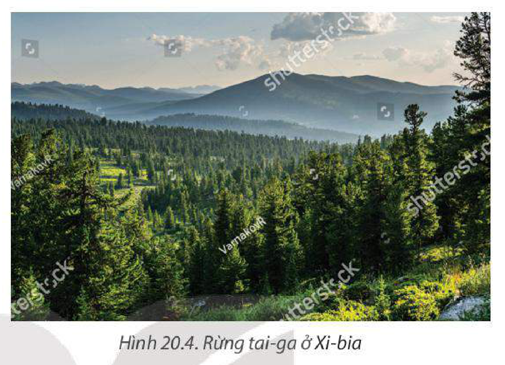
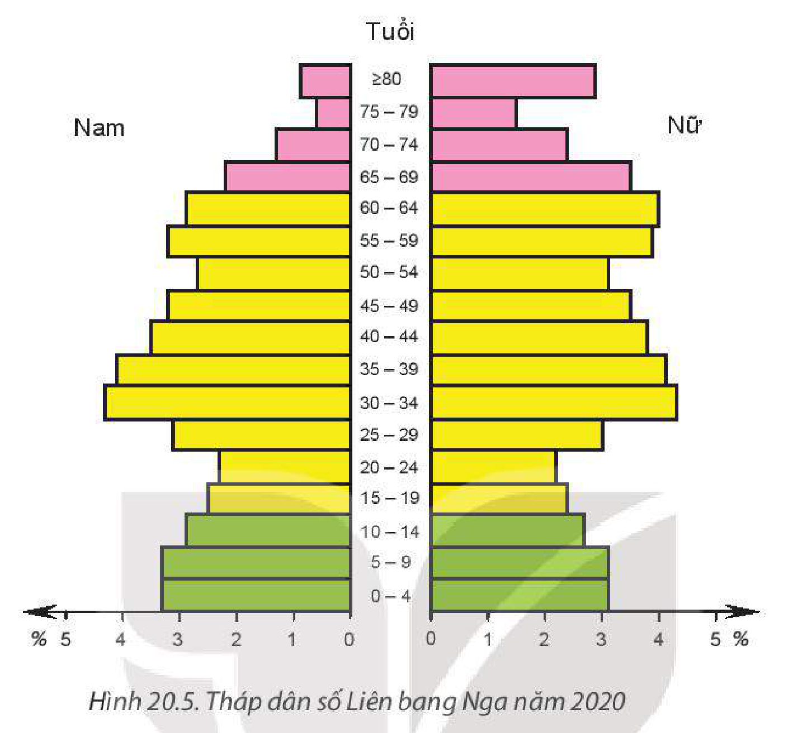
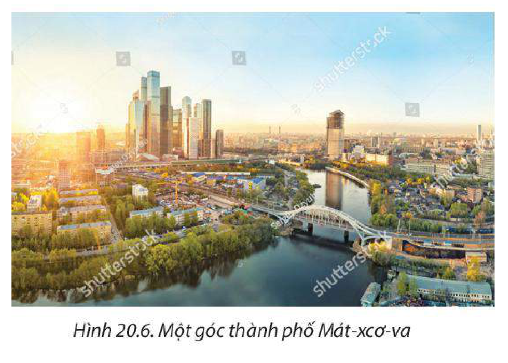
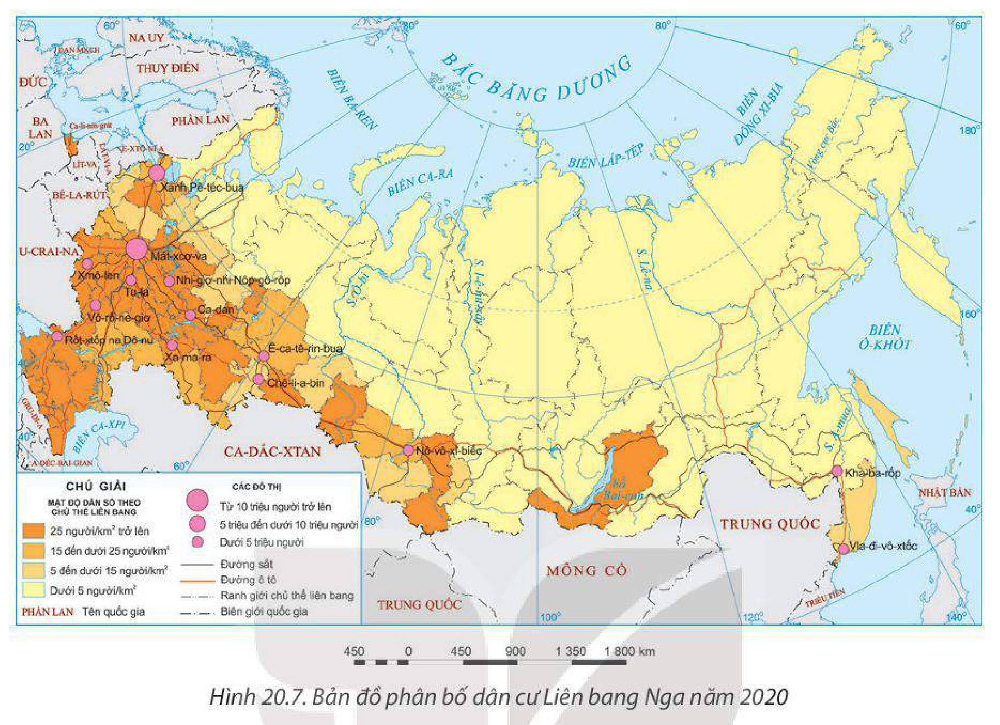
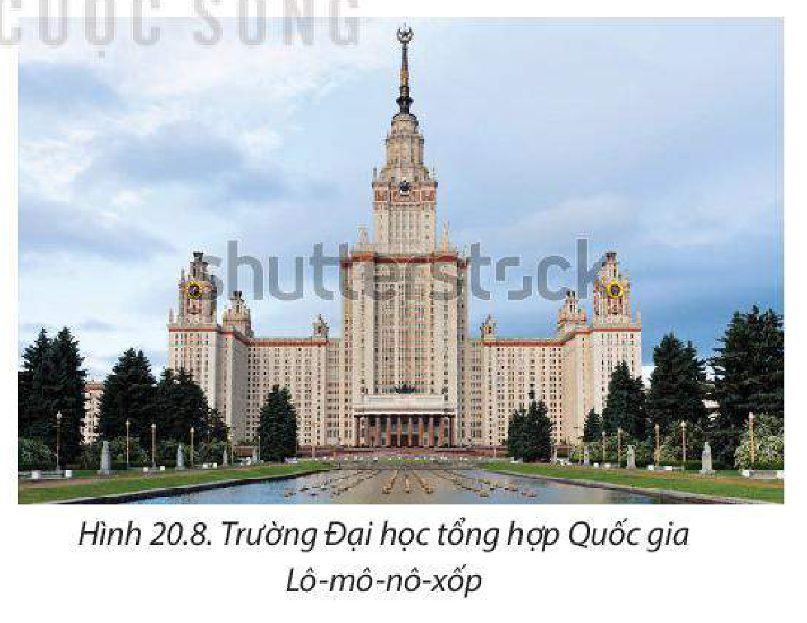

<!-- pdf:99 -->

# BÀI 20: VỊ TRÍ ĐỊA LÍ, ĐIỀU KIỆN TỰ NHIÊN, DÂN CƯ VÀ XÃ HỘI LIÊN BANG NGA

> **LIÊN BANG NGA**
>
> Diện tích đất: khoảng 17 triệu km²
>
> Số dân: 145,9 triệu người (năm 2020)
>
> Thủ đô: Mát-xcơ-va

## 🔴 Mở đầu

Liên bang Nga có diện tích rộng lớn, giáp với nhiều khu vực và quốc gia; điều kiện tự nhiên độc đáo, tài nguyên thiên nhiên phong phú; dân cư và xã hội với nhiều nét đa dạng, khác biệt. Những đặc điểm này có ảnh hưởng như thế nào đến sự phát triển kinh tế – xã hội của Liên bang Nga?

## I. PHẠM VI LÃNH THỔ VÀ VỊ TRÍ ĐỊA LÍ

<!-- term: Phạm vi lãnh thổ Liên bang Nga -->
Liên bang Nga nằm trên cả hai châu lục (châu Á và châu Âu), lãnh thổ bao gồm phần lớn đồng bằng Đông Âu và khu vực Bắc Á cùng phần lãnh thổ Ca-li-nin-grát, nằm biệt lập ở phía tây giữa Ba Lan và Lít-va.

<!-- term: Vị trí địa lí Liên bang Nga -->
Liên bang Nga là quốc gia rộng lớn nhất thế giới, phần đất liền trải dài từ khoảng vĩ độ 41°B đến vĩ độ 77°B và từ khoảng kinh độ 169°T đến kinh độ 27°Đ. Đất liền trải dài trên nhiều múi giờ và nhiều đới khí hậu. Liên bang Nga tiếp giáp với rất nhiều quốc gia (14 quốc gia) ở phía tây và phía nam; tiếp giáp Bắc Băng Dương ở phía bắc, Thái Bình Dương ở phía đông, với nhiều biển như: Ca-ra, Ba-ren, Ô-khốt,...

> 💡 EM CÓ BIẾT?
>
> Diện tích Liên bang Nga chiếm 1/8 bề mặt đất liền của Trái Đất.
>
> Đường biên giới của Liên bang Nga xấp xỉ chiều dài Xích đạo.

Do lãnh thổ rộng lớn, vị trí tiếp giáp với nhiều nước, nhiều biển và đại dương nên Liên bang Nga thuận lợi cho giao thương phát triển kinh tế, văn hoá song cũng nảy sinh những khó khăn về khai thác lãnh thổ và an ninh quốc phòng.

> ❓ Dựa vào thông tin mục I và hình 20.1, hãy:
>
> – Nêu đặc điểm phạm vi lãnh thổ và vị trí địa lí của Liên bang Nga.
>
> – Phân tích ảnh hưởng của phạm vi lãnh thổ và vị trí địa lí đến sự phát triển kinh tế – xã hội của Liên bang Nga.

<!-- pdf:100 -->

## II. ĐIỀU KIỆN TỰ NHIÊN VÀ TÀI NGUYÊN THIÊN NHIÊN

### 1. Địa hình và đất

Liên bang Nga có địa hình đa dạng, cao ở phía đông, thấp về phía tây. Sông I-ê-nít-xây chia lãnh thổ Liên bang Nga thành hai phần: phần phía Tây và phần phía Đông.

*Hình 20.1. Bản đồ tự nhiên Liên bang Nga*

<!-- term: Địa hình phần phía Tây Liên bang Nga -->
– Phần phía Tây chủ yếu là địa hình đồng bằng và đồi núi thấp. Đồng bằng Đông Âu tương đối cao, xen lẫn đồi thấp, có nhiều tiềm năng phát triển nông nghiệp, là nơi tập trung phần lớn dân cư. Đồng bằng Tây Xi-bia thấp, có nhiều đầm lầy, không thuận lợi cho phát triển nông nghiệp. U-ran là dãy núi già có độ cao trung bình khoảng 1 000 m, chia cắt đồng bằng Đông Âu và đồng bằng Tây Xi-bia, tạo nên ranh giới tự nhiên giữa châu Âu và châu Á.

*Hình 20.2. Một phần đồng bằng Tây Xi-bia*

<!-- pdf:101 -->

<!-- term: Địa hình phần phía Đông Liên bang Nga -->
– Phần phía Đông chủ yếu là núi, cao nguyên và các đồng bằng nhỏ. Đây là nơi không thuận lợi cho phát triển nông nghiệp song có tài nguyên thiên nhiên phong phú và trữ năng thuỷ điện lớn.

Liên bang Nga có nhiều loại đất khác nhau, bao gồm: đất đài nguyên, đất pốt dôn, đất nâu xám, đất đen,... Các loại đất thích hợp cho hoạt động trồng trọt, chăn nuôi và phát triển rừng. Tuy nhiên, hơn 40% diện tích lãnh thổ Liên bang Nga thường xuyên nằm dưới lớp băng tuyết không thuận lợi cho canh tác.

### 2. Khí hậu

<!-- term: Khí hậu Liên bang Nga -->
Lãnh thổ Liên bang Nga chủ yếu nằm trong đới khí hậu ôn đới và có sự phân hoá theo lãnh thổ.

– Phần lãnh thổ phía bắc từ vòng cực Bắc trở lên có khí hậu cận cực rất khắc nghiệt, mùa đông kéo dài, có nhiều tuyết.

– Phần phía nam từ vòng cực Bắc trở xuống có khí hậu ôn đới, có thể chia thành ba vùng: vùng phía tây (đồng bằng Đông Âu) khí hậu ôn đới chịu ảnh hưởng của biển, vùng nội địa châu Á có khí hậu ôn đới lục địa và vùng ven Thái Bình Dương có khí hậu ôn đới gió mùa.

Khí hậu tạo điều kiện cho Liên bang Nga có cơ cấu cây trồng, vật nuôi đa dạng, với nhiều loại nông sản đặc trưng của vùng ôn đới. Tuy nhiên, nhiều vùng rộng lớn có khí hậu giá lạnh, khắc nghiệt, không thuận lợi cho hoạt động kinh tế và sinh sống của dân cư.

### 3. Sông, hồ

– Liên bang Nga có mạng lưới sông khá phát triển, có nhiều hệ thống sông lớn trên thế giới. Các sông lớn là sông Von-ga, Ô-bi, I-ê-nít-xây, Lê-na. Phần lớn các sông đều bắt nguồn từ vùng núi nam Xi-bia rồi chảy về hướng bắc.

Các sông có giá trị về nhiều mặt: giao thông đường thuỷ (Von-ga), thuỷ điện (Ô-bi, I-ê-nít-xây,...) cung cấp nước cho sinh hoạt và sản xuất, đồng thời là nguồn cung cấp thuỷ sản quan trọng. Tuy nhiên, vào mùa đông một số sông bị đóng băng trong thời gian dài nên giao thông đường sông bị hạn chế.

*Hình 20.3. Hồ Bai-can*

<!-- term: Hồ Bai-can -->
– Liên bang Nga có nhiều hồ lớn, trong đó hồ Bai-can là hồ sâu nhất thế giới và là hồ chứa nước ngọt lớn nhất hành tinh. Các hồ ở Liên bang Nga có giá trị về thuỷ sản, du lịch và bảo vệ tự nhiên.

<!-- pdf:102 -->

### 4. Sinh vật

Tài nguyên sinh vật của Liên bang Nga rất đa dạng và phân hoá theo vùng. Liên bang Nga có diện tích rừng đứng đầu thế giới, chiếm khoảng 20% diện tích rừng thế giới (năm 2020).

<!-- term: Rừng tai-ga -->
Rừng ở Liên bang Nga chủ yếu là rừng lá kim (tai-ga), chiếm khoảng 60% diện tích rừng cả nước, tập trung nhiều nhất ở vùng Xi-bia và phía bắc châu Âu.

Thực vật chính của rừng tai-ga là cây lá kim như: vân sam, thông, tùng rụng lá,... Trong rừng có nhiều loài động vật như gấu nâu, nai sừng tấm và rất nhiều loài chim. Rừng tai-ga là nguồn nguyên liệu quan trọng cho ngành khai thác và chế biến gỗ.

*Hình 20.4. Rừng tai-ga ở Xi-bia*

Ngoài rừng tai-ga, Liên bang Nga còn có rừng lá rộng ở phía đông nam với hệ động thực vật phong phú. Thảo nguyên ở phía nam đồng bằng Tây Xi-bia có các loại cỏ chiếm ưu thế, thuận lợi phát triển chăn nuôi. Đài nguyên lạnh giá phía bắc có nhiều loài động vật như gấu trắng, hải cẩu, tuần lộc.

### 5. Khoáng sản

<!-- term: Tài nguyên khoáng sản Liên bang Nga -->
Liên bang Nga rất giàu tài nguyên khoáng sản, bao gồm các loại khoáng sản năng lượng, kim loại, phi kim loại như than đá, dầu mỏ, khí tự nhiên, kim cương, vàng, thiếc, đồng,... Dầu mỏ, khí tự nhiên có trữ lượng hàng đầu thế giới, tập trung nhiều nhất ở đồng bằng Tây Xi-bia. Than tập trung nhiều ở dãy U-ran và phía đông.

**BẢNG 20.1. TRỮ LƯỢNG MỘT SỐ KHOÁNG SẢN CHÍNH CỦA LIÊN BANG NGA NĂM 2020**

| Khoáng sản | Trữ lượng |
| --- | --- |
| Dầu mỏ *(tỉ tấn)* | 14,8 |
| Khí tự nhiên *(nghìn tỉ m³)* | 37,4 |
| Than đá *(tỉ tấn)* | 162,2 |
| Quặng sắt *(tỉ tấn)* | 25,0 |
| Kim cương *(tỉ carat)* | 1,1 |
| Vàng *(nghìn tấn)* | 6,8 |

*(Nguồn: Bộ Tài nguyên và Môi trường Liên bang Nga, 2022)*

<!-- pdf:103 -->

Tài nguyên khoáng sản giàu có là cơ sở nguyên liệu để phát triển các ngành công nghiệp và thúc đẩy hoạt động ngoại thương. Nhiều loại khoáng sản của Liên bang Nga ảnh hưởng lớn tới nguồn cung nguyên liệu toàn cầu, đồng thời làm tăng vị thế của nước Nga trên thế giới. Tuy nhiên, Liên bang Nga cũng gặp những khó khăn trong việc khai thác và tiêu thụ các nguồn tài nguyên khoáng sản do nhiều loại khoáng sản nằm ở những nơi có địa hình phức tạp hoặc những vùng có khí hậu khắc nghiệt.

### 6. Biển

<!-- term: Tài nguyên biển Liên bang Nga -->
Tổng chiều dài đường bờ biển của Liên bang Nga khoảng 37 000 km, dài thứ ba trên thế giới sau Ca-na-đa và In-đô-nê-xi-a. Liên bang Nga có nhiều biển lớn như biển Ba-ren, biển Ca-ra, biển Ô-khốt,... Tài nguyên sinh vật biển phong phú với các loài có giá trị kinh tế cao thuộc vùng biển lạnh như cá hồi, cá thu, cá trích,... Nhiều vùng biển, nhất là vùng biển phía đông nam có tiềm năng phát triển ngành khai thác thuỷ sản, phát triển giao thông vận tải biển, thương mại và du lịch biển. Vùng biển và thềm lục địa (vùng biển Ô-khốt) có trữ lượng lớn dầu mỏ và khí tự nhiên. Vùng biển phía bắc có thời gian đóng băng kéo dài trong năm gây khó khăn cho hoạt động giao thông vận tải.

> ❓ Dựa vào nội dung mục II và hình 20.1, hãy:
>
> – Trình bày khái quát đặc điểm điều kiện tự nhiên và tài nguyên thiên nhiên của Liên bang Nga.
>
> – Phân tích thuận lợi và khó khăn của một điều kiện tự nhiên và tài nguyên thiên nhiên đối với sự phát triển kinh tế – xã hội Liên bang Nga.

## III. DÂN CƯ VÀ XÃ HỘI

### 1. Dân cư

<!-- term: Dân cư Liên bang Nga -->
– Liên bang Nga là nước đông dân, đứng thứ 9 thế giới (năm 2020). Tỉ lệ tăng tự nhiên của dân số Liên bang Nga thấp, trung bình giai đoạn 2015 – 2020 là 0,05%. Năm 2020, Liên bang Nga có khoảng 72,8 triệu lao động. Tuy nhiên, do tỉ suất sinh thấp, cơ cấu dân số già nên vấn đề thiếu hụt lao động trở thành thách thức đối với Liên bang Nga hiện nay và trong tương lai.

> 💡 EM CÓ BIẾT?
>
> Nước Nga phải đối mặt với tình trạng giảm dân số kéo dài rất nhiều năm trong thập niên 90 của thế kỉ XX do tỉ lệ tăng tự nhiên của dân số âm và di cư ra nước ngoài. Từ năm 2010 đến nay, số dân Liên bang Nga bắt đầu tăng nhẹ. Liên bang Nga đang có những chính sách dân số nhằm duy trì mức sinh thay thế và tránh tình trạng suy giảm dân số.

**BẢNG 20.2. SỐ DÂN CỦA LIÊN BANG NGA GIAI ĐOẠN 1991 – 2020**

| Năm | 1991 | 2000 | 2005 | 2010 | 2015 | 2020 |
| --- | --- | --- | --- | --- | --- | --- |
| Số dân *(triệu người)* | 148,3 | 145,6 | 143,7 | 143,5 | 145,0 | 145,9 |
<!-- ocr-ok: đối chiếu trực tiếp ảnh trang PDF 103 (Bảng 20.2, OCR bỏ sót hàng năm trên nền màu xanh) -->

*(Nguồn: Ngân hàng Thế giới, 2020)*

– Liên bang Nga là quốc gia đa sắc tộc với khoảng 100 dân tộc, hơn 80% dân số là người Nga, ngoài ra còn có các dân tộc khác như Tác-ta, U-crai-na, Bát-xki-a, Chu-vát,... sống tập trung chủ yếu ở các nước cộng hoà tự trị.

<!-- pdf:104 -->

– Liên bang Nga có cơ cấu dân số già, nhóm từ 65 tuổi trở lên chiếm 15,5% tổng số dân (năm 2020), tỉ suất tử thô cao. Liên bang Nga có số nữ nhiều hơn số nam, đặc biệt ở các nhóm tuổi cao.

*Hình 20.5. Tháp dân số Liên bang Nga năm 2020*

– Liên bang Nga có mật độ dân số trung bình rất thấp, chỉ khoảng 9 người/km² (năm 2020). Dân cư phân bố không đều, khoảng 75% dân cư sống tập trung ở phần lãnh thổ phía tây dãy U-ran (phần châu Âu thuộc Nga), trong khi ở các vùng phía bắc và phía đông (như Xi-bia, Viễn Đông) dân cư rất thưa thớt, nhiều vùng gần như không có người ở. Những vùng dân cư đông đúc là những nơi có kinh tế phát triển, điều kiện tự nhiên (khí hậu, nguồn nước,...) thuận lợi cho cư trú. Các khu vực thưa dân tuy có tài nguyên thiên nhiên phong phú nhưng điều kiện địa hình, khí hậu,... khắc nghiệt.

– Đô thị hoá của Liên bang Nga ở mức cao, tỉ lệ dân thành thị cao là 74,8% năm 2020. Các đô thị phần lớn thuộc loại nhỏ và trung bình. Mát-xcơ-va (gần 13 triệu) và Xanh Pê-téc-bua (gần 6 triệu) là các đô thị lớn nhất của đất nước. Các đô thị là những trung tâm chính trị, tài chính, công nghiệp, dịch vụ và giao thông vận tải của Liên bang Nga.

*Hình 20.6. Một góc thành phố Mát-xcơ-va*

<!-- pdf:105 -->

*Hình 20.7. Bản đồ phân bố dân cư Liên bang Nga năm 2020*

> ❓ Dựa vào thông tin mục 1 và hình 20.7, hãy:
>
> – Nêu đặc điểm dân cư Liên bang Nga.
>
> – Phân tích tác động của đặc điểm dân cư đối với sự phát triển kinh tế – xã hội Liên bang Nga.

### 2. Xã hội

<!-- term: Văn hoá và xã hội Liên bang Nga -->
– Sự đa dạng về dân tộc, sắc tộc đã tạo nên một nền văn hoá Nga đa dạng, độc đáo. Tôn giáo chủ yếu là Chính thống giáo, ngoài ra còn có các tôn giáo khác như Hồi giáo, Phật giáo,...

– Nước Nga có nền văn hoá lớn, phát triển lâu đời, với nhiều đóng góp cho văn hoá nhân loại như: các công trình kiến trúc, tác phẩm văn học, hội hoạ, âm nhạc, vũ điệu, công trình khoa học (toán, hoá học, vũ trụ), thành tựu về quân sự,...

*Hình 20.8. Trường Đại học tổng hợp Quốc gia Lô-mô-nô-xốp*

– Chất lượng cuộc sống của người dân Nga được cải thiện đáng kể.

<!-- pdf:106 -->

**BẢNG 20.3. TUỔI THỌ TRUNG BÌNH, SỐ NĂM ĐI HỌC TRUNG BÌNH CỦA NGƯỜI TỪ 25 TUỔI TRỞ LÊN CỦA LIÊN BANG NGA VÀ THẾ GIỚI NĂM 2000 VÀ NĂM 2020**

| Quốc gia / Thế giới | Tuổi thọ trung bình *(năm)* Năm 2000 | Tuổi thọ trung bình *(năm)* Năm 2020 | Số năm đi học trung bình của người từ 25 tuổi trở lên *(năm)* Năm 2000 | Số năm đi học trung bình của người từ 25 tuổi trở lên *(năm)* Năm 2020 |
| --- | --- | --- | --- | --- |
| Liên bang Nga | 65,3 | 71,3 | 12,1 | 12,8 |
| Thế giới | 68 | 73 | 4,5 | 8,6 |

*(Nguồn: Liên hợp quốc, 2022)*

– Người dân Liên bang Nga có trình độ học vấn cao. Liên bang Nga là quốc gia đứng hàng đầu thế giới về các ngành khoa học cơ bản với nhiều trường đại học danh tiếng. Nền tảng khoa học – công nghệ lâu đời là điều kiện thuận lợi cho Liên bang Nga phát triển kinh tế và thu hút đầu tư của nước ngoài.

– Liên bang Nga đang phải đối mặt với nhiều thách thức như sự phân hoá trình độ phát triển kinh tế giữa các khu vực, nhiều vấn đề xã hội phức tạp,...

> ❓ Dựa vào thông tin mục 2, hãy phân tích ảnh hưởng của đặc điểm xã hội tới sự phát triển kinh tế – xã hội Liên bang Nga.

## ✏️ Luyện tập

1. Phân tích ảnh hưởng của điều kiện tự nhiên đến sản xuất nông nghiệp của Liên bang Nga.

2. Dựa vào hình 20.5, hãy phân tích cơ cấu giới tính và tuổi của dân số Liên bang Nga năm 2020. Nêu ảnh hưởng của cơ cấu dân số đó đối với sự phát triển kinh tế – xã hội của Liên bang Nga.

## 🚀 Vận dụng

Sưu tầm thông tin và viết báo cáo ngắn về tài nguyên rừng lá kim của Liên bang Nga.

## 📷 Danh sách hình trong bài

| Mã hình | Trang PDF | Vị trí trong bài | Chú thích gốc |
| --- | --- | --- | --- |
| H11-dia-b20-01 | 100 | Mục II.1 | Hình 20.1. Bản đồ tự nhiên Liên bang Nga |
| H11-dia-b20-02 | 100 | Mục II.1 | Hình 20.2. Một phần đồng bằng Tây Xi-bia |
| H11-dia-b20-03 | 101 | Mục II.3 | Hình 20.3. Hồ Bai-can |
| H11-dia-b20-04 | 102 | Mục II.4 | Hình 20.4. Rừng tai-ga ở Xi-bia |
| H11-dia-b20-05 | 104 | Mục III.1 | Hình 20.5. Tháp dân số Liên bang Nga năm 2020 |
| H11-dia-b20-06 | 104 | Mục III.1 | Hình 20.6. Một góc thành phố Mát-xcơ-va |
| H11-dia-b20-07 | 105 | Mục III.1 | Hình 20.7. Bản đồ phân bố dân cư Liên bang Nga năm 2020 |
| H11-dia-b20-08 | 105 | Mục III.2 | Hình 20.8. Trường Đại học tổng hợp Quốc gia Lô-mô-nô-xốp |
