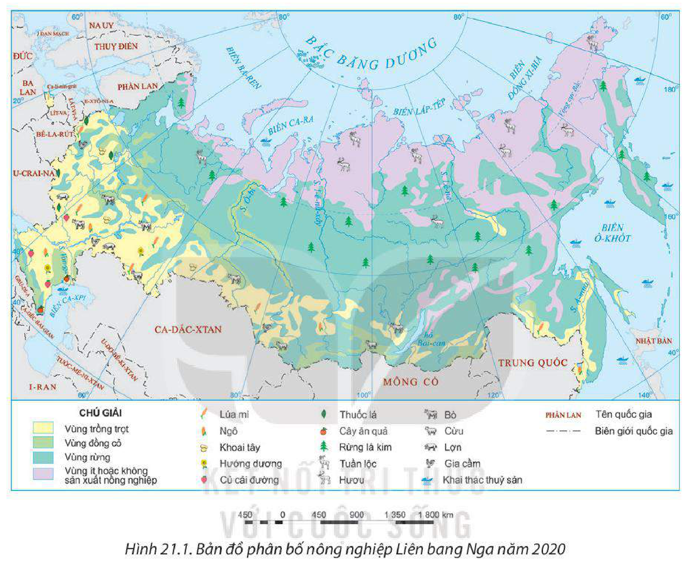
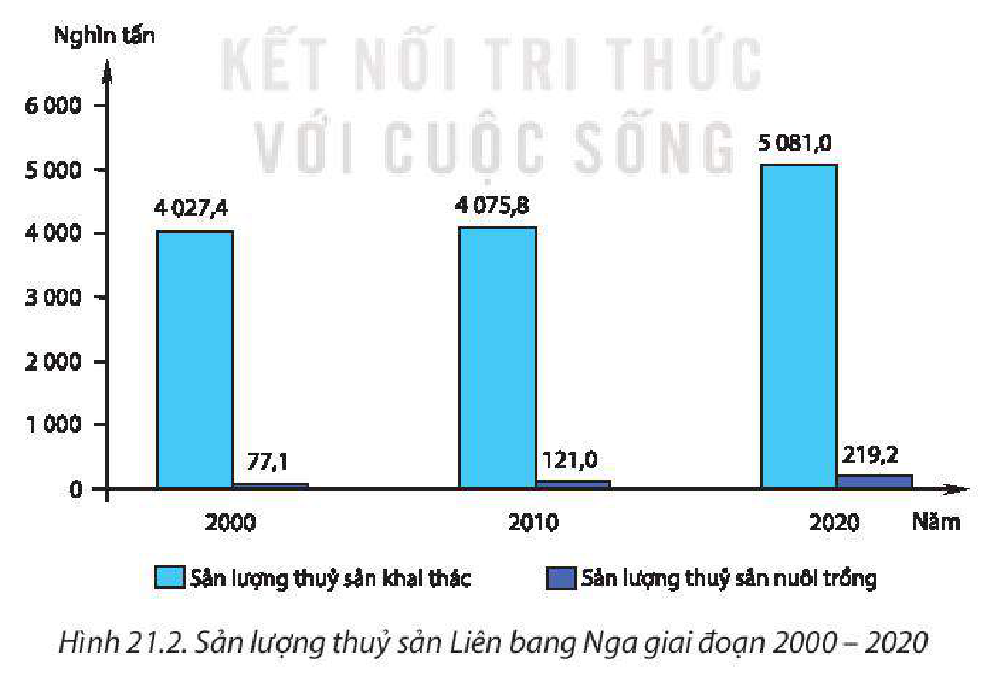
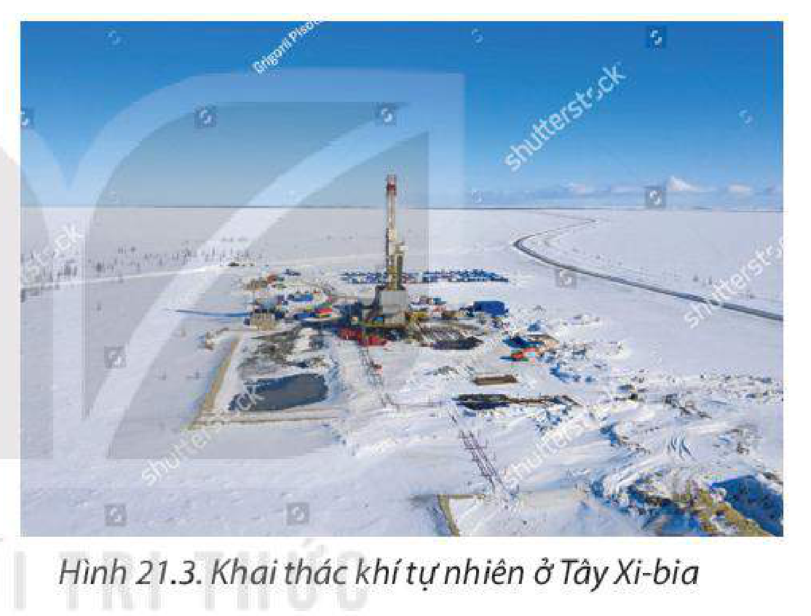
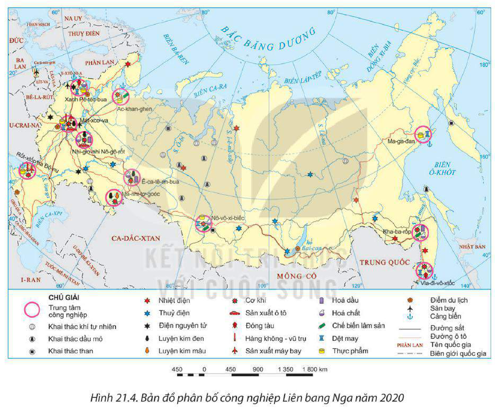
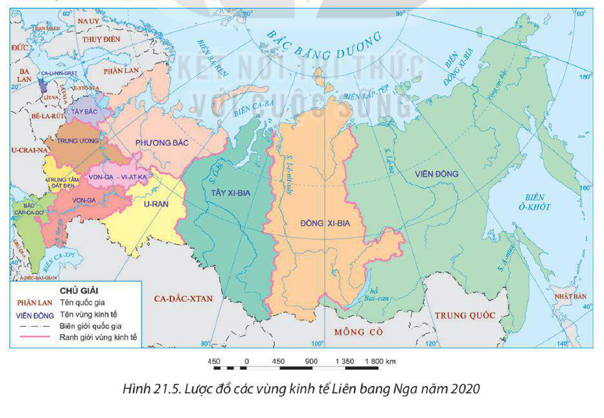

<!-- pdf:107 -->

# BÀI 21: KINH TẾ LIÊN BANG NGA

## 🔴 Mở đầu

Liên bang Nga có điều kiện tự nhiên, dân cư và xã hội thuận lợi để phát triển kinh tế. Quốc gia này đang từng bước khẳng định vai trò, vị thế của mình trong nền kinh tế thế giới. Kinh tế Liên bang Nga phát triển ra sao? Những ngành kinh tế nào đóng vai trò quan trọng đối với nền kinh tế Liên bang Nga?

## I. TÌNH HÌNH PHÁT TRIỂN KINH TẾ

<!-- term: Nền kinh tế Liên bang Nga -->
Liên bang Nga có quy mô GDP khá lớn, năm 2020 đạt khoảng 1,5 nghìn tỉ USD (chiếm khoảng 1,7% GDP toàn cầu). Tốc độ tăng trưởng GDP không ổn định. Cơ cấu kinh tế có sự chuyển dịch theo hướng tăng tỉ trọng các ngành dịch vụ và các ngành có hàm lượng khoa học – kĩ thuật cao.

**BẢNG 21.1. MỘT SỐ CHỈ TIÊU KINH TẾ CỦA LIÊN BANG NGA GIAI ĐOẠN 2000 – 2020**

| Chỉ tiêu | Năm 2000 | Năm 2010 | Năm 2020 |
| --- | --- | --- | --- |
| GDP theo giá hiện hành *(tỉ USD)* | 259,7 | 1 479,8 | 1 483,5 |
| Tốc độ tăng GDP *(%)* | 10,0 | 4,0 | -3,0 |
| Cơ cấu GDP *(%)* – Nông nghiệp, lâm nghiệp và thuỷ sản | 5,8 | 3,3 | 4,0 |
| Cơ cấu GDP *(%)* – Công nghiệp và xây dựng | 33,9 | 30,0 | 29,9 |
| Cơ cấu GDP *(%)* – Dịch vụ | 49,7 | 53,1 | 56,1 |
| Cơ cấu GDP *(%)* – Thuế sản phẩm trừ trợ cấp sản phẩm | 10,6 | 13,6 | 10,0 |

*(Nguồn: Ngân hàng Thế giới, 2022)*

> ❓ Dựa vào nội dung mục I, hãy nêu khái quát tình hình phát triển kinh tế của Liên bang Nga.

## II. CÁC NGÀNH KINH TẾ

### 1. Nông nghiệp, lâm nghiệp và thuỷ sản

Nông nghiệp, lâm nghiệp và thuỷ sản có vai trò quan trọng trong nền kinh tế Liên bang Nga. Ngành này góp phần khai thác hiệu quả các tài nguyên đất, nước, khí hậu,... của đất nước; cung cấp lương thực, thực phẩm cho thị trường trong nước và thế giới; góp phần bảo vệ môi trường,... Năm 2020, ngành nông nghiệp, lâm nghiệp, thuỷ sản đóng góp 4,0% GDP và thu hút khoảng 6% lực lượng lao động.

<!-- pdf:108 -->

**a) Nông nghiệp**

<!-- term: Nông nghiệp Liên bang Nga -->
Hiện nay, Liên bang Nga đang đầu tư, áp dụng khoa học – công nghệ vào sản xuất,... để mang lại hiệu quả ngày càng cao. Sản xuất nông nghiệp phát triển ở đồng bằng Đông Âu, phía đông nam,...

*Hình 21.1. Bản đồ phân bố nông nghiệp Liên bang Nga năm 2020*

**BẢNG 21.2. MỘT SỐ NÔNG SẢN CỦA LIÊN BANG NGA GIAI ĐOẠN 2000 – 2020**

| Sản lượng | Năm 2000 | Năm 2020 |
| --- | --- | --- |
| Lúa mì *(triệu tấn)* | 34,5 | 85,9 |
| Củ cải đường *(triệu tấn)* | 14,1 | 33,9 |
| Khoai tây *(triệu tấn)* | 29,5 | 19,6 |
| Hạt hướng dương *(triệu tấn)* | 3,9 | 13,3 |
| Đàn bò *(triệu con)* | 28,1 | 18,1 |
| Đàn cừu *(triệu con)* | 12,6 | 20,7 |

*(Nguồn: Tổ chức Lương thực và Nông nghiệp Liên hợp quốc, 2022)*

<!-- pdf:109 -->

– Trồng trọt chiếm khoảng 40% giá trị sản xuất nông nghiệp của Liên bang Nga. Các cây trồng chính là cây lương thực (lúa mì, ngô, khoai tây,...), cây công nghiệp (củ cải đường, thuốc lá, hướng dương,...) và cây ăn quả. Đồng bằng Đông Âu là vùng trồng trọt chính của nước Nga.

– Chăn nuôi khá phát triển, các vật nuôi chủ yếu là lợn, bò, cừu và một số vật nuôi đặc trưng xứ lạnh như hươu, tuần lộc.

**b) Lâm nghiệp**

<!-- term: Lâm nghiệp Liên bang Nga -->
Lâm nghiệp là ngành kinh tế quan trọng của Liên bang Nga. Năm 2020, Liên bang Nga có diện tích rừng lớn nhất thế giới, khoảng 815 triệu ha, chiếm gần 50% diện tích lãnh thổ. Ngành khai thác và chế biến lâm sản hằng năm đem lại nguồn thu đáng kể cho nền kinh tế. Sản lượng gỗ tròn khai thác ngày càng tăng từ 158,1 triệu m³ năm 2000 lên 217,0 triệu m³ năm 2020, đứng thứ tư trên thế giới (sau Hoa Kỳ, Ấn Độ và Trung Quốc). Gỗ và các sản phẩm từ gỗ là một trong những mặt hàng xuất khẩu chính của Liên bang Nga.

**c) Thuỷ sản**

<!-- term: Thuỷ sản Liên bang Nga -->
Liên bang Nga là một trong những quốc gia có nhiều điều kiện thuận lợi cho phát triển ngành khai thác thuỷ sản (giáp nhiều biển và đại dương, nhiều hệ thống sông, hồ lớn). Ngành khai thác thuỷ sản khá phát triển, sản lượng thuỷ sản khai thác của Liên bang Nga chiếm 6,1% tổng sản lượng thuỷ sản khai thác toàn thế giới (năm 2020) và trở thành nước xuất khẩu thuỷ sản lớn. Khai thác thuỷ sản của Liên bang Nga tập trung chủ yếu ở ngư trường Viễn Đông, ngư trường phía Nam, vùng biển Ca-xpi,...

*Hình 21.2. Sản lượng thuỷ sản Liên bang Nga giai đoạn 2000 – 2020*

*(Nguồn: Tổ chức Lương thực và Nông nghiệp Liên hợp quốc, 2022)*

Ngành nuôi trồng thuỷ sản mặc dù có sản lượng ngày càng tăng nhưng tỉ trọng còn nhỏ trong tổng sản lượng thuỷ sản.

<!-- pdf:110 -->

Một số sản phẩm thuỷ sản có sản lượng lớn và giá trị kinh tế cao ở Liên bang Nga là cá hồi, cá thu, cá trích, cá tuyết,...

> ❓ Dựa vào nội dung mục 1, hãy:
>
> – Xác định sự phân bố một số nông sản chính của Liên bang Nga.
>
> – Trình bày tình hình phát triển ngành nông nghiệp, lâm nghiệp và thuỷ sản của Liên bang Nga.

### 2. Công nghiệp

<!-- term: Công nghiệp Liên bang Nga -->
Công nghiệp giữ vai trò chủ đạo trong nền kinh tế Liên bang Nga. Năm 2020, công nghiệp và xây dựng chiếm 30% GDP và thu hút khoảng 27% lực lượng lao động. Cơ cấu ngành công nghiệp đa dạng, các ngành công nghiệp chính là năng lượng, chế tạo, luyện kim.

– Công nghiệp năng lượng có vai trò quan trọng trong nền kinh tế Liên bang Nga.

+ Năm 2020, Liên bang Nga là nhà sản xuất dầu mỏ và khí tự nhiên lớn thứ hai thế giới (sau Hoa Kỳ). Ngành này tập trung chủ yếu ở vùng U-ran và Tây Xi-bia.

+ Liên bang Nga đứng thứ năm trên thế giới về sản lượng khai thác than, chiếm 5,2% sản lượng than toàn cầu (sau Trung Quốc, Ấn Độ, In-đô-nê-xi-a và Hoa Kỳ). Các mỏ than có sản lượng khai thác cao nhất tập trung ở Xi-bia và Viễn Đông.

*Hình 21.3. Khai thác khí tự nhiên ở Tây Xi-bia*

+ Công nghiệp sản xuất điện có cơ cấu ngành đa dạng dựa trên nguồn nguyên liệu dồi dào, bao gồm thuỷ điện, nhiệt điện, điện nguyên tử, năng lượng tái tạo khác,... Sản lượng điện ngày càng tăng, chiếm khoảng 4% sản lượng điện toàn thế giới (năm 2020) và đứng thứ tư thế giới (sau Trung Quốc, Hoa Kỳ và Ấn Độ). Các nhà máy nhiệt điện lớn phân bố ở vùng Trung ương, U-ran và Tây Xi-bia.

– Công nghiệp chế tạo là động lực phát triển của nền kinh tế Nga. Một số sản phẩm quan trọng của ngành công nghiệp chế tạo máy như: tàu vũ trụ, tên lửa, máy bay, tàu ngầm, tàu phá băng, ô tô, động cơ, máy công cụ, máy kéo,...

– Công nghiệp luyện kim của Liên bang Nga có lịch sử lâu đời; trong đó, sản xuất thép là lĩnh vực quan trọng nhất. Sản lượng thép liên tục tăng, chiếm 3,8% sản lượng thép toàn thế giới (năm 2020), phân bố ở các vùng Tây Xi-bia, U-ran và Trung ương.

<!-- pdf:111 -->

**BẢNG 21.3. SẢN LƯỢNG MỘT SỐ SẢN PHẨM CÔNG NGHIỆP CỦA LIÊN BANG NGA GIAI ĐOẠN 2000 – 2020**

| Sản phẩm | Năm 2000 | Năm 2011 | Năm 2020 |
| --- | --- | --- | --- |
| Điện *(tỉ kWh)* | 878,0 | 1 055,0 | 1 085,0 |
| Than *(triệu tấn)* | 258,0 | 336,0 | 398,0 |
| Quặng sắt *(triệu tấn)* | 87,0 | 104,0 | 100,0 |
| Thép *(triệu tấn)* | 59,2 | 68,1 | 73,8 |

*(Nguồn: Thống kê về các nền kinh tế mới nổi năm 2021)*

*Hình 21.4. Bản đồ phân bố công nghiệp Liên bang Nga năm 2020*

Sự phân bố các ngành công nghiệp của Liên bang Nga thể hiện sự chuyên môn hoá, các ngành khai thác, sơ chế phân bố ở miền Đông, trong khi miền Tây tập trung các ngành chế biến và các ngành công nghệ cao. Các trung tâm công nghiệp lớn tập trung ở đồng bằng Đông Âu, U-ran, Tây Xi-bia và dọc các đường giao thông quan trọng.

> ❓ Khai thác nội dung mục 2, hãy:
>
> – Xác định sự phân bố một số ngành công nghiệp chính của Liên bang Nga.
>
> – Trình bày tình hình phát triển ngành công nghiệp của Liên bang Nga.

<!-- pdf:112 -->

### 3. Dịch vụ

<!-- term: Dịch vụ Liên bang Nga -->
Ngành dịch vụ đang ngày càng giữ vị trí quan trọng trong nền kinh tế Liên bang Nga, chiếm 56,3% trong GDP và thu hút 67,3% lực lượng lao động (năm 2020). Các ngành dịch vụ phát triển đa dạng theo hướng hiện đại hoá. Các trung tâm dịch vụ lớn như Mát-xcơ-va, Xanh Pê-téc-bua,... đồng thời là các đô thị lớn. Một số ngành dịch vụ nổi bật của Liên bang Nga là thương mại, giao thông vận tải, du lịch và tài chính ngân hàng.

**a) Thương mại**

– Nội thương của Liên bang Nga phát triển thể hiện ở hàng hoá trên thị trường phong phú, chất lượng sản phẩm tăng; giá trị buôn bán, trao đổi ngày càng lớn; hệ thống bán buôn, bán lẻ phát triển rộng khắp với nhiều hình thức,...

– Liên bang Nga là một trong những nước xuất khẩu, nhập khẩu hàng hoá và dịch vụ lớn trên thế giới và luôn xuất siêu. Các mặt hàng xuất khẩu chính gồm: dầu mỏ, khí tự nhiên, kim loại, hoá chất, thực phẩm và gỗ. Các mặt hàng nhập khẩu chính gồm: máy móc và thiết bị, ô tô, rau quả, hàng dệt may và da giày. Các đối tác thương mại chính của Liên bang Nga là Trung Quốc, Ấn Độ, Hoa Kỳ, một số nước Đông Nam Á,...

**BẢNG 21.4. TRỊ GIÁ XUẤT NHẬP KHẨU HÀNG HOÁ VÀ DỊCH VỤ CỦA LIÊN BANG NGA GIAI ĐOẠN 2000 – 2020**

*(Đơn vị: tỉ USD)*

| Trị giá | Năm 2000 | Năm 2010 | Năm 2015 | Năm 2020 |
| --- | --- | --- | --- | --- |
| Xuất khẩu | 114,4 | 444,5 | 391,4 | 378,6 |
| Nhập khẩu | 62,5 | 322,4 | 281,6 | 305,0 |

*(Nguồn: Ngân hàng Thế giới, 2022)*

**b) Giao thông vận tải**

Liên bang Nga có mạng lưới giao thông phát triển, với đầy đủ các loại hình giao thông, đóng góp vào sự phát triển kinh tế, văn hoá trong nước cũng như giữa nước Nga và các nước trên thế giới. Mát-xcơ-va là đầu mối giao thông vận tải lớn nhất cả nước.

<!-- term: Tuyến đường sắt xuyên Xi-bia -->
> 💡 EM CÓ BIẾT?
>
> Tuyến đường sắt xuyên Xi-bia (trên 9 000 km) và tuyến BAM dài 3 200 km nối từ hồ Bai-can tới sông A-mua là hai tuyến đường sắt dài nhất nước Nga, có vai trò thúc đẩy phát triển kinh tế vùng phía Đông Xi-bia nhiều tiềm năng.
<!-- ocr-ok: đối chiếu trực tiếp ảnh trang PDF 112 (hộp Em có biết 2 cột bị OCR đọc lẫn và sót dòng) -->

– Liên bang Nga là một trong những nước có mạng lưới đường sắt dài nhất thế giới với hơn 87 000 km. Hệ thống tàu điện ngầm của Liên bang Nga rất phát triển, nhất là ở Thủ đô Mát-xcơ-va.

– Đường bộ có tổng chiều dài trên 1 triệu km, với nhiều hệ thống đường cao tốc liên bang, phát triển ở khu vực phía tây.

– Đường sông có tổng chiều dài trên 100 nghìn km với mạng lưới kênh đào nối lưu vực các sông lớn, chủ yếu trên phần nước Nga thuộc châu Âu, nhất là trên sông Von-ga.

– Giao thông vận tải đường biển khá phát triển, các cảng lớn và quan trọng của Liên bang Nga gồm: Xanh Pê-téc-bua, Vla-đi-vô-xtốc, Ma-ga-đan,...

<!-- pdf:113 -->

– Đường ống được phát triển rất mạnh ở Liên bang Nga. Tổng chiều dài đường ống lớn thứ hai thế giới để vận chuyển dầu mỏ và khí tự nhiên không chỉ trong lãnh thổ mà còn đi đến các nước khác, nhất là các nước châu Âu.

– Đường hàng không cũng phát triển. Năm 2020, Liên bang Nga có trên 1 200 sân bay, nhiều sân bay lớn như: She-re-met-ye-vô, Pun-cô-vô, Khơ-ra-brô-vô, Đô-mô-đê-đô-vô,...

**c) Du lịch**

Tài nguyên du lịch tự nhiên và văn hoá phong phú, độc đáo, giàu bản sắc với nhiều di sản tự nhiên và văn hoá thế giới, tạo điều kiện cho Liên bang Nga trở thành điểm đến hấp dẫn đối với khách du lịch. Năm 2019, Liên bang Nga đón 24,6 triệu khách du lịch quốc tế, doanh thu đạt 11 tỉ USD. Mát-xcơ-va và Xanh Pê-téc-bua là các trung tâm du lịch lớn nhất của nước Nga. Các địa điểm du lịch nổi tiếng như: hồ Bai-can, nhà thờ chính toà Thánh Ba-sin, Cung điện Crem-lin,...

**d) Tài chính ngân hàng**

Tài chính ngân hàng của Liên bang Nga phát triển đa dạng với nhiều hoạt động như thị trường trái phiếu, chứng khoán, tín dụng,... thúc đẩy nền kinh tế phát triển. Các trung tâm tài chính quan trọng của Liên bang Nga là Mát-xcơ-va, Xanh Pê-téc-bua,...

> ❓ Dựa vào thông tin mục 3, hãy trình bày tình hình phát triển một số ngành dịch vụ của Liên bang Nga.

## III. MỘT SỐ VÙNG KINH TẾ

*Hình 21.5. Lược đồ các vùng kinh tế Liên bang Nga năm 2020*

<!-- pdf:114 -->

<!-- term: Các vùng kinh tế của Liên bang Nga -->
Liên bang Nga có 12 vùng kinh tế. Mỗi vùng có nguồn lực phát triển, các ngành kinh tế trọng điểm,... khác nhau. Các vùng kinh tế quan trọng của Liên bang Nga là vùng Trung ương, vùng Trung tâm đất đen, vùng U-ran và vùng Viễn Đông.

**BẢNG 21.5. MỘT SỐ VÙNG KINH TẾ Ở LIÊN BANG NGA NĂM 2020**

| Vùng kinh tế | Đặc điểm nổi bật |
| --- | --- |
| Trung ương | – Diện tích: 482,3 nghìn km². – Nằm ở trung tâm phần châu Âu của Liên bang Nga. – Là vùng kinh tế lâu đời, phát triển nhất. Các ngành công nghiệp chủ yếu là dệt may, hoá chất và chế tạo máy. – Các thành phố lớn: Mát-xcơ-va, Xmô-len, Tu-la,... |
| Trung tâm đất đen | – Diện tích: 167 nghìn km². – Là vùng tập trung dải đất đen phì nhiêu, nguồn nước dồi dào. Hoạt động kinh tế chính là nông nghiệp và các ngành công nghiệp phục vụ nông nghiệp. – Các thành phố lớn: Vô-rô-ne-giơ, Bê-gô-rốt,... |
| U-ran | – Diện tích: 832,3 nghìn km². – Rất giàu khoáng sản như than đá, sắt, kim cương, vàng, đồng. Các ngành công nghiệp phát triển là khai thác khoáng sản, luyện kim, cơ khí, hoá chất, chế biến gỗ. Nông nghiệp còn hạn chế. – Các thành phố lớn: Ê-ca-tê-rin-bua, Ma-nhi-tơ-gioóc,... |
| Viễn Đông | – Diện tích: 6 900 nghìn km². – Giàu tài nguyên thiên nhiên, nhất là than và rừng. Các hoạt động kinh tế chính là khai thác khoáng sản, khai thác gỗ, đóng tàu, cơ khí, khai thác và chế biến thuỷ sản. – Các thành phố lớn: Vla-đi-vô-xtốc, Kha-ba-rốp,... |

> ❓ Dựa vào thông tin mục III và hình 21.5, hãy:
>
> – Xác định các vùng kinh tế của Liên bang Nga.
>
> – Trình bày đặc điểm nổi bật của một số vùng kinh tế quan trọng.

## ✏️ Luyện tập

1. Dựa vào bảng 21.1, vẽ biểu đồ thể hiện cơ cấu GDP của Liên bang Nga năm 2000 và năm 2020. Nêu nhận xét.

2. Dựa vào bản đồ phân bố nông nghiệp của Liên bang Nga (hình 21.1), nhận xét sự phân bố các cây trồng và vật nuôi chính của Liên bang Nga.

## 🚀 Vận dụng

Sưu tầm thông tin, hình ảnh và viết báo cáo ngắn về một vấn đề kinh tế của Liên bang Nga mà em quan tâm (một sản phẩm nổi bật, một ngành kinh tế quan trọng,...).

## 📷 Danh sách hình trong bài

| Mã hình | Trang PDF | Vị trí trong bài | Chú thích gốc |
| --- | --- | --- | --- |
| H11-dia-b21-01 | 108 | Mục II.1a | Hình 21.1. Bản đồ phân bố nông nghiệp Liên bang Nga năm 2020 |
| H11-dia-b21-02 | 109 | Mục II.1c | Hình 21.2. Sản lượng thuỷ sản Liên bang Nga giai đoạn 2000 – 2020 |
| H11-dia-b21-03 | 110 | Mục II.2 | Hình 21.3. Khai thác khí tự nhiên ở Tây Xi-bia |
| H11-dia-b21-04 | 111 | Mục II.2 | Hình 21.4. Bản đồ phân bố công nghiệp Liên bang Nga năm 2020 |
| H11-dia-b21-05 | 113 | Mục III | Hình 21.5. Lược đồ các vùng kinh tế Liên bang Nga năm 2020 |
