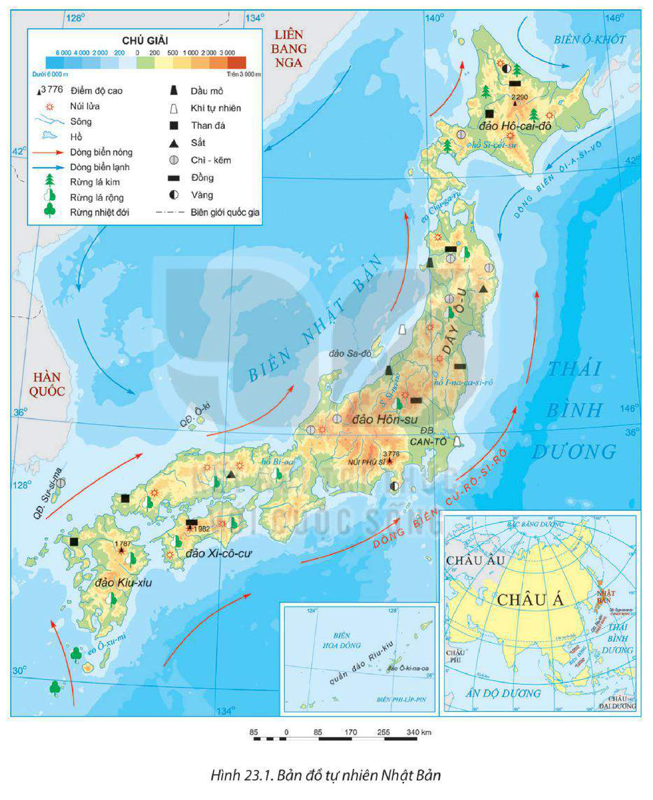
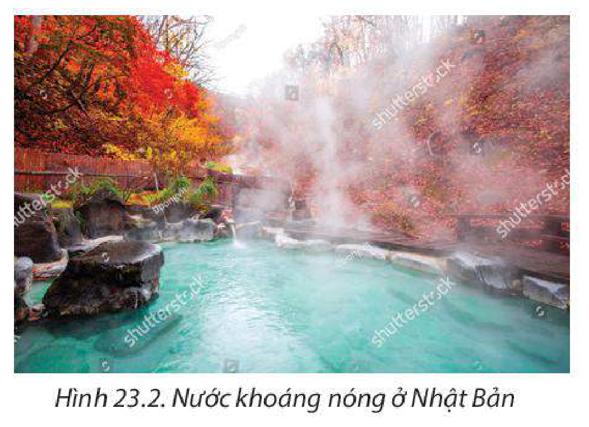
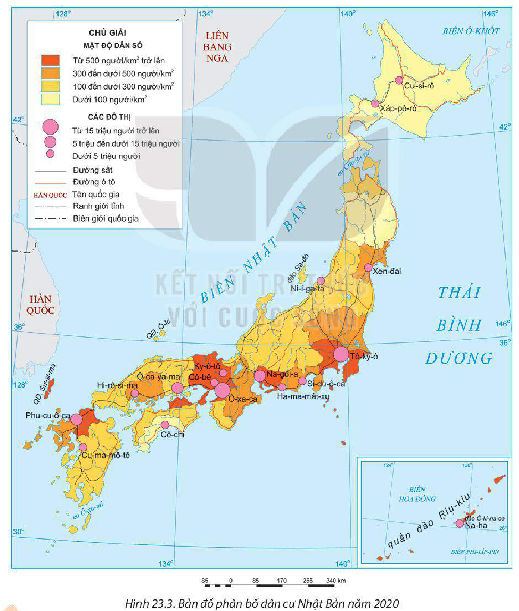
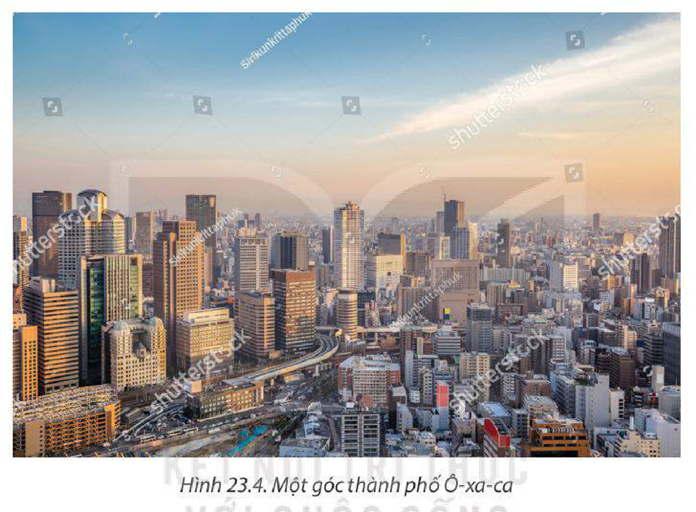

<!-- pdf:116 -->

# BÀI 23: VỊ TRÍ ĐỊA LÍ, ĐIỀU KIỆN TỰ NHIÊN, DÂN CƯ VÀ XÃ HỘI NHẬT BẢN

> **NHẬT BẢN**
>
> Diện tích đất: khoảng 378,0 nghìn km²
>
> Số dân: 126,2 triệu người (năm 2020)
>
> Thủ đô: Tô-ky-ô

## 🔴 Mở đầu

Nhật Bản là quốc gia nằm ở khu vực Đông Á, có điều kiện tự nhiên và tài nguyên thiên nhiên không thuận lợi như nhiều nước khác nhưng dân cư và xã hội có nhiều nét nổi bật, đặc sắc. Những điều kiện đó đã ảnh hưởng như thế nào đến sự phát triển kinh tế – xã hội của đất nước?

## I. VỊ TRÍ ĐỊA LÍ

<!-- term: Quần đảo Nhật Bản -->
Nhật Bản là một quốc gia quần đảo, nằm ở phía đông bắc của châu Á, lãnh thổ gồm hàng nghìn đảo, trong đó bốn đảo lớn nhất là Hô-cai-đô, Hôn-su, Xi-cô-cư, Kiu-xiu. Đây là chuỗi đảo lớn nhất nằm cách lục địa châu Á khoảng 190 km về phía đông.

<!-- term: Vị trí địa lí Nhật Bản -->
Nhật Bản nằm trong khoảng vĩ độ từ 20°B đến 45°B và trong khoảng kinh độ từ 123°Đ đến 154°Đ. Phía đông và phía nam giáp Thái Bình Dương, phía tây giáp biển Nhật Bản, phía bắc giáp biển Ô-khốt. Nhật Bản gần các nước trong lục địa là Liên bang Nga, Trung Quốc, Hàn Quốc và Cộng hoà Dân chủ nhân dân Triều Tiên. Nhật Bản nằm trong khu vực phát triển kinh tế năng động châu Á – Thái Bình Dương, thuận lợi cho giao thương quốc tế và phát triển kinh tế.

Với đặc điểm vị trí địa lí, Nhật Bản có nhiều điều kiện xây dựng các hải cảng, phát triển tổng hợp kinh tế biển. Nhật Bản nằm trên vành đai lửa Thái Bình Dương nên chịu tác động của nhiều thiên tai, nhất là động đất và sóng thần, ảnh hưởng đến đời sống và sản xuất.

> ❓ Dựa vào thông tin mục I và hình 23.1, hãy:
>
> – Xác định vị trí địa lí của Nhật Bản.
>
> – Phân tích ảnh hưởng của vị trí địa lí đến phát triển kinh tế – xã hội Nhật Bản.

<!-- pdf:117 -->

## II. ĐIỀU KIỆN TỰ NHIÊN VÀ TÀI NGUYÊN THIÊN NHIÊN

Điều kiện tự nhiên và tài nguyên thiên nhiên của Nhật Bản không thực sự thuận lợi cho phát triển kinh tế – xã hội.

*Hình 23.1. Bản đồ tự nhiên Nhật Bản*

<!-- pdf:118 -->

### 1. Địa hình và đất

Nhìn chung, Nhật Bản là một đất nước nhiều đồi núi, địa hình bị cắt xẻ phức tạp.

<!-- term: Núi Phú Sĩ và đồng bằng Can-tô -->
> 💡 EM CÓ BIẾT?
>
> Phú Sĩ là ngọn núi cao nhất ở Nhật Bản với độ cao 3 776 m.
>
> Đồng bằng Can-tô trên đảo Hôn-su là đồng bằng lớn nhất Nhật Bản, với diện tích khoảng 17 000 km², đây cũng là nơi tập trung đông dân cư nhất Nhật Bản.

– Đồi núi chiếm khoảng 4/5 diện tích, phần lớn là núi trẻ, có độ cao trung bình từ 1 500 – 2 000 m. Nhật Bản có rất nhiều núi lửa, chiếm khoảng 10% núi lửa đang hoạt động trên thế giới. Đất pốt dôn, đất nâu,... thích hợp cho phát triển rừng và chăn nuôi.

– Đồng bằng nhỏ hẹp và phân bố ven biển. Do diện tích đồng bằng và đất thấp rất ít nên nhiều sườn đồi núi đã được khai thác để sử dụng vào việc canh tác.

### 2. Khí hậu

<!-- term: Khí hậu Nhật Bản -->
Nhật Bản nằm trong đới khí hậu ôn đới, mang tính chất gió mùa; phần lớn lãnh thổ có lượng mưa trên 1 000 mm/năm. Khí hậu Nhật Bản phân hoá rõ rệt:

– Theo chiều bắc – nam: Phía bắc có khí hậu ôn đới, mùa đông kéo dài, lạnh, thường xảy ra bão tuyết. Phía nam có khí hậu cận nhiệt, mùa đông ít lạnh, mùa hạ nóng, thường có mưa to và bão.

– Theo chiều đông – tây: sự phân hoá thể hiện rõ ở đảo Hôn-su, phía đông đảo ấm, mưa nhiều vào mùa hạ, lạnh và khô ráo vào mùa đông; phía tây đảo có mùa đông lạnh hơn, nhiều tuyết.

– Ở những khu vực địa hình núi cao, khí hậu có sự phân hoá theo độ cao.

Nhìn chung, khí hậu Nhật Bản thuận lợi cho sản xuất và sinh hoạt của người dân. Khí hậu phân hoá đa dạng ảnh hưởng đến cơ cấu cây trồng, vật nuôi và mùa vụ, loại hình du lịch.

### 3. Sông, hồ

Nhật Bản có mạng lưới sông ngòi khá dày, do ảnh hưởng của địa hình nên đa số các sông đều ngắn, dốc và có tốc độ chảy lớn. Sông dài nhất của Nhật Bản là sông Si-na-nô. Nhìn chung, các sông có giá trị về thuỷ điện nhưng hạn chế về mặt giao thông.

Nhật Bản có nhiều hồ, lớn nhất là hồ Bi-oa trên đảo Hôn-su. Đặc biệt, Nhật Bản có nhiều hồ núi lửa, như hồ Ku-sa-rô, Si-cốt-sư trên đảo Hô-cai-đô, nhiều hồ có cảnh quan đẹp có thể khai thác để phục vụ du lịch.

### 4. Sinh vật

Sinh vật của Nhật Bản khá phong phú, có các kiểu rừng: rừng lá kim, rừng lá rộng, rừng nhiệt đới. Rừng lá kim phân bố chủ yếu ở đảo Hô-cai-đô, rừng lá rộng có ở đảo Hôn-su và Kiu-xiu. Rừng là tài nguyên quan trọng của Nhật Bản với thành phần loài rất đa dạng. Đây là cơ sở để phát triển ngành lâm nghiệp và công nghiệp chế biến gỗ.

<!-- pdf:119 -->

### 5. Khoáng sản

<!-- term: Khoáng sản Nhật Bản -->
Nhật Bản là nước nghèo tài nguyên khoáng sản. Các khoáng sản có trữ lượng lớn nhất là than đá (đảo Hô-cai-đô, Kiu-xiu) và đồng (đảo Hôn-su), các khoáng sản khác (vàng, chì – kẽm, dầu mỏ, khí tự nhiên,...) có trữ lượng không đáng kể. Vì vậy, Nhật Bản phải nhập khẩu phần lớn khoáng sản để phục vụ cho các ngành công nghiệp.

*Hình 23.2. Nước khoáng nóng ở Nhật Bản*

Nhật Bản có nhiều suối khoáng nóng tự nhiên để phát triển du lịch, nhất là du lịch nghỉ dưỡng, chữa bệnh như Cư-xát-xư, Ha-cô-nê (đảo Hôn-su), Y-u-phu-in, Bép-pu (đảo Kiu-xiu),...

### 6. Biển

<!-- term: Tài nguyên biển Nhật Bản -->
Nhật Bản có đường bờ biển dài khoảng 29 000 km với vùng biển rộng, phần lớn biển không đóng băng, bờ biển bị chia cắt tạo thành nhiều vũng vịnh, là điều kiện thuận lợi để xây dựng các cảng biển.

Vùng biển Nhật Bản có tính đa dạng sinh học cao, 25% số loài cá biển trên thế giới có mặt ở vùng biển này. Do nằm ở nơi giao nhau của dòng biển nóng Cư-rô-si-vô và dòng biển lạnh Ôi-a-si-vô nên Nhật Bản có nhiều ngư trường lớn với nguồn cá dồi dào, các loài cá có giá trị là cá ngừ, cá thu, cá trích, cá hồi,... Đây là điều kiện để Nhật Bản phát triển ngành khai thác thuỷ sản.

> ❓ Dựa vào thông tin mục II và hình 23.1, hãy:
>
> – Trình bày đặc điểm điều kiện tự nhiên và tài nguyên thiên nhiên của Nhật Bản.
>
> – Phân tích ảnh hưởng của điều kiện tự nhiên và tài nguyên thiên nhiên đến phát triển kinh tế – xã hội Nhật Bản.

## III. DÂN CƯ VÀ XÃ HỘI

### 1. Dân cư

<!-- term: Dân cư Nhật Bản -->
Nhật Bản là nước đông dân. Năm 2020 số dân Nhật Bản là 126,2 triệu người, đứng thứ 11 thế giới. Số dân đông tạo cho Nhật Bản có một thị trường tiêu thụ nội địa mạnh. Tỉ lệ tăng dân số Nhật Bản rất thấp, dưới 0% từ năm 2008 và năm 2020 là -0,3%.

Thành phần dân tộc của Nhật Bản về cơ bản khá đồng nhất.

Nhật Bản có số nam ít hơn số nữ. Nhật Bản là quốc gia có cơ cấu dân số già, tuổi thọ trung bình cao nhất thế giới. Điều này gây ra sự thiếu hụt về lực lượng lao động trong tương lai, tạo ra sức ép lên hệ thống phúc lợi xã hội và giảm khả năng cạnh tranh kinh tế của Nhật Bản.

<!-- pdf:120 -->

**BẢNG 23.1. SỐ DÂN VÀ CƠ CẤU DÂN SỐ THEO TUỔI CỦA NHẬT BẢN GIAI ĐOẠN 1950 – 2020**

| Năm | 1950 | 2000 | 2020 |
| --- | --- | --- | --- |
| Số dân *(triệu người)* | 82,8 | 126,9 | 126,2 |
| Cơ cấu dân số *(%)*: – Dưới 15 tuổi | 35,4 | 14,6 | 12,4 |
| – Từ 15 đến 64 tuổi | 59,6 | 68,0 | 59,2 |
| – Từ 65 tuổi trở lên | 5,0 | 17,4 | 28,4 |

*(Nguồn: Liên hợp quốc, 2022)*

*Hình 23.3. Bản đồ phân bố dân cư Nhật Bản năm 2020*

<!-- pdf:121 -->

Nhật Bản là nước có mật độ dân số cao. Năm 2020, mật độ dân số trung bình của Nhật Bản là 338 người/km². Dân cư phân bố không đều giữa các đảo và giữa các khu vực trên cùng một đảo. Khoảng 60% dân cư sống trên 3% diện tích đất nước, chủ yếu ở các đồng bằng ven biển, đặc biệt là dải đồng bằng ven Thái Bình Dương trên đảo Hôn-su.

Nhật Bản có tỉ lệ dân thành thị cao (91,8% năm 2020), Tô-ky-ô là vùng đô thị lớn nhất thế giới (năm 2020), các thành phố lớn khác là Ô-xa-ca, Na-gôi-a,... Mức sống của người dân đô thị cao, cơ sở hạ tầng hiện đại, các đô thị đồng thời là các trung tâm kinh tế, văn hoá. Tuy nhiên, dân cư tập trung với mật độ cao ở các vùng đô thị cũng nảy sinh các vấn đề về nhà ở, việc làm,...

*Hình 23.4. Một góc thành phố Ô-xa-ca*

> ❓ Dựa vào thông tin mục 1 và hình 23.3, hãy:
>
> – Nêu đặc điểm nổi bật về dân cư Nhật Bản.
>
> – Phân tích ảnh hưởng của đặc điểm dân cư đến phát triển kinh tế – xã hội của Nhật Bản.

### 2. Xã hội

<!-- term: Đạo Shin-tô và văn hoá Nhật Bản -->
Nhật Bản có phong tục tập quán độc đáo và nền văn hoá đặc sắc. Trong văn hoá Nhật Bản, đạo Shin-tô là tín ngưỡng truyền thống. Người Nhật trân trọng và bảo tồn các nét đẹp văn hoá truyền thống, các lễ hội. Các giá trị văn hoá, các di tích lịch sử đã góp phần phát triển ngành du lịch của Nhật Bản.

> 💡 EM CÓ BIẾT?
>
> Văn hoá Nhật Bản là một trong những nền văn hoá đặc sắc nhất thế giới. Nghệ thuật truyền thống Nhật Bản rất độc đáo, có thể kể đến như: cắm hoa I-kê-ba-na, gấp giấy, tranh in, đồ gỗ sơn mài, gốm sứ,...

Người dân Nhật Bản rất chăm chỉ, có tính kỉ luật và tinh thần trách nhiệm cao. Nhật Bản nằm trong

<!-- pdf:122 -->

nhóm các quốc gia dẫn đầu về số lượng bằng sáng chế trên thế giới, đặc biệt trong lĩnh vực trí tuệ nhân tạo và công nghệ,... Ý chí vươn lên của người Nhật Bản đã giúp quốc gia này khắc phục được những khó khăn về điều kiện tự nhiên và cho phép Nhật Bản duy trì được sự thịnh vượng của mình.

Người dân Nhật Bản có chất lượng cuộc sống cao; chỉ số HDI của Nhật Bản thuộc nhóm rất cao, đạt 0,923 năm 2020.

**BẢNG 23.2. TUỔI THỌ TRUNG BÌNH VÀ SỐ NĂM ĐI HỌC TRUNG BÌNH CỦA NGƯỜI TỪ 25 TUỔI TRỞ LÊN CỦA NHẬT BẢN NĂM 2000 VÀ NĂM 2020**

| Chỉ tiêu | Năm 2000 | Năm 2020 |
| --- | --- | --- |
| Tuổi thọ trung bình *(năm)* | 81,2 | 84,7 |
| Số năm đi học trung bình của người từ 25 tuổi trở lên *(năm)* | 12,1 | 13,4 |

*(Nguồn: Liên hợp quốc, 2022)*

Nhật Bản rất chú trọng đầu tư cho giáo dục. Hầu hết các nhà trường đều đề cao thái độ và giá trị đạo đức để hình thành nên nhân cách, tạo nên những thế hệ công dân có kiến thức, chuyên môn cao, có trách nhiệm trong cuộc sống và công việc.

Nhật Bản có hệ thống y tế phát triển, 100% người dân tham gia bảo hiểm y tế. Chi tiêu cho y tế của Nhật Bản chiếm khoảng 10% GDP và có xu hướng tăng.

> ❓ Dựa vào thông tin mục 2, hãy phân tích tác động của các đặc điểm xã hội tới phát triển kinh tế – xã hội của Nhật Bản.

## ✏️ Luyện tập

1. Tại sao nói điều kiện tự nhiên và tài nguyên thiên nhiên của Nhật Bản không thực sự thuận lợi cho phát triển kinh tế – xã hội?

2. Dựa vào bảng 23.1, hãy nhận xét sự thay đổi trong cơ cấu dân số theo tuổi của Nhật Bản giai đoạn 1950 – 2020.

## 🚀 Vận dụng

Tìm kiếm thông tin, trình bày thực trạng và ảnh hưởng của già hoá dân số đến phát triển kinh tế – xã hội của Nhật Bản.

## 📷 Danh sách hình trong bài

| Mã hình | Trang PDF | Vị trí trong bài | Chú thích gốc |
| --- | --- | --- | --- |
| H11-dia-b23-01 | 117 | Mục II | Hình 23.1. Bản đồ tự nhiên Nhật Bản |
| H11-dia-b23-02 | 119 | Mục II.5 | Hình 23.2. Nước khoáng nóng ở Nhật Bản |
| H11-dia-b23-03 | 120 | Mục III.1 | Hình 23.3. Bản đồ phân bố dân cư Nhật Bản năm 2020 |
| H11-dia-b23-04 | 121 | Mục III.1 | Hình 23.4. Một góc thành phố Ô-xa-ca |
