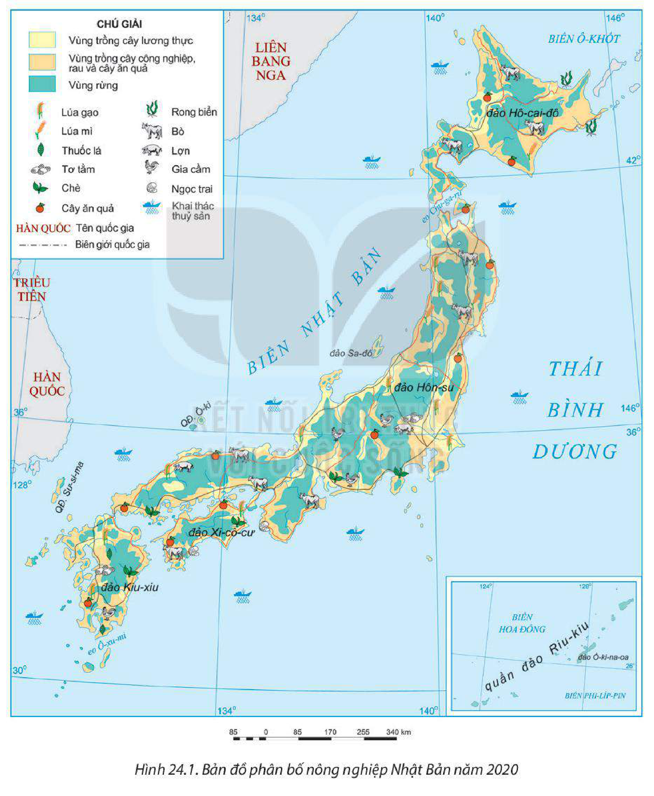
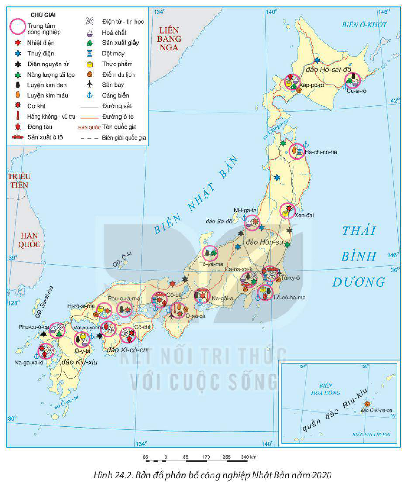
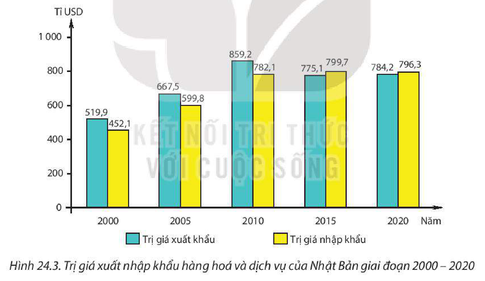

<!-- pdf:123 -->

# BÀI 24: KINH TẾ NHẬT BẢN

## 🔴 Mở đầu

Thế kỉ XX chứng kiến sự phát triển thần kì của kinh tế Nhật Bản. Quốc gia này là nền kinh tế phát triển bậc nhất châu Á. Vì sao Nhật Bản duy trì được vị thế cường quốc kinh tế trên thế giới? Các ngành kinh tế của Nhật Bản có sự phát triển và phân bố như thế nào?

## I. TÌNH HÌNH PHÁT TRIỂN KINH TẾ

<!-- term: Các giai đoạn phát triển kinh tế Nhật Bản -->
Quá trình phát triển kinh tế Nhật Bản trải qua nhiều giai đoạn:

<!-- term: Các giai đoạn phát triển kinh tế Nhật Bản -->
– Giai đoạn 1955 – 1972: Công cuộc tái thiết và phát triển kinh tế của chính phủ Nhật Bản diễn ra thành công. Nhật Bản có tốc độ tăng GDP cao, bình quân khoảng 10%/năm, trở thành một nước phát triển. Từ năm 1968, kinh tế Nhật Bản vươn lên đứng thứ hai thế giới, sau Hoa Kỳ.

<!-- term: Các giai đoạn phát triển kinh tế Nhật Bản -->
– Giai đoạn 1973 – 1992: Ảnh hưởng của cuộc khủng hoảng năng lượng những năm 70 và “thời kì bong bóng kinh tế” năm 1991 đã dẫn đến kinh tế trì trệ kéo dài.

<!-- term: Các giai đoạn phát triển kinh tế Nhật Bản -->
– Giai đoạn 1992 đến nay: Sau giai đoạn tăng trưởng kinh tế cao từ năm 2002 đến năm 2006, cuộc khủng hoảng tài chính toàn cầu vào những năm 2007 – 2008 cùng với thiên tai, dịch bệnh khiến tốc độ tăng GDP của Nhật Bản xuống thấp. Năm 2020, Nhật Bản đứng thứ ba thế giới về quy mô GDP sau Hoa Kỳ và Trung Quốc, là thành viên của G7 và G20.

**BẢNG 24.1. QUY MÔ GDP THEO GIÁ HIỆN HÀNH VÀ TỐC ĐỘ TĂNG GDP CỦA NHẬT BẢN GIAI ĐOẠN 1961 – 2020**

| Chỉ tiêu | Năm 1961 | Năm 1970 | Năm 1980 | Năm 1990 | Năm 2000 | Năm 2010 | Năm 2019 | Năm 2020 |
| --- | --- | --- | --- | --- | --- | --- | --- | --- |
| GDP *(tỉ USD)* | 53,5 | 212,6 | 1 105,0 | 3 132,0 | 4 968,4 | 5 759,1 | 5 123,3 | 5 040,1 |
| Tốc độ tăng GDP *(%)* | 12,0 | 2,5 | 2,8 | 4,9 | 2,8 | 4,1 | 0,3 | -4,6 |
<!-- ocr-ok: đối chiếu trực tiếp ảnh trang PDF 123 (Bảng 24.1, OCR bỏ sót hàng năm và đọc sai số liệu) -->

*(Nguồn: Ngân hàng Thế giới, 2022)*

Trong cơ cấu GDP của Nhật Bản, dịch vụ là ngành có tỉ trọng cao nhất (gần 70%), nông nghiệp có tỉ trọng nhỏ nhất (khoảng 1%). Nền kinh tế Nhật Bản phát triển ở trình độ cao, các ngành kinh tế ứng dụng nhiều thành tựu của khoa học – công nghệ.

Kinh tế Nhật Bản đang đối mặt với nhiều thách thức như: dân số già, mức nợ công cao, phụ thuộc vào nguồn nguyên nhiên liệu từ bên ngoài, sự cạnh tranh gay gắt của các nước, thiên tai,... Để nâng cao vị thế trong nền kinh tế thế giới, Nhật Bản đang tập trung phát triển kinh tế số (rô-bốt, trí tuệ nhân tạo, công nghệ thực tế – ảo,...).

<!-- pdf:124 -->

> ❓ Dựa vào thông tin mục I, hãy trình bày và giải thích tình hình phát triển kinh tế của Nhật Bản.

## II. CÁC NGÀNH KINH TẾ

### 1. Nông nghiệp, lâm nghiệp và thuỷ sản

*Hình 24.1. Bản đồ phân bố nông nghiệp Nhật Bản năm 2020*

<!-- pdf:125 -->

Nông nghiệp, lâm nghiệp và thuỷ sản chiếm tỉ lệ nhỏ (chỉ khoảng 1%) trong cơ cấu GDP của Nhật Bản và thu hút khoảng 3% lực lượng lao động (năm 2020); đáp ứng một phần nhu cầu về lương thực, thực phẩm của người dân và tạo ra một số mặt hàng xuất khẩu có giá trị cao.

**a) Nông nghiệp**

<!-- term: Nông nghiệp Nhật Bản -->
Nền nông nghiệp Nhật Bản sản xuất theo hướng thâm canh với quy mô nhỏ, áp dụng công nghệ tiên tiến, cho năng suất cao với chất lượng hàng đầu thế giới.

– Trồng trọt có vị trí quan trọng, chiếm hơn 60% tổng giá trị sản xuất nông nghiệp (năm 2020). Trình độ cơ giới hoá nông nghiệp rất cao. Các sản phẩm chính gồm: lúa gạo, lúa mì, rau, cây ăn quả. Các vùng trồng trọt chính là đảo Hô-cai-đô, tỉnh Cu-ma-mô-tô (đảo Kiu-xiu), tỉnh Ca-ga-oa (đảo Xi-cô-cư), tỉnh A-ki-ta (đảo Hôn-su),... Nhật Bản chú trọng sản xuất những sản phẩm trồng trọt cao cấp.

– Chăn nuôi tương đối phát triển, tỉ trọng có xu hướng tăng. Các vật nuôi chính là bò, lợn, gia cầm. Do được áp dụng công nghệ hiện đại nên ngành chăn nuôi bò, nhất là bò sữa được coi là một thành tựu của nông nghiệp Nhật Bản, chủ yếu tập trung ở Hô-cai-đô, nơi có những đồng cỏ rộng lớn.

**BẢNG 24.2. MỘT SỐ NÔNG SẢN CỦA NHẬT BẢN GIAI ĐOẠN 2000 – 2020**

| Nông sản | Năm 2000 | Năm 2010 | Năm 2020 |
| --- | --- | --- | --- |
| – Lúa gạo: + Diện tích *(nghìn ha)* | 1 770 | 1 643 | 1 462 |
| + Sản lượng *(nghìn tấn)* | 11 863 | 10 596 | 9 708 |
| – Lúa mì: + Diện tích *(nghìn ha)* | 183 | 207 | 213 |
| + Sản lượng *(nghìn tấn)* | 688 | 571 | 949 |
| – Bò: + Số lượng *(nghìn con)* | 4 588 | 4 376 | 3 907 |
| + Sản lượng thịt *(nghìn tấn)* | 530 | 515 | 477 |

*(Nguồn: Tổ chức Lương thực và Nông nghiệp Liên hợp quốc, 2022)*

**b) Lâm nghiệp**

Lâm nghiệp được chú trọng phát triển. Nhật Bản có diện tích và tỉ lệ che phủ rừng lớn, rừng có vai trò quan trọng đối với việc chống xói mòn đất và bảo vệ môi trường. Rừng trồng chiếm khoảng 40% tổng diện tích rừng. Nhật Bản vẫn phải nhập gỗ nguyên liệu và nhiều sản phẩm từ gỗ.

<!-- pdf:126 -->

**BẢNG 24.3. MỘT SỐ CHỈ TIÊU CỦA NGÀNH LÂM NGHIỆP NHẬT BẢN GIAI ĐOẠN 2000 – 2020**

*(Đơn vị: triệu m³)*

| Chỉ tiêu | Năm 2000 | Năm 2010 | Năm 2020 |
| --- | --- | --- | --- |
| Sản lượng gỗ tròn khai thác | 18,1 | 17,3 | 30,3 |
| Khối lượng gỗ nhập khẩu | 15,9 | 4,7 | 21,9 |

*(Nguồn: Tổ chức Lương thực và Nông nghiệp Liên hợp quốc, 2022)*

**c) Thuỷ sản**

<!-- term: Thuỷ sản Nhật Bản -->
Khai thác thuỷ sản có lịch sử phát triển lâu đời ở Nhật Bản. Ngành khai thác thuỷ sản đã đạt đến mức công nghiệp hoá và được phát triển ở hầu khắp đất nước. Sản lượng thuỷ sản khai thác năm 2020 là 3,2 triệu tấn (đứng thứ tám thế giới). Thuỷ sản khai thác xa bờ chiếm tỉ lệ lớn trong tổng sản lượng. Đội tàu khai thác thuỷ sản của Nhật Bản lớn hàng đầu thế giới (năm 2020). Các loài khai thác chủ yếu là cá ngừ, cá hồi, cá thu, cua, tôm, mực ống,... Thuỷ sản khai thác là nguồn nguyên liệu cho công nghiệp chế biến và là mặt hàng xuất khẩu quan trọng của Nhật Bản.

Nuôi trồng thuỷ sản được chú trọng phát triển. Sản lượng thuỷ sản nuôi trồng đạt khoảng 1 triệu tấn năm 2020 (đứng thứ 14 trên thế giới). Các loài thuỷ sản được nuôi trồng chủ yếu là tôm, rong biển, trai lấy ngọc, hàu,...

> ❓ Dựa vào thông tin mục 1 và hình 24.1, hãy trình bày sự phát triển và phân bố của ngành nông nghiệp, lâm nghiệp và thuỷ sản Nhật Bản.

### 2. Công nghiệp

<!-- term: Công nghiệp Nhật Bản -->
Công nghiệp là ngành đóng vai trò quan trọng trong nền kinh tế Nhật Bản, chiếm khoảng 29% GDP và thu hút khoảng 27% lao động (năm 2020), tạo ra khối lượng hàng hoá xuất khẩu lớn nhất cho đất nước. Cơ cấu ngành công nghiệp đa dạng, có nhiều ngành đứng đầu thế giới về kĩ thuật, công nghệ tiên tiến như công nghiệp chế tạo, công nghiệp điện tử – tin học,... Các trung tâm công nghiệp lớn nhất của Nhật Bản nằm dọc bờ biển hoặc gần các vịnh lớn nhằm thuận lợi cho nhập khẩu nguyên liệu và xuất khẩu sản phẩm, tiêu biểu là Tô-ky-ô, Na-gôi-a, Ô-xa-ca (đảo Hôn-su), Phu-cu-ô-ca (đảo Kiu-xiu), Xáp-pô-rô (đảo Hô-cai-đô), Cô-chi (đảo Xi-cô-cư),...

– Công nghiệp chế tạo phát triển mạnh và chiếm khoảng 40% giá trị hàng công nghiệp xuất khẩu của Nhật Bản. Các sản phẩm nổi bật là tàu biển (sản xuất khoảng 20% số tàu biển thế giới mỗi năm), ô tô (chiếm 10% sản lượng ô tô thế giới). Các ngành chế tạo tập trung và phát triển mạnh ở Hôn-su, Xi-cô-cư.

– Công nghiệp điện tử – tin học đứng hàng đầu thế giới với các sản phẩm điện tử tiêu dùng, máy tính, ti vi, chất bán dẫn (chiếm khoảng 10% thế giới), rô-bốt (chiếm 45% sản lượng của thế giới),...

<!-- pdf:127 -->

*Hình 24.2. Bản đồ phân bố công nghiệp Nhật Bản năm 2020*

Hiện nay, Nhật Bản đang đầu tư mạnh vào các ngành năng lượng hạt nhân, năng lượng tái tạo; công nghiệp hàng không – vũ trụ; công nghệ sinh học và dược phẩm,...

> ❓ Dựa vào thông tin mục 2 và hình 24.2, hãy trình bày sự phát triển và phân bố ngành công nghiệp Nhật Bản.

<!-- pdf:128 -->

### 3. Dịch vụ

<!-- term: Dịch vụ Nhật Bản -->
Dịch vụ là ngành kinh tế đóng góp phần lớn vào GDP (khoảng 69,5%) và thu hút 72,9% lực lượng lao động của Nhật Bản (năm 2020). Các ngành dịch vụ có vai trò quan trọng của Nhật Bản là thương mại, giao thông vận tải, tài chính ngân hàng và du lịch.

**a) Thương mại**

– Nội thương đóng góp khoảng 13 – 14% GDP (giai đoạn 2010 – 2020). Các hoạt động buôn bán chủ yếu diễn ra ở các chợ truyền thống, siêu thị, trung tâm thương mại,... Thương mại điện tử ngày càng đóng vai trò quan trọng.

– Ngoại thương: Tổng trị giá xuất nhập khẩu hàng hoá và dịch vụ đạt hơn 1 500 tỉ USD. So với các quốc gia phát triển khác, Nhật Bản có mức xuất khẩu khá thấp so với quy mô GDP. Các mặt hàng xuất khẩu chủ yếu của Nhật Bản là phương tiện giao thông, máy móc, thiết bị điện tử, thiết bị y tế, hoá chất, nhựa,... Các mặt hàng nhập khẩu chính là năng lượng, nguyên liệu công nghiệp, sản phẩm nông nghiệp,... Các đối tác thương mại chính của Nhật Bản là Hoa Kỳ, Trung Quốc, EU, các nước Đông Nam Á, Ô-xtrây-li-a,...

*Hình 24.3. Trị giá xuất nhập khẩu hàng hoá và dịch vụ của Nhật Bản giai đoạn 2000 – 2020*

**b) Giao thông vận tải**

Hệ thống giao thông vận tải của Nhật Bản đồng bộ và hiện đại, đóng vai trò quan trọng trong chiến lược phát triển kinh tế – xã hội và giao thương quốc tế.

<!-- term: Tàu cao tốc Sin-can-xen -->
Giao thông đường sắt được chú trọng phát triển, đóng vai trò quan trọng trong vận chuyển hành khách và hàng hoá, đặc biệt là hệ thống tàu cao tốc Sin-can-xen kết nối các thành phố lớn.

<!-- pdf:129 -->

Giao thông vận tải đường bộ với chiều dài mạng lưới hơn 1,2 triệu km, chiếm hơn 90% khối lượng vận tải hàng hoá trong nước (năm 2020). Đường hàng không, đường biển của Nhật Bản đều phát triển mạnh để đáp ứng nhu cầu vận chuyển hành khách và hàng hoá. Năm 2020, cả nước có 176 sân bay, các sân bay quan trọng là: Ha-nê-đa, Na-ri-ta, Can-sai,... Hệ thống cảng biển lớn của Nhật Bản bao gồm: Tô-ky-ô, Ô-xa-ca, Cô-bê,...

**c) Tài chính ngân hàng**

Nhật Bản là một trong những trung tâm tài chính quan trọng của thế giới. Tô-ky-ô là trung tâm tài chính lớn nhất của đất nước, là nơi đặt trụ sở của nhiều ngân hàng và công ty bảo hiểm lớn trên thế giới.

**d) Du lịch**

Hoạt động du lịch phát triển mạnh, đóng góp khoảng 7% vào GDP (năm 2019). Ngành du lịch phát triển dựa trên tài nguyên du lịch rất đa dạng; cơ sở vật chất, kĩ thuật, kết cấu hạ tầng phát triển hiện đại; dịch vụ du lịch đa dạng, chất lượng cao,... Năm 2019, Nhật Bản thu hút được 31,8 triệu khách du lịch quốc tế (đứng thứ 12 thế giới), doanh thu từ khách du lịch quốc tế đạt 46,1 tỉ USD (đứng thứ 7 thế giới). Du lịch nội địa đóng vai trò quan trọng.

Các địa điểm du lịch nổi tiếng ở Nhật Bản là Ni-xê-cô, Phu-ta-nô (đảo Hô-cai-đô); Mát-su-si-ma, Ha-cư-ba, Ka-na-da-oa, núi Phú Sĩ (đảo Hôn-su),...

> ❓ Dựa vào nội dung mục 3, hãy trình bày sự phát triển và phân bố của một số ngành dịch vụ Nhật Bản.

## III. CÁC VÙNG KINH TẾ

<!-- term: Các vùng kinh tế của Nhật Bản -->
Các vùng kinh tế của Nhật Bản gắn với bốn đảo lớn.

**BẢNG 24.4. CÁC VÙNG KINH TẾ CỦA NHẬT BẢN NĂM 2020**

| Đảo | Đặc điểm nổi bật |
| --- | --- |
| Hô-cai-đô | – Diện tích: 83,4 nghìn km², đóng góp 3,4% GDP cả nước. – Rừng chiếm diện tích lớn, khoáng sản chủ yếu là than. – Giá trị ngành nông nghiệp, lâm nghiệp và thuỷ sản lớn nhất Nhật Bản, các sản phẩm nông nghiệp chính là lúa mì, khoai tây, rong biển, thịt bò,... – Phát triển công nghiệp chế biến thực phẩm, chế biến gỗ, luyện kim đen, sản xuất giấy. – Du lịch phát triển mạnh. – Các trung tâm kinh tế quan trọng là Xáp-pô-rô, Cu-si-rô. |

<!-- pdf:130 -->

| Đảo | Đặc điểm nổi bật |
| --- | --- |
| Hôn-su | – Diện tích: 231,2 nghìn km² (chiếm khoảng 60% diện tích Nhật Bản), số dân đông nhất, kinh tế phát triển nhất và được chia thành 5 vùng nhỏ là Tô-hô-cư, Can-tô, Chu-bu, Can-sai, Chu-gô-cư. – Khí hậu phân hoá theo chiều bắc – nam, đông – tây, có đường bờ biển dài, nhiều vũng vịnh; thường xuyên chịu ảnh hưởng của hoạt động núi lửa và động đất. – Nông nghiệp nổi tiếng với lúa gạo, hoa quả, khai thác và nuôi trồng thuỷ sản,... – Công nghiệp phát triển mạnh, phân bố chủ yếu ở bờ biển Thái Bình Dương. – Ngành dịch vụ phát triển mạnh nhất Nhật Bản. – Các trung tâm kinh tế lớn là Tô-ky-ô, I-ô-cô-ha-ma, Ca-oa-xa-ki, Ô-xa-ca, Cô-bê, Ky-ô-tô. |
| Xi-cô-cư | – Diện tích: 18, nghìn km² (chiếm khoảng 5% diện tích đất nước), đóng góp khoảng 3% GDP cả nước. – Nông nghiệp đóng vai trò quan trọng. – Ngành công nghiệp điện tử – tin học, đóng tàu, công nghệ sinh học và công nghệ nano,... rất phát triển. – Các trung tâm kinh tế lớn là Cô-chi, Mát-xu-ya-ma. |
| Kiu-xiu | – Diện tích: 42,2 nghìn km², đóng góp khoảng 10% GDP của Nhật Bản. – Các nông sản chủ yếu là lúa gạo, thuốc lá, cây ăn quả,... – Các ngành công nghiệp tự động và bán dẫn chiếm ưu thế. – Hoạt động thương mại và giao thông vận tải biển phát triển. – Các trung tâm kinh tế chính là Phu-cu-ô-ca và Na-ga-xa-ki. |

> ❓ Dựa vào thông tin mục III, hãy so sánh đặc điểm nổi bật của các vùng kinh tế Nhật Bản.

## ✏️ Luyện tập

1. Dựa vào bản đồ phân bố nông nghiệp Nhật Bản, hãy nêu sự phân bố một số sản phẩm nông nghiệp của Nhật Bản.

2. Dựa vào bảng 24.1, hãy vẽ biểu đồ thể hiện GDP và tốc độ tăng GDP của Nhật Bản giai đoạn 1990 – 2020. Nêu nhận xét.

## 🚀 Vận dụng

Tìm kiếm thông tin và viết bài giới thiệu ngắn về một vấn đề địa lí kinh tế Nhật Bản mà em quan tâm (một sản phẩm nông nghiệp hoặc công nghiệp,...).

## 📷 Danh sách hình trong bài

| Mã hình | Trang PDF | Vị trí trong bài | Chú thích gốc |
| --- | --- | --- | --- |
| H11-dia-b24-01 | 124 | Mục II.1 | Hình 24.1. Bản đồ phân bố nông nghiệp Nhật Bản năm 2020 |
| H11-dia-b24-02 | 127 | Mục II.2 | Hình 24.2. Bản đồ phân bố công nghiệp Nhật Bản năm 2020 |
| H11-dia-b24-03 | 128 | Mục II.3a | Hình 24.3. Trị giá xuất nhập khẩu hàng hoá và dịch vụ của Nhật Bản giai đoạn 2000 – 2020 |
