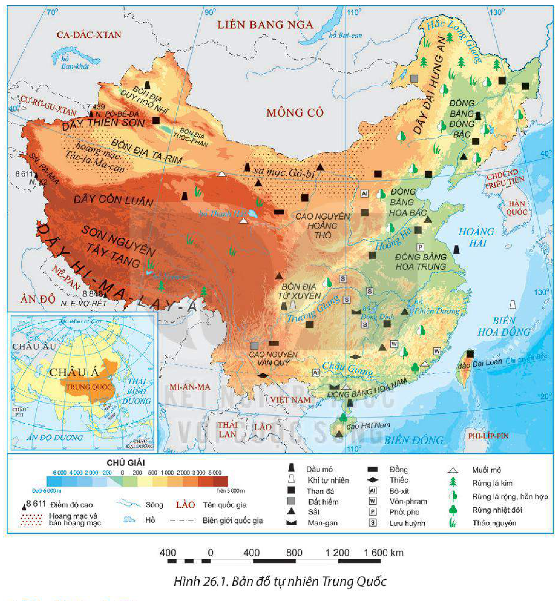
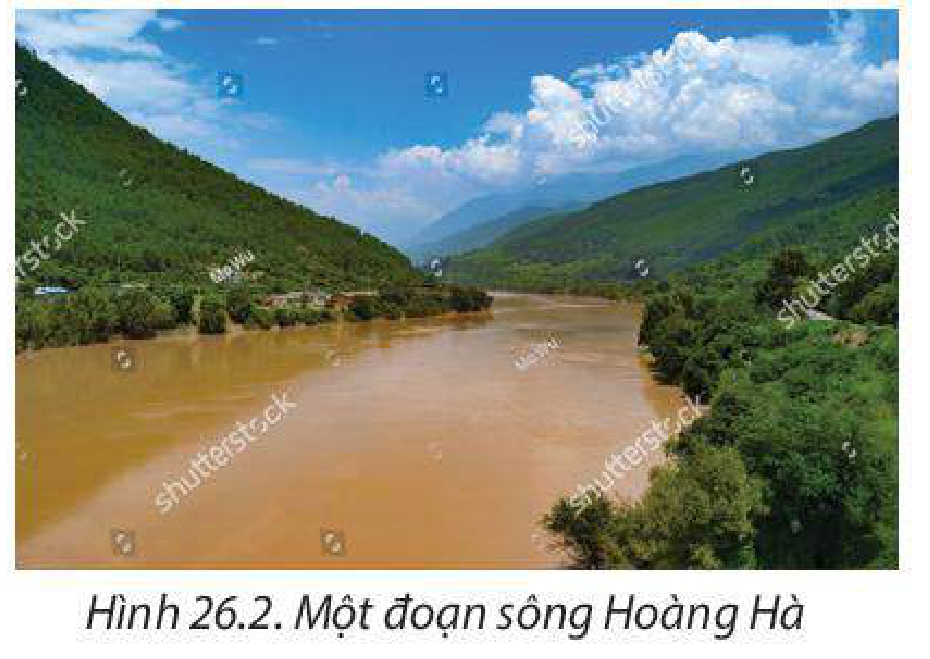
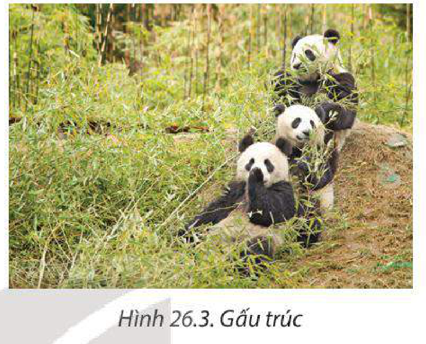
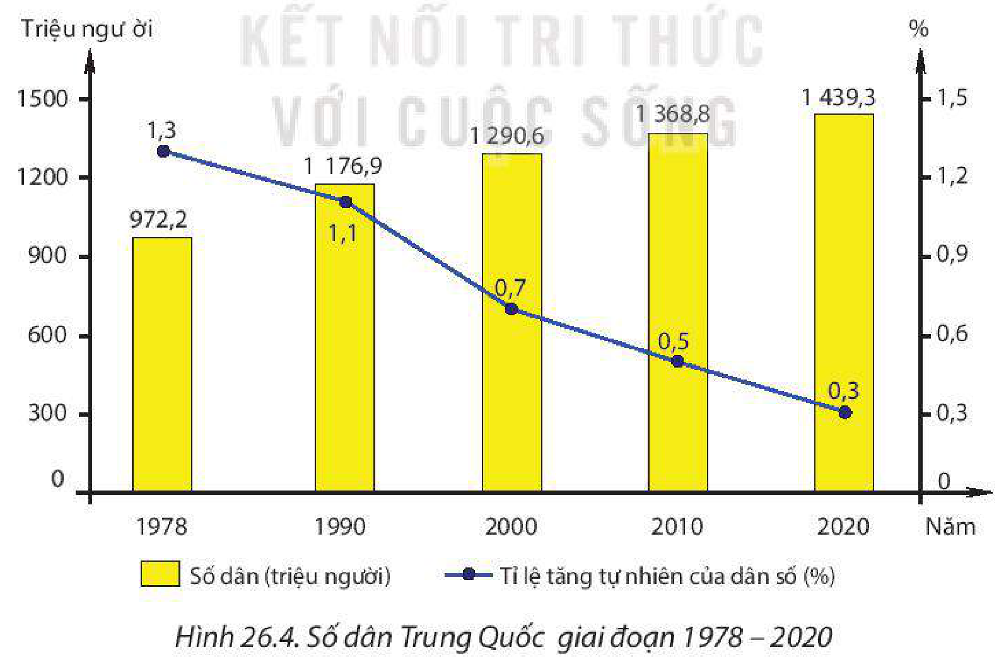
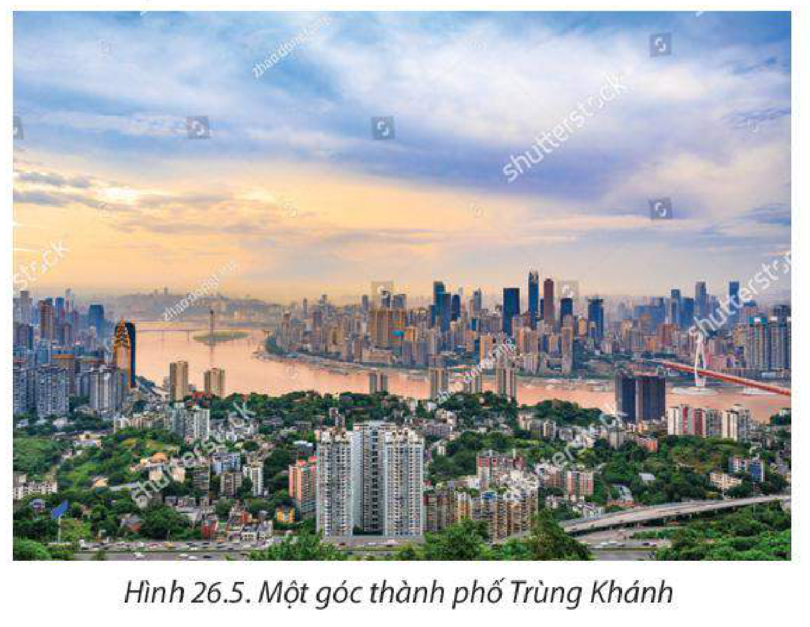
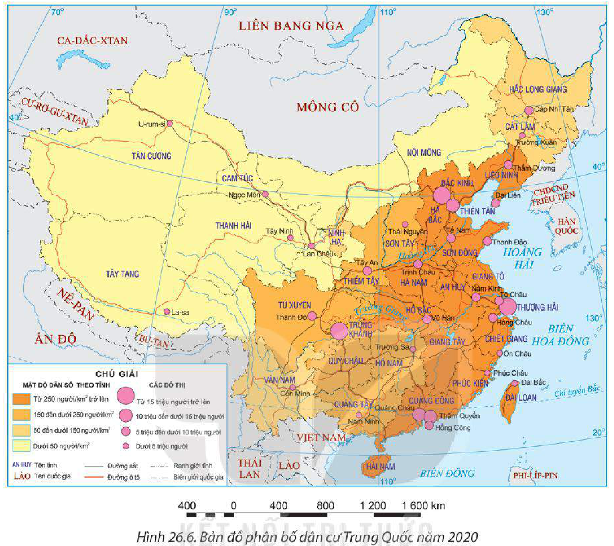

<!-- pdf:133 -->

# BÀI 26: VỊ TRÍ ĐỊA LÍ, ĐIỀU KIỆN TỰ NHIÊN, DÂN CƯ VÀ XÃ HỘI TRUNG QUỐC

> **CỘNG HOÀ NHÂN DÂN TRUNG HOA (TRUNG QUỐC)**
>
> Diện tích: khoảng 9,6 triệu km²
>
> Số dân: 1 439,3 triệu người (năm 2020)
>
> Thủ đô: Bắc Kinh

## 🔴 Mở đầu

Trung Quốc là đất nước rộng lớn, có điều kiện tự nhiên đa dạng, nguồn tài nguyên thiên nhiên phong phú; số dân đông nhất thế giới, nguồn lao động dồi dào và ngày càng nâng cao về chất lượng,... là cơ sở cho sự phát triển kinh tế – xã hội. Điều kiện tự nhiên, tài nguyên thiên nhiên, dân cư và xã hội Trung Quốc có đặc điểm như thế nào?

## I. PHẠM VI LÃNH THỔ VÀ VỊ TRÍ ĐỊA LÍ

<!-- term: Phạm vi lãnh thổ và vị trí địa lí Trung Quốc -->
Trung Quốc nằm ở Đông Á, có diện tích khoảng 9,6 triệu km².

Lãnh thổ Trung Quốc (phần đất liền) trải dài theo chiều vĩ tuyến từ khoảng vĩ độ 20°B đến vĩ độ 53°B, theo chiều kinh tuyến từ khoảng kinh độ 73°Đ đến kinh độ 135°Đ.

Trung Quốc tiếp giáp với 14 quốc gia ở phía bắc, phía tây và phía nam, phần lớn đường biên giới trên đất liền giữa Trung Quốc với các nước có địa hình núi cao, hiểm trở, khó khăn cho việc giao thương. Trung Quốc có vùng biển rộng lớn thuộc các biển Hoàng Hải, Hoa Đông,... thuộc Thái Bình Dương và các đảo, quần đảo, tạo thuận lợi cho việc giao lưu, liên kết kinh tế – thương mại với các nước trong khu vực Đông Á, Đông Nam Á, các nước trên thế giới và phát triển nhiều ngành kinh tế biển.

Đất nước rộng lớn, thiên nhiên có sự phân hoá giữa các vùng, nguồn tài nguyên thiên nhiên phong phú tạo điều kiện để Trung Quốc phát triển một nền kinh tế đa dạng.

> ❓ Dựa vào thông tin mục I và hình 26.1, hãy:
> – Xác định tên các quốc gia tiếp giáp với Trung Quốc.
> – Phân tích ảnh hưởng của phạm vi lãnh thổ và vị trí địa lí đến phát triển kinh tế – xã hội Trung Quốc.

<!-- pdf:134 -->

## II. ĐIỀU KIỆN TỰ NHIÊN VÀ TÀI NGUYÊN THIÊN NHIÊN

<!-- term: Sự phân hoá tự nhiên Đông – Tây của Trung Quốc -->
Trung Quốc có điều kiện tự nhiên đa dạng và tài nguyên thiên nhiên phong phú. Thiên nhiên Trung Quốc có sự khác biệt giữa miền Đông và miền Tây; kinh tuyến 105°Đ là ranh giới giữa hai miền.

*Hình 26.1. Bản đồ tự nhiên Trung Quốc*

### 1. Địa hình và đất

<!-- term: Địa hình và đất Trung Quốc -->
Địa hình Trung Quốc rất đa dạng; trong đó núi, sơn nguyên, cao nguyên chiếm hơn 70% diện tích lãnh thổ. Trên lục địa, địa hình thấp dần từ tây sang đông, tạo ra hai miền địa hình khác nhau.

<!-- term: Địa hình và đất miền Đông Trung Quốc -->
– Miền Đông có địa hình chủ yếu là đồng bằng và đồi núi thấp. Các đồng bằng châu thổ: Đông Bắc, Hoa Bắc, Hoa Trung và Hoa Nam có đất phù sa màu mỡ, là

<!-- pdf:135 -->

những vùng nông nghiệp trù phú, dân cư tập trung đông đúc. Phía đông nam có địa hình đồi núi thấp, độ cao trung bình dưới 400 m, chủ yếu là đất feralit, thuận lợi cho việc trồng cây công nghiệp, cây ăn quả nhiệt đới và cận nhiệt.

<!-- term: Địa hình và đất miền Tây Trung Quốc -->
– Miền Tây là nơi tập trung nhiều dãy núi cao, đồ sộ (Hi-ma-lay-a, Côn Luân, Thiên Sơn,...), cao nguyên (Tây Tạng, Vân Quý,...), bồn địa (Ta-rim, Duy Ngô Nhĩ, Tuốc-phan,...) và hoang mạc (Tác-la Ma-can, Gô-bi,...). Địa hình hiểm trở và chia cắt mạnh; loại đất phổ biến là đất xám hoang mạc và bán hoang mạc nghèo dinh dưỡng, khô cằn nên nhìn chung điều kiện tự nhiên không thuận lợi cho sản xuất, một số nơi có thể trồng rừng và trên các cao nguyên có thể phát triển đồng cỏ chăn nuôi gia súc.

> 💡 EM CÓ BIẾT?
>
> Hi-ma-lay-a là hệ thống núi trẻ, cao và đồ sộ nhất thế giới, thuộc phạm vi lãnh thổ Trung Quốc, Ấn Độ, Nê-pan, Bu-tan, Pa-ki-xtan. Trên dãy Hi-ma-lay-a có đỉnh E-vơ-rét cao nhất thế giới (8 848 m).
>
> Nơi thấp nhất của bồn địa Tuốc-phan nằm ở độ cao –154 m so với mực nước biển.

### 2. Khí hậu

<!-- term: Khí hậu Trung Quốc -->
Phần lớn lãnh thổ Trung Quốc có khí hậu ôn đới, phần phía nam có khí hậu cận nhiệt. Tuy nhiên, do lãnh thổ rộng lớn, địa hình phức tạp nên khí hậu có sự phân hoá đa dạng theo chiều đông – tây, bắc – nam và theo độ cao.

<!-- term: Khí hậu miền Đông Trung Quốc -->
Miền Đông có khí hậu gió mùa; mùa hạ nóng ẩm, mưa nhiều, mùa đông lạnh và khô; lượng mưa trung bình từ 750 mm đến 2 000 mm/năm. Từ nam lên bắc, khí hậu chuyển từ cận nhiệt đới gió mùa sang ôn đới gió mùa, nên nhiệt độ và lượng mưa cũng thay đổi, phía nam có nhiệt độ và lượng mưa cao hơn phía bắc. Nhìn chung, miền Đông có khí hậu ôn hoà, thuận lợi cho sản xuất nông nghiệp và cư trú, song mưa tập trung vào mùa hạ gây lũ lụt ở hạ lưu một số sông, ảnh hưởng đến sinh hoạt và sản xuất.

<!-- term: Khí hậu miền Tây Trung Quốc -->
Miền Tây có khí hậu ôn đới lục địa khắc nghiệt, nhiệt độ chênh lệch giữa ngày và đêm và giữa các mùa khá lớn; lượng mưa trung bình năm chỉ khoảng 250 mm (một số nơi có lượng mưa dưới 100 mm/năm) nên nhiều nơi hình thành hoang mạc. Khí hậu khắc nghiệt của miền Tây là một trong số những nguyên nhân khiến cho khu vực này dân cư thưa thớt.

Ở các vùng núi và cao nguyên cao ở miền Tây có kiểu khí hậu núi cao, càng lên cao càng lạnh.

### 3. Sông, hồ

<!-- term: Sông, hồ Trung Quốc -->
Trung Quốc có hàng nghìn con sông lớn nhỏ. Các sông lớn nhất là Hoàng Hà, Trường Giang, Hắc Long Giang, Châu Giang.

Đa số các sông đều bắt nguồn từ vùng núi phía tây và chảy ra các biển ở phía đông. Ở miền Tây, sông có dòng chảy mạnh, giàu tiềm năng thuỷ điện. Ở miền Đông, sông có giá trị cung cấp nước cho sản xuất nông nghiệp, nuôi trồng và đánh bắt thuỷ sản,

*Hình 26.2. Một đoạn sông Hoàng Hà*

<!-- pdf:136 -->

giao thông đường thuỷ; tuy nhiên, vào mùa hạ mực nước sông dâng cao gây lũ lụt cho nhiều vùng đất rộng lớn ở hạ lưu.

Trung Quốc có một số hồ lớn như: Động Đình, Phiên Dương,... là những hồ chứa nước ngọt quan trọng, có giá trị về thuỷ lợi và du lịch. Các hồ nước mặn như Thanh Hải, Nam-so,... thích hợp phát triển du lịch.

### 4. Sinh vật

<!-- term: Sinh vật Trung Quốc -->
– Hệ thực vật của Trung Quốc rất đa dạng, phong phú và có sự phân hoá theo chiều bắc – nam và đông – tây.

Rừng tự nhiên tập trung phần lớn ở khu vực khí hậu gió mùa miền Đông, từ nam lên bắc là rừng nhiệt đới, rừng lá rộng và rừng lá kim. Miền Tây chủ yếu là hoang mạc, bán hoang mạc và thảo nguyên, riêng vùng phía nam của cao nguyên Tây Tạng có rừng lá kim phát triển trong các thung lũng.

*Hình 26.3. Gấu trúc*

Rừng cung cấp nguồn nguyên liệu dồi dào cho ngành công nghiệp chế biến gỗ của Trung Quốc; thảo nguyên ở miền Tây với diện tích lên tới hàng trăm triệu ha, được sử dụng để chăn nuôi gia súc.

– Hệ động vật của Trung Quốc cũng rất phong phú, trong đó có hơn 100 loài đặc hữu và quý hiếm, có giá trị lớn về nguồn gen, như gấu trúc, bò Iắc (bò Tây Tạng), cá sấu,...

### 5. Khoáng sản

<!-- term: Khoáng sản Trung Quốc -->
Trung Quốc có gần 150 loại khoáng sản, trong đó nhiều loại có giá trị kinh tế cao, tạo điều kiện để phát triển nhiều ngành công nghiệp.

– Khoáng sản năng lượng: Than có trữ lượng hơn 143 tỉ tấn (hơn 13% của thế giới), tập trung nhiều ở Đông Bắc, Hoa Bắc, Tây Bắc. Dầu mỏ và khí tự nhiên được tìm thấy ở nhiều nơi như Đông Bắc, Hoa Nam, bồn địa Tứ Xuyên,...

– Khoáng sản kim loại: Kim loại đen có sắt, man-gan,... với trữ lượng khá lớn, phân bố rải rác trên khắp lãnh thổ. Kim loại màu có đồng, thiếc, bô-xít,.. với trữ lượng lớn hàng đầu thế giới. Đặc biệt, Trung Quốc có trữ lượng đất hiếm, đứng đầu thế giới (44 triệu tấn), là nguyên liệu đặc biệt quan trọng trong các ngành công nghệ cao. Kim loại màu chủ yếu tập trung ở phía đông nam của đất nước.

– Khoáng sản phi kim loại có trữ lượng lớn như: phốt pho, lưu huỳnh, muối mỏ,...

### 6. Biển

<!-- term: Tài nguyên biển Trung Quốc -->
Trung Quốc giàu tài nguyên biển: Trữ lượng dầu mỏ, khí tự nhiên lớn, các mỏ dầu lớn nằm ở vùng bờ biển và thềm lục địa của Hoàng Hải, các mỏ khí tự nhiên lớn nằm ở biển Hoa Đông và gần đảo Hải Nam.

<!-- pdf:137 -->

Các vùng biển của Trung Quốc có nhiều loài hải sản có giá trị kinh tế cao như: tôm hùm, cá ngừ, mực, bạch tuộc, các loài rong biển,... tạo thuận lợi cho hoạt động nuôi trồng và khai thác thuỷ sản.

Ven biển có nhiều vũng vịnh, thuận lợi để xây dựng các cảng biển, phát triển giao thông vận tải biển. Một số vùng biển, đảo như Hải Nam có tiềm năng phát triển du lịch.

> ❓ Dựa vào thông tin mục II và hình 26.1, hãy:
> – Trình bày đặc điểm nổi bật của điều kiện tự nhiên và tài nguyên thiên nhiên ở Trung Quốc.
> – Phân tích ảnh hưởng của điều kiện tự nhiên và tài nguyên thiên nhiên đến sự phát triển kinh tế – xã hội của Trung Quốc.

## III. DÂN CƯ VÀ XÃ HỘI

### 1. Dân cư

<!-- term: Quy mô và gia tăng dân số Trung Quốc -->
– Trung Quốc là nước đông dân nhất thế giới. Năm 2020, số dân Trung Quốc là hơn 1,4 tỉ người, chiếm hơn 18% số dân thế giới.

Dân số đông đã tạo nên thị trường tiêu thụ lớn, nguồn lao động dồi dào cho phát triển kinh tế.

Tỉ lệ tăng tự nhiên của dân số Trung Quốc đang có chiều hướng giảm dần nên số dân tăng thêm hằng năm cũng giảm dần.

<!-- term: Chính sách Một con -->
> 💡 EM CÓ BIẾT?
>
> Để kiểm soát tốc độ tăng dân số, từ năm 1979, Trung Quốc đã áp dụng chính sách mỗi gia đình chỉ có 1 con (Chính sách Một con). Tuy nhiên, sau 35 năm thực hiện, do thiếu hụt nguồn lao động, mất cân bằng giới tính trầm trọng và tình trạng già hoá dân số, Chính phủ Trung Quốc đã cho phép các gia đình sinh con thứ hai vào năm 2016 và khuyến khích sinh con thứ ba vào năm 2021.

*Hình 26.4. Số dân Trung Quốc giai đoạn 1978 – 2020*
*(Nguồn: Ngân hàng Thế giới, 2022)*

<!-- pdf:138 -->

<!-- term: Cơ cấu dân số Trung Quốc -->
– Cơ cấu dân số:

<!-- term: Cơ cấu dân số Trung Quốc -->
+ Trung Quốc đang trong thời kì cơ cấu dân số vàng, số người trong độ tuổi lao động ở Trung Quốc chiếm tỉ lệ cao trong dân số. Tuy vậy già hoá dân số làm cho tỉ lệ người già đang ngày càng tăng lên, điều này đặt ra nhiều thách thức cho Trung Quốc trong tương lai.

**BẢNG 26.1. CƠ CẤU DÂN SỐ THEO TUỔI CỦA TRUNG QUỐC GIAI ĐOẠN 1990 – 2020**

*(Đơn vị: %)*

| Độ tuổi \ Năm | 1990 | 2000 | 2010 | 2020 |
| --- | --- | --- | --- | --- |
| Dưới 15 tuổi | 28,6 | 24,8 | 18,7 | 17,0 |
| Từ 15 đến 64 tuổi | 65,8 | 68,4 | 73,2 | 70,0 |
| Từ 65 tuổi trở lên | 5,6 | 6,8 | 8,1 | 13,0 |

*(Nguồn: Liên hợp quốc, 2022)*

+ Cơ cấu giới tính ở Trung Quốc có sự chênh lệch khá lớn. Năm 2020, tỉ lệ nam là 51,3%, tỉ lệ nữ là 48,7% trong tổng số dân, điều này sẽ ảnh hưởng tới đặc điểm nguồn lao động, việc làm và các vấn đề xã hội của Trung Quốc.

– Trung Quốc có hơn 56 dân tộc cùng chung sống, trong đó người Hán chiếm hơn 90% dân số. Ngoài ra, còn có người Choang, Ui-gua, Tạng, Hồi, Mông Cổ,... sống tập trung tại các khu tự trị ở vùng núi và biên giới.

<!-- term: Phân bố dân cư và đô thị hoá Trung Quốc -->
– Trung Quốc là nước có mật độ dân số khá cao (khoảng 150 người/km² năm 2020), song phân bố rất không đều. Dân cư tập trung đông đúc ở khu vực phía đông (khoảng 90% dân cư), trong khi khu vực phía tây dân cư thưa thớt, đây là một trong những nguyên nhân dẫn đến sự chênh lệch về trình độ phát triển kinh tế giữa hai miền.

– Đô thị hoá ở Trung Quốc diễn ra với tốc độ nhanh, tỉ lệ dân thành thị là 61,0% năm 2020). Trung Quốc có nhiều thành phố quy mô dân số trên 10 triệu người như: Thượng Hải, Bắc Kinh, Trùng Khánh, Quảng Châu, Thiên Tân,... Công nghiệp hoá nông thôn đã làm thay đổi diện mạo các làng xã và mở rộng lối sống đô thị.

*Hình 26.5. Một góc thành phố Trùng Khánh*

<!-- pdf:139 -->

*Hình 26.6. Bản đồ phân bố dân cư Trung Quốc năm 2020*

> ❓ Dựa vào thông tin mục 1 và hình 26.6, hãy:
> – Nêu một số đặc điểm nổi bật của dân cư Trung Quốc.
> – Phân tích tác động của một trong các đặc điểm dân cư tới phát triển kinh tế – xã hội Trung Quốc.

### 2. Xã hội

<!-- term: Đặc điểm xã hội Trung Quốc -->
– Trung Quốc là một trong những cái nôi của nền văn minh thế giới. Trung Quốc có nền văn hoá phong phú với nhiều công trình kiến trúc, nghệ thuật, các tác phẩm văn học, hội hoạ,... nổi tiếng có giá trị. Đây là động lực quan trọng cho phát triển kinh tế – xã hội.

> 💡 EM CÓ BIẾT?
>
> Một số phát minh nổi bật của Trung Quốc thời cổ, trung đại là la bàn, kĩ thuật in, thuốc súng, giấy, gốm sứ, địa chấn kế, kĩ thuật rèn sắt,...

– Chất lượng cuộc sống của người dân ngày càng cải thiện. Năm 2020, Trung Quốc có HDI ở mức cao (0,764), GNI/người đạt 10 530 USD.

<!-- pdf:140 -->

**BẢNG 26.2. TUỔI THỌ TRUNG BÌNH VÀ SỐ NĂM ĐI HỌC TRUNG BÌNH CỦA NGƯỜI TỪ 25 TUỔI TRỞ LÊN CỦA TRUNG QUỐC VÀ THẾ GIỚI NĂM 2000 VÀ NĂM 2020**

| Quốc gia / Thế giới | Tuổi thọ trung bình *(năm)* - Năm 2000 | Tuổi thọ trung bình *(năm)* - Năm 2020 | Số năm đi học trung bình của người từ 25 tuổi trở lên *(năm)* - Năm 2000 | Số năm đi học trung bình của người từ 25 tuổi trở lên *(năm)* - Năm 2020 |
| --- | --- | --- | --- | --- |
| Trung Quốc | 71,9 | 78,1 | 5,9 | 7,6 |
| Thế giới | 68 | 73 | 4,5 | 8,6 |

*(Nguồn: Liên hợp quốc, 2022)*

– Giáo dục ở Trung Quốc được chú trọng nên chất lượng nguồn lao động cũng dần được cải thiện. Truyền thống lao động cần cù, sáng tạo và nguồn nhân lực dồi dào, ngày càng có chất lượng là nguồn lực quan trọng để phát triển kinh tế – xã hội của Trung Quốc.

– Công tác chăm sóc sức khoẻ cho người dân được đẩy mạnh, hiện có khoảng hơn 1,3 tỉ dân có bảo hiểm y tế.

– Công cuộc xây dựng nông thôn mới đã đạt được nhiều thành tựu, làm thay đổi tình hình kinh tế – xã hội ở các vùng nông thôn, nâng cao đời sống người dân, rút ngắn khoảng cách giữa thành thị và nông thôn, góp phần công nghiệp hoá và hiện đại hoá toàn diện đất nước. Tuy nhiên, sự phát triển kinh tế – xã hội giữa các vùng miền (miền Đông và miền Tây, vùng nông thôn và thành thị) có sự chênh lệch.

> ❓ Dựa vào thông tin mục 2, hãy:
> – Nêu các đặc điểm xã hội của Trung Quốc.
> – Phân tích tác động của một trong các đặc điểm xã hội tới phát triển kinh tế – xã hội Trung Quốc.

## ✏️ Luyện tập

**1.** Hoàn thành bảng theo mẫu sau vào vở:

| Điều kiện tự nhiên và tài nguyên thiên nhiên | Đặc điểm cơ bản | Ảnh hưởng đến phát triển kinh tế – xã hội |
| --- | --- | --- |
| ? | ? | ? |

**2.** Dựa vào hình 26.4, hãy nhận xét sự thay đổi số dân và tỉ lệ tăng tự nhiên của dân số Trung Quốc giai đoạn 1978 – 2020.

## 🚀 Vận dụng

Tìm kiếm thông tin về một trong các đối tượng địa lí sau: sơn nguyên Tây Tạng, hồ Thanh Hải, sông Trường Giang, hoang mạc Tác-la Ma-can,...

## 📷 Danh sách hình trong bài

| Mã hình | Trang PDF | Vị trí trong bài | Chú thích gốc |
| --- | --- | --- | --- |
| H11-dia-b26-01 | 134 | Mục II | Hình 26.1. Bản đồ tự nhiên Trung Quốc |
| H11-dia-b26-02 | 135 | Mục II.3 | Hình 26.2. Một đoạn sông Hoàng Hà |
| H11-dia-b26-03 | 136 | Mục II.4 | Hình 26.3. Gấu trúc |
| H11-dia-b26-04 | 137 | Mục III.1 | Hình 26.4. Số dân Trung Quốc giai đoạn 1978 – 2020 |
| H11-dia-b26-05 | 138 | Mục III.1 | Hình 26.5. Một góc thành phố Trùng Khánh |
| H11-dia-b26-06 | 139 | Mục III.1 | Hình 26.6. Bản đồ phân bố dân cư Trung Quốc năm 2020 |
